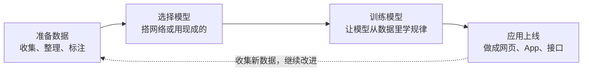
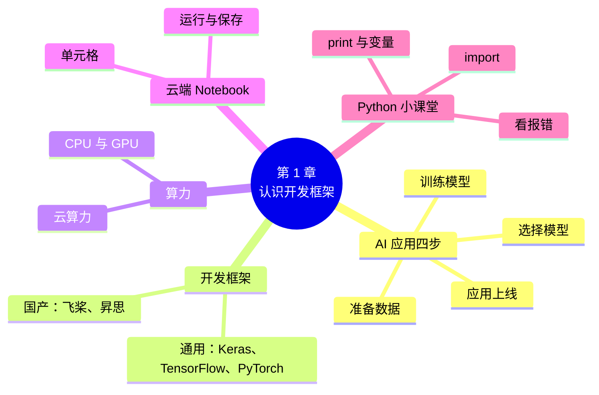

# 第 1 章 认识人工智能开发框架

!!! abstract "本章学时"
    理论 4 学时（线上 3 + 线下 1）· 实验 1 学时（本章共 3 个实验，教师可任选）

## 学习目标

学完本章，你应该能够：

1. **说出**一个人工智能应用从数据到上线要经过的四个步骤，以及开发框架在其中的作用（记忆）；
2. **列举**两个通用框架和两个国产框架，并说出它们各自适合什么场合（记忆）；
3. **解释**为什么训练模型常常要用 GPU，什么是云算力（理解）；
4. **操作**云端 Notebook：新建笔记本、运行单元格、上传文件、保存（应用）；
5. **运行**一段 Python 代码，读懂报错信息的最后一行（应用）。

!!! info "先修要求"
    本章不需要任何编程基础。会用浏览器上网、会注册网站账号就可以开始。

    - 如果你学过“人工智能导论”，第 1 章讲过的人工智能发展历程这里不再重复；
    - 本章用到的 Python 知识在 [1.5 Python 小课堂①](#15) 中从头讲，更完整的内容见[附录 A](../../appendix/a-python.md)。

??? abstract "本章概念清单（18 个，点击查看定义和例子）"
    1. [人工智能开发框架](../../appendix/glossary.md#g-人工智能开发框架)
    2. [标签](../../appendix/glossary.md#g-标签)
    3. [模型](../../appendix/glossary.md#g-模型)
    4. [训练](../../appendix/glossary.md#g-训练)
    5. [推理](../../appendix/glossary.md#g-推理)
    6. [TensorFlow](../../appendix/glossary.md#g-TensorFlow)
    7. [Keras](../../appendix/glossary.md#g-Keras)
    8. [PyTorch](../../appendix/glossary.md#g-PyTorch)
    9. [飞桨](../../appendix/glossary.md#g-飞桨)
    10. [昇思](../../appendix/glossary.md#g-昇思)
    11. [CPU](../../appendix/glossary.md#g-CPU)
    12. [GPU](../../appendix/glossary.md#g-GPU)
    13. [云算力](../../appendix/glossary.md#g-云算力)
    14. [Notebook](../../appendix/glossary.md#g-Notebook)
    15. [单元格](../../appendix/glossary.md#g-单元格)
    16. [变量](../../appendix/glossary.md#g-变量)
    17. [函数](../../appendix/glossary.md#g-函数)
    18. [注释](../../appendix/glossary.md#g-注释)

## 情景导入

小林在一家连锁花店做店长。每到情人节、母亲节，店里会来很多第一次买花的顾客，他们指着花问“这是什么花”“适合送谁”，店员忙得团团转。小林想：要是顾客用手机拍一张照片，就能知道这是什么花、花语是什么，该多好。

小林在网上搜了一下，发现“识别花的种类”正是人工智能最拿手的事情之一。可是再往下看，满屏都是“卷积神经网络”“反向传播”“张量”这样的词，还有一大段一大段的代码。小林没学过编程，心里打起了退堂鼓：这是不是只有大公司的工程师才能做？

其实不是。今天做一个花卉识别[模型](../../appendix/glossary.md#g-模型 "机器学习从数据中学到的、能把输入转换成预测结果的规律；在框架里就是一个会学习的程序"){ .term }，并不需要从零写出复杂的数学程序。就像开一家花店不用自己造冰柜、造收银机一样，做人工智能应用也有现成的“工具箱”，这个工具箱就叫[**人工智能开发框架**](../../appendix/glossary.md#g-人工智能开发框架 "把数字计算、自动求导、GPU 加速、常用网络层和模型保存等功能做成现成工具的软件，也叫深度学习框架"){ .term }。工具箱里有现成的零件、有现成的“半成品”模型，我们要学的是：怎样把这些零件拼起来，让它为我们干活。

这本书就跟着小林的“花卉识别助手”一路做下去：第 2 章先用现成的模型认一认花，第 5 章自己[训练](../../appendix/glossary.md#g-训练 "把数据和标签反复交给模型，让模型对照答案不断调整自己、学会规律的过程"){ .term }一个模型，第 7 章把准确率大幅提高，第 11 章把它做成一个网页，发给同事用手机打开。本章先认识这个工具箱，并把“工作台”准备好。

## 1.1 人工智能应用是怎样做出来的

### 1.1.1 从数据到应用的四个步骤 { #111 }

不管是手机相册里的“人像分类”、外卖平台的“好评差评判断”，还是智能音箱的“听懂你说话”，做出一个人工智能应用，大体都要经过四步：



1. **准备数据**。想让模型认识五种花，就得先准备几百上千张标好“这是玫瑰”“这是郁金香”的照片。标好的答案叫[**标签**](../../appendix/glossary.md#g-标签 "样本的正确答案，也就是希望模型学会预测的那个量"){ .term }。
2. **选择模型**。模型可以理解成一个“会学习的程序”。它可以自己搭，也可以拿别人已经训练好的来用。
3. **训练模型**。把照片和标签一批批喂给模型，模型猜一猜、对一对答案、改一改，反复很多遍，慢慢就学会了。这个过程叫训练。
4. **应用上线**。训练好的模型要变成别人能用的东西，比如一个网页：上传照片，显示结果。用训练好的模型去回答新问题，叫[**推理**](../../appendix/glossary.md#g-推理 "用训练好的模型对新数据给出预测结果的过程"){ .term }。

用学生学习来打个比方：数据是课本和练习题，模型是学生，训练是做题、对答案、改错的过程，上线就是学生毕业后去工作。

### 1.1.2 开发框架：做人工智能的工具箱 { #112 }

上面四步，每一步都要写程序。如果什么都从零写，光是让模型“对答案、改错”这一步就要用到大量的数学计算，普通人很难写对，也很难写快。

**人工智能开发框架**（也叫深度学习框架）就是把这些常用的、难写的部分提前做好的软件工具箱。它主要替我们做了五件事：

| 框架替我们做的事 | 打个比方 | 后面在哪一章用到 |
|---|---|---|
| 存放和计算大批数字（图片、声音都变成数字） | 一个超大的、算得飞快的电子表格 | 第 3 章 |
| 提供现成的“积木”（各种层），拼起来就是模型 | 乐高积木 | 第 4 章 |
| 自动完成“对答案、改错”的数学计算 | 自动批改作业、自动订正 | 第 5 章 |
| 让计算跑在显卡（GPU）上，快几十倍 | 从一个人干活变成一千个人一起干 | 本章 1.3 节 |
| 提供别人训练好的模型、保存和发布模型的工具 | 现成的“半成品”和打包机 | 第 2、7、11 章 |

所以，学开发框架不是学数学，而是学“怎样用好这个工具箱”：知道工具箱里有什么，知道每样工具什么时候用，看得懂别人写的代码，自己会照着改。这正是本书的目标。

## 1.2 主流开发框架一览

### 1.2.1 通用框架：Keras / TensorFlow 和 PyTorch { #121 }

世界上用得最多的开发框架有两个家族：

- [**TensorFlow**](../../appendix/glossary.md#g-TensorFlow "谷歌公司 2015 年开源的深度学习框架，本书通用版中 Keras 的计算“发动机”"){ .term }：谷歌公司 2015 年开源的框架<sup class="cite">[[1]](#ref1-1)</sup>，在企业里用得很多，手机端、网页端的工具也很齐全。
- [**Keras**](../../appendix/glossary.md#g-Keras "简单易用的高层深度学习接口，可以运行在 TensorFlow、PyTorch、JAX 上，本书通用版的主要框架"){ .term }：最初由弗朗索瓦·肖莱（François Chollet）在 2015 年开发<sup class="cite">[[3]](#ref1-3)</sup>，后来成为 TensorFlow 的“官方高层接口”。它的特点是简单：几行代码就能搭网络、训练模型。2023 年发布的 Keras 3 可以在 TensorFlow、PyTorch、JAX 三种“发动机”上运行<sup class="cite">[[4]](#ref1-4)</sup>。
- [**PyTorch**](../../appendix/glossary.md#g-PyTorch "Meta 公司 2016 年推出的深度学习框架，写法灵活，开源模型大多用它编写"){ .term }：由脸书（现 Meta）公司 2016 年推出<sup class="cite">[[2]](#ref1-2)</sup>，写法灵活，很受研究人员欢迎。今天网上开源的新模型，大多数是用 PyTorch 写的。

这几个框架的关系可以这样理解：TensorFlow 和 PyTorch 是“发动机”，Keras 是装在发动机外面的“方向盘和仪表盘”，让开车的人不用懂发动机内部也能把车开走。

### 1.2.2 国产框架：飞桨和昇思 { #122 }

我国也有自己成熟的开发框架：

- **飞桨（PaddlePaddle）**：百度公司 2016 年开源，是我国第一个开源开放、功能完备的产业级深度学习平台<sup class="cite">[[5]](#ref1-5)</sup>。它最大的特点是“产业套件”多：文字识别（PaddleOCR）、图像分类（PaddleClas）、目标检测（PaddleDetection）、自然语言处理（PaddleNLP）、语音（PaddleSpeech）等，很多任务一两行代码就能调用。[飞桨](../../appendix/glossary.md#g-飞桨 "百度公司 2016 年开源的国产深度学习平台，产业套件丰富，本书国产版的主要框架"){ .term }的写法和 PyTorch 非常像，学会一个，另一个很快就能看懂。
- **昇思（MindSpore）**：华为公司 2020 年 3 月开源的框架<sup class="cite">[[6]](#ref1-6)</sup>，和华为的昇腾（Ascend）人工智能芯片配合得最好，在政务、金融、运营商等需要国产软硬件的场合用得越来越多。第 12 章会专门介绍。

### 1.2.3 本书的两个版本怎么选 { #123 }

本书每一段代码、每一个实验都有两个版本，在网页上点代码块上方的标签就能切换，选一次，全书都会跟着切换：

| | 通用版 | 国产版 |
|---|---|---|
| 主要框架 | Keras（以 TensorFlow 为发动机） | 飞桨（高层 API） |
| 现成模型从哪里来 | Keras 自带模型库、Ultralytics 等 | 飞桨产业套件 |
| 推荐的云端平台 | 魔搭社区 Notebook | 飞桨 AI Studio |
| 适合谁 | 想和国际主流接轨、以后看英文资料多的同学 | 单位使用国产软硬件、想用飞桨产业套件的同学 |

两个版本讲的道理完全一样，练习题也一样，只是代码写法不同。如果拿不准，就跟着任课老师选；老师没有要求的话，选哪个都可以。

下面是同一件事（导入框架，打印版本号）的两种写法，你可以点一下标签试试切换：

=== "通用版"

    ```python
    import keras                       # 导入 Keras 框架
    print(keras.__version__)           # 打印版本号
    ```

=== "国产版"

    ```python
    import paddle                      # 导入飞桨框架
    print(paddle.__version__)          # 打印版本号
    ```

!!! tip "要不要两个都学？"
    不要求。先把一个版本学扎实。学完全书后，如果有兴趣，可以把另一个版本的实验也做一遍，你会发现大部分代码只是“换了个名字”，附录 B 列出了两个版本的对照表。

## 1.3 CPU、GPU 与云算力 { #13 }

### 1.3.1 为什么训练模型要用显卡 { #131 }

电脑里负责计算的主要有两种芯片：

- [**CPU**](../../appendix/glossary.md#g-CPU "中央处理器，电脑的“大脑”，核心少但每个核心能力强"){ .term }（中央处理器）：电脑的“大脑”，能干各种复杂的活，但核心数量少，一般只有 4 到 16 个。
- [**GPU**](../../appendix/glossary.md#g-GPU "图形处理器（显卡），核心多达几千个，适合同时做大量简单计算，常用来训练模型"){ .term }（图形处理器，也就是显卡）：本来是用来画游戏画面的，核心数量多达几千个，每个核心能力不强，但特别适合“同时做大量简单计算”。

训练模型恰恰就是大量简单计算：一张 224×224 的彩色照片有 15 万个数字，一次训练要处理成千上万张照片，每个数字都要做乘法和加法。打个比方：CPU 像一位大学教授，什么题都会做，但一次只能做几道；GPU 像一千个小学生，每人只会做加法，但一千人同时做，算一大堆加法时比教授快得多。

<iframe class="sim-frame" src="../../sims/cpu-gpu-race/main.html" height="430" loading="lazy" title="CPU 与 GPU 谁算得快"></iframe>

拖动“计算量”滑块，点“开始比赛”，看看任务很少和任务很多时，CPU 和 GPU 谁更快。这是示意动画，耗时按简化的模型计算。[全屏打开](../../sims/cpu-gpu-race/main.html){ target=_blank } · [教学说明](../../sims/cpu-gpu-race/index.md)
{ .sim-caption }

动画里有一个细节值得注意：任务很少的时候，GPU 反而不占优势，因为把数据搬到显卡上本身就要花时间。所以本书前几章的小实验，用普通电脑的 CPU 就够了；只有数据多、模型大的时候，GPU 的优势才明显。

### 1.3.2 什么是云算力 { #132 }

一块训练用的显卡少则几千元、多则几万甚至几十万元，个人学习时没必要买。[**云算力**](../../appendix/glossary.md#g-云算力 "通过网络租用云平台机房里的 CPU、GPU 等计算资源，按使用时长计费"){ .term }就是“租用”别人机房里的计算资源：通过浏览器登录云平台，就能用上平台上的 CPU 和 GPU，按使用时长计费，很多平台还给学习者提供免费额度。

本书推荐两个国内平台，注册后都能免费使用：

| 平台 | 运营方 | 特点 |
|---|---|---|
| 魔搭社区（ModelScope） | 阿里巴巴 | 模型多，提供免费的 CPU Notebook 和限时 GPU，适合通用版 |
| 飞桨 AI Studio | 百度 | 飞桨环境预装好，每天有免费的 GPU 使用时长，适合国产版 |

各平台的免费额度经常调整，以注册时平台上的说明为准。学校的 A40 显卡服务器（每块 48 GB 显存）主要用于课堂演示，老师会在课堂上演示需要大显卡的内容。

## 1.4 云端 Notebook：打开网页就能写代码 { #14 }

### 1.4.1 Notebook 是什么 { #141 }

写程序通常要在电脑上安装一堆软件，对初学者来说，光安装就可能卡好几天。[**Notebook**](../../appendix/glossary.md#g-Notebook "把代码、运行结果和文字说明放在同一页面、按单元格逐段运行的编程环境，文件扩展名 .ipynb"){ .term }（笔记本，常用的是 Jupyter Notebook<sup class="cite">[[7]](#ref1-7)</sup>）把写代码变得像写文档一样简单：

- 页面由一个个[**单元格**](../../appendix/glossary.md#g-单元格 "Notebook 中的一个代码块或文字块，可以单独运行，结果显示在它下方"){ .term }组成，每个单元格里写几行代码；
- 点一下“运行”，结果就显示在这个单元格的正下方；
- 代码、运行结果、文字说明可以放在同一个文件里，文件扩展名是 `.ipynb`。

云端 Notebook 就是放在云平台上的 Notebook：框架已经装好，打开网页就能用，自己的电脑配置低也没关系。本书每个实验都配有 `.ipynb` 文件，上传到平台、打开、从上到下依次运行就行。

### 1.4.2 注册并新建一个 Notebook { #142 }

=== "通用版"

    1. 打开魔搭社区 <https://www.modelscope.cn/>，用手机号注册并登录；
    2. 进入“我的 Notebook”，选择 **CPU 环境**（免费），镜像选带 TensorFlow 的官方镜像，点“启动”；
    3. 等待一两分钟，点“查看 Notebook”，在打开的页面里点 **Python 3** 新建一个笔记本。

=== "国产版"

    1. 打开飞桨 AI Studio <https://aistudio.baidu.com/>，用百度账号登录；
    2. 进入“项目”，点“创建项目”，类型选 **Notebook**，环境选最新版本的 PaddlePaddle；
    3. 创建后点“启动环境”，选择 CPU（免费）或 GPU（使用每日免费时长），进入后新建一个笔记本。

平台的页面布局会不时更新，如果找不到上面写的按钮，以平台自己的帮助文档为准，基本流程都是“登录 → 启动环境 → 新建笔记本”。

### 1.4.3 Notebook 的五个基本操作 { #143 }

| 操作 | 怎么做 | 说明 |
|---|---|---|
| 运行单元格 | 点单元格，按 `Shift + Enter` | 运行后自动跳到下一个单元格 |
| 新建单元格 | 点工具栏上的 `+` | 新单元格默认是代码单元格 |
| 上传文件 | 左侧文件栏点“上传”图标 | 实验的数据文件夹可以打包成 zip 上传后解压 |
| 保存 | 按 `Ctrl + S` | 云端平台关闭环境前一定要先保存 |
| 重新开始 | 菜单 Kernel → Restart | 程序“卡住”或想从头运行时用 |

!!! warning "关掉网页之前先保存、再停止环境"
    云平台的环境长时间不用会自动关闭，没有保存的代码会丢失。免费 GPU 按时间计算，用完要点“停止”，不然会白白耗掉当天的额度。

## 1.5 Python 小课堂①：运行第一段代码 { #15 }

本书用 Python 语言写代码。Python 的语法接近英语，是初学者最友好的编程语言之一。每章的“Python 小课堂”只讲本章马上要用的几个知识点，够用就行。

### 1.5.1 print：让电脑说话 { #151 }

```python
print("你好，人工智能！")       # 在屏幕上显示一句话
print(3 * 224 * 224)            # 也可以显示计算结果：150528
```

- `print( )` 是一个[**函数**](../../appendix/glossary.md#g-函数 "完成某个功能、可以反复调用的一段程序，用“名字(参数)”的形式使用"){ .term }，作用是把括号里的内容显示出来；
- 文字要用英文的双引号 `" "` 括起来，数字不用；
- `#` 后面的内容是[**注释**](../../appendix/glossary.md#g-注释 "代码中 # 后面写给人看的说明，运行时被跳过"){ .term }，是写给人看的说明，电脑会跳过它。本书代码里的注释都是中文，帮你看懂每一行。

### 1.5.2 变量：贴了名字的盒子 { #152 }

```python
name = "小林"                   # 把文字“小林”放进名叫 name 的盒子
hours = 72                      # 把数字 72 放进名叫 hours 的盒子
print(name, "这门课一共", hours, "学时")
```

等号 `=` 在 Python 里不是“相等”，而是“把右边的东西放进左边的盒子”。以后要用的时候，写盒子的名字就行。`print` 里用逗号隔开几样东西，它们会依次显示，中间自动加空格。

### 1.5.3 import：把工具箱拿过来 { #153 }

Python 自己只会做最基本的事情，框架、画图工具这些都是“扩展工具箱”，用之前要先 `import`（导入）：

```python
import keras                    # 通用版：导入 Keras
import paddle                   # 国产版：导入飞桨
```

导入以后，就可以用“工具箱名.工具名”的方式使用里面的工具，比如 `keras.__version__` 表示 Keras 工具箱里记录版本号的那一项。

### 1.5.4 看懂报错：只看最后一行 { #154 }

写代码一定会出错，出错不可怕。Python 出错时会显示一大段红色文字，**初学者只要看最后一行**：冒号前面是错误类型，后面是原因。

```text
NameError: name 'nmae' is not defined
```

意思是：名字 `nmae` 没有定义过——原来是把 `name` 拼错了。下表是初学者最常见的四种报错：

| 报错（最后一行） | 用大白话说 | 怎么改 |
|---|---|---|
| `NameError: name 'xxx' is not defined` | 你用了一个电脑不认识的名字 | 检查拼写；检查前面定义它的单元格有没有运行 |
| `SyntaxError: invalid syntax` | 句子写得不合规矩 | 常见原因是用了中文的括号、引号、逗号，改成英文的 |
| `ModuleNotFoundError: No module named 'xxx'` | 找不到这个工具箱 | 工具箱没装，或者名字写错了；云平台上换成带这个框架的环境 |
| `IndentationError` | 行首的空格对不齐 | 同一段代码的行首空格要一致，不要混用空格和 Tab |

!!! tip "中英文符号是初学者的头号敌人"
    代码里所有的括号、引号、逗号、冒号都要用**英文半角**符号。只有引号里面的文字和 `#` 后面的注释可以写中文。

## 1.6 前沿视窗：让大模型帮你写代码、解释代码

2023 年以来，DeepSeek、通义千问、文心一言、豆包、Kimi 等国产大模型都能读懂和编写代码。对初学者来说，它们是很好的“随身助教”：

- **解释代码**：把看不懂的代码粘贴给它，问“请逐行解释这段代码”；
- **解释报错**：把报错的最后几行粘贴给它，问“这是什么错误，怎么改”；
- **改写代码**：告诉它“把图片大小从 128 改成 160，其他不变”。

但要注意三点：

1. **它会犯错**。大模型可能编造不存在的函数，或者给出旧版本的写法。它给的代码一定要自己运行一遍，看结果对不对。
2. **先自己想，再问它**。如果每一步都直接问答案，自己就学不会了。本书的“改一改”练习，建议先自己动手，实在卡住再问。
3. **不要把敏感信息发给它**。单位的客户资料、密码、密钥都不要粘贴进去（第 12 章还会讲）。

截至 2026 年 10 月，主流的代码编辑工具和云端 Notebook 平台大多已经内置了 AI 助手，在代码旁边就能直接提问，用法和上面一样。

## 本章实验

!!! abstract "实验总览"
    | 实验 | 类型 | 建议时长 | 内容 |
    |---|---|---|---|
    | 实验 1-1 | ★ 必做 | 25 分钟 | 打开云端 Notebook，运行第一段代码 |
    | 实验 1-2 | ★ 必做 | 15 分钟 | 环境自检：看框架版本、有没有 GPU、算一道大题 |
    | 实验 1-3 | ☆ 选做 | 40 分钟 | 在自己的电脑上安装框架 |

    代码见配套资源 `labs/ch01/` 目录：`keras/` 是通用版，`paddle/` 是国产版，每个实验都有 `.py` 和 `.ipynb` 两种文件，内容相同。

### 实验 1-1 ★ 打开云端 Notebook，运行第一段代码 { #1-1 }

**实验目的**

1. 学会在云端平台上启动环境、新建笔记本、运行单元格；
2. 运行第一段 Python 代码，确认框架可以使用。

**实验环境**：云端 Notebook（通用版用魔搭社区，国产版用 AI Studio），CPU 即可。

**实验数据**：无。

**实验步骤与代码**

第一档 · 跑通：按 1.4.2 节的步骤新建一个笔记本，把下面四段代码分别输入四个单元格，依次按 `Shift + Enter` 运行。

=== "通用版"

    ```python
    print("你好，人工智能！")               # 单元格 1：让电脑说一句话
    ```

    ```python
    name = "小明"                           # 单元格 2 ← 改这里：换成你的名字
    hours = 72
    print(name, "这门课一共", hours, "学时")
    ```

    ```python
    print(3 * 224 * 224)                    # 单元格 3：一张 224×224 彩色照片有多少个数字
    ```

    ```python
    import keras                            # 单元格 4：请出框架
    print("Keras 版本：", keras.__version__)
    ```

    完整代码：`labs/ch01/keras/lab1_1_first_code.ipynb`

=== "国产版"

    ```python
    print("你好，人工智能！")               # 单元格 1：让电脑说一句话
    ```

    ```python
    name = "小明"                           # 单元格 2 ← 改这里：换成你的名字
    hours = 72
    print(name, "这门课一共", hours, "学时")
    ```

    ```python
    print(3 * 224 * 224)                    # 单元格 3：一张 224×224 彩色照片有多少个数字
    ```

    ```python
    import paddle                           # 单元格 4：请出框架
    print("飞桨版本：", paddle.__version__)
    ```

    完整代码：`labs/ch01/paddle/lab1_1_first_code.ipynb`

**运行结果**

=== "通用版"

    ```text
    你好，人工智能！
    小明 这门课一共 72 学时
    150528
    Keras 版本： 3.15.1
    ```

=== "国产版"

    ```text
    你好，人工智能！
    小明 这门课一共 72 学时
    150528
    飞桨版本： 3.3.1
    ```

版本号是编者编写时（2026 年 10 月）的版本，你看到的可能更新，不影响学习。

第二档 · 改一改：

1. 把单元格 2 的名字换成你自己的名字，学时换成你这学期所有课程的学时之和，再运行；
2. 在单元格 3 里算一算：一张 1920×1080 的彩色照片有多少个数字？
3. 故意把单元格 4 的 `keras`（或 `paddle`）拼错，运行一下，看报错的最后一行是什么，再改回来。

**实验记录表**

| 步骤 | 观察内容 | 你的结果 |
|---|---|---|
| 1 | 使用的平台和环境（CPU / GPU） | |
| 2 | 改名字后单元格 2 的输出 | |
| 3 | 1920×1080 彩色照片的数字个数 | |
| 4 | 拼错框架名时报错的最后一行 | |

**常见问题排查**

| 现象 | 原因 | 解决办法 |
|---|---|---|
| 按了运行没反应，单元格左边显示 `[*]` | 程序还在运行，或环境刚启动 | 稍等几秒；一直不动就用 Kernel → Restart 重启 |
| `SyntaxError: invalid character '（'` | 用了中文括号 | 把括号、引号、逗号全部换成英文的 |
| `ModuleNotFoundError: No module named 'keras'` | 选的环境里没有这个框架 | 通用版选带 TensorFlow 的镜像；国产版选 PaddlePaddle 环境 |

**思考与练习**

1. 为什么 `print("150528")` 和 `print(150528)` 显示的内容一样？它们有什么不同？
2. 1920×1080 的照片比 224×224 的照片多了多少倍的数字？这对训练速度会有什么影响？

**实验报告要求**

提交运行结果截图（含你自己的名字）和实验记录表。

### 实验 1-2 ★ 环境自检 { #1-2 }
**实验目的**

1. 运行环境自检脚本，查看 Python 和框架的版本；
2. 查看当前环境有没有 GPU；
3. 用一道“大题”体会框架的计算速度。

**实验环境**：同实验 1-1。有条件的同学可以在 GPU 环境下再运行一次做对比。

**实验数据**：无（程序自己生成随机数）。

**实验步骤与代码**

第一档 · 跑通：上传并打开 `lab1_2_check_env.ipynb`，从上到下依次运行。核心代码如下：

=== "通用版"

    ```python
    import keras, platform, time
    import numpy as np
    import tensorflow as tf

    print("Python 版本：", platform.python_version())
    print("Keras 版本：", keras.__version__, "| 后端：", keras.config.backend())
    gpus = tf.config.list_physical_devices("GPU")       # 列出所有 GPU
    print("GPU 数量：", len(gpus))

    a = np.random.rand(2000, 2000).astype("float32")   # 2000×2000 的随机数表格
    start = time.time()                                 # 记下开始时间
    c = keras.ops.matmul(a, a)                          # 矩阵乘法：约 80 亿次乘法和加法
    print(f"用时：{time.time() - start:.3f} 秒")
    ```

=== "国产版"

    ```python
    import paddle, platform, time

    print("Python 版本：", platform.python_version())
    print("飞桨版本：", paddle.__version__)
    print("当前设备：", paddle.device.get_device())     # cpu 或 gpu:0
    paddle.utils.run_check()                            # 飞桨自带的安装检查

    a = paddle.rand([2000, 2000])                       # 2000×2000 的随机数表格
    start = time.time()                                 # 记下开始时间
    c = paddle.matmul(a, a)                             # 矩阵乘法：约 80 亿次乘法和加法
    print(f"用时：{time.time() - start:.3f} 秒")
    ```

**运行结果**（编者的笔记本电脑，4 核 CPU，无 GPU）

=== "通用版"

    ```text
    Python 版本： 3.11.18
    Keras 版本： 3.15.1 | 后端： tensorflow
    TensorFlow 版本： 2.21.0
    GPU 数量： 0 （0 表示只能用 CPU，本课的必做实验用 CPU 也能完成）
    2000×2000 矩阵乘法用时：0.232 秒
    ```

=== "国产版"

    ```text
    Python 版本： 3.11.18
    飞桨版本： 3.3.1
    当前设备： cpu
    能用 GPU 吗： False （False 表示只能用 CPU，本课的必做实验用 CPU 也能完成）
    Running verify PaddlePaddle program ...
    PaddlePaddle works well on 1 CPU.
    PaddlePaddle is installed successfully! Let's start deep learning with PaddlePaddle now.
    2000×2000 矩阵乘法用时：0.097 秒
    ```

用时和电脑配置有关，每次运行也会略有不同。程序开头可能还会显示几行英文提示（如 `oneDNN custom operations are on`），那是框架的启动信息，不是错误。

第二档 · 改一改：把 `2000` 改成 `500` 和 `4000` 各运行一次，记录用时。矩阵边长翻一倍，计算量变成原来的 8 倍，用时是不是也差不多变成 8 倍？

!!! warning "待实测：GPU 环境下的用时"
    编者的编写环境没有 GPU。请在 AI Studio 或魔搭的 GPU 环境中运行同一脚本，把 `4000` 的用时填进记录表。注意第一次在 GPU 上运行会稍慢（要先启动显卡），建议连续运行两次，记第二次的用时。

**实验记录表**

| 矩阵边长 | CPU 用时（秒） | GPU 用时（秒，选做） |
|---|---|---|
| 500 | | |
| 2000 | | |
| 4000 | | |

**常见问题排查**

| 现象 | 原因 | 解决办法 |
|---|---|---|
| 显示 GPU 数量 0，但选的是 GPU 环境 | 镜像里的框架是 CPU 版 | 换成平台提供的 GPU 镜像 |
| 边长改成 10000 后程序很久不动或崩溃 | 数字太多，内存不够 | 改回 4000 以内；重启 Kernel |

**思考与练习**

1. 根据你的记录表，画出“边长—用时”的变化趋势，说说计算量和用时的关系。
2. 结合 1.3 节的动画，解释为什么边长是 500 时 GPU 不一定比 CPU 快。

**实验报告要求**

提交运行结果截图和填好的实验记录表。

### 实验 1-3 ☆ 在自己的电脑上安装框架 { #1-3 }
**实验目的**

1. 学会用 pip 安装框架，并配置国内镜像源加快下载；
2. 在本机运行实验 1-2 的自检脚本。

**实验环境**：自己的 Windows 或 macOS 电脑，内存 8 GB 以上，硬盘剩余空间 10 GB 以上。

**实验数据**：无。

**实验步骤与代码**

第一档 · 跑通：

1. 从 Python 官网（<https://www.python.org/downloads/>）下载并安装 Python 3.11，安装时**勾选 “Add python.exe to PATH”**；
2. 打开“命令提示符”（Windows）或“终端”（macOS），输入下面的命令。`-i` 后面是清华大学的国内镜像，下载更快：

=== "通用版"

    ```bash
    pip install tensorflow keras jupyter -i https://pypi.tuna.tsinghua.edu.cn/simple
    ```

=== "国产版"

    ```bash
    pip install paddlepaddle jupyter -i https://pypi.tuna.tsinghua.edu.cn/simple
    ```

3. 安装完成后输入 `jupyter notebook`，浏览器会自动打开本地的 Notebook 页面；
4. 打开 `lab1_2_check_env.ipynb` 并运行。

详细的安装说明和各种情况的处理办法见[附录 C](../../appendix/c-environment.md)。

**运行结果**：与实验 1-2 类似，版本号和用时因电脑而异。

第二档 · 改一改：比较自己电脑和云端平台上实验 1-2 的用时，哪一个快？

**实验记录表**

| 项目 | 你的结果 |
|---|---|
| 操作系统、内存大小 | |
| 安装的 Python 和框架版本 | |
| 本机 2000×2000 矩阵乘法用时 | |
| 遇到的问题和解决办法 | |

**常见问题排查**

| 现象 | 原因 | 解决办法 |
|---|---|---|
| `'pip' 不是内部或外部命令` | 安装 Python 时没勾选 Add to PATH | 重新运行安装程序，选 Modify，勾选该项 |
| 下载很慢或超时 | 默认的国外下载源慢 | 命令末尾加 `-i https://pypi.tuna.tsinghua.edu.cn/simple` |
| `No matching distribution found` | Python 版本太新或太旧，框架还不支持 | 安装 Python 3.11 |

**思考与练习**

1. 本机安装和云端 Notebook 各有什么优缺点？你更喜欢哪一种？

**实验报告要求**

提交本机运行自检脚本的截图和实验记录表。

## 本章小结

- 做一个人工智能应用要经过四步：**准备数据 → 选择模型 → 训练模型 → 应用上线**。用训练好的模型回答新问题叫**推理**。
- **人工智能开发框架**是做人工智能的工具箱，替我们完成数字计算、提供积木、自动“对答案改错”、调用 GPU、提供现成模型。
- 通用框架有 TensorFlow、Keras、PyTorch；国产框架有**飞桨**和**昇思**。本书通用版用 Keras，国产版用飞桨。
- **GPU** 有几千个核心，适合同时做大量简单计算，所以训练大模型要用显卡；个人学习可以使用**云算力**和平台的免费额度。
- **云端 Notebook** 打开网页就能写代码，由一个个单元格组成，`Shift + Enter` 运行。
- Python 入门：`print` 显示内容，`=` 把东西放进变量，`import` 导入工具箱，报错只看最后一行。



**下一章预告**

工作台准备好了，下一章马上动手：只用五六行代码，调用一个别人已经训练好的模型，让它认一认花的照片。你会看到模型输出的“把握有多大”，也会发现它认错的时候——它为什么会认错，正是后面几章要解决的问题。

## 参考文献

正文中的上标编号（如<sup class="cite">[[1]](#ref1-1)</sup>）对应下面的文献。带链接的可以直接打开；书籍可在图书馆或电子书平台查阅。

<div class="refs" markdown>

**教材与专著**

- <span id="ref1-3"></span>[3] CHOLLET F. Deep Learning with Python[M]. 2nd ed. Shelter Island: Manning Publications, 2021.
    <span class="ref-note">Keras 作者写的入门书，前几章用很少的数学讲清深度学习和 Keras 的基本用法，对应 1.2.1 节。</span>

**经典论文**

- <span id="ref1-1"></span>[1] ABADI M, BARHAM P, CHEN J, et al. TensorFlow: A System for Large-Scale Machine Learning[C]//12th USENIX Symposium on Operating Systems Design and Implementation (OSDI 16). Savannah: USENIX Association, 2016: 265-283.
    <span class="ref-note">TensorFlow 的设计论文，介绍它为什么能在多台机器、多种硬件上运行，对应 1.2.1 节。</span>
- <span id="ref1-2"></span>[2] PASZKE A, GROSS S, MASSA F, et al. PyTorch: An Imperative Style, High-Performance Deep Learning Library[C]//Advances in Neural Information Processing Systems 32. Vancouver: Curran Associates, 2019: 8024-8035.
    <span class="ref-note">PyTorch 的设计论文，介绍“像写普通 Python 程序一样写模型”的思路，对应 1.2.1 节。</span>
- <span id="ref1-7"></span>[7] KLUYVER T, RAGAN-KELLEY B, PÉREZ F, et al. Jupyter Notebooks: A Publishing Format for Reproducible Computational Workflows[C]//Positioning and Power in Academic Publishing: Players, Agents and Agendas. Amsterdam: IOS Press, 2016: 87-90.
    <span class="ref-note">介绍 Jupyter Notebook 的论文，说明把代码、结果和说明放在一起的好处，对应 1.4.1 节。</span>

**在线资源与数据**

- <span id="ref1-4"></span>[4] Keras 官方网站[EB/OL]. [2026-10-31]. <https://keras.io/>.
    <span class="ref-note">Keras 3 的官方文档和入门教程，对应 1.2.1 节和本书通用版的全部代码。</span>
- <span id="ref1-5"></span>[5] 飞桨 PaddlePaddle 官方网站[EB/OL]. [2026-10-31]. <https://www.paddlepaddle.org.cn/>.
    <span class="ref-note">飞桨的官方文档、产业套件介绍和安装说明，对应 1.2.2 节和本书国产版的全部代码。</span>
- <span id="ref1-6"></span>[6] MindSpore. MindSpore Officially Goes Open Source[EB/OL]. (2020-03-28)[2026-10-31]. <https://www.mindspore.cn/news/en/176>.
    <span class="ref-note">昇思 MindSpore 正式开源的官方新闻，对应 1.2.2 节。</span>
- <span id="ref1-8"></span>[8] 魔搭社区[EB/OL]. [2026-10-31]. <https://www.modelscope.cn/>；飞桨 AI Studio[EB/OL]. [2026-10-31]. <https://aistudio.baidu.com/>.
    <span class="ref-note">本书推荐的两个云端平台，对应 1.3.2 节和 1.4.2 节。</span>

</div>

## 课后练习

选择题和判断题可以直接点击选项作答，系统会马上告诉你对错，并展开答案与解析；多选题选好后点“提交答案”。简答和实操题请先自己作答，再点开“答案与解析”核对。每道题的解析下方都有“回看”链接，做错了可以直接跳回正文复习。

**一、单项选择题**

<div class="quiz" data-answer="C" markdown>

**1.** 用训练好的模型对一张新照片判断“这是什么花”，这个过程叫（　　）。

- A. 训练
- B. 标注
- C. 推理
- D. 上传

</div>

??? tip "答案与解析"
    **答案：C**

    用训练好的模型回答新问题叫推理。训练是让模型从数据中学习的过程；标注是给数据写上正确答案；上传只是传文件。

    考查：推理 · 认知层次：记忆 · [回看 1.1.1](#111)
    { .quiz-meta }

<div class="quiz" data-answer="B" markdown>

**2.** 下列关于人工智能开发框架的说法，正确的是（　　）。

- A. 使用框架之前必须先学会推导所有数学公式
- B. 框架把常用、难写的部分提前做好，我们只要学会怎样组合使用
- C. 框架只能用来训练模型，不能用来上线应用
- D. 每做一个新应用都要重新写一个框架

</div>

??? tip "答案与解析"
    **答案：B**

    框架就是工具箱，替我们完成数字计算、自动“对答案改错”等难写的部分。它也提供保存和发布模型的工具，所以 C 错；A、D 正是框架帮我们省掉的事。

    考查：开发框架 · 认知层次：理解 · [回看 1.1.2](#112)
    { .quiz-meta }

<div class="quiz" data-answer="D" markdown>

**3.** 下列框架中，由我国公司开发的是（　　）。

- A. TensorFlow
- B. PyTorch
- C. Keras
- D. 飞桨

</div>

??? tip "答案与解析"
    **答案：D**

    飞桨由百度开发，昇思由华为开发。TensorFlow 来自谷歌，PyTorch 来自 Meta，Keras 由弗朗索瓦·肖莱开发、后成为 TensorFlow 的高层接口。

    考查：主流框架 · 认知层次：记忆 · [回看 1.2](#12)
    { .quiz-meta }

<div class="quiz" data-answer="A" markdown>

**4.** 关于 Keras 和 TensorFlow 的关系，最贴切的比喻是（　　）。

- A. TensorFlow 像发动机，Keras 像方向盘和仪表盘
- B. Keras 像发动机，TensorFlow 像方向盘
- C. 两者是完全没有关系的两辆车
- D. Keras 是 TensorFlow 的旧版本

</div>

??? tip "答案与解析"
    **答案：A**

    Keras 是装在 TensorFlow（以及 PyTorch、JAX）外面的高层接口，让使用者不懂内部细节也能搭网络、训练模型。

    考查：Keras · 认知层次：理解 · [回看 1.2.1](#121)
    { .quiz-meta }

<div class="quiz" data-answer="C" markdown>

**5.** 训练模型常用 GPU 的主要原因是（　　）。

- A. GPU 的每个核心都比 CPU 的核心更聪明
- B. GPU 价格比 CPU 便宜
- C. GPU 核心数量多，适合同时做大量简单计算
- D. 没有 GPU 就完全不能训练模型

</div>

??? tip "答案与解析"
    **答案：C**

    GPU 有几千个核心，每个核心能力不强但数量多，正好适合训练模型时的大量乘法和加法。A 说反了；D 错，本书前几章的实验用 CPU 就能完成。

    考查：GPU · 认知层次：理解 · [回看 1.3.1](#131)
    { .quiz-meta }

<div class="quiz" data-answer="B" markdown>

**6.** 在 Notebook 中运行当前单元格的快捷键是（　　）。

- A. `Ctrl + C`
- B. `Shift + Enter`
- C. `Alt + F4`
- D. `Ctrl + Z`

</div>

??? tip "答案与解析"
    **答案：B**

    `Shift + Enter` 运行当前单元格并跳到下一个。`Ctrl + S` 是保存，`Alt + F4` 会关闭窗口，千万别按错。

    考查：Notebook 操作 · 认知层次：记忆 · [回看 1.4.3](#143)
    { .quiz-meta }

<div class="quiz" data-answer="A" markdown>

**7.** 运行 `print(name)` 时出现 `NameError: name 'name' is not defined`，最可能的原因是（　　）。

- A. 定义 `name` 的那个单元格还没有运行
- B. 电脑没有联网
- C. 框架版本太旧
- D. 显卡坏了

</div>

??? tip "答案与解析"
    **答案：A**

    `NameError` 表示电脑不认识这个名字。在 Notebook 里，变量要先在某个单元格里定义并运行过，后面才能用；也可能是拼写错误。

    考查：看懂报错 · 认知层次：分析 · [回看 1.5.4](#154)
    { .quiz-meta }

<div class="quiz" data-answer="D" markdown>

**8.** 下面哪一行代码会出现 `SyntaxError`？（　　）

- A. `print("你好")`
- B. `hours = 72`
- C. `# 这是注释（中文括号没关系）`
- D. `print（"你好"）`

</div>

??? tip "答案与解析"
    **答案：D**

    D 用了中文括号，Python 不认识。C 是注释，注释里写什么都可以；A 引号里的中文也没问题。

    考查：Python 语法 · 认知层次：应用 · [回看 1.5.4](#154)
    { .quiz-meta }

**二、多项选择题**

<div class="quiz quiz-multi" data-answer="ABCD" markdown>

**1.** 开发框架替我们完成的工作包括（　　）。

- A. 存放和计算大批数字
- B. 提供可以拼接的“积木”（层）
- C. 自动完成“对答案、改错”的数学计算
- D. 让计算在 GPU 上运行

</div>

??? tip "答案与解析"
    **答案：ABCD**

    1.1.2 节的表格列出了框架替我们做的五件事，四个选项都在其中，另外还有提供现成模型和发布工具。

    考查：开发框架 · 认知层次：记忆 · [回看 1.1.2](#112)
    { .quiz-meta }

<div class="quiz quiz-multi" data-answer="AC" markdown>

**2.** 下列属于国产人工智能开发框架的有（　　）。

- A. 飞桨（PaddlePaddle）
- B. Keras
- C. 昇思（MindSpore）
- D. PyTorch

</div>

??? tip "答案与解析"
    **答案：AC**

    飞桨来自百度，昇思来自华为。Keras 和 PyTorch 都是国外的通用框架。

    考查：国产框架 · 认知层次：记忆 · [回看 1.2.2](#122)
    { .quiz-meta }

<div class="quiz quiz-multi" data-answer="ABD" markdown>

**3.** 使用云端 Notebook 时，正确的做法有（　　）。

- A. 关闭网页前先按 `Ctrl + S` 保存
- B. 用完免费 GPU 后点“停止”环境
- C. 把单位客户的手机号粘贴到代码里方便测试
- D. 程序卡住时用 Kernel → Restart 重启

</div>

??? tip "答案与解析"
    **答案：ABD**

    C 不对：客户的个人信息不能随便放到云平台和代码里，第 12 章会专门讲数据安全。

    考查：Notebook 操作 · 认知层次：应用 · [回看 1.4.3](#143)
    { .quiz-meta }

**三、判断题**

<div class="quiz quiz-judge" data-answer="×" markdown>

**1.** 本书的通用版和国产版讲的道理不同，所以两个版本的练习题也不同。

- √ 正确
- × 错误

</div>

??? tip "答案与解析"
    **答案：×**

    两个版本讲的道理完全一样，练习题也一样，只是代码写法不同。

    考查：本书两个版本 · 认知层次：记忆 · [回看 1.2.3](#123)
    { .quiz-meta }

<div class="quiz quiz-judge" data-answer="√" markdown>

**2.** 任务量很小的时候，GPU 不一定比 CPU 快。

- √ 正确
- × 错误

</div>

??? tip "答案与解析"
    **答案：√**

    把数据搬到显卡上本身要花时间，任务很少时这部分时间占了大头，GPU 的优势体现不出来。

    考查：GPU · 认知层次：理解 · [回看 1.3.1](#131)
    { .quiz-meta }

<div class="quiz quiz-judge" data-answer="×" markdown>

**3.** 在 Python 里，`hours = 72` 的意思是“判断 hours 是否等于 72”。

- √ 正确
- × 错误

</div>

??? tip "答案与解析"
    **答案：×**

    一个等号 `=` 是“把右边的值放进左边的变量”。判断是否相等要用两个等号 `==`，以后会用到。

    考查：变量 · 认知层次：理解 · [回看 1.5.2](#152)
    { .quiz-meta }

<div class="quiz quiz-judge" data-answer="√" markdown>

**4.** 代码中 `#` 后面的内容是注释，电脑运行时会跳过它。

- √ 正确
- × 错误

</div>

??? tip "答案与解析"
    **答案：√**

    注释是写给人看的说明。本书代码的注释都是中文，帮助你看懂每一行。

    考查：注释 · 认知层次：记忆 · [回看 1.5.1](#151)
    { .quiz-meta }

<div class="quiz quiz-judge" data-answer="×" markdown>

**5.** 大模型给出的代码一定是正确的，可以不运行直接交作业。

- √ 正确
- × 错误

</div>

??? tip "答案与解析"
    **答案：×**

    大模型可能编造不存在的函数，或给出旧版本的写法。它给的代码一定要自己运行检查。

    考查：大模型辅助编程 · 认知层次：评价 · [回看 1.6](#16)
    { .quiz-meta }

**四、简答题**

**1.** 用“学生学习”打比方，说明做一个人工智能应用的四个步骤。

??? tip "答案与解析"
    **参考答案：** 准备数据相当于准备课本和练习题；选择模型相当于选定一个学生；训练模型相当于学生做题、对答案、改错，反复练习；应用上线相当于学生毕业后去工作，回答新问题（推理）。

    考查：AI 应用四步 · 认知层次：理解 · [回看 1.1.1](#111)
    { .quiz-meta }

**2.** 小王的单位使用华为的服务器和昇腾芯片，他应该优先考虑哪个框架？说明理由。

??? tip "答案与解析"
    **参考答案：** 优先考虑昇思（MindSpore），因为它和华为的昇腾芯片配合得最好；如果单位还要用文字识别等现成套件，也可以考虑飞桨，飞桨同样支持国产硬件。

    考查：框架选型 · 认知层次：评价 · [回看 1.2.2](#122)
    { .quiz-meta }

**3.** 云端 Notebook 和在自己电脑上安装框架，各有什么优点？

??? tip "答案与解析"
    **参考答案：** 云端 Notebook 不用安装、打开网页就能用，还能用上免费 GPU，对电脑配置没有要求；本机安装不依赖网络、没有使用时长限制，数据放在自己电脑上更放心。初学者建议先用云端。

    考查：云端 Notebook · 认知层次：分析 · [回看 1.4.1](#141)
    { .quiz-meta }

**五、实操题**

**1.** 在 Notebook 中新建一个单元格，用变量和 `print` 显示“我叫 ×××，本学期学习人工智能开发框架技术，共 72 学时”，其中名字和学时要先放进变量。写出代码和运行结果。

??? tip "答案与解析"
    **参考答案：**

    ```python
    name = "李华"
    hours = 72
    print("我叫", name, "，本学期学习人工智能开发框架技术，共", hours, "学时")
    ```

    运行结果：`我叫 李华 ，本学期学习人工智能开发框架技术，共 72 学时`。逗号隔开的几样东西之间会自动加一个空格。

    考查：变量与 print · 认知层次：应用 · [回看 1.5.2](#152)
    { .quiz-meta }
