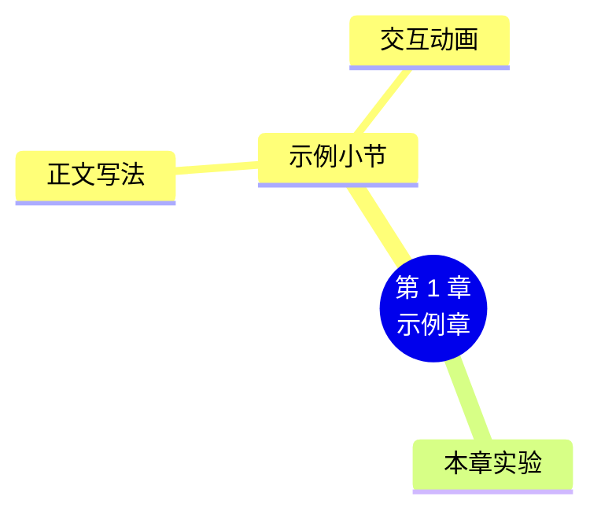

# 第 1 章 示例章

!!! danger "这是模板示例"
    本章只用来演示一章的完整结构和每种元素的写法（各元素的规范见仓库根目录的《编写规范.md》）。写第一章正文时，整章替换；本提示框也要删掉。

!!! abstract "本章学时"
    理论 5 学时 · 实验 1 学时（本章共 3 个实验，教师可任选）

## 学习目标

学完本章，你应该能够：

1. **说出**……（记忆）；
2. **解释**……（理解）；
3. **计算 / 实现**……（应用）；
4. **比较 / 选择**……（分析、评价）。

!!! info "先修要求"
    学习本章前，你需要掌握：

    - 本书前面章节的某个小节（[1.1 示例小节](#11)）；
    - 其他课程的内容，写清课程名和章节，并给出链接（例如《机器学习》第 2 章“数据预处理”）；
    - 用 pandas 读取 CSV 文件（[附录 A.7 pandas](../../appendix/a-python.md#a7-pandas)）。

??? abstract "本章概念清单（2 个，点击查看定义和例子）"
    1. [示例术语](../../appendix/glossary.md#g-示例术语)
    2. [另一个术语](../../appendix/glossary.md#g-另一个术语)

## 情景导入

用一个学生熟悉的工作或生活场景开头（两三段），提出本章要解决的问题，并点出本章的核心概念，例如[**示例术语**](../../appendix/glossary.md#g-示例术语 "这里是术语表中的定义，鼠标悬停时显示"){ .term }。

## 1.1 示例小节

### 1.1.1 正文写法

正文用通俗的语言和身边的例子讲清原理，公式只保留最必要的部分。引用文献时，在句末加上标编号。<sup class="cite">[[1]](#ref1-1)</sup>

**算一算**：用一个可以手算的小例子把公式算一遍，例如 3 个样本中 2 个判对，准确率 = 2 ÷ 3 ≈ 66.7%。

需要公式时用 MathJax：

\[
\text{准确率} = \frac{\text{判对的样本数}}{\text{样本总数}}
\]

!!! cert "证书考点 · 人工智能训练师（三级）· 智能训练"
    本小节对应的考核要求，用一两句话写清：考什么、怎么考、容易错在哪里。证书名和级别要与仓库中的“证书考点对照”页一致。没有对应证书的课程不用这个提示框。

### 1.1.2 交互动画

动画嵌在正文中最需要它的位置，下方紧跟一行说明（怎么操作、看什么），再给出全屏和教学说明的链接：

<iframe class="sim-frame" src="../../sims/example-counter/main.html" height="260" loading="lazy" title="示例动画：点击计数器"></iframe>

点“加一”和“清零”，观察数字和柱子的变化。[全屏打开](../../sims/example-counter/main.html){ target=_blank } · [教学说明](../../sims/example-counter/index.md)
{ .sim-caption }

### 1.1.3 图示

流程、结构类的图优先用 Mermaid：


## 1.2 前沿视窗

介绍本领域最新的技术和产品，以国产为主（例如 DeepSeek、通义千问、文心、豆包、智谱、Kimi），兼顾国外主流产品。版本号在成书时统一核对；会过时的数字写明“截至某年某月”。

## 本章实验

!!! abstract "实验总览"
    | 实验 | 类型 | 建议时长 | 内容 |
    |---|---|---|---|
    | 实验 1-1 | ★ 基础 | 40 分钟 | 示例实验 |
    | 实验 1-2 | ★ 基础 | 50 分钟 | …… |
    | 实验 1-3 | ☆ 拓展 | 60 分钟 | …… |

    实验代码见配套资源 `labs/ch01/` 目录。

### 实验 1-1 ★ 示例实验

**实验目的**

1. ……；
2. ……。

**实验环境**：附录 C 的基础环境（只用 CPU）。**实验数据**：`labs/data/示例.csv`（来源与许可见 `labs/data/README.md`）。

**实验步骤与代码**

```python
import pandas as pd

df = pd.DataFrame({"y_true": [1, 0, 1], "y_pred": [1, 0, 0]})
acc = (df.y_true == df.y_pred).mean()
print(f"准确率：{acc:.1%}")
```

**运行结果**

```text
准确率：66.7%
```

运行结果必须是编者实际运行得到的，原样粘贴，不要手写。

!!! warning "待实测"
    需要 GPU、联网下载模型或调用大模型 API、编写环境无法运行的部分，写明原因和编者已经验证过的内容，再给出记录表让学生填写。需要云算力的实验，写明推荐的平台和预计费用。

**实验记录表**

| 步骤 | 观察内容 | 你的结果 |
|---|---|---|
| 1 | …… | |

**常见问题排查**

| 现象 | 原因 | 解决办法 |
|---|---|---|
| `ModuleNotFoundError` | 没有安装对应的库 | 按附录 C 安装 |

**思考与练习**

1. ……

**实验报告要求**

提交代码运行截图和思考题答案。有证书对应的课程，报告按“测试报告 + 错误案例分析”格式写。

## 本章小结

- 用 5–8 条要点概括本章，关键术语加粗；
- 最后附一张 Mermaid 思维导图。



**下一章预告**

用一段话说明下一章学什么、和本章有什么联系（最后一章改为“结语”）。

## 参考文献

正文中的上标编号（如<sup class="cite">[[1]](#ref1-1)</sup>）对应下面的文献。带链接的可以直接打开；书籍可在图书馆或电子书平台查阅。

<div class="refs" markdown>

**教材与专著**

- <span id="ref1-1"></span>[1] 周志华. 机器学习[M]. 北京：清华大学出版社，2016.
    <span class="ref-note">每条文献下面用一句话说明它讲了什么、对应本章哪一节。所有文献都要核实存在且信息准确，查不到就删掉。</span>

**经典论文**

**在线资源与数据**

</div>

## 课后练习

选择题和判断题可以直接点击选项作答，系统会马上告诉你对错，并展开答案与解析；多选题选好后点“提交答案”。简答和实操题请先自己作答，再点开“答案与解析”核对。每道题的解析下方都有“回看”链接，做错了可以直接跳回正文复习。

**一、单项选择题**

<div class="quiz" data-answer="B" markdown>

**1.** 3 个样本判对 2 个，准确率约为（　　）。

- A. 33.3%
- B. 66.7%
- C. 75%
- D. 100%

</div>

??? tip "答案与解析"
    **答案：B**

    准确率 = 判对的样本数 ÷ 样本总数 = 2 ÷ 3 ≈ 66.7%。

    考查：准确率 · 认知层次：应用 · [回看 1.1.1](#111)
    { .quiz-meta }

**二、多项选择题**

<div class="quiz quiz-multi" data-answer="ACD" markdown>

**1.** 下列属于本章示例元素的有（　　）。

- A. 交互动画
- B. 视频
- C. 在线练习题
- D. 参考文献

</div>

??? tip "答案与解析"
    **答案：ACD**

    多选题的 `data-answer` 写出全部正确选项的字母，顺序不限。

    考查：教材结构 · 认知层次：记忆 · [回看 1.1.2](#112)
    { .quiz-meta }

**三、判断题**

<div class="quiz quiz-judge" data-answer="√" markdown>

**1.** 书中的运行结果必须是编者实际运行得到的。

- √ 正确
- × 错误

</div>

??? tip "答案与解析"
    **答案：√**

    没法运行的部分标“待实测”，并提供记录表。

    考查：实验规范 · 认知层次：记忆 · [回看实验 1-1](#1-1)
    { .quiz-meta }

**四、简答题**

**1.** 简述本章示例实验的步骤。

??? tip "答案与解析"
    **参考答案：** ……

    **解析：** ……

    考查：…… · 认知层次：理解 · [回看实验 1-1](#1-1)
    { .quiz-meta }

**五、实操题**

**1.** 修改实验 1-1 的数据，使准确率变为 100%，写出修改后的代码和运行结果。

??? tip "答案与解析"
    **参考答案：** 把第 3 个样本的 `y_pred` 改为 1。

    考查：…… · 认知层次：应用 · [回看实验 1-1](#1-1)
    { .quiz-meta }
