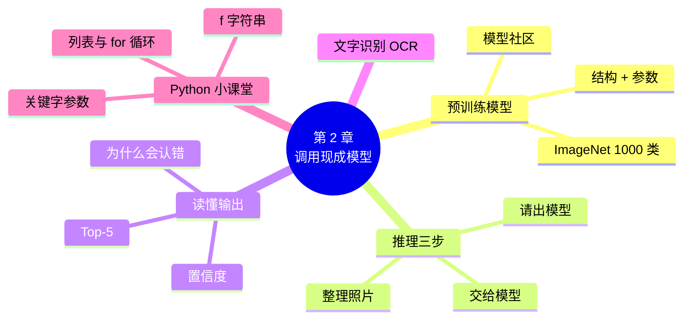

# 第 2 章 第一次用框架：调用现成模型

!!! abstract "本章学时"
    理论 4 学时（线上 3 + 线下 1）· 实验 1 学时（本章共 3 个实验，教师可任选）

## 学习目标

学完本章，你应该能够：

1. **说出**什么是预训练模型、什么是推理，以及它们和训练的区别（记忆）；
2. **运行**几行代码调用现成的图像分类模型，识别一张照片（应用）；
3. **读懂**模型的输出：类别名称、置信度和前 5 个答案（理解）；
4. **分析**模型认错的原因，特别是“要认的东西不在模型学过的类别里”（分析）；
5. **使用**现成的文字识别模型，从图片中提取文字（应用）。

!!! info "先修要求"
    学习本章前，你需要掌握：

    - 在云端 Notebook 中运行单元格（[1.4.3](../01-intro/index.md#143)）；
    - `print`、变量、`import` 的用法（[1.5 Python 小课堂①](../01-intro/index.md#15)）。

??? abstract "本章概念清单（12 个，点击查看定义和例子）"
    1. [预训练模型](../../appendix/glossary.md#g-预训练模型)
    2. [ImageNet](../../appendix/glossary.md#g-ImageNet)
    3. [模型参数](../../appendix/glossary.md#g-模型参数)
    4. [置信度](../../appendix/glossary.md#g-置信度)
    5. [Top-5](../../appendix/glossary.md#g-Top-5)
    6. [文字识别](../../appendix/glossary.md#g-文字识别)
    7. [模型社区](../../appendix/glossary.md#g-模型社区)
    8. [参数](../../appendix/glossary.md#g-参数)
    9. [关键字参数](../../appendix/glossary.md#g-关键字参数)
    10. [字符串](../../appendix/glossary.md#g-字符串)
    11. [列表](../../appendix/glossary.md#g-列表)
    12. [for 循环](../../appendix/glossary.md#g-for-循环)

## 情景导入

上一章，小林把工作台准备好了。他迫不及待地想试试：能不能马上让电脑认出店里的花？

同事小周在一家互联网公司做过实习，她说：“你不用自己从头教电脑认东西。网上有很多大公司已经训练好的模型，它们看过一百多万张照片，认识一千种东西，你拿过来直接用就行，几行代码的事。”

小林照着小周给的代码试了一下：一张雏菊的照片，模型回答“daisy（雏菊），把握 35.6%”。认对了！他又试了一张郁金香，模型却回答“picket_fence（尖桩篱栅）”——郁金香怎么成了篱笆？再试玫瑰，模型说是“vase（花瓶）”。

这一章我们就跟着小林，用几行代码请出一个“现成的模型”，看它怎样认花、怎样认图片里的文字；也要弄明白，这么厉害的模型为什么会把郁金香认成篱笆。

## 2.1 模型、预训练模型与推理

### 2.1.1 模型是一个“会学习的学生” { #211 }

第 1 章打过一个比方：模型像一个学生。刚“出生”的模型什么都不会，它的脑子里有成千上万个可以调整的数字，叫作[**模型参数**](../../appendix/glossary.md#g-模型参数 "模型在训练中学到、保存在文件里的大量数字，决定模型怎样答题，也叫权重"){ .term }。训练就是让模型看大量带答案的例子，不断调整这些数字，直到它能答对题。

训练好以后，模型就变成两样东西：

- **结构**：模型由哪些部分组成、数据怎样一步步流过去，就像学生的“大脑构造”；
- **参数**：训练中学到的那一大堆数字，就像学生学到的“知识”。

两样东西都保存在文件里。把文件拷给别人，别人就得到了一个同样“有知识”的模型，不用再从头教一遍。

### 2.1.2 预训练模型：别人已经教好的学生 { #212 }

[**预训练模型**](../../appendix/glossary.md#g-预训练模型 "别人已经用大量数据训练好、可以直接下载使用的模型"){ .term }就是别人已经用大量数据训练好、公开出来给大家用的模型。最有名的一批图像模型，都是在 [ImageNet](../../appendix/glossary.md#g-ImageNet "一个有 1000 个类别、约 128 万张图片的大型图片数据集，很多图像模型都在它上面预训练"){ .term } 数据集上训练的。ImageNet 是斯坦福大学等单位整理的一个超大图片库<sup class="cite">[[1]](#ref2-1)</sup>，其中最常用的部分有 1000 个类别、一百二十多万张训练图片<sup class="cite">[[2]](#ref2-2)</sup>，类别从“金鱼”“雏菊”到“咖啡杯”“消防车”都有。

自己训练一个这样的模型，需要很多块显卡算上好几天；而用预训练模型，只要下载一个几十兆的文件。这就是为什么做人工智能应用的第一步，往往是“先看看有没有现成的模型”。

本章用到的两个预训练图像模型：

| | 通用版 | 国产版 |
|---|---|---|
| 模型名称 | MobileNetV2<sup class="cite">[[3]](#ref2-3)</sup> | PP-LCNet<sup class="cite">[[4]](#ref2-4)</sup> |
| 出品方 | 谷歌 | 百度飞桨 |
| 特点 | 小巧，手机上也能跑 | 专门为普通 CPU 优化，速度快 |
| 训练数据 | ImageNet，1000 类 | ImageNet，1000 类 |
| 参数文件大小 | 约 14 MB | 约 12 MB |

两个模型名字里的“Mobile”“LC（Lightweight CPU，轻量级 CPU）”都说明了同一件事：它们是“轻量级”模型，在普通电脑上也能很快算出结果，很适合初学者。

### 2.1.3 推理：让学生答题 { #213 }

把一张新照片交给训练好的模型，让它说出“这是什么”，这个过程叫**推理**，也叫预测。推理和训练的区别，可以用下表记住：

| | 训练 | 推理 |
|---|---|---|
| 好比 | 学生上课、做练习、对答案改错 | 学生考试、工作，回答新问题 |
| 需要标签（正确答案）吗 | 需要 | 不需要 |
| 模型参数会变吗 | 会，越学越好 | 不会，只是用 |
| 需要的计算量 | 大，常常要用 GPU | 小，普通电脑就行 |

本章只做推理，不做训练。从第 4 章开始，我们才自己训练模型。

## 2.2 五行代码识别一张照片

### 2.2.1 第一步：请出模型 { #221 }

=== "通用版"

    ```python
    from keras.applications import mobilenet_v2           # 从 Keras 的模型库里拿出 MobileNetV2
    model = mobilenet_v2.MobileNetV2(weights="imagenet")   # 装上在 ImageNet 上训练好的参数
    ```

    `keras.applications` 是 Keras 自带的“模型库”，里面有几十个常用的预训练图像模型<sup class="cite">[[5]](#ref2-5)</sup>。`weights="imagenet"` 的意思是“要那份在 ImageNet 上训练好的参数”。第一次运行时，程序会自动从网上下载参数文件，之后再运行就直接用下载好的。

=== "国产版"

    ```python
    from paddlex import create_model                       # PaddleX：飞桨的“模型超市”
    model = create_model(model_name="PP-LCNet_x1_0")       # 按名字取出 PP-LCNet 模型
    ```

    PaddleX 是飞桨推出的低代码开发工具，把飞桨的几百个模型放在一个“超市”里，按名字就能取用<sup class="cite">[[6]](#ref2-6)</sup>。`PP-LCNet_x1_0` 是模型的全名，`x1_0` 表示标准大小的版本。第一次运行时，程序会自动从网上下载模型文件。

这一步做完，变量 `model` 里装的就是一个“有知识的学生”了。

### 2.2.2 第二步：把照片交给模型 { #222 }

模型对输入的要求很严格。MobileNetV2 和 PP-LCNet 都要求照片是 224×224 像素大小、按特定的规则换算过的数字。

=== "通用版"

    ```python
    import keras, numpy as np
    img = keras.utils.load_img("daisy_1.jpg", target_size=(224, 224))   # 读照片，同时缩放到 224×224
    x = keras.utils.img_to_array(img)                                  # 照片变成数字
    x = mobilenet_v2.preprocess_input(np.expand_dims(x, 0))            # 变成“一批一张”，再按模型要求换算
    pred = model.predict(x, verbose=0)                                 # 交给模型，得到答案
    ```

    这四行分别是：读照片、照片变数字、整理格式、交给模型。第三行有两个动作：`np.expand_dims(x, 0)` 把“一张照片”包装成“一批照片（这一批里只有一张）”，因为框架习惯一次处理一批；`preprocess_input` 把 0～255 的像素值换算成模型训练时用的 -1～1。这两个动作的道理第 3 章会讲，现在照抄就行。

=== "国产版"

    ```python
    for res in model.predict("daisy_1.jpg", batch_size=1, topk=5):   # 交给模型，要前 5 个答案
        print(res["label_names"], res["scores"])                    # 打印类别名称和把握
    ```

    PaddleX 把“读照片、缩放、换算”都藏在 `predict` 里面自动完成了，所以一行就够。`batch_size=1` 表示一次处理一张，`topk=5` 表示要最有可能的 5 个答案。

!!! note "两个版本的写法为什么不一样长"
    通用版把每一步都摆在明处，读代码的人能看清模型的输入是什么样子；国产版的 PaddleX 是“低代码”工具，把这些步骤包起来了，用起来更省事。两种写法背后做的事情完全相同。第 3 章讲“数据在框架里的样子”时，你会明白这些被包起来的步骤到底在做什么。

### 2.2.3 读懂输出：类别和把握 { #223 }

模型的回答不是一句话，而是一张“清单”：1000 个类别，每个类别一个 0 到 1 之间的数，加起来正好等于 1。这个数叫[**置信度**](../../appendix/glossary.md#g-置信度 "模型对某个答案有多大把握，用 0～1 或百分比表示"){ .term }，可以理解成模型对这个答案有多大把握。我们一般只看把握最大的前几个，叫[**Top-5**](../../appendix/glossary.md#g-Top-5 "模型给出的把握最大的前 5 个答案"){ .term }（前 5 名）。下面是实验 2-1 中，通用版模型对一张雏菊照片的回答：

```text
daisy                35.6%
coral_fungus         3.0%
vase                 3.0%
picket_fence         2.6%
shower_curtain       2.4%
```

读法是：模型认为这张照片最可能是 daisy（雏菊），把握 35.6%；其次是 coral_fungus（珊瑚菌）、vase（花瓶），把握都只有 3% 左右。第一名远远高于第二名，说明模型对“雏菊”这个答案比较有信心。

**算一算**：5 个答案的把握加起来是 35.6% + 3.0% + 3.0% + 2.6% + 2.4% = 46.6%。剩下的 53.4% 分散在另外 995 个类别里，每个都很小。所以 35.6% 虽然不到一半，但在 1000 个选项里遥遥领先。

<iframe class="sim-frame" src="../../sims/model-top5/main.html" height="470" loading="lazy" title="模型是怎样“看”图的"></iframe>

点上方的小图换一张照片，看模型的前 5 个答案。比一比：哪几张认对了？认错的照片，模型的把握是高还是低？[全屏打开](../../sims/model-top5/main.html){ target=_blank } · [教学说明](../../sims/model-top5/index.md)
{ .sim-caption }

### 2.2.4 模型为什么会认错 { #224 }

用实验 2-2 把 5 种花各 2 张照片都试一遍（通用版的实际结果）：

| 照片 | 模型的第一名答案 | 把握 | 对不对 |
|---|---|---|---|
| 雏菊 1 | daisy（雏菊） | 35.6% | ✓ |
| 雏菊 2 | daisy（雏菊） | 86.6% | ✓ |
| 蒲公英 1 | ostrich（鸵鸟） | 15.1% | ✗ |
| 蒲公英 2 | lakeside（湖边） | 3.4% | ✗ |
| 玫瑰 1 | vase（花瓶） | 39.9% | ✗ |
| 玫瑰 2 | velvet（天鹅绒） | 15.2% | ✗ |
| 向日葵 1 | bee（蜜蜂） | 13.0% | ✗ |
| 向日葵 2 | daisy（雏菊） | 90.5% | ✗ |
| 郁金香 1 | hip（玫瑰果） | 16.7% | ✗ |
| 郁金香 2 | picket_fence（尖桩篱栅） | 36.5% | ✗ |

10 张只认对 2 张。这么有名的模型，怎么这么差？原因有三个：

1. **它根本不认识这些花**。ImageNet 的 1000 个类别里有“雏菊”，却没有玫瑰、郁金香、向日葵、蒲公英。一个只学过“雏菊”的学生，看到向日葵，只能答一个“最像的”——向日葵也是黄色花瓣围着花心，于是答成了雏菊，而且把握高达 90.5%。这是模型最常见的错误：**要认的东西不在它学过的类别里**。
2. **它看到的不只是花**。玫瑰 1 被认成花瓶，因为照片里的玫瑰插在花瓶里，花瓶反而是模型认识的；郁金香 2 背后有一排篱笆。模型并不知道我们“想问的是花”，它会说出照片里它最有把握的东西。
3. **照片和训练数据不一样**。蒲公英 2 的把握只有 3.4%，说明模型自己都很犹豫。光线、角度、背景和训练照片差别很大时，模型就容易“懵”。

!!! tip "把握低是一个有用的信号"
    第一名的把握很低（比如低于 20%）时，往往说明模型拿不准，这时候它的答案不可信。实际应用中，常常设定一个门槛：把握低于门槛就回答“我不确定”，交给人来判断。第 8 章还会用到这个办法。

那么，怎样让模型认识玫瑰、郁金香呢？答案是用我们自己的花卉照片训练它。第 5 章会从零训练一个花卉识别模型，第 7 章会用一个更聪明的办法——在现成模型的基础上“补课”，只用几百张照片就能让它认对九成以上。

## 2.3 现成模型还能做什么

### 2.3.1 一行代码认出图片里的文字 { #231 }

识别图片里的文字叫[**文字识别**](../../appendix/glossary.md#g-文字识别 "让模型从图片里找出文字并把它变成可编辑文本的技术"){ .term }（OCR，Optical Character Recognition，光学字符识别），是现成模型用得最多的场合之一：拍照识别小票、发票、名片、车牌、快递单，都靠它。

我国在这方面的现成模型很强。飞桨的 PaddleOCR 是全球最受欢迎的开源文字识别工具之一<sup class="cite">[[7]](#ref2-7)</sup>，对中文的识别效果尤其好。

=== "通用版"

    ```python
    from rapidocr_onnxruntime import RapidOCR    # RapidOCR：PaddleOCR 模型的“通用格式”版本
    ocr = RapidOCR()                             # 模型文件随安装包一起下载
    result, _ = ocr("flower_shop_notice.png")    # 识别一张图片
    for box, text, score in result:              # 每一行文字：位置、内容、把握
        print(text, score)
    ```

    RapidOCR 是一个开源项目<sup class="cite">[[8]](#ref2-8)</sup>，它把 PaddleOCR 的模型转换成通用的 ONNX 格式（第 11 章会讲这种格式），不装飞桨也能用。可见国产模型也是“通用版”工具箱的重要成员。

=== "国产版"

    ```python
    from paddleocr import PaddleOCR              # 飞桨文字识别套件
    ocr = PaddleOCR(use_doc_orientation_classify=False, use_doc_unwarping=False,
                    use_textline_orientation=False)   # 关掉三个用不上的功能，速度更快
    for res in ocr.predict("flower_shop_notice.png"):  # 识别一张图片
        print(res["rec_texts"], res["rec_scores"])      # 识别出的文字和把握
    ```

    PaddleOCR 3.x 的默认模型除了认文字，还能判断文档方向、拉平弯曲的纸张。我们的示例图片是端正的，所以把这几个功能关掉。

对一张虚构的花店告示图片，通用版的识别结果如下（实验 2-3 的实际输出）：

```text
花语小铺·母亲节特惠    （把握 100%）
康乃馨花束每束39元    （把握 100%）
向日葵花束每束59元    （把握 100%）
营业时间：9:00-21:00    （把握 99%）
订花电话：020-88886666    （把握 99%）
```

文字全部认对了，只是原图里的空格被去掉了。

### 2.3.2 现成模型的“三大门类” { #232 }

除了图片，文字和声音也有大量现成模型。后面几章会一一用到：

| 门类 | 能做什么 | 本书在哪一章用 |
|---|---|---|
| 图像 | 认出是什么（分类）、找出在哪里（检测）、认出文字（OCR） | 第 2、7、8 章 |
| 文本 | 判断好评差评、提取关键词、分类、对话 | 第 9 章 |
| 语音 | 把说话变成文字（语音识别）、把文字读出来（语音合成） | 第 10 章 |

### 2.3.3 到哪里找现成模型 { #233 }

现成模型集中放在“[模型社区](../../appendix/glossary.md#g-模型社区 "集中发布、下载和在线体验各种模型的网站"){ .term }”（也叫模型库）里，就像手机的应用商店：

- **魔搭社区（ModelScope）**：阿里巴巴发起，国内最大的模型社区之一，模型多、中文说明全；
- **飞桨模型库与 PaddleX**：飞桨官方维护，与飞桨产业套件配套；
- **Hugging Face**：国际上最大的模型社区，开源大模型几乎都会在这里发布；
- **框架自带的模型库**：如 `keras.applications`、`paddle.vision.models`，里面是最经典的一批模型。

挑选现成模型时，要看四件事：**能做什么任务**、**认识哪些类别**（比如本章的模型不认识郁金香）、**大小和速度**、**使用许可**（能不能用在商业产品里）。

## 2.4 Python 小课堂②：函数参数、字符串和列表 { #24 }

### 2.4.1 函数调用和参数 { #241 }

上一章的 `print("你好")` 就是一次**函数**调用。函数名后面的括号里放的是[**参数**](../../appendix/glossary.md#g-参数 "调用函数时写在括号里交给函数的值"){ .term }，也就是交给函数的“原材料”。很多函数可以接收好几个参数：

```python
keras.utils.load_img("daisy_1.jpg", target_size=(224, 224))
```

- 第一个参数 `"daisy_1.jpg"` 是照片的文件名；
- 第二个参数 `target_size=(224, 224)` 带了名字，叫[**关键字参数**](../../appendix/glossary.md#g-关键字参数 "用“名字=值”形式写的参数，不用记顺序"){ .term }，写成“名字=值”。好处是一看就知道这个值是干什么的，而且顺序可以调换。

本书代码中带 `← 改这里` 的地方，大多就是让你改某个参数的值。

### 2.4.2 字符串：用引号括起来的文字 { #242 }

用引号括起来的内容叫[**字符串**](../../appendix/glossary.md#g-字符串 "用引号括起来的一段文字"){ .term }，文件名、类别名都是字符串。字符串有一个很实用的写法：在引号前加一个 `f`，就可以在花括号里直接放变量，叫“f 字符串”：

```python
name, prob = "daisy", 0.356
print(f"{name} 的把握是 {prob:.1%}")     # 显示：daisy 的把握是 35.6%
```

花括号里的 `:.1%` 表示“按百分数显示，保留 1 位小数”，所以 0.356 显示成 35.6%。

### 2.4.3 列表和 for 循环 { #243 }

把一组东西放在方括号里，就是一个[**列表**](../../appendix/glossary.md#g-列表 "用方括号括起来、按顺序存放多个值的容器"){ .term }：

```python
flowers = ["雏菊", "蒲公英", "玫瑰", "向日葵", "郁金香"]
for f in flowers:          # 对列表里的每一样东西，依次做下面缩进的事
    print("我认识", f)
```

`for … in …:` 叫 [**for 循环**](../../appendix/glossary.md#g-for-循环 "把列表中的每个元素依次取出来、对它做同样操作的写法"){ .term }，意思是“把列表里的东西一个一个拿出来，每拿一个就做一遍下面的事”。注意两点：

- 第一行末尾的**冒号**不能少；
- 要重复做的事，行首要**缩进**（一般是 4 个空格，Notebook 里按 Tab 键会自动输入）。缩进的行属于循环，不缩进的行不属于。

实验 2-2 就是用 for 循环把文件夹里的照片一张一张交给模型的。

## 2.5 前沿视窗：模型社区与“模型即服务” { #25 }

这几年，人工智能开发的方式发生了一个大变化：从“每个应用都自己训练模型”，变成“先去模型社区找现成的，不够再改”。魔搭社区上线两年多，开源模型数量就已超过数万个；飞桨把常用模型做成 PaddleX 的“产线”，一行代码就能调用一整套流程。

更进一步的做法叫“模型即服务”：模型连下载都不用，直接通过网络调用平台上的模型，按调用次数付费。百度智能云千帆、阿里云百炼、火山引擎等平台都提供这类服务，国产大模型（文心、通义千问、豆包、DeepSeek 等）大多也用这种方式对外开放。第 9 章会尝试调用大模型服务。

对开发者来说，这意味着“会找模型、会用模型、会评估模型好不好用”，往往比“会从零训练模型”更常用。不过，现成模型也有局限：它不一定认识你要认的东西（就像本章的郁金香），而且使用时要遵守许可协议和数据安全的要求。截至 2026 年 10 月，各模型社区的模型数量和许可协议变化很快，使用前要以平台当时的说明为准。

## 本章实验

!!! abstract "实验总览"
    | 实验 | 类型 | 建议时长 | 内容 |
    |---|---|---|---|
    | 实验 2-1 | ★ 必做 | 20 分钟 | 让模型认出一张花的照片 |
    | 实验 2-2 | ★ 必做 | 25 分钟 | 换图试试：认一批照片，找出认错的原因 |
    | 实验 2-3 | ☆ 选做 | 25 分钟 | 一行代码体验文字识别 |

    代码见配套资源 `labs/ch02/` 目录（`keras/` 通用版，`paddle/` 国产版），照片在 `labs/data/test_photos/`，文字识别示例图片在 `labs/data/ocr_samples/`。

### 实验 2-1 ★ 让模型认出一张花的照片

**实验目的**

1. 学会调用预训练的图像分类模型；
2. 读懂模型输出的 Top-5 类别和置信度。

**实验环境**：云端 Notebook 或本机，CPU 即可，需要联网（第一次运行要下载模型文件）。

**实验数据**：`labs/data/test_photos/` 中的 10 张花卉照片（选自 TensorFlow 花卉数据集，CC BY 2.0），也可以用自己拍的照片。

**实验步骤与代码**

第一档 · 跑通：上传 `labs/data/test_photos/` 文件夹和 `lab2_1_recognize_flower.ipynb`，依次运行。

=== "通用版"

    ```python
    import keras, numpy as np
    from keras.applications import mobilenet_v2

    model = mobilenet_v2.MobileNetV2(weights="imagenet")     # 请出模型
    PHOTO = "../../data/test_photos/daisy_1.jpg"              # ← 改这里：换成你的照片
    img = keras.utils.load_img(PHOTO, target_size=(224, 224))
    x = mobilenet_v2.preprocess_input(np.expand_dims(keras.utils.img_to_array(img), 0))
    pred = model.predict(x, verbose=0)                        # 推理
    for _, name, prob in mobilenet_v2.decode_predictions(pred, top=5)[0]:
        print(f"{name:20s} {prob:.1%}")                       # 打印前 5 个答案
    ```

    `decode_predictions` 把模型输出的 1000 个数字翻译成“类别名 + 把握”，并按把握从大到小排好。完整代码：`labs/ch02/keras/lab2_1_recognize_flower.ipynb`

=== "国产版"

    ```python
    from paddlex import create_model

    model = create_model(model_name="PP-LCNet_x1_0")          # 请出模型
    PHOTO = "../../data/test_photos/daisy_1.jpg"              # ← 改这里：换成你的照片
    for res in model.predict(PHOTO, batch_size=1, topk=5):    # 推理，要前 5 个答案
        for name, score in zip(res["label_names"], res["scores"]):
            print(f"{name:20s} {score:.1%}")                  # 打印前 5 个答案
    ```

    `zip` 把两个列表“拉链式”地配成对：第 1 个名称配第 1 个分数，第 2 个配第 2 个……完整代码：`labs/ch02/paddle/lab2_1_recognize_flower.ipynb`

**运行结果**

=== "通用版"

    ```text
    daisy                35.6%
    coral_fungus         3.0%
    vase                 3.0%
    picket_fence         2.6%
    shower_curtain       2.4%
    ```

    第一次运行时，上面还会显示两行下载进度（模型参数约 14 MB，类别名称表约 35 KB）。

=== "国产版"

    !!! warning "待实测"
        编者的编写环境无法连接飞桨的模型下载服务器，这段代码已检查过写法，但没有实际运行。请在 AI Studio 上运行，把结果填进下面的记录表。PP-LCNet 和 MobileNetV2 都是在 ImageNet 上训练的，预计第一名也是 daisy（雏菊），但把握的具体数值会不同。

第二档 · 改一改：

1. 把 `PHOTO` 换成 `daisy_2.jpg`，再运行，比较两张雏菊照片的把握；
2. 把 `top=5`（国产版 `topk=5`）改成 `top=3`，看输出有什么变化；
3. 用手机拍一张身边物品（杯子、键盘、香蕉等）的照片，上传后让模型认一认。

**实验记录表**

| 照片 | 第一名答案 | 把握 | 对不对 |
|---|---|---|---|
| daisy_1.jpg | | | |
| daisy_2.jpg | | | |
| 你自己拍的照片：______ | | | |

**常见问题排查**

| 现象 | 原因 | 解决办法 |
|---|---|---|
| `FileNotFoundError: ... daisy_1.jpg` | 照片的路径写错了，或者照片没上传 | 在左侧文件栏确认照片的位置，把 `PHOTO` 改成正确的路径 |
| 下载模型时报 `URLError`、`Connection` 等网络错误 | 当前环境连不上下载服务器 | 换一个云平台；或者请老师提前把模型文件放到共享目录 |
| 输出全是英文看不懂 | ImageNet 的类别名称是英文 | 用翻译软件查，或参考 2.2.4 节的表格 |

**思考与练习**

1. 两张雏菊照片的把握差别很大（35.6% 和 86.6%），你觉得是照片的什么不同造成的？
2. 你拍的物品认对了吗？如果认错了，你觉得原因是 2.2.4 节说的哪一种？

**实验报告要求**

提交运行结果截图和实验记录表。

### 实验 2-2 ★ 换图试试：认一批照片

**实验目的**

1. 学会用 for 循环让模型一次认一批照片；
2. 统计模型认对、认错的情况，分析认错的原因。

**实验环境**：同实验 2-1。

**实验数据**：同实验 2-1。

**实验步骤与代码**

第一档 · 跑通：运行 `lab2_2_more_photos.ipynb`。

=== "通用版"

    ```python
    from pathlib import Path
    FOLDER = Path("../../data/test_photos")                 # ← 改这里：放照片的文件夹
    for photo in sorted(FOLDER.glob("*.jpg")):              # 依次取出文件夹里的每张 jpg 照片
        img = keras.utils.load_img(photo, target_size=(224, 224))
        x = mobilenet_v2.preprocess_input(np.expand_dims(keras.utils.img_to_array(img), 0))
        _, name, prob = mobilenet_v2.decode_predictions(model.predict(x, verbose=0), top=1)[0][0]
        print(f"{photo.name:18s} → {name:16s} {prob:.1%}")   # 只打印第一名
    ```

=== "国产版"

    ```python
    from pathlib import Path
    FOLDER = Path("../../data/test_photos")                 # ← 改这里：放照片的文件夹
    for photo in sorted(FOLDER.glob("*.jpg")):              # 依次取出文件夹里的每张 jpg 照片
        res = next(iter(model.predict(str(photo), batch_size=1, topk=1)))   # 只要第一名
        print(f"{photo.name:18s} → {res['label_names'][0]:16s} {res['scores'][0]:.1%}")
    ```

`Path` 用来表示一个文件夹，`FOLDER.glob("*.jpg")` 找出里面所有以 `.jpg` 结尾的文件，`sorted` 把它们按名字排好序。

**运行结果**

=== "通用版"

    ```text
    daisy_1.jpg        → daisy            35.6%
    daisy_2.jpg        → daisy            86.6%
    dandelion_1.jpg    → ostrich          15.1%
    dandelion_2.jpg    → lakeside         3.4%
    roses_1.jpg        → vase             39.9%
    roses_2.jpg        → velvet           15.2%
    sunflowers_1.jpg   → bee              13.0%
    sunflowers_2.jpg   → daisy            90.5%
    tulips_1.jpg       → hip              16.7%
    tulips_2.jpg       → picket_fence     36.5%
    ```

=== "国产版"

    !!! warning "待实测"
        原因同实验 2-1。请在 AI Studio 上运行，把 10 张照片的结果填进记录表，并和通用版的结果比一比。由于两个模型认识的是同样的 1000 个类别，预计也只有雏菊能认对。

第二档 · 改一改：

1. 在实验记录表里统计：10 张照片认对了几张？认错的照片中，有几张的把握低于 20%？
2. 新建一个文件夹，放进你拍的 5 张照片（最好是 ImageNet 里有的东西，比如香蕉、键盘、马克杯），把 `FOLDER` 改成这个文件夹，看看认对几张。

**实验记录表**

| 统计项 | 花卉照片（10 张） | 你自己的照片（5 张） |
|---|---|---|
| 认对的张数 | | |
| 认错且把握低于 20% 的张数 | | |
| 认错且把握高于 50% 的张数 | | |

**常见问题排查**

| 现象 | 原因 | 解决办法 |
|---|---|---|
| 什么都没打印 | 文件夹里没有 `.jpg` 文件（可能是 `.JPG` 或 `.png`） | 把 `"*.jpg"` 改成 `"*.JPG"` 或 `"*.png"` |
| `IndentationError` | for 循环下面的行没有对齐 | 循环里的每一行前面都要有同样多的空格 |

**思考与练习**

1. 向日葵 2 被认成雏菊，而且把握高达 90.5%。“把握高”是不是就一定“认得对”？
2. 如果要让模型认识玫瑰和郁金香，你觉得需要准备什么？

**实验报告要求**

提交运行结果截图、实验记录表，并用 3～5 句话写出你对“模型为什么会认错”的分析。

### 实验 2-3 ☆ 一行代码体验文字识别

**实验目的**

1. 调用现成的文字识别模型，从图片中提取文字；
2. 用自己拍的照片测试识别效果。

**实验环境**：云端 Notebook 或本机，CPU 即可。通用版需要先安装 RapidOCR：`pip install rapidocr_onnxruntime`；国产版需要安装 PaddleOCR：`pip install paddleocr`。

**实验数据**：`labs/data/ocr_samples/` 中的花店告示和销售小票图片（编者用程序生成，店名、电话、金额都是虚构的）。

**实验步骤与代码**

第一档 · 跑通：运行 `lab2_3_ocr.ipynb`，代码见 [2.3.1 节](#231)。

**运行结果**

=== "通用版"

    ```text
    花语小铺·母亲节特惠    （把握 100%）
    康乃馨花束每束39元    （把握 100%）
    向日葵花束每束59元    （把握 100%）
    营业时间：9:00-21:00    （把握 99%）
    订花电话：020-88886666    （把握 99%）
    ```

=== "国产版"

    !!! warning "待实测"
        编者的编写环境无法下载 PaddleOCR 的模型文件，代码未实际运行。通用版的 RapidOCR 用的正是 PaddleOCR 的模型，预计识别结果相同或非常接近。请在 AI Studio 上运行并记录结果。

第二档 · 改一改：

1. 把 `PHOTO` 换成 `receipt.png`（销售小票），看看能不能认出每一件商品和金额；
2. 用手机拍一张身边的招牌、书的封面或包装盒上的文字，上传后识别，记录认错的字。

**实验记录表**

| 图片 | 一共几行文字 | 认对几行 | 认错的字（原字 → 认成） |
|---|---|---|---|
| flower_shop_notice.png | 5 | | |
| receipt.png | | | |
| 你自己拍的照片 | | | |

**常见问题排查**

| 现象 | 原因 | 解决办法 |
|---|---|---|
| `ModuleNotFoundError: No module named 'rapidocr_onnxruntime'` | 没有安装 | 在单元格里运行 `!pip install rapidocr_onnxruntime` |
| 识别结果为空（`None`） | 图片里的字太小、太模糊或拍斜了 | 靠近一点、拍正、光线充足 |

**思考与练习**

1. 识别小票时，表格中的空格被去掉了。如果要把“商品、数量、金额”分开存进表格，你有什么想法？（第 8 章会讲）

**实验报告要求**

提交识别结果截图和实验记录表。

## 本章小结

- **模型**由结构和**模型参数**组成。**预训练模型**是别人用大量数据训练好、公开给大家用的模型，拿来就能用。
- 用训练好的模型回答新问题叫**推理**。推理不需要标签，模型参数不变，计算量小。
- 调用现成图像分类模型只要三步：**请出模型 → 把照片整理成模型要的样子 → 交给模型**。
- 模型输出每个类别的**置信度**，加起来等于 1；通常看 **Top-5**。把握低说明模型拿不准。
- 模型认错的常见原因：要认的东西不在它学过的类别里、照片里有更显眼的别的东西、照片和训练数据差别大。
- **文字识别（OCR）**是现成模型用得最多的场合之一，PaddleOCR 对中文效果很好。
- Python：函数的**关键字参数**、f 字符串、**列表**和 **for 循环**。



**下一章预告**

这一章，我们把照片“交给模型”时，照抄了 `img_to_array`、`expand_dims` 这些看不太懂的步骤。下一章就打开这个盒子：一张照片在框架里到底是什么样子？为什么要“一批一批”地处理？怎样把几百张花卉照片整理成训练用的数据集？弄清这些，我们才能在第 5 章训练自己的模型。

## 参考文献

正文中的上标编号（如<sup class="cite">[[1]](#ref2-1)</sup>）对应下面的文献。带链接的可以直接打开；书籍可在图书馆或电子书平台查阅。

<div class="refs" markdown>

**经典论文**

- <span id="ref2-1"></span>[1] DENG J, DONG W, SOCHER R, et al. ImageNet: A Large-Scale Hierarchical Image Database[C]//2009 IEEE Conference on Computer Vision and Pattern Recognition. Miami: IEEE, 2009: 248-255.
    <span class="ref-note">ImageNet 图片库的原始论文，对应 2.1.2 节。</span>
- <span id="ref2-2"></span>[2] RUSSAKOVSKY O, DENG J, SU H, et al. ImageNet Large Scale Visual Recognition Challenge[J]. International Journal of Computer Vision, 2015, 115(3): 211-252.
    <span class="ref-note">介绍 ImageNet 1000 类比赛数据集和历年成绩，本章模型的类别就来自这里，对应 2.1.2 节。</span>
- <span id="ref2-3"></span>[3] SANDLER M, HOWARD A, ZHU M, et al. MobileNetV2: Inverted Residuals and Linear Bottlenecks[C]//2018 IEEE/CVF Conference on Computer Vision and Pattern Recognition. Salt Lake City: IEEE, 2018: 4510-4520.
    <span class="ref-note">通用版所用模型 MobileNetV2 的论文，对应 2.1.2 节。</span>
- <span id="ref2-4"></span>[4] CUI C, GAO T, WEI S, et al. PP-LCNet: A Lightweight CPU Convolutional Neural Network[EB/OL]. (2021-09-17)[2026-10-31]. <https://arxiv.org/abs/2109.15099>.
    <span class="ref-note">国产版所用模型 PP-LCNet 的论文，介绍怎样让模型在普通 CPU 上跑得快，对应 2.1.2 节。</span>
- <span id="ref2-7"></span>[7] DU Y, LI C, GUO R, et al. PP-OCR: A Practical Ultra Lightweight OCR System[EB/OL]. (2020-09-21)[2026-10-31]. <https://arxiv.org/abs/2009.09941>.
    <span class="ref-note">PaddleOCR 第一代轻量文字识别系统的论文，对应 2.3.1 节。</span>

**在线资源与数据**

- <span id="ref2-5"></span>[5] Keras Applications[EB/OL]. [2026-10-31]. <https://keras.io/api/applications/>.
    <span class="ref-note">Keras 自带模型库的说明，列出每个模型的大小、准确率和用法，对应 2.2.1 节。</span>
- <span id="ref2-6"></span>[6] PaddleX 文档[EB/OL]. [2026-10-31]. <https://paddlepaddle.github.io/PaddleX/>.
    <span class="ref-note">PaddleX 低代码开发工具的官方文档，含模型列表和 create_model 用法，对应 2.2.1 节。</span>
- <span id="ref2-8"></span>[8] RapidAI. RapidOCR[EB/OL]. [2026-10-31]. <https://github.com/RapidAI/RapidOCR>.
    <span class="ref-note">把 PaddleOCR 模型转换为 ONNX 格式的开源文字识别工具，对应 2.3.1 节。</span>

</div>

## 课后练习

选择题和判断题可以直接点击选项作答，系统会马上告诉你对错，并展开答案与解析；多选题选好后点“提交答案”。简答和实操题请先自己作答，再点开“答案与解析”核对。每道题的解析下方都有“回看”链接，做错了可以直接跳回正文复习。

**一、单项选择题**

<div class="quiz" data-answer="B" markdown>

**1.** 别人已经用大量数据训练好、公开出来给大家使用的模型叫（　　）。

- A. 空白模型
- B. 预训练模型
- C. 测试模型
- D. 标签模型

</div>

??? tip "答案与解析"
    **答案：B**

    预训练模型就是“别人已经教好的学生”，拿来就能做推理。

    考查：预训练模型 · 认知层次：记忆 · [回看 2.1.2](#212)
    { .quiz-meta }

<div class="quiz" data-answer="C" markdown>

**2.** 下列关于推理的说法，正确的是（　　）。

- A. 推理时需要提供每张照片的正确答案
- B. 推理时模型参数会越变越好
- C. 推理一般不需要很大的计算量，普通电脑就能完成
- D. 推理就是训练的另一个名字

</div>

??? tip "答案与解析"
    **答案：C**

    推理只是“用”模型，不需要标签，参数不变，计算量比训练小得多。

    考查：推理与训练的区别 · 认知层次：理解 · [回看 2.1.3](#213)
    { .quiz-meta }

<div class="quiz" data-answer="A" markdown>

**3.** 通用版代码 `mobilenet_v2.MobileNetV2(weights="imagenet")` 中，`weights="imagenet"` 的作用是（　　）。

- A. 装上在 ImageNet 上训练好的参数
- B. 把照片上传到 ImageNet 网站
- C. 让模型只识别 ImageNet 里的照片
- D. 设置照片大小为 224×224

</div>

??? tip "答案与解析"
    **答案：A**

    weights 是“权重”，也就是模型参数。这一项指定要用哪一份训练好的参数。

    考查：调用预训练模型 · 认知层次：理解 · [回看 2.2.1](#221)
    { .quiz-meta }

<div class="quiz" data-answer="D" markdown>

**4.** 模型对一张照片输出：daisy 35.6%、coral_fungus 3.0%、vase 3.0%……下列理解正确的是（　　）。

- A. 这张照片有 35.6% 的面积是雏菊
- B. 模型认为这张照片一定不是花瓶
- C. 35.6% 不到一半，所以模型的答案没有意义
- D. 模型认为最可能是雏菊，而且明显比其他答案有把握

</div>

??? tip "答案与解析"
    **答案：D**

    置信度表示把握，不是面积。1000 个类别分一份“100%”，35.6% 已经远远领先第二名的 3.0%。

    考查：置信度与 Top-5 · 认知层次：理解 · [回看 2.2.3](#223)
    { .quiz-meta }

<div class="quiz" data-answer="B" markdown>

**5.** 一张向日葵照片被 ImageNet 预训练模型认成“雏菊”，把握 90.5%。最主要的原因是（　　）。

- A. 照片太模糊
- B. 模型学过的 1000 个类别里没有向日葵，只能挑一个最像的
- C. 模型的参数没有下载完整
- D. 向日葵和雏菊是同一种花

</div>

??? tip "答案与解析"
    **答案：B**

    ImageNet 1000 类里有雏菊没有向日葵。模型只能在自己认识的类别里选答案，所以即使把握很高也可能是错的。

    考查：模型认错的原因 · 认知层次：分析 · [回看 2.2.4](#224)
    { .quiz-meta }

<div class="quiz" data-answer="C" markdown>

**6.** 通用版代码中，`np.expand_dims(x, 0)` 的作用是（　　）。

- A. 把照片放大一倍
- B. 把照片变成黑白
- C. 把“一张照片”包装成“一批照片（这一批只有一张）”
- D. 删除照片的第一行像素

</div>

??? tip "答案与解析"
    **答案：C**

    框架习惯一次处理一批数据，所以单张照片也要包装成“一批”。第 3 章会详细讲。

    考查：整理模型输入 · 认知层次：理解 · [回看 2.2.2](#222)
    { .quiz-meta }

<div class="quiz" data-answer="A" markdown>

**7.** 执行 `print(f"{0.866:.1%}")` 显示的是（　　）。

- A. 86.6%
- B. 0.866
- C. 87%
- D. 0.9%

</div>

??? tip "答案与解析"
    **答案：A**

    `:.1%` 表示按百分数显示、保留 1 位小数，0.866 显示成 86.6%。

    考查：f 字符串 · 认知层次：应用 · [回看 2.4.2](#242)
    { .quiz-meta }

<div class="quiz" data-answer="D" markdown>

**8.** 下面的代码运行时报 `IndentationError`，原因是（　　）。

```python
for f in ["玫瑰", "郁金香"]:
print(f)
```

- A. 列表里不能放中文
- B. `for` 应该写成 `For`
- C. 少了一个括号
- D. `print(f)` 前面没有缩进

</div>

??? tip "答案与解析"
    **答案：D**

    for 循环里要重复做的事必须缩进（一般 4 个空格），否则 Python 不知道哪些行属于循环。

    考查：for 循环 · 认知层次：分析 · [回看 2.4.3](#243)
    { .quiz-meta }

**二、多项选择题**

<div class="quiz quiz-multi" data-answer="ABC" markdown>

**1.** 一个训练好的模型保存下来，包含的内容有（　　）。

- A. 模型的结构
- B. 训练中学到的模型参数
- C. 足以让别人直接拿去推理的信息
- D. 训练时用过的全部照片

</div>

??? tip "答案与解析"
    **答案：ABC**

    模型文件里是结构和参数，有了它别人就能直接推理。训练照片不在模型文件里，所以模型文件只有十几兆。

    考查：模型的组成 · 认知层次：理解 · [回看 2.1.1](#211)
    { .quiz-meta }

<div class="quiz quiz-multi" data-answer="ABCD" markdown>

**2.** 挑选现成模型时，需要关注的有（　　）。

- A. 它能做什么任务
- B. 它认识哪些类别
- C. 它的大小和速度
- D. 它的使用许可

</div>

??? tip "答案与解析"
    **答案：ABCD**

    这四件事都要看，尤其是“认识哪些类别”，本章的郁金香就是反例。

    考查：选择现成模型 · 认知层次：评价 · [回看 2.3.3](#233)
    { .quiz-meta }

<div class="quiz quiz-multi" data-answer="ACD" markdown>

**3.** 下列属于文字识别（OCR）应用场景的有（　　）。

- A. 拍照识别发票上的金额
- B. 判断一条评论是好评还是差评
- C. 自动读取快递单上的地址
- D. 识别停车场入口的车牌号

</div>

??? tip "答案与解析"
    **答案：ACD**

    B 处理的是已经是文字的内容，属于文本任务（第 9 章），不需要从图片里认字。

    考查：文字识别 · 认知层次：理解 · [回看 2.3.1](#231)
    { .quiz-meta }

**三、判断题**

<div class="quiz quiz-judge" data-answer="√" markdown>

**1.** 模型输出的 1000 个类别的置信度加起来等于 1（即 100%）。

- √ 正确
- × 错误

</div>

??? tip "答案与解析"
    **答案：√**

    模型把“100% 的把握”分给 1000 个类别，所以加起来等于 1。

    考查：置信度 · 认知层次：记忆 · [回看 2.2.3](#223)
    { .quiz-meta }

<div class="quiz quiz-judge" data-answer="×" markdown>

**2.** 模型对一个答案的把握越高，这个答案就一定越正确。

- √ 正确
- × 错误

</div>

??? tip "答案与解析"
    **答案：×**

    向日葵被认成雏菊，把握 90.5%，却是错的。把握低说明模型拿不准，但把握高也不能保证正确。

    考查：置信度的局限 · 认知层次：评价 · [回看 2.2.4](#224)
    { .quiz-meta }

<div class="quiz quiz-judge" data-answer="√" markdown>

**3.** RapidOCR 使用的是 PaddleOCR 的模型，只是换成了通用的 ONNX 格式。

- √ 正确
- × 错误

</div>

??? tip "答案与解析"
    **答案：√**

    所以不装飞桨也能用国产的文字识别模型。

    考查：文字识别工具 · 认知层次：记忆 · [回看 2.3.1](#231)
    { .quiz-meta }

<div class="quiz quiz-judge" data-answer="×" markdown>

**4.** 关键字参数必须按照固定的顺序书写，否则会报错。

- √ 正确
- × 错误

</div>

??? tip "答案与解析"
    **答案：×**

    关键字参数写成“名字=值”，有名字标着，顺序可以调换。

    考查：函数参数 · 认知层次：理解 · [回看 2.4.1](#241)
    { .quiz-meta }

<div class="quiz quiz-judge" data-answer="√" markdown>

**5.** 第一次运行调用预训练模型的代码时，程序会自动从网上下载模型参数文件。

- √ 正确
- × 错误

</div>

??? tip "答案与解析"
    **答案：√**

    所以第一次运行需要联网，之后就直接用下载好的文件。

    考查：调用预训练模型 · 认知层次：记忆 · [回看 2.2.1](#221)
    { .quiz-meta }

**四、简答题**

**1.** 用表格或几句话说明训练和推理的三点区别。

??? tip "答案与解析"
    **参考答案：** ① 训练需要标签，推理不需要；② 训练时模型参数不断调整，推理时参数不变；③ 训练计算量大，常要用 GPU，推理计算量小，普通电脑就行。

    考查：推理与训练的区别 · 认知层次：理解 · [回看 2.1.3](#213)
    { .quiz-meta }

**2.** 实验 2-2 中，10 张花卉照片只认对了 2 张。请分析至少两个原因。

??? tip "答案与解析"
    **参考答案：** ① ImageNet 的 1000 个类别里只有雏菊，没有玫瑰、郁金香、向日葵、蒲公英，模型只能挑最像的类别；② 照片里有花瓶、篱笆等更显眼、模型又认识的东西，模型就答成了这些东西；③ 部分照片的光线、角度和训练数据差别大，模型的把握很低。

    考查：模型认错的原因 · 认知层次：分析 · [回看 2.2.4](#224)
    { .quiz-meta }

**3.** 店里要做一个“拍照识花”的小程序，能直接用本章的预训练模型吗？为什么？

??? tip "答案与解析"
    **参考答案：** 不能直接用。本章的模型不认识玫瑰、郁金香等常见花卉，大部分会认错。需要用店里花卉的照片对模型再训练（第 5 章从零训练，第 7 章用迁移学习），让它认识要认的这些花。

    考查：现成模型的局限 · 认知层次：评价 · [回看 2.2.4](#224)
    { .quiz-meta }

**五、实操题**

**1.** 修改实验 2-2 的代码，让它只打印“把握大于 50%”的照片和答案，把握低的照片打印“我不确定”。写出修改后的循环部分和运行结果。

??? tip "答案与解析"
    **参考答案（通用版）：**

    ```python
    for photo in sorted(FOLDER.glob("*.jpg")):
        img = keras.utils.load_img(photo, target_size=(224, 224))
        x = mobilenet_v2.preprocess_input(np.expand_dims(keras.utils.img_to_array(img), 0))
        _, name, prob = mobilenet_v2.decode_predictions(model.predict(x, verbose=0), top=1)[0][0]
        if prob > 0.5:
            print(photo.name, "→", name, f"{prob:.1%}")
        else:
            print(photo.name, "→ 我不确定")
    ```

    `if … else` 的意思是“如果……就……，否则……”，同样要注意冒号和缩进。按实验 2-2 的结果，只有 daisy_2.jpg（86.6%）和 sunflowers_2.jpg（90.5%）会打印答案，其余 8 张打印“我不确定”。注意 sunflowers_2.jpg 把握很高却是错的。

    考查：for 循环、置信度门槛 · 认知层次：应用 · [回看 2.2.4](#224)
    { .quiz-meta }
