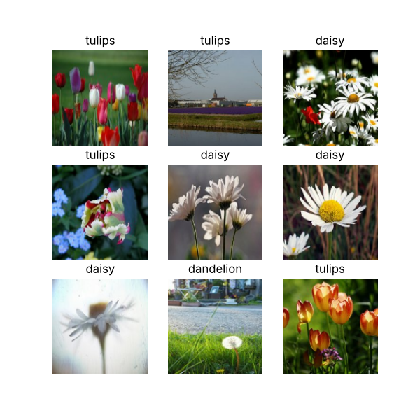
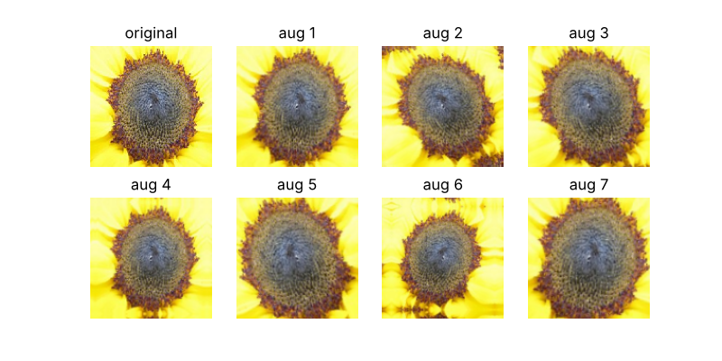
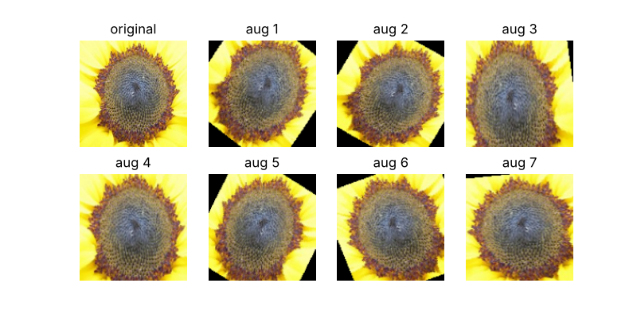
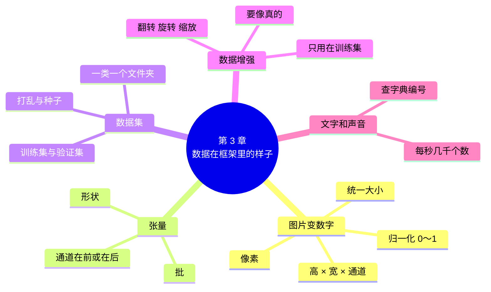

# 第 3 章 数据在框架里的样子

!!! abstract "本章学时"
    理论 5 学时（线上 4 + 线下 1）· 实验 1 学时（本章共 3 个实验，教师可任选）

## 学习目标

学完本章，你应该能够：

1. **说出**彩色图片在框架里由哪三个维度的数字组成，什么是张量和形状（记忆）；
2. **解释**为什么要把数据分成训练集和验证集、为什么要一批一批地处理（理解）；
3. **运行**几行代码把一个文件夹的照片读成数据集，并读懂输出的形状和标签（应用）；
4. **判断**一组数据增强设置是否合适（评价）；
5. **说出**文字和声音变成数字的基本思路（理解）。

!!! info "先修要求"
    学习本章前，你需要掌握：

    - 调用现成模型识别照片的三个步骤（[2.2 节](../02-pretrained/index.md#22)）；
    - 函数参数、字符串、列表和 for 循环（[2.4 Python 小课堂②](../02-pretrained/index.md#24)）。

??? abstract "本章概念清单（11 个，点击查看定义和例子）"
    1. [通道](../../appendix/glossary.md#g-通道)
    2. [形状](../../appendix/glossary.md#g-形状)
    3. [归一化](../../appendix/glossary.md#g-归一化)
    4. [张量](../../appendix/glossary.md#g-张量)
    5. [批](../../appendix/glossary.md#g-批)
    6. [数据集](../../appendix/glossary.md#g-数据集)
    7. [训练集](../../appendix/glossary.md#g-训练集)
    8. [验证集](../../appendix/glossary.md#g-验证集)
    9. [数据增强](../../appendix/glossary.md#g-数据增强)
    10. [索引](../../appendix/glossary.md#g-索引)
    11. [字典](../../appendix/glossary.md#g-字典)

## 情景导入

上一章，小林用现成模型认花，十张照片只认对了两张。小周说：“现成模型没学过你店里的花，你得自己教它。第一步，先把照片准备好。”

小林翻出手机相册，按花的种类建了五个文件夹：雏菊、蒲公英、玫瑰、向日葵、郁金香，每个文件夹放了一百五十张照片。他问小周：“照片准备好了，怎么交给模型？”

小周反问：“你上一章照抄的那几行代码，`img_to_array`、`expand_dims`，知道是干什么的吗？”小林摇摇头。

“模型只认识数字。照片、文字、声音，进了框架都得先变成一堆整整齐齐的数字。你得知道这堆数字长什么样，排成什么形状，模型才吃得进去。”

这一章，我们就打开这个盒子：看看一张照片在框架里到底是什么样子，再把七百五十张照片整理成模型能用的数据集。

## 3.1 图片在框架里是一张“数字表” { #31 }

### 3.1.1 像素：照片是由小格子拼成的 { #311 }

把手机里的照片放大、再放大，会看到它是由一个个小方格拼起来的，每个小方格只有一种颜色，叫**像素**。一张宽 200、高 159 像素的照片，就是 159 行、200 列的小方格。

每个像素的颜色，用**红、绿、蓝**三种光的强弱来表示，每种颜色的强弱是 0～255 之间的一个整数：0 表示一点都没有，255 表示最强。

| 颜色 | 红 | 绿 | 蓝 |
|---|---|---|---|
| 纯黑 | 0 | 0 | 0 |
| 纯白 | 255 | 255 | 255 |
| 大红 | 255 | 0 | 0 |
| 向日葵的黄 | 250 左右 | 220 左右 | 30 左右 |

这和小时候用红、黄、蓝颜料调色的道理相似，只是这里是三种“光”叠在一起。

### 3.1.2 三层数字表：高 × 宽 × 颜色通道 { #312 }

把一张照片所有像素的“红”数字排成一张表，就得到一张和照片一样大的数字表；“绿”和“蓝”也各排一张。三张表叠在一起，就是这张照片在框架里的样子。每一张表叫一个[**通道**](../../appendix/glossary.md#g-通道 "图片中同一种颜色的数字排成的一张表；彩色图片有红、绿、蓝 3 个通道，黑白图片只有 1 个"){ .term }，彩色图片有 3 个通道，黑白照片只有 1 个。

下面的动画里，点照片上任意一个点，就能看到它和周围像素的三个通道的数字。

<iframe class="sim-frame" src="../../sims/image-to-numbers/main.html" height="520" loading="lazy" title="图片变数字"></iframe>

[全屏打开动画](../../sims/image-to-numbers/main.html){ target=_blank }

一张 159 行、200 列的彩色照片，一共有 159 × 200 × 3 = 95400 个数字。框架用一组数来描述这堆数字的“长宽高”，叫[**形状**](../../appendix/glossary.md#g-形状 "张量每个方向上有多少个数，写成括号里的一组数"){ .term }，写作 `(159, 200, 3)`，意思是 159 行、200 列、3 个通道。

=== "通用版"

    ```python
    img = keras.utils.load_img("roses_1.jpg")     # 读入照片
    x = keras.utils.img_to_array(img)             # 照片变成数字
    print(x.shape)                                # 显示 (159, 200, 3)
    print(x[0, 0])                                # 第 0 行第 0 列那个点：[31. 22. 17.]
    ```

=== "国产版"

    ```python
    img = Image.open("roses_1.jpg").convert("RGB")   # 读入照片，统一成红绿蓝三色
    x = np.array(img, dtype="float32")               # 照片变成数字
    print(x.shape)                                   # 显示 (159, 200, 3)
    print(x[0, 0])                                   # 第 0 行第 0 列那个点：[31. 22. 17.]
    ```

    国产版用 Python 最常用的图片工具 PIL 读照片，用 numpy 把它变成数字，和飞桨配合得很好。

`x[0, 0]` 是左上角那个像素：红 31、绿 22、蓝 17，三个数都很小，所以是接近黑色的深褐色。注意编号是**从 0 开始**的，第一行是第 0 行。

### 3.1.3 统一大小，缩到 0～1 { #313 }

把照片交给模型之前，还要做两件事：

1. **统一大小**。相机拍的照片有大有小，但模型要求每张照片的形状一模一样，就像快递柜的格子尺寸是固定的。本书自己训练的模型统一用 128×128，第 2 章的现成模型用 224×224。
2. **把数字缩到 0～1**。像素值是 0～255，把每个数除以 255，就都变成了 0～1 之间的小数。这一步叫[**归一化**](../../appendix/glossary.md#g-归一化 "把数据按比例缩放到一个统一的小范围里（如 0～1），让模型更容易学"){ .term }。好比考试成绩有百分制、五分制，先都换算成“得分率”再比较，模型学起来会更顺利。

=== "通用版"

    ```python
    img = keras.utils.load_img("roses_1.jpg", target_size=(128, 128))  # 读入时就缩放到 128×128
    x = keras.utils.img_to_array(img) / 255.0     # 0～255 缩到 0～1
    print(x.shape)                                # (128, 128, 3)
    ```

=== "国产版"

    ```python
    from paddle.vision import transforms as T
    tf = T.Compose([T.Resize((128, 128)),         # 第一步：缩放到 128×128
                    T.ToTensor()])                # 第二步：变成张量，同时缩到 0～1
    x = tf(img)
    print(x.shape)                                # [3, 128, 128]
    ```

    `T.Compose` 把几个处理步骤串成一条“流水线”，照片从左到右依次经过每一步。`T.ToTensor()` 一步做了两件事：变成飞桨的数据格式，并且除以 255。

??? note "第 2 章为什么是 -1～1？"
    第 2 章的 MobileNetV2 用的 `preprocess_input` 是把 0～255 换算到 -1～1。不同模型训练时用的换算规则不同，用现成模型时要照它的规则来；自己训练的模型，用 0～1 就行。

!!! cert "证书考点"
    人工智能数据处理工程师（高级）证书的“深度学习实战”部分，训练前的数据读取、尺寸统一和归一化就是本节内容。

## 3.2 张量：框架里装数据的“多层盒子” { #32 }

### 3.2.1 从一个数到一批照片 { #321 }

框架里装数据的容器叫[**张量**](../../appendix/glossary.md#g-张量 "框架中存放数据的多维数字容器，可以看成一层套一层的数字表"){ .term }（Tensor）。名字听起来很玄，其实就是“排得整整齐齐的一堆数字”。按排列的方向有几个，可以分成：

| 有几个方向 | 好比 | 例子 | 形状 |
|---|---|---|---|
| 0 个 | 一个数 | 一张照片的标签 `2`（玫瑰） | `()` |
| 1 个 | 一排数（列表） | 一句话变成的编号 `[1, 2, 5]` | `(3,)` |
| 2 个 | 一张表格 | 一张 128×128 的黑白照片 | `(128, 128)` |
| 3 个 | 几张叠在一起的表格 | 一张 128×128 的彩色照片 | `(128, 128, 3)` |
| 4 个 | 一摞照片 | 32 张彩色照片 | `(32, 128, 128, 3)` |

“方向的个数”也叫**维度**。形状括号里有几个数，就是几维张量。只要记住一句话：**形状里每个数，说的是这个方向上有多少个**。

### 3.2.2 批：一次交一摞作业 { #322 }

训练模型时，框架不是一张一张地处理照片，也不是一次把七百五十张全部塞进去，而是一次拿一小摞，比如 32 张，这一小摞叫一[**批**](../../appendix/glossary.md#g-批 "一次交给模型处理的一小组样本；每批的数量叫批大小"){ .term }（Batch），每批的张数叫**批大小**。

好比老师批改作业：一本一本改太慢，全班的作业一下全摊在桌上又放不下，于是一次抱一摞来改。批大小一般取 16、32、64 这样的数，太大了显卡内存装不下，太小了又慢。

一批照片的形状就是在单张照片的形状前面再加一个数：

```text
单张照片：     (128, 128, 3)
一批 32 张：  (32, 128, 128, 3)
```

这就解释了第 2 章那个看不懂的 `expand_dims`：模型只收“一批”，哪怕只有一张照片，也要把它包装成“一批里只有 1 张”，形状从 `(224, 224, 3)` 变成 `(1, 224, 224, 3)`。

### 3.2.3 两个版本的“颜色通道”放的位置不一样 { #323 }

=== "通用版"

    Keras 把颜色通道放在**最后**：一批照片的形状是 `(张数, 高, 宽, 通道)`，如 `(32, 128, 128, 3)`。

    ```python
    import numpy as np
    batch = np.expand_dims(x, 0)                  # 在最前面加一个“张数”方向
    print(batch.shape)                            # (1, 128, 128, 3)
    ```

=== "国产版"

    飞桨把颜色通道放在**最前**（紧跟张数）：一批照片的形状是 `[张数, 通道, 高, 宽]`，如 `[32, 3, 128, 128]`。

    ```python
    batch = x.unsqueeze(0)                        # 在最前面加一个“张数”方向
    print(batch.shape)                            # [1, 3, 128, 128]
    ```

    `unsqueeze(0)` 和 Keras 版的 `expand_dims(x, 0)` 是一个意思。PyTorch 也是通道在前。

两种排法装的是同样多的数字，只是顺序不同，就像一摞作业本可以横着放也可以竖着放。**用哪个框架，就照哪个框架的规矩来**；把一种排法的数据直接交给另一个框架的模型，就会报“形状不对”的错。

## 3.3 数据集：把几百张照片整理好 { #33 }

### 3.3.1 用文件夹给照片“贴标签” { #331 }

[**数据集**](../../appendix/glossary.md#g-数据集 "为训练和评估模型而收集整理的一批样本及其标签"){ .term }就是为训练模型准备的一批样本和它们的标签。图片分类最常见的整理方法，就是小林的做法：**一类一个文件夹，文件夹名就是标签**。

```text
flowers_small/
├── daisy/        雏菊，150 张
├── dandelion/    蒲公英，150 张
├── roses/        玫瑰，150 张
├── sunflowers/   向日葵，150 张
└── tulips/       郁金香，150 张
```

本书随书数据 `labs/data/flowers_small/` 就是这样整理的，照片选自 TensorFlow 花卉数据集<sup class="cite">[[1]](#ref3-1)</sup>。框架读入时，会把文件夹名按字母顺序排好，依次编号 0、1、2、3、4：

| 编号 | 0 | 1 | 2 | 3 | 4 |
|---|---|---|---|---|---|
| 类别 | daisy 雏菊 | dandelion 蒲公英 | roses 玫瑰 | sunflowers 向日葵 | tulips 郁金香 |

模型只认编号，不认名字。所以模型说“2”，我们要自己对照这张表翻译成“玫瑰”。

### 3.3.2 训练集和验证集：练习题和模拟考 { #332 }

七百五十张照片不能全拿来训练。要留出一部分，训练时不给模型看，专门用来检查它学得怎么样：

- [**训练集**](../../appendix/glossary.md#g-训练集 "用来训练模型、让模型从中学习规律的那部分数据"){ .term }：给模型学习用的，好比平时的练习题，有答案，可以反复做；
- [**验证集**](../../appendix/glossary.md#g-验证集 "训练时不给模型学、专门用来检查模型学得怎么样的那部分数据"){ .term }：检查学习效果用的，好比模拟考，题目学生没见过。

为什么不能用练习题来考？因为模型可能把练习题的答案“背”下来了，练习题全对，换一道新题就不会。只有用没见过的题考，才知道它是真学会了还是死记硬背。第 5 章我们会亲眼看到这种情况。

常见的分法是八成训练、两成验证。本书 750 张照片，600 张训练，150 张验证。分之前要把照片**打乱**，否则可能前面全是雏菊、后面全是郁金香，验证集里就只剩郁金香了。

### 3.3.3 几行代码读入整个数据集 { #333 }

=== "通用版"

    ```python
    train_ds, val_ds = keras.utils.image_dataset_from_directory(
        "flowers_small",                          # 数据文件夹
        validation_split=0.2, subset="both",      # 留 20% 做验证集，两份一起返回
        seed=42,                                  # 打乱用的“种子”，固定后每次分法一样
        image_size=(128, 128),                    # 统一缩放到 128×128
        batch_size=32)                            # 每批 32 张
    print(train_ds.class_names)                   # ['daisy', 'dandelion', 'roses', 'sunflowers', 'tulips']
    ```

    `image_dataset_from_directory` 一个函数就做完了读文件夹、贴标签、统一大小、打乱、分成两份、分批这六件事<sup class="cite">[[2]](#ref3-2)</sup>。它读出来的像素值还是 0～255，第 4 章会在网络的第一层把它缩到 0～1。

=== "国产版"

    ```python
    paddle.seed(42)                               # 打乱用的“种子”，固定后每次分法一样
    tf = T.Compose([T.Resize((128, 128)), T.ToTensor()])  # 统一大小、缩到 0～1
    full = DatasetFolder("flowers_small", transform=tf)   # 读文件夹，每个子文件夹是一类
    train_ds, val_ds = paddle.io.random_split(full, [600, 150])  # 打乱后分成两份
    loader = paddle.io.DataLoader(train_ds, batch_size=32, shuffle=True)  # 每批 32 张
    print(full.classes)                           # ['daisy', 'dandelion', 'roses', 'sunflowers', 'tulips']
    ```

    飞桨把这件事分成三步<sup class="cite">[[3]](#ref3-3)</sup>：`DatasetFolder` 读文件夹、贴标签；`random_split` 打乱后分成训练集和验证集；`DataLoader`（数据加载器）负责一批一批地取出来，`shuffle=True` 表示每一轮都重新打乱。

“种子”（seed）是什么？电脑里的“随机”其实是按一个起始数算出来的，起始数一样，打乱的结果就一样。固定种子，你和同学、和本书的运行结果才能对得上。

运行后，取出一批看看：

=== "通用版"

    ```text
    一批图片的形状： (32, 128, 128, 3)
    这一批的标签： [4 4 0 4 0 0 0 1 4 3 2 4 1 2 0 0 3 1 0 4 1 4 2 3 1 3 4 2 2 0 0 1]
    训练集一共 19 批，验证集 5 批
    ```

=== "国产版"

    ```text
    一批图片的形状： paddle.Size([32, 3, 128, 128])
    这一批的标签： [1 3 3 3 1 1 0 1 4 4 0 2 0 0 4 4 0 0 1 3 3 0 1 3 2 1 4 0 2 2 0 1]
    训练集一共 19 批
    ```

600 张照片每批 32 张，600 ÷ 32 = 18.75，最后一批只有 24 张，所以一共 19 批。标签是一串 0～4 的编号，顺序是乱的，说明确实打乱了。

{ width="420" }

## 3.4 数据增强：一张照片当几张用 { #34 }

### 3.4.1 为什么要“变着花样”给模型看 { #341 }

一百多张玫瑰照片，对模型来说其实很少。照片少，模型就容易把这些照片的细节背下来，换一张就不认识了。

再拍几千张照片又费时费钱。有个省事的办法：把已有的照片左右翻一翻、转一转、放大一点、调亮一点，每一轮训练时随机变一下，模型每次看到的都“不完全一样”。这叫[**数据增强**](../../appendix/glossary.md#g-数据增强 "训练时对样本做随机翻转、旋转、缩放等小变化，让模型见到更多样的数据"){ .term }。一朵玫瑰，不管从左边拍还是右边拍、离近点还是远点，都还是玫瑰；让模型多见见这些样子，它就更不容易被拍摄角度骗到。早在 2012 年，让深度学习一举成名的 AlexNet 就用了翻转、裁剪这类增强<sup class="cite">[[4]](#ref3-4)</sup>，今天它仍然是图像任务最常用的技巧之一<sup class="cite">[[5]](#ref3-5)</sup>。

下面的动画里，拖动滑块，点“再随机一次”，看同一张照片能变出多少种样子。

<iframe class="sim-frame" src="../../sims/augment-preview/main.html" height="720" loading="lazy" title="数据增强预览"></iframe>

[全屏打开动画](../../sims/augment-preview/main.html){ target=_blank }

### 3.4.2 增强要“像真的” { #342 }

增强不是变得越多越好。原则只有一条：**变完以后，还要像是真实世界里能拍到的照片**。

- 花可以左右翻转，但一般不上下翻转，因为很少有人倒着拍花；
- 旋转十几二十度很正常，转到九十度以上就不自然了；
- 识别数字时不能把“6”转 180 度，否则就成了“9”，标签都错了。

另外，**数据增强只用在训练集上**。验证集是“模拟考”，题目要保持原样，否则考出来的成绩就不准了。

### 3.4.3 代码：几块“变换积木” { #343 }

=== "通用版"

    ```python
    from keras import layers
    augment = keras.Sequential([
        layers.RandomFlip("horizontal"),          # 随机左右翻转
        layers.RandomRotation(0.1),               # 随机旋转，最多 ±0.1 圈（±36 度）
        layers.RandomZoom(0.2),                   # 随机放大或缩小，最多 20%
    ])
    out = augment(x, training=True)               # 训练模式下才会真正变化
    ```

    `keras.Sequential` 把几块“积木”从上到下串起来，第 4 章搭网络也用它。这几块增强积木只在训练时起作用，预测时自动“关掉”，所以演示时要写 `training=True`。

    { width="560" }

=== "国产版"

    ```python
    augment = T.Compose([
        T.RandomHorizontalFlip(),                 # 随机左右翻转
        T.RandomRotation(36),                     # 随机旋转，最多 ±36 度
        T.RandomResizedCrop(128, scale=(0.6, 1.0)),  # 随机裁下 60%～100% 的一块，再放大回 128
    ])
    out = augment(img)                            # 每调用一次，变化都不一样
    ```

    飞桨的增强写在 `T.Compose` 流水线里，用法和 3.1.3 节的缩放、`ToTensor` 一样。真正训练时，只给训练集的流水线加这几步，验证集的流水线不加。

    { width="560" }

细心看会发现，Keras 版旋转后四个角用照片边缘“反射”补齐，飞桨版则补成黑色。两种补法对训练都可以，第 6 章会用实验比较加不加增强的效果。

## 3.5 文字和声音怎样变成数字 { #35 }

图片好办，本来就是像素格子。文字和声音也要变成数字，思路如下。

### 3.5.1 文字：查字典编号 { #351 }

最简单的办法是先编一本“字典”，给每个词一个编号，然后把一句话里的词逐个换成编号：

```python
vocab = {"花": 1, "很": 2, "好看": 3, "不": 4, "新鲜": 5}   # 词 → 编号
sentence = ["花", "很", "新鲜"]
print([vocab[w] for w in sentence])                        # [1, 2, 5]
```

一句话就变成了一个一维张量 `[1, 2, 5]`。真实的字典有几千到几万个词，第 9 章会用框架自带的工具自动建字典，并让模型学会“好看”和“漂亮”意思相近。

### 3.5.2 声音：每秒记几千个数 { #352 }

声音是空气的振动。麦克风每秒钟测量很多次振动的强弱，记成一个数，一秒钟的录音就是一长串数字。随书的语音指令数据每秒记 8000 个数，叫**采样率 8000 赫兹**：

```text
声音：每秒 8000 个数字，一共 8000 个，前 5 个： [ -91 -111 -120 -133 -131]
```

一段 1 秒的 “yes” 录音，就是一个形状为 `(8000,)` 的一维张量。第 10 章会把这串数字画成“声音的图片”，再用图片的办法来识别。

小结一下：**不管图片、文字还是声音，进了框架都是张量**。框架的工作，就是对张量做各种计算。

## 3.6 Python 小课堂③：索引、字典和形状报错 { #36 }

### 3.6.1 索引：从 0 开始数 { #361 }

用方括号加位置编号取出某个元素，叫[**索引**](../../appendix/glossary.md#g-索引 "用方括号和位置编号取出数据中某个元素的写法，编号从 0 开始"){ .term }。Python 的编号**从 0 开始**，最后一个可以用 -1：

```python
names = ["daisy", "dandelion", "roses", "sunflowers", "tulips"]
print(names[2])        # roses：第 3 个，编号是 2
print(names[-1])       # tulips：最后一个
print(x[0, 0])         # 图片第 0 行第 0 列的像素，逗号隔开每个方向的编号
```

模型输出编号 2，用 `names[2]` 就翻译成了 “roses”，第 5 章做预测时就是这么写的。

### 3.6.2 字典：按名字查值 { #362 }

用花括号把“名字: 值”成对地放在一起，叫[**字典**](../../appendix/glossary.md#g-字典 "用花括号存放“键: 值”对、按键查值的容器"){ .term }。列表按位置查，字典按名字查：

```python
cn = {"daisy": "雏菊", "roses": "玫瑰"}   # 英文名 → 中文名
print(cn["roses"])                        # 玫瑰
```

冒号前面的叫“键”，后面的叫“值”。3.5.1 节的词表就是一个字典。

### 3.6.3 本章常见报错对照 { #363 }

本章的代码最容易出问题的是路径和形状。下表左栏是报错的最后一行（只摘关键部分）：

| 报错原文 | 用大白话说 | 怎么改 |
|---|---|---|
| `FileNotFoundError` 或 `No such file or directory` | 找不到这个文件或文件夹 | 在左侧文件栏核对路径，注意 `../` 表示“上一级文件夹” |
| `No images found in directory` 或 `Found 0 files belonging to 0 classes` | 文件夹找到了，但里面没有按“一类一个子文件夹”放照片 | 检查数据文件夹下是不是直接就是 `daisy/`、`roses/` 等子文件夹 |
| `IndexError: list index out of range` | 编号超出范围了，比如列表只有 5 个，却要第 5 号（第 6 个） | 记住编号从 0 开始，最大编号是“个数减 1” |
| `KeyError: '玫瑰'` | 字典里没有这个键 | 检查拼写，或先把这个键加进字典 |
| 通用版：`Expected shape (None, 128, 128, 3), but input has incompatible shape ...` | 模型要“一批”（形状前面有个表示张数的 None），你只给了“一张” | 用 `np.expand_dims(x, 0)` 包一层 |
| 国产版：`The input of Op(Conv) should be a 4-D or 5-D Tensor. But received: input's dimension is 3` | 模型要四维的“一批”，你只给了三维的“一张” | 用 `x.unsqueeze(0)` 包一层 |
| 国产版：`The number of input's channels should be equal to filter's channels` | 通道放错了位置：飞桨要通道在前，你给的是通道在后 | 用 `T.ToTensor()` 处理照片，它会把通道挪到前面 |

## 3.7 前沿视窗：数据比模型更重要 { #37 }

在人工智能圈子里，有一句流行的话：“数据决定了模型效果的上限，模型和算法只是在逼近这个上限。”著名学者吴恩达近年大力提倡“以数据为中心的人工智能”：与其花大力气改模型，不如花力气把数据整理好——标签有没有标错，各类样本是不是一样多，照片是不是覆盖了真实使用的各种场景<sup class="cite">[[6]](#ref3-6)</sup>。

这也带动了一个新职业：**数据标注员**，负责给照片框出物体、给录音写出文字、给评论标上好评差评。近年来国家在多个城市布局建设数据标注基地，人工智能训练师（含数据标注）也已经是国家职业分类里的正式职业。对专科同学来说，理解“数据在框架里的样子”、会整理和检查数据集，是进入人工智能行业最直接的一项本领。

另一个趋势是**合成数据**：用程序或大模型生成训练数据，比如本书第 9 章的外卖评论，就是编者按规则生成的。合成数据能解决数据少、涉及隐私等问题，但生成得不像真的，模型也会学偏，和数据增强“要像真的”是同一个道理。

## 本章实验

!!! abstract "实验总览"
    | 实验 | 类型 | 建议时长 | 内容 |
    |---|---|---|---|
    | 实验 3-1 | ★ 必做 | 15 分钟 | 把一张图片变成数字 |
    | 实验 3-2 | ★ 必做 | 25 分钟 | 读入花卉数据集，看一批照片 |
    | 实验 3-3 | ☆ 选做 | 20 分钟 | 数据增强效果对比 |

    代码见配套资源 `labs/ch03/` 目录（`keras/` 通用版，`paddle/` 国产版），数据在 `labs/data/`。上传时请保持 `labs/` 下的文件夹结构，代码中的 `../../data/` 才能找到数据。

### 实验 3-1 ★ 把一张图片变成数字 { #3-1 }

**实验目的**

1. 看到一张彩色照片在框架里的形状和数值；
2. 学会把照片统一大小、归一化、包装成一批。

**实验环境**：云端 Notebook 或本机，CPU 即可。

**实验数据**：`labs/data/test_photos/` 中的照片；选做部分用到 `labs/data/speech_commands_small/` 中的一段录音。

**实验步骤与代码**

第一档 · 跑通：打开 `lab3_1_image_to_numbers.ipynb`，依次运行四个单元格。

=== "通用版"

    ```python
    import numpy as np                              # numpy：处理一大堆数字的工具
    import keras
    PHOTO = "../../data/test_photos/roses_1.jpg"    # ← 改这里：换一张照片
    img = keras.utils.load_img(PHOTO)               # 读入照片
    x = keras.utils.img_to_array(img)               # 变成一个三维的数字表格
    print("形状：", x.shape)                        # （高, 宽, 3 个颜色通道）
    print("左上角那个点的红、绿、蓝：", x[0, 0])     # ← 改这里：换个位置看看
    img = keras.utils.load_img(PHOTO, target_size=(128, 128))  # 统一缩放到 128×128
    x = keras.utils.img_to_array(img) / 255.0       # 0～255 缩到 0～1
    batch = np.expand_dims(x, 0)                    # 包装成“一批”，这一批只有 1 张
    print("缩放后：", x.shape, " 一批：", batch.shape)
    ```

    完整代码：`labs/ch03/keras/lab3_1_image_to_numbers.ipynb`

=== "国产版"

    ```python
    import numpy as np                              # numpy：处理一大堆数字的工具
    from PIL import Image                           # PIL：Python 常用的图片工具
    from paddle.vision import transforms as T
    PHOTO = "../../data/test_photos/roses_1.jpg"    # ← 改这里：换一张照片
    img = Image.open(PHOTO).convert("RGB")          # 读入照片，统一成红绿蓝三色
    x = np.array(img, dtype="float32")              # 变成一个三维的数字表格
    print("形状：", x.shape)                        # （高, 宽, 3 个颜色通道）
    print("左上角那个点的红、绿、蓝：", x[0, 0])     # ← 改这里：换个位置看看
    tf = T.Compose([T.Resize((128, 128)), T.ToTensor()])  # 缩放到 128×128，变成 0～1 的张量
    t = tf(img)
    batch = t.unsqueeze(0)                          # 包装成“一批”，这一批只有 1 张
    print("缩放后：", t.shape, " 一批：", batch.shape)
    ```

    完整代码：`labs/ch03/paddle/lab3_1_image_to_numbers.ipynb`

**运行结果**

=== "通用版"

    ```text
    照片大小（宽, 高）： (200, 159)
    形状： (159, 200, 3)
    左上角那个点的红、绿、蓝： [31. 22. 17.]
    最小值： 0.0  最大值： 255.0
    缩放后： (128, 128, 3)  一批： (1, 128, 128, 3)
    数值范围： 0.0 ～ 1.0
    文字变数字： [1, 2, 5]
    声音：每秒 8000 个数字，一共 8000 个，前 5 个： [ -91 -111 -120 -133 -131]
    ```

=== "国产版"

    ```text
    照片大小（宽, 高）： (200, 159)
    形状： (159, 200, 3)
    左上角那个点的红、绿、蓝： [31. 22. 17.]
    最小值： 0.0  最大值： 255.0
    缩放后： paddle.Size([3, 128, 128])  一批： paddle.Size([1, 3, 128, 128])
    数值范围： 0.0 ～ 0.9960784316062927
    文字变数字： [1, 2, 5]
    声音：每秒 8000 个数字，一共 8000 个，前 5 个： [ -91 -111 -120 -133 -131]
    ```

    最大值是 0.996 而不是 1.0，是因为缩放照片时相邻像素的颜色被“平均”了一下，最亮的那个点没有正好剩下 255。这不影响使用。

注意照片大小写的是“(宽, 高)”，而形状写的是“(高, 宽, 通道)”，顺序是反的。这是初学者最容易搞混的地方：**形状总是先说行数（高），再说列数（宽）**。

第二档 · 改一改：

1. 把 `x[0, 0]` 改成 `x[100, 100]`，看照片中间某个点的颜色；再试 `x[158, 199]`（右下角）和 `x[159, 200]`，后者为什么报错？
2. 把 `PHOTO` 换成 `sunflowers_2.jpg`，看形状有什么变化；
3. 把 `(128, 128)` 改成 `(64, 64)`，算一算一张照片现在有多少个数字。

**实验记录表**

| 照片 | 原始形状 | 一共多少个数字 | 缩放后一批的形状 |
|---|---|---|---|
| roses_1.jpg | (159, 200, 3) | 95400 | |
| sunflowers_2.jpg | | | |
| 缩放到 64×64 后 | | | |

**常见问题排查**

| 现象 | 原因 | 解决办法 |
|---|---|---|
| `IndexError: index 159 is out of bounds` | 编号从 0 开始，159 行的照片最大编号是 158 | 编号不要超过“行数减 1” |
| `FileNotFoundError` | 照片路径不对 | 检查 `labs/data/test_photos/` 是否上传，路径中 `../../` 是否正确 |
| `No module named 'scipy'` | 选做部分读声音要用 scipy | 运行 `!pip install scipy` |

**思考与练习**

1. 一张手机拍的 4000×3000 像素的彩色照片，有多少个数字？为什么训练前要先缩小？

**实验报告要求**

提交运行结果截图和实验记录表。

### 实验 3-2 ★ 读入花卉数据集 { #3-2 }

**实验目的**

1. 学会把“一类一个文件夹”的照片读成数据集，分出训练集和验证集；
2. 读懂一批数据的形状和标签。

**实验环境**：云端 Notebook 或本机，CPU 即可。

**实验数据**：`labs/data/flowers_small/`，5 类花各 150 张（选自 TensorFlow 花卉数据集，CC BY 2.0）。

**实验步骤与代码**

第一档 · 跑通：打开 `lab3_2_load_flowers.ipynb`，依次运行三个单元格。

=== "通用版"

    ```python
    import keras
    DATA = "../../data/flowers_small"               # ← 改这里：数据文件夹的位置
    train_ds, val_ds = keras.utils.image_dataset_from_directory(
        DATA, validation_split=0.2, subset="both",  # 20% 留作验证集
        seed=42, image_size=(128, 128),             # 打乱的“种子”；统一成 128×128
        batch_size=32)                              # ← 改这里：每批几张
    print("类别：", train_ds.class_names)
    for images, labels in train_ds.take(1):         # 只取第 1 批
        print("一批图片的形状：", images.shape)      # （张数, 高, 宽, 3）
        print("这一批的标签：", labels.numpy())      # 每张图对应的类别编号
    print("训练集一共", len(train_ds), "批，验证集", len(val_ds), "批")
    ```

    第三个单元格把这一批的前 9 张画出来，标上类别名。完整代码：`labs/ch03/keras/lab3_2_load_flowers.ipynb`

=== "国产版"

    ```python
    import paddle
    from paddle.vision import transforms as T
    from paddle.vision.datasets import DatasetFolder
    DATA = "../../data/flowers_small"               # ← 改这里：数据文件夹的位置
    paddle.seed(42)                                 # 打乱的“种子”，让每次分法一样
    tf = T.Compose([T.Resize((128, 128)), T.ToTensor()])  # 统一成 128×128 的张量
    full = DatasetFolder(DATA, transform=tf)        # 每个子文件夹是一类
    train_ds, val_ds = paddle.io.random_split(full, [600, 150])  # 600 张训练，150 张验证
    loader = paddle.io.DataLoader(train_ds, batch_size=32, shuffle=True)  # ← 改这里：每批几张
    images, labels = next(iter(loader))             # 只取第 1 批
    print("一批图片的形状：", images.shape)          # [张数, 3, 高, 宽]
    print("这一批的标签：", labels.numpy().ravel())   # 每张图对应的类别编号
    ```

    `next(iter(loader))` 的意思是“从加载器里取出下一批”，照抄即可。第三个单元格把这一批的前 9 张画出来。完整代码：`labs/ch03/paddle/lab3_2_load_flowers.ipynb`

**运行结果**

=== "通用版"

    ```text
    Found 750 files belonging to 5 classes.
    Using 600 files for training.
    Using 150 files for validation.
    类别： ['daisy', 'dandelion', 'roses', 'sunflowers', 'tulips']
    一批图片的形状： (32, 128, 128, 3)
    这一批的标签： [4 4 0 4 0 0 0 1 4 3 2 4 1 2 0 0 3 1 0 4 1 4 2 3 1 3 4 2 2 0 0 1]
    训练集一共 19 批，验证集 5 批
    ```

=== "国产版"

    ```text
    类别： ['daisy', 'dandelion', 'roses', 'sunflowers', 'tulips']  一共 750 张
    一批图片的形状： paddle.Size([32, 3, 128, 128])
    这一批的标签： [1 3 3 3 1 1 0 1 4 4 0 2 0 0 4 4 0 0 1 3 3 0 1 3 2 1 4 0 2 2 0 1]
    训练集一共 19 批
    ```

两个版本打乱的方式不同，所以同一个种子 42 分出来的照片和顺序并不一样，这很正常。

第二档 · 改一改：

1. 把批大小 32 改成 64，看训练集变成几批，一批的形状变成什么；
2. 把验证集比例改成 0.3（国产版改成 `[525, 225]`），看训练集和验证集各有多少张；
3. 对照 3.3.1 节的编号表，把你那一批前 5 个标签翻译成花名。

**实验记录表**

| 设置 | 训练集张数 | 训练集批数 | 一批的形状 |
|---|---|---|---|
| 批大小 32，验证 20% | 600 | 19 | |
| 批大小 64，验证 20% | | | |
| 批大小 32，验证 30% | | | |

**常见问题排查**

| 现象 | 原因 | 解决办法 |
|---|---|---|
| `Found 0 files belonging to 0 classes` | 路径指到了错误的文件夹 | `DATA` 要指向 `flowers_small` 本身，它下面直接是 5 个类别文件夹 |
| 类别里多出一个 `.ipynb_checkpoints` | Notebook 自动生成的隐藏文件夹被当成了一类 | 删除数据文件夹中的这个隐藏文件夹 |
| 国产版 `random_split` 报长度不对 | 两个数加起来不等于总张数 | 两个数之和必须是 750 |

**思考与练习**

1. 如果不打乱就分训练集和验证集，会出现什么问题？

**实验报告要求**

提交运行结果截图、9 张照片的网格图和实验记录表。

### 实验 3-3 ☆ 数据增强效果对比 { #3-3 }

**实验目的**

1. 学会用框架自带的增强工具变换照片；
2. 能判断增强的幅度是否合适。

**实验环境**：云端 Notebook 或本机，CPU 即可。

**实验数据**：`labs/data/test_photos/sunflowers_1.jpg`，可换成其他照片。

**实验步骤与代码**

第一档 · 跑通：打开 `lab3_3_augmentation.ipynb`，运行后得到一张 2 行 4 列的图，第一张是原图，后面 7 张是随机增强的结果。

=== "通用版"

    ```python
    import keras, numpy as np
    from keras import layers
    img = keras.utils.load_img("../../data/test_photos/sunflowers_1.jpg", target_size=(128, 128))
    x = np.expand_dims(keras.utils.img_to_array(img), 0)   # 一批只有 1 张
    augment = keras.Sequential([
        layers.RandomFlip("horizontal"),            # 随机左右翻转
        layers.RandomRotation(0.1),                 # 随机旋转（最多 ±36 度）  ← 改这里
        layers.RandomZoom(0.2),                     # 随机放大缩小 20%         ← 改这里
    ])
    out = augment(x, training=True)[0]              # 变一次，取出这一批里的那一张
    ```

    完整代码（含画图部分）：`labs/ch03/keras/lab3_3_augmentation.ipynb`

=== "国产版"

    ```python
    from PIL import Image
    from paddle.vision import transforms as T
    img = Image.open("../../data/test_photos/sunflowers_1.jpg").convert("RGB").resize((128, 128))
    augment = T.Compose([
        T.RandomHorizontalFlip(),                   # 随机左右翻转
        T.RandomRotation(36),                       # 随机旋转（最多 ±36 度）  ← 改这里
        T.RandomResizedCrop(128, scale=(0.6, 1.0)), # 随机裁一块再放大回 128   ← 改这里
    ])
    out = augment(img)                              # 变一次
    ```

    完整代码（含画图部分）：`labs/ch03/paddle/lab3_3_augmentation.ipynb`

**运行结果**：见 3.4.3 节的两张效果图。每次运行结果都不一样，因为增强本来就是随机的。

第二档 · 改一改：

1. 把旋转幅度改到最大（通用版 `0.5`，国产版 `180`），看看效果，这样的照片适合训练吗？
2. 换一张郁金香照片 `tulips_1.jpg`，试试加上上下翻转（通用版 `RandomFlip("horizontal_and_vertical")`，国产版加一行 `T.RandomVerticalFlip()`），你觉得合适吗？

第三档 · 挑战（选做）：查阅框架文档，加一个随机调亮度的积木（通用版 `layers.RandomBrightness(0.2)`，国产版 `T.ColorJitter(brightness=0.2)`），观察效果。

**实验记录表**

| 设置 | 效果描述 | 适合训练花卉模型吗 |
|---|---|---|
| 默认设置 | | |
| 旋转最大 | | |
| 加上下翻转 | | |

**常见问题排查**

| 现象 | 原因 | 解决办法 |
|---|---|---|
| 通用版每张都和原图一样 | 没写 `training=True`，增强积木处于“预测模式”，不起作用 | 调用时加上 `training=True` |
| 画出来的图一片白或颜色很怪 | 画图时数值范围不对 | 0～255 的数据画图前要 `.astype("uint8")`；0～1 的数据可以直接画 |

**思考与练习**

1. 为什么数据增强只用在训练集上，不用在验证集上？

**实验报告要求**

提交三种设置下的效果图和实验记录表。

## 本章小结

- 彩色图片在框架里是**高 × 宽 × 3 个通道**的数字，每个数在 0～255 之间。训练前要**统一大小**并**归一化**到 0～1。
- 框架里装数据的容器叫**张量**，**形状**说明每个方向上有多少个数。
- 模型一次处理一**批**数据，所以一批照片的形状要在最前面加上张数。Keras 通道在最后 `(32, 128, 128, 3)`，飞桨通道在前 `[32, 3, 128, 128]`。
- 图片分类的**数据集**常按“一类一个文件夹”整理，框架按文件夹名的字母顺序编号。
- 数据要分成**训练集**（练习题）和**验证集**（模拟考），分之前先打乱，固定种子让结果可以重现。
- **数据增强**用随机翻转、旋转、缩放让模型见到更多样的照片，只用在训练集，变化要“像真的”。
- 文字查字典变编号，声音每秒记几千个数，进了框架都是张量。
- Python：**索引**从 0 开始，**字典**按键查值。



**下一章预告**

数据准备好了，接下来要给模型搭一个“大脑”。下一章我们用“搭积木”的方式，一层一层地把神经网络搭起来，并学会读懂网络的结构表：每一层的输出是什么形状、一共有多少个要学的参数。本章学的“形状”，下一章会一直用到。

## 参考文献

正文中的上标编号（如<sup class="cite">[[1]](#ref3-1)</sup>）对应下面的文献。带链接的可以直接打开；书籍可在图书馆或电子书平台查阅。

<div class="refs" markdown>

**经典论文**

- <span id="ref3-4"></span>[4] KRIZHEVSKY A, SUTSKEVER I, HINTON G E. ImageNet Classification with Deep Convolutional Neural Networks[C]//Advances in Neural Information Processing Systems 25. Lake Tahoe: Curran Associates, 2012: 1097-1105.
    <span class="ref-note">即 AlexNet，让深度学习在图像识别上一举成名，论文中用翻转、裁剪做数据增强，对应 3.4.1 节。</span>
- <span id="ref3-5"></span>[5] SHORTEN C, KHOSHGOFTAAR T M. A Survey on Image Data Augmentation for Deep Learning[J]. Journal of Big Data, 2019, 6: 60.
    <span class="ref-note">图像数据增强方法的综述，介绍翻转、旋转、裁剪、颜色变换等方法和效果，对应 3.4 节。</span>
- <span id="ref3-7"></span>[7] HARRIS C R, MILLMAN K J, VAN DER WALT S J, et al. Array Programming with NumPy[J]. Nature, 2020, 585(7825): 357-362.
    <span class="ref-note">介绍 numpy 的多维数组，张量的思想和写法都来自这里，对应 3.2 节。</span>

**在线资源与数据**

- <span id="ref3-1"></span>[1] TensorFlow Team. Flowers[DS/OL]. (2019)[2026-10-31]. <https://www.tensorflow.org/datasets/catalog/tf_flowers>.
    <span class="ref-note">本书花卉照片的来源，5 类约 3670 张，CC BY 2.0 许可；随书数据从中每类选了 150 张，对应 3.3.1 节。</span>
- <span id="ref3-2"></span>[2] Keras. Image data loading[EB/OL]. [2026-10-31]. <https://keras.io/api/data_loading/image/>.
    <span class="ref-note">image_dataset_from_directory 的官方说明，各参数的含义都在这里，对应 3.3.3 节。</span>
- <span id="ref3-3"></span>[3] 飞桨. 数据集定义与加载[EB/OL]. [2026-10-31]. <https://www.paddlepaddle.org.cn/documentation/docs/zh/guides/beginner/data_load_cn.html>.
    <span class="ref-note">飞桨官方入门教程，讲 Dataset 和 DataLoader 的用法，对应 3.3.3 节。</span>
- <span id="ref3-6"></span>[6] DeepLearning.AI. Data-Centric AI[EB/OL]. [2026-10-31]. <https://www.deeplearning.ai/the-batch/tag/data-centric-ai/>.
    <span class="ref-note">吴恩达团队关于“以数据为中心的人工智能”的系列文章，对应 3.7 节。</span>

</div>

## 课后练习

选择题和判断题可以直接点击选项作答，系统会马上告诉你对错，并展开答案与解析；多选题选好后点“提交答案”。简答和实操题请先自己作答，再点开“答案与解析”核对。每道题的解析下方都有“回看”链接，做错了可以直接跳回正文复习。

**一、单项选择题**

<div class="quiz" data-answer="C" markdown>

**1.** 一张宽 200 像素、高 100 像素的彩色照片，用 Keras 读成数字后，形状是（　　）。

- A. (200, 100, 3)
- B. (3, 200, 100)
- C. (100, 200, 3)
- D. (100, 200)

</div>

??? tip "答案与解析"
    **答案：C**

    形状总是先说行数（高），再说列数（宽），Keras 把通道放在最后。

    考查：图片的形状 · 认知层次：应用 · [回看 3.1.2](#312)
    { .quiz-meta }

<div class="quiz" data-answer="B" markdown>

**2.** 某个像素的红、绿、蓝分别是 255、255、255，它的颜色是（　　）。

- A. 黑色
- B. 白色
- C. 红色
- D. 灰色

</div>

??? tip "答案与解析"
    **答案：B**

    三种光都最强，叠在一起就是白色；都是 0 是黑色。

    考查：像素与通道 · 认知层次：理解 · [回看 3.1.1](#311)
    { .quiz-meta }

<div class="quiz" data-answer="A" markdown>

**3.** 把像素值除以 255，让它们落在 0～1 之间，这一步叫（　　）。

- A. 归一化
- B. 数据增强
- C. 推理
- D. 打乱

</div>

??? tip "答案与解析"
    **答案：A**

    归一化是把数据按比例缩到一个统一的小范围，好比把各种分制的成绩都换算成得分率。

    考查：归一化 · 认知层次：记忆 · [回看 3.1.3](#313)
    { .quiz-meta }

<div class="quiz" data-answer="D" markdown>

**4.** 32 张 128×128 的彩色照片组成一批，在飞桨中这一批的形状是（　　）。

- A. (32, 128, 128, 3)
- B. (128, 128, 3, 32)
- C. [3, 32, 128, 128]
- D. [32, 3, 128, 128]

</div>

??? tip "答案与解析"
    **答案：D**

    飞桨的顺序是 [张数, 通道, 高, 宽]；A 是 Keras 的顺序。

    考查：批的形状 · 认知层次：应用 · [回看 3.2.3](#323)
    { .quiz-meta }

<div class="quiz" data-answer="B" markdown>

**5.** 把数据分成训练集和验证集，验证集的作用好比（　　）。

- A. 课本
- B. 学生没见过题目的模拟考
- C. 平时反复做的练习题
- D. 标准答案

</div>

??? tip "答案与解析"
    **答案：B**

    验证集训练时不给模型学，专门用来检查模型是真学会了还是背下了练习题。

    考查：训练集与验证集 · 认知层次：理解 · [回看 3.3.2](#332)
    { .quiz-meta }

<div class="quiz" data-answer="C" markdown>

**6.** `image_dataset_from_directory` 读入 `flowers_small` 文件夹时，`roses` 文件夹里的照片标签是（　　）。

- A. 0
- B. 1
- C. 2
- D. 3

</div>

??? tip "答案与解析"
    **答案：C**

    框架按文件夹名的字母顺序编号：daisy 0、dandelion 1、roses 2、sunflowers 3、tulips 4。

    考查：文件夹与标签编号 · 认知层次：应用 · [回看 3.3.1](#331)
    { .quiz-meta }

<div class="quiz" data-answer="A" markdown>

**7.** 有 600 张训练照片，批大小是 32，训练集一共有（　　）批。

- A. 19
- B. 18
- C. 20
- D. 32

</div>

??? tip "答案与解析"
    **答案：A**

    600 ÷ 32 = 18.75，前 18 批每批 32 张，剩下的 24 张单独成第 19 批。

    考查：批与批大小 · 认知层次：应用 · [回看 3.3.3](#333)
    { .quiz-meta }

<div class="quiz" data-answer="D" markdown>

**8.** 列表 `names = ["daisy", "dandelion", "roses"]`，`names[-1]` 的值是（　　）。

- A. "daisy"
- B. "dandelion"
- C. 报错
- D. "roses"

</div>

??? tip "答案与解析"
    **答案：D**

    -1 表示最后一个元素。

    考查：索引 · 认知层次：应用 · [回看 3.6.1](#361)
    { .quiz-meta }

**二、多项选择题**

<div class="quiz quiz-multi" data-answer="ABD" markdown>

**1.** 把照片交给自己训练的模型之前，通常要做的处理有（　　）。

- A. 把所有照片缩放成同样大小
- B. 把像素值缩到 0～1
- C. 把彩色照片全部改成黑白照片
- D. 按批组织，形状最前面加上张数

</div>

??? tip "答案与解析"
    **答案：ABD**

    颜色对认花很重要，一般不改成黑白。

    考查：图片预处理 · 认知层次：理解 · [回看 3.1.3](#313)
    { .quiz-meta }

<div class="quiz quiz-multi" data-answer="AC" markdown>

**2.** 训练一个识别花卉的模型，下列数据增强方式合适的有（　　）。

- A. 随机左右翻转
- B. 随机旋转最多 180 度
- C. 随机放大 10%～20%
- D. 把亮度调到几乎全白

</div>

??? tip "答案与解析"
    **答案：AC**

    增强后的照片要像真实拍到的。花倒立、照片全白都不真实，会把模型教糊涂。

    考查：数据增强的原则 · 认知层次：评价 · [回看 3.4.2](#342)
    { .quiz-meta }

<div class="quiz quiz-multi" data-answer="ABC" markdown>

**3.** 下列关于张量的说法，正确的有（　　）。

- A. 张量是框架里存放数据的多维数字容器
- B. 一张彩色照片是三维张量
- C. 一段 1 秒、采样率 8000 赫兹的录音可以是形状为 (8000,) 的一维张量
- D. 文字不能变成张量，只能直接交给模型

</div>

??? tip "答案与解析"
    **答案：ABC**

    文字先查字典变成编号，同样是张量。图片、文字、声音进了框架都是张量。

    考查：张量 · 认知层次：理解 · [回看 3.2.1](#321)
    { .quiz-meta }

**三、判断题**

<div class="quiz quiz-judge" data-answer="×" markdown>

**1.** 在 Python 中，列表的第一个元素编号是 1。

- √ 正确
- × 错误

</div>

??? tip "答案与解析"
    **答案：×**

    Python 的编号从 0 开始，第一个元素是 `names[0]`。

    考查：索引 · 认知层次：记忆 · [回看 3.6.1](#361)
    { .quiz-meta }

<div class="quiz quiz-judge" data-answer="√" markdown>

**2.** 模型只收“一批”数据，即使只预测一张照片，也要把它包装成“一批里只有 1 张”。

- √ 正确
- × 错误

</div>

??? tip "答案与解析"
    **答案：√**

    这就是 `expand_dims(x, 0)`（飞桨 `unsqueeze(0)`）的作用。

    考查：批 · 认知层次：理解 · [回看 3.2.2](#322)
    { .quiz-meta }

<div class="quiz quiz-judge" data-answer="×" markdown>

**3.** 数据增强应该同时用在训练集和验证集上，这样效果更好。

- √ 正确
- × 错误

</div>

??? tip "答案与解析"
    **答案：×**

    验证集是“模拟考”，要保持原样，否则测出来的成绩不准。增强只用在训练集上。

    考查：数据增强的原则 · 认知层次：理解 · [回看 3.4.2](#342)
    { .quiz-meta }

<div class="quiz quiz-judge" data-answer="√" markdown>

**4.** 固定随机种子后，每次运行分出来的训练集和验证集都一样。

- √ 正确
- × 错误

</div>

??? tip "答案与解析"
    **答案：√**

    电脑的“随机”是从一个起始数算出来的，起始数一样，结果就一样。

    考查：打乱与种子 · 认知层次：理解 · [回看 3.3.3](#333)
    { .quiz-meta }

<div class="quiz quiz-judge" data-answer="×" markdown>

**5.** Keras 和飞桨都把颜色通道放在形状的最后。

- √ 正确
- × 错误

</div>

??? tip "答案与解析"
    **答案：×**

    Keras 通道在最后，飞桨（和 PyTorch）通道在前，紧跟张数。

    考查：通道位置 · 认知层次：记忆 · [回看 3.2.3](#323)
    { .quiz-meta }

**四、简答题**

**1.** 为什么不能用训练集来检查模型学得好不好？

??? tip "答案与解析"
    **参考答案：** 模型在训练中可能把训练集的答案“背”了下来，在训练集上表现很好，换没见过的数据就不行。只有用训练时没给它看过的验证集来检查，才能知道它是不是真学会了，就像要用没见过的题目来模拟考。

    考查：训练集与验证集 · 认知层次：理解 · [回看 3.3.2](#332)
    { .quiz-meta }

**2.** 小林只有每类 150 张照片，又没时间再去拍。请说明数据增强为什么能帮上忙，并举出两种适合花卉照片的增强方式。

??? tip "答案与解析"
    **参考答案：** 照片少时模型容易背下照片细节，换一张就不认识。数据增强在每一轮训练时把照片随机变一下，模型每次看到的都不完全一样，相当于见到了更多样的照片，更不容易被拍摄角度、远近骗到。适合的方式如随机左右翻转、小角度旋转（如 ±20 度以内）、轻微放大缩小、轻微调亮度。

    考查：数据增强 · 认知层次：理解 · [回看 3.4.1](#341)
    { .quiz-meta }

**3.** 用一两句话分别说明文字和声音是怎样变成数字的。

??? tip "答案与解析"
    **参考答案：** 文字：先编一本字典给每个词一个编号，再把句子中的词逐个换成编号，得到一串数字。声音：麦克风每秒测量很多次空气振动的强弱，比如每秒 8000 次，一秒的录音就是 8000 个数字。

    考查：文字和声音变数字 · 认知层次：理解 · [回看 3.5](#35)
    { .quiz-meta }

**五、实操题**

**1.** 修改实验 3-2 的代码，在读入数据集后，用一个字典把英文类别名翻译成中文，打印出第一批前 5 张照片的中文花名。写出新增的代码和运行结果。

??? tip "答案与解析"
    **参考答案（通用版）：**

    ```python
    cn = {"daisy": "雏菊", "dandelion": "蒲公英", "roses": "玫瑰",
          "sunflowers": "向日葵", "tulips": "郁金香"}     # 英文名 → 中文名
    names = train_ds.class_names                          # 编号 → 英文名
    for images, labels in train_ds.take(1):
        for k in labels.numpy()[:5]:                      # 前 5 个标签
            print(k, names[k], cn[names[k]])
    ```

    国产版把 `train_ds.class_names` 换成 `full.classes`，把循环中的 `labels.numpy()[:5]` 换成 `labels.numpy().ravel()[:5]`，并把 `names[k]` 写成 `names[int(k)]`。按本书的运行结果，通用版第一批的前 5 个标签是 4、4、0、4、0，打印出郁金香、郁金香、雏菊、郁金香、雏菊。这里用到了两次“查找”：先用索引把编号变成英文名，再用字典把英文名变成中文名。`[:5]` 表示“取前 5 个”，叫切片。

    考查：索引、字典、数据集标签 · 认知层次：应用 · [回看 3.6](#36)
    { .quiz-meta }
