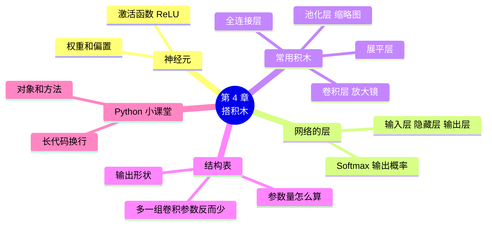

# 第 4 章 搭积木：构建神经网络

!!! abstract "本章学时"
    理论 5 学时（线上 4 + 线下 1）· 实验 1 学时（本章共 3 个实验，教师可任选）

## 学习目标

学完本章，你应该能够：

1. **说出**神经元、激活函数、全连接层、卷积层、池化层各自的作用（记忆）；
2. **解释**为什么识别图片要用卷积网络，而不是只用全连接层（理解）；
3. **运行**积木式代码搭出一个神经网络，并打印它的结构表（应用）；
4. **读懂**结构表中每层的输出形状和参数量，算出简单层的参数量（应用）；
5. **分析**增减层对参数量的影响（分析）。

!!! info "先修要求"
    学习本章前，你需要掌握：

    - 张量、形状和批的概念（[3.2 节](../03-data/index.md#32)）；
    - 两个版本中颜色通道放的位置（[3.2.3](../03-data/index.md#323)）；
    - 列表的写法（[2.4.3](../02-pretrained/index.md#243)）。

??? abstract "本章概念清单（10 个，点击查看定义和例子）"
    1. [神经元](../../appendix/glossary.md#g-神经元)
    2. [神经网络](../../appendix/glossary.md#g-神经网络)
    3. [激活函数](../../appendix/glossary.md#g-激活函数)
    4. [全连接层](../../appendix/glossary.md#g-全连接层)
    5. [Softmax](../../appendix/glossary.md#g-Softmax)
    6. [卷积层](../../appendix/glossary.md#g-卷积层)
    7. [池化层](../../appendix/glossary.md#g-池化层)
    8. [参数量](../../appendix/glossary.md#g-参数量)
    9. [对象](../../appendix/glossary.md#g-对象)
    10. [方法](../../appendix/glossary.md#g-方法)

## 情景导入

数据整理好了，小林问小周：“接下来是不是要写很复杂的程序，教电脑认花？”

小周打开一段代码给他看，只有十来行，每行一个词：`Conv2D`、`MaxPooling2D`、`Flatten`、`Dense`……“这就是一个能认花的神经网络。框架已经把各种零件做好了，你要做的就是挑几块积木，从上到下摞起来。”

“就这么简单？那每块积木是干什么的？摞几块合适？”

“这就是这一章要弄明白的。还有，搭好以后框架会给你一张‘结构表’，告诉你每一层出来的数据是什么形状、有多少个要学的数。会读这张表，你就算入门了。”

## 4.1 神经网络：一层一层传话的流水线 { #41 }

### 4.1.1 神经元：一个会打分的评委

神经网络里最小的零件叫[**神经元**](../../appendix/glossary.md#g-神经元 "神经网络中最小的计算单元，把输入的数各乘一个权重再相加、加上偏置，经过激活函数后输出一个数"){ .term }。它的工作很像一个打分的评委：

- 收到几个数（比如一朵花的花瓣长、花瓣宽）；
- 每个数乘一个“看重程度”，叫**权重**，看重的乘大一点，不看重的乘小一点；
- 加起来，再加一个“基础分”，叫**偏置**；
- 最后把总分交给下一关。

```text
总分 = 花瓣长 × 0.8 + 花瓣宽 × 0.5 + 0.1
```

这里的 0.8、0.5、0.1 就是第 2 章说的**模型参数**。刚搭好的网络，这些数是随便填的；训练，就是一点点调整它们，让评委打出的分越来越准。

### 4.1.2 层和网络：一级一级往下传

一个评委能力有限。把很多评委排成一排，叫一**层**；再把好几层排起来，前一层的打分交给后一层当输入，一层一层往下传，就组成了[**神经网络**](../../appendix/glossary.md#g-神经网络 "由许多神经元分层连接而成的模型，数据从输入层经过若干隐藏层传到输出层"){ .term }。


- **输入层**：接收原始数据，不做计算；
- **隐藏层**：中间那些层，从数据里一层层提炼出有用的信息，叫“隐藏”是因为它们的结果我们一般看不到；
- **输出层**：给出最终答案，要分几类，就有几个神经元。

这就像一条流水线：原料从一头进去，每道工序加工一下，另一头出来成品。

### 4.1.3 激活函数：评委的“门槛”

如果每个神经元只是乘一乘、加一加，那么不管摞多少层，效果都和一层差不多，学不会复杂的规律。所以每个神经元算完总分后，还要过一道“门槛”，叫[**激活函数**](../../appendix/glossary.md#g-激活函数 "神经元算出总分后再经过的一道变换，给网络加入“拐弯”的能力；最常用的是 ReLU"){ .term }。

最常用的激活函数叫 **ReLU**<sup class="cite">[[1]](#ref4-1)</sup>，规则简单到一句话：**负数变成 0，正数原样通过**。好比评委打分，觉得“完全不像”就直接给 0 分，不倒扣分。

```text
ReLU(3.5)  = 3.5
ReLU(-2.0) = 0
```

正是这道看似简单的门槛，让多层网络有了“拐弯”的能力，能学会复杂的规律。隐藏层一般都用 ReLU；输出层要用另一种，下一节讲。

## 4.2 第一个网络：用全连接层认鸢尾花 { #42 }

### 4.2.1 鸢尾花问题

先拿一个最简单的例子练手。**鸢尾花数据集**是统计学家费希尔 1936 年整理的<sup class="cite">[[2]](#ref4-2)</sup>：测量了三种鸢尾花各 50 朵的花萼长、花萼宽、花瓣长、花瓣宽，要根据这 4 个数判断是哪一种。它是机器学习里最经典的入门数据集。

输入是 4 个数，输出是 3 种花，中间放一层 8 个神经元。

### 4.2.2 全连接层：人人都和人人连

最基本的积木叫[**全连接层**](../../appendix/glossary.md#g-全连接层 "每个神经元都和上一层所有输出相连的层；Keras 中叫 Dense，飞桨中叫 Linear"){ .term }：这一层的每个神经元，都接收上一层**所有**的输出，就像开会时每个评委都要听取上一轮所有人的意见。

=== "通用版"

    ```python
    import keras
    from keras import layers
    model = keras.Sequential([
        keras.Input(shape=(4,)),                 # 输入层：每朵花 4 个数
        layers.Dense(8, activation="relu"),      # 隐藏层：8 个神经元，激活函数 ReLU
        layers.Dense(3, activation="softmax"),   # 输出层：3 种花各一个概率
    ])
    ```

    `keras.Sequential` 的意思是“按顺序摞起来”，方括号里从上到下写每一层<sup class="cite">[[3]](#ref4-3)</sup>。全连接层在 Keras 里叫 `Dense`（稠密的），括号里第一个数是神经元个数，`activation` 指定激活函数。

=== "国产版"

    ```python
    import paddle
    from paddle import nn
    net = nn.Sequential(
        nn.Linear(4, 8), nn.ReLU(),              # 隐藏层：4 个输入 → 8 个神经元，再过 ReLU
        nn.Linear(8, 3), nn.Softmax(),           # 输出层：8 个输入 → 3 种花各一个概率
    )
    ```

    `nn.Sequential` 的意思是“按顺序摞起来”，括号里从前到后写每一块积木<sup class="cite">[[4]](#ref4-4)</sup>。全连接层在飞桨里叫 `Linear`（线性的），要写两个数：**输入几个、输出几个**。激活函数在飞桨里是单独的一块积木，紧跟在后面。

两种写法的区别值得留意：

| | 通用版 Keras | 国产版飞桨 |
|---|---|---|
| 全连接层的名字 | `Dense` | `Linear` |
| 要写的数 | 只写输出个数，输入个数自动推算 | 输入、输出个数都要写 |
| 激活函数 | 写在层里：`activation="relu"` | 单独一块：`nn.ReLU()` |

### 4.2.3 输出层：把分数变成概率

输出层有 3 个神经元，各给一个分数，但分数可大可小、可正可负，不好理解。输出层的激活函数 [**Softmax**](../../appendix/glossary.md#g-Softmax "把一组分数变成加起来等于 1 的概率的函数，常用在分类网络的输出层"){ .term } 负责把它们变成**加起来等于 1 的概率**，分数越高，概率越大。第 2 章模型输出的“置信度”，就是 Softmax 算出来的。

还没训练的网络，参数是随便填的，所以它的回答也是乱猜的。实验 4-1 中，未训练的网络对一朵花的回答是：

```text
三种花的概率： [[0.006 0.106 0.888]]  加起来： 1.0
```

三个概率加起来正好是 1，但它说的“第 3 种花的可能性 88.8%”毫无根据，这朵花其实是第 1 种。要让它答对，就得训练，那是第 5 章的事。

## 4.3 卷积网络：用“放大镜”看图片 { #43 }

### 4.3.1 只用全连接层看图片，为什么不行

能不能把照片直接交给全连接层？一张 128×128 的彩色照片有 49152 个数。如果第一层有 64 个神经元，每个都要和 49152 个数相连，光这一层就要三百多万个参数，又慢又容易死记硬背。

更大的问题是，全连接层把照片当成一长串互不相干的数，看不出“哪些点挨在一起”。而认花恰恰要看挨在一起的点组成的形状：花瓣的边缘、花心的圆盘、叶子的纹理。

### 4.3.2 卷积层：拿着放大镜一格一格扫

[**卷积层**](../../appendix/glossary.md#g-卷积层 "用许多个小窗口（卷积核）在图片上逐格滑动、寻找局部特征的层；Keras 中叫 Conv2D"){ .term }的做法很像拿着一个小放大镜在照片上从左到右、从上到下一格一格地扫：

- 放大镜每次只看 3×3 的一小块；
- 每个放大镜专门找一种图案，比如“竖着的边”“黄色的圆点”；
- 扫完整张照片，就得到一张新的“图案地图”，记录这种图案在哪里出现得多。

一个卷积层通常有十几到几十个放大镜，各找各的图案。浅层的放大镜找边缘、颜色这些简单图案，深层的放大镜在前一层的“图案地图”上再找，就能拼出花瓣、花心这些复杂的样子。这种思路最早由杨立昆（Yann LeCun）等人在识别手写数字时提出并推广<sup class="cite">[[5]](#ref4-5)</sup>，现在是图像识别的标准做法。

放大镜有多大、有几个，就是卷积层要设定的两个数：

=== "通用版"

    ```python
    layers.Conv2D(16, 3, activation="relu")   # 16 个放大镜，每个 3×3，激活函数 ReLU
    ```

    输出形状的最后一个数（通道数）就是放大镜个数 16。

=== "国产版"

    ```python
    nn.Conv2D(3, 16, 3)    # 输入 3 个通道，16 个放大镜，每个 3×3
    nn.ReLU()              # 激活函数单独一块
    ```

    和 `Linear` 一样，飞桨的卷积层要写输入通道数：第一层的输入是彩色照片，所以是 3；下一层的输入就是上一层放大镜的个数。

放大镜不在边上“补边”时，3×3 的放大镜在 128 格宽的照片上只能停 126 个位置，所以每过一个卷积层，长和宽各减 2：128×128 变成 126×126。

### 4.3.3 池化层：缩略图，只留最明显的

[**池化层**](../../appendix/glossary.md#g-池化层 "把图片按小方块（如 2×2）缩小、只保留每块中最大值的层，用来缩小数据、保留明显特征"){ .term }把图案地图缩小：每 2×2 个格子只留一个最大的数，长和宽各缩小一半。好比把一张大照片做成缩略图，细节少了，但最明显的东西还在。

池化层没有要学的参数，它只是按固定规则缩小，好处是数据量变成原来的四分之一，后面的计算更快，也让网络对花的位置稍有挪动不那么敏感。

### 4.3.4 展平层：从“图片”变成“一长串”

卷积和池化处理的是“图片形状”的数据。到最后要交给全连接层做判断时，要先用**展平层**（Flatten）把它拉成一长串，就像把一摞卡片一张张首尾相接排成一行。

### 4.3.5 搭出花卉卷积网络

把这些积木组合起来：三组“卷积 + 池化”找图案、缩小，再展平，最后用两个全连接层做判断。

=== "通用版"

    ```python
    model = keras.Sequential([
        keras.Input(shape=(128, 128, 3)),            # 输入：128×128 的彩色照片
        layers.Rescaling(1 / 255),                   # 把 0～255 缩到 0～1
        layers.Conv2D(16, 3, activation="relu"),     # 第一组：卷积 + 池化
        layers.MaxPooling2D(),
        layers.Conv2D(32, 3, activation="relu"),     # 第二组
        layers.MaxPooling2D(),
        layers.Conv2D(64, 3, activation="relu"),     # 第三组
        layers.MaxPooling2D(),
        layers.Flatten(),                            # 展平
        layers.Dense(64, activation="relu"),         # 全连接层
        layers.Dense(5, activation="softmax"),       # 输出层：5 种花
    ])
    ```

    第 3 章说过，`image_dataset_from_directory` 读出来的像素是 0～255。这里第一块积木 `Rescaling(1 / 255)` 就把归一化放进了网络里，以后预测新照片时也不会忘了这一步。

=== "国产版"

    ```python
    net = nn.Sequential(
        nn.Conv2D(3, 16, 3), nn.ReLU(), nn.MaxPool2D(2),     # 第一组：卷积 + 激活 + 池化
        nn.Conv2D(16, 32, 3), nn.ReLU(), nn.MaxPool2D(2),    # 第二组
        nn.Conv2D(32, 64, 3), nn.ReLU(), nn.MaxPool2D(2),    # 第三组
        nn.Flatten(),                                        # 展平
        nn.Linear(64 * 14 * 14, 64), nn.ReLU(),              # 全连接层
        nn.Linear(64, 5), nn.Softmax(),                      # 输出层：5 种花
    )
    ```

    第 3 章的 `T.ToTensor()` 已经把像素缩到了 0～1，所以网络里不用再归一化。`nn.Linear(64 * 14 * 14, 64)` 的输入个数要自己算：最后一个池化层输出 64 个通道、14×14 大小，展平后是 12544 个数。这个数算错了就会报错，4.5.3 节有对照。

## 4.4 读懂网络结构表 { #44 }

### 4.4.1 打印结构表

网络搭好后，用一行代码就能打印出它的结构表：

=== "通用版"

    ```python
    model.summary()
    ```

    ```text
    ┏━━━━━━━━━━━━━━━━━━━━━━━━━━━━━━━━━┳━━━━━━━━━━━━━━━━━━━━━━━━┳━━━━━━━━━━━━━━━┓
    ┃ Layer (type)                    ┃ Output Shape           ┃       Param # ┃
    ┡━━━━━━━━━━━━━━━━━━━━━━━━━━━━━━━━━╇━━━━━━━━━━━━━━━━━━━━━━━━╇━━━━━━━━━━━━━━━┩
    │ rescaling (Rescaling)           │ (None, 128, 128, 3)    │             0 │
    │ conv2d (Conv2D)                 │ (None, 126, 126, 16)   │           448 │
    │ max_pooling2d (MaxPooling2D)    │ (None, 63, 63, 16)     │             0 │
    │ conv2d_1 (Conv2D)               │ (None, 61, 61, 32)     │         4,640 │
    │ max_pooling2d_1 (MaxPooling2D)  │ (None, 30, 30, 32)     │             0 │
    │ conv2d_2 (Conv2D)               │ (None, 28, 28, 64)     │        18,496 │
    │ max_pooling2d_2 (MaxPooling2D)  │ (None, 14, 14, 64)     │             0 │
    │ flatten (Flatten)               │ (None, 12544)          │             0 │
    │ dense (Dense)                   │ (None, 64)             │       802,880 │
    │ dense_1 (Dense)                 │ (None, 5)              │           325 │
    └─────────────────────────────────┴────────────────────────┴───────────────┘
     Total params: 826,789 (3.15 MB)
    ```

    为了排版紧凑，这里去掉了行与行之间的分隔线。形状里的 `None` 表示“张数不固定”，一批几张都可以。

=== "国产版"

    ```python
    paddle.summary(net, (1, 3, 128, 128))     # 要告诉它输入形状：1 张、3 通道、128×128
    ```

    ```text
     Layer (type)       Input Shape          Output Shape         Param #
    ===========================================================================
       Conv2D-1      [[1, 3, 128, 128]]   [1, 16, 126, 126]         448
        ReLU-1      [[1, 16, 126, 126]]   [1, 16, 126, 126]          0
      MaxPool2D-1   [[1, 16, 126, 126]]    [1, 16, 63, 63]           0
       Conv2D-2      [[1, 16, 63, 63]]     [1, 32, 61, 61]         4,640
    ……（中间略）
       Flatten-1     [[1, 64, 14, 14]]        [1, 12544]             0
       Linear-1         [[1, 12544]]           [1, 64]            802,880
       Linear-2          [[1, 64]]              [1, 5]              325
    ===========================================================================
    Total params: 826,789
    ```

    飞桨的表多了一列输入形状，激活函数也各占一行。通道数在前，所以 `[1, 16, 126, 126]` 表示 1 张、16 个通道、126×126。

两个版本搭的是同一个网络，所以每层的参数量和总参数量完全一样：**826,789**。

### 4.4.2 一行一行读

读结构表，就是顺着数据的流向，看它每过一层变成了什么样子：

| 经过 | 形状变化（只看高、宽、通道） | 说明 |
|---|---|---|
| 输入 | 128 × 128 × 3 | 一张彩色照片 |
| 卷积 16 | 126 × 126 × 16 | 边长减 2，通道变成放大镜个数 |
| 池化 | 63 × 63 × 16 | 边长减半 |
| 卷积 32 → 池化 | 61 × 61 × 32 → 30 × 30 × 32 | 61 除以 2 不尽，舍去小数 |
| 卷积 64 → 池化 | 28 × 28 × 64 → 14 × 14 × 64 | |
| 展平 | 12544 | 14 × 14 × 64 = 12544 |
| 全连接 64 | 64 | |
| 输出 | 5 | 5 种花各一个概率 |

### 4.4.3 参数量是怎么算出来的

[**参数量**](../../appendix/glossary.md#g-参数量 "模型中所有要在训练中学习的数（权重和偏置）的总个数，反映模型的大小"){ .term }就是这个网络里所有要学的数（权重和偏置）一共有多少个。会算两种层就够了：

- **全连接层** =（输入个数 + 1）× 神经元个数。“+1”是每个神经元的偏置。
    - 鸢尾花网络隐藏层：(4 + 1) × 8 = 40；输出层：(8 + 1) × 3 = 27；合计 67。
    - 花卉网络输出层：(64 + 1) × 5 = 325。
- **卷积层** =（3 × 3 × 输入通道数 + 1）× 放大镜个数。
    - 第一个卷积层：(3 × 3 × 3 + 1) × 16 = 448。
- 池化层、展平层、Rescaling 层没有要学的参数，是 0。

再看一眼结构表就会发现：全连接层 `dense` 一层就有 802,880 个参数，占了全部的 97%。因为它的输入是展平后的 12544 个数，每个神经元都要和这 12544 个数相连。

### 4.4.4 动手搭一搭

下面的动画可以随意增减积木，实时算出结构表。试试点“少一组卷积”：卷积层少了，参数是变多还是变少？

<iframe class="sim-frame" src="../../sims/layer-blocks/main.html" height="620" loading="lazy" title="搭积木：网络结构表"></iframe>

[全屏打开动画](../../sims/layer-blocks/main.html){ target=_blank }

答案可能出乎意料：少一组“卷积 + 池化”，图片没有缩小到 14×14，展平后有 28800 个数，后面的全连接层参数暴涨，总参数量从 83 万增加到 185 万。**参数多不一定好**，参数越多，模型越容易死记硬背，训练也越慢。第 6 章会再讨论这个问题。

## 4.5 Python 小课堂④：对象、方法和长代码换行 { #45 }

### 4.5.1 对象和方法：点号后面是“它会做的事”

`model = keras.Sequential([...])` 这一行做出来的 `model`，在 Python 里叫一个[**对象**](../../appendix/glossary.md#g-对象 "程序中把数据和它能做的操作打包在一起的东西，如搭好的模型 model"){ .term }。对象既装着数据（各层和参数），又会做一些事。它会做的事叫[**方法**](../../appendix/glossary.md#g-方法 "属于某个对象的函数，用“对象.方法名()”调用"){ .term }，用“对象.方法名()”来调用：

```python
model.summary()          # 让模型打印结构表
model.predict(flower)    # 让模型预测
model.count_params()     # 让模型数一数自己有多少参数
```

点号可以读成“的”：`model.summary()` 就是“模型的打印结构表功能”。第 5 章还会用到 `model.compile()`、`model.fit()`、`model.save()`。

`keras.layers.Dense`、`paddle.nn.Linear` 里的点号意思类似，表示“keras 工具箱里的 layers 抽屉里的 Dense”。

### 4.5.2 长代码换行：括号没关上就可以接着写

搭网络的代码很长，一行写不下。Python 的规则是：**圆括号、方括号没有关上，就可以换行接着写**，换行后的缩进只是为了好看。每块积木后面的逗号不能漏，漏了就会报错。

```python
model = keras.Sequential([          # 方括号开始
    layers.Dense(8, activation="relu"),
    layers.Dense(3, activation="softmax"),
])                                  # 方括号和圆括号都关上，这条语句才结束
```

### 4.5.3 本章常见报错对照

| 报错原文 | 用大白话说 | 怎么改 |
|---|---|---|
| `SyntaxError: invalid syntax. Perhaps you forgot a comma?` | 语法错误，可能漏了逗号 | 检查每块积木后面有没有逗号 |
| `Could not interpret activation function identifier: softmx` | 不认识这个激活函数的名字 | 检查拼写，应该是 `"softmax"`、`"relu"` |
| `expected axis -1 of input shape to have value 4, but received input with shape (1, 3)` | 网络要 4 个数，你只给了 3 个 | 输入的个数要和 `keras.Input(shape=(4,))` 一致 |
| 飞桨：`the [1] dimension of Input(X) must be equal to the [0] dimension of Input(Y). But receiving ... [63504] ... [12544]` | 展平后实际有 63504 个数，全连接层却写成 12544 个输入 | 按结构表重新算展平后的个数，改 `nn.Linear` 的第一个数 |
| 飞桨：`The number of input's channels should be equal to filter's channels` | 卷积层写的输入通道数和上一层输出的不一样 | 每个 `nn.Conv2D` 的第一个数，要等于上一个卷积层的第二个数 |

## 4.6 前沿视窗：从几十万到几千亿参数 { #46 }

本章的花卉网络有 83 万个参数，保存下来约 3 MB。第 2 章的 MobileNetV2 约有 350 万个参数。而今天的大语言模型，参数量动辄几百亿、几千亿：2020 年的 GPT-3 有 1750 亿个参数<sup class="cite">[[6]](#ref4-6)</sup>，国产开源的 DeepSeek-V3 总参数量达到 6710 亿<sup class="cite">[[7]](#ref4-7)</sup>。

参数量这么大，靠的仍然是本章这些积木的思路：一层一层摞起来，只是层数更多、每层更宽，换成了更适合处理文字的 Transformer 积木（“自然语言处理导论”课程会讲）。大模型的参数文件要几百 GB，训练要成千上万块 GPU 算上几个月。

另一个方向恰恰相反：把模型做小。手机、摄像头、汽车里的芯片算力有限，于是有了 MobileNet、PP-LCNet 这类“轻量级”网络，以及第 11 章会介绍的模型压缩。对大多数实际应用来说，**够用、跑得快**往往比“越大越好”更重要。

## 本章实验

!!! abstract "实验总览"
    | 实验 | 类型 | 建议时长 | 内容 |
    |---|---|---|---|
    | 实验 4-1 | ★ 必做 | 15 分钟 | 搭一个三层网络，看懂结构表 |
    | 实验 4-2 | ★ 必做 | 25 分钟 | 搭一个识别花卉的卷积网络，喂一批照片 |
    | 实验 4-3 | ☆ 选做 | 20 分钟 | 加减层，看参数量怎么变 |

    代码见配套资源 `labs/ch04/` 目录（`keras/` 通用版，`paddle/` 国产版）。

### 实验 4-1 ★ 搭一个三层网络，看懂结构表 { #4-1 }

**实验目的**

1. 学会用 `Sequential` 搭网络；
2. 读懂结构表，验证参数量的算法。

**实验环境**：云端 Notebook 或本机，CPU 即可。

**实验数据**：一朵鸢尾花的 4 个测量值（写在代码里）。

**实验步骤与代码**

第一档 · 跑通：打开 `lab4_1_three_layers.ipynb`，依次运行三个单元格。

=== "通用版"

    ```python
    import keras
    from keras import layers
    keras.utils.set_random_seed(42)                # 固定随机种子，让结果和书上一样
    model = keras.Sequential([
        keras.Input(shape=(4,)),                    # 输入层：每朵花 4 个数
        layers.Dense(8, activation="relu"),         # 隐藏层：8 个神经元   ← 改这里
        layers.Dense(3, activation="softmax"),      # 输出层：3 种鸢尾花各一个概率
    ])
    model.summary()                                 # 每层的输出形状和参数量
    import numpy as np
    flower = np.array([[5.1, 3.5, 1.4, 0.2]])       # 一朵花的 4 个测量值（厘米）
    prob = model.predict(flower, verbose=0)         # 交给网络
    print("三种花的概率：", prob.round(3), " 加起来：", prob.sum().round(3))
    ```

    完整代码：`labs/ch04/keras/lab4_1_three_layers.ipynb`

=== "国产版"

    ```python
    import paddle
    from paddle import nn
    paddle.seed(42)                                 # 固定随机种子，让结果和书上一样
    net = nn.Sequential(
        nn.Linear(4, 8), nn.ReLU(),                 # 隐藏层：4 个输入 → 8 个神经元   ← 改这里
        nn.Linear(8, 3), nn.Softmax(),              # 输出层：3 种鸢尾花各一个概率
    )
    paddle.summary(net, (1, 4))                     # 输入形状：1 朵花、4 个数
    flower = paddle.to_tensor([[5.1, 3.5, 1.4, 0.2]])   # 一朵花的 4 个测量值（厘米）
    prob = net(flower)                                  # 交给网络
    print("三种花的概率：", prob.numpy().round(3), " 加起来：", prob.sum().numpy().round(3))
    ```

    完整代码：`labs/ch04/paddle/lab4_1_three_layers.ipynb`

**运行结果**

=== "通用版"

    ```text
    │ dense (Dense)                   │ (None, 8)              │            40 │
    │ dense_1 (Dense)                 │ (None, 3)              │            27 │
     Total params: 67 (268.00 B)
    三种花的概率： [[0.006 0.106 0.888]]  加起来： 1.0
    ```

=== "国产版"

    ```text
       Linear-1           [[1, 4]]              [1, 8]              40
        ReLU-1            [[1, 8]]              [1, 8]               0
       Linear-2           [[1, 8]]              [1, 3]              27
       Softmax-1          [[1, 3]]              [1, 3]               0
    Total params: 67
    三种花的概率： [[0. 0. 1.]]  加起来： 1.0
    ```

两个版本的参数量都是 67，和 4.4.3 节算的一样。概率不同，是因为两个框架随便填的初始参数不一样；反正都是没训练的乱猜，这朵花其实是第 1 种（山鸢尾）。

第二档 · 改一改：

1. 把隐藏层的 8 个神经元改成 16 个（国产版两处都要改：`nn.Linear(4, 16)` 和 `nn.Linear(16, 3)`），先自己算参数量，再运行验证；
2. 在隐藏层后面再加一层 8 个神经元的全连接层，算一算总参数量；
3. 去掉 `set_random_seed`（国产版去掉 `paddle.seed`）运行两次，看概率是否每次都不同。

**实验记录表**

| 网络结构 | 自己算的参数量 | 结构表显示的参数量 |
|---|---|---|
| 4 → 8 → 3 | 67 | 67 |
| 4 → 16 → 3 | | |
| 4 → 8 → 8 → 3 | | |

**常见问题排查**

| 现象 | 原因 | 解决办法 |
|---|---|---|
| `SyntaxError ... forgot a comma?` | 积木之间漏了逗号 | 每块积木后面加逗号 |
| 国产版改成 16 后报 `must be equal to` | 只改了一处，上下两层的个数对不上 | 前一层的输出个数 = 后一层的输入个数 |

**思考与练习**

1. 每次运行未训练网络的输出都不一样，说明了什么？

**实验报告要求**

提交结构表截图和实验记录表。

### 实验 4-2 ★ 搭一个识别花卉的卷积网络 { #4-2 }

**实验目的**

1. 搭出本书的花卉卷积网络；
2. 喂进一批照片，验证输入、输出的形状。

**实验环境**：云端 Notebook 或本机，CPU 即可。

**实验数据**：`labs/data/flowers_small/`。

**实验步骤与代码**

第一档 · 跑通：打开 `lab4_2_flower_cnn.ipynb`，依次运行三个单元格。第一个单元格就是 4.3.5 节的网络，第二个单元格打印结构表（见 4.4.1 节）。第三个单元格喂一批照片：

=== "通用版"

    ```python
    DATA = "../../data/flowers_small"
    ds = keras.utils.image_dataset_from_directory(DATA, image_size=(128, 128), batch_size=8, seed=42)
    images, labels = next(iter(ds))                 # 取一批 8 张
    out = model.predict(images, verbose=0)
    print("输入形状：", images.shape, " 输出形状：", out.shape)
    print("第 1 张照片的 5 个概率：", out[0].round(3))
    ```

    完整代码：`labs/ch04/keras/lab4_2_flower_cnn.ipynb`

=== "国产版"

    ```python
    from paddle.vision import transforms as T
    from paddle.vision.datasets import DatasetFolder
    ds = DatasetFolder("../../data/flowers_small", transform=T.Compose([T.Resize((128, 128)), T.ToTensor()]))
    images, labels = next(iter(paddle.io.DataLoader(ds, batch_size=8, shuffle=True)))  # 取一批 8 张
    out = net(images)
    print("输入形状：", images.shape, " 输出形状：", out.shape)
    print("第 1 张照片的 5 个概率：", out[0].numpy().round(3))
    ```

    完整代码：`labs/ch04/paddle/lab4_2_flower_cnn.ipynb`

**运行结果**

=== "通用版"

    ```text
    Found 750 files belonging to 5 classes.
    输入形状： (8, 128, 128, 3)  输出形状： (8, 5)
    第 1 张照片的 5 个概率： [0.193 0.197 0.194 0.202 0.215]
    ```

=== "国产版"

    ```text
    输入形状： paddle.Size([8, 3, 128, 128])  输出形状： paddle.Size([8, 5])
    第 1 张照片的 5 个概率： [0.171 0.371 0.249 0.143 0.066]
    ```

8 张照片进去，出来 8 行、每行 5 个概率。通用版 5 个概率都在 0.2 左右，等于“五种花各 20%，我也不知道”，这正是没训练的网络该有的样子。

第二档 · 改一改：

1. 把 `batch_size=8` 改成 16，看输出形状怎么变；
2. 把第一个卷积层的 16 个放大镜改成 8 个（国产版要同时改下一个卷积层的输入通道数），对照结构表看哪几行变了。

**实验记录表**

| 修改 | 输出形状 | 第一个卷积层参数量 | 总参数量 |
|---|---|---|---|
| 原始网络 | (8, 5) | 448 | 826,789 |
| 批大小 16 | | | |
| 第一层改为 8 个放大镜 | | | |

**常见问题排查**

| 现象 | 原因 | 解决办法 |
|---|---|---|
| 国产版报 `must be equal to the [0] dimension of Input(Y)` | 改了卷积层后，展平后的个数变了，`nn.Linear` 的输入个数没跟着改 | 用 `paddle.summary` 看展平层的输出，改 `nn.Linear` 的第一个数 |
| 通用版报 `Found 0 files` | 数据路径不对 | 见实验 3-2 的排查表 |

**思考与练习**

1. 改变批大小，参数量会变吗？为什么？

**实验报告要求**

提交结构表截图、运行结果截图和实验记录表。

### 实验 4-3 ☆ 加减层，看参数量怎么变 { #4-3 }

**实验目的**

1. 体会网络结构和参数量的关系；
2. 理解“多一组卷积，参数反而少”的原因。

**实验环境**：云端 Notebook 或本机，CPU 即可。

**实验步骤与代码**

第一档 · 跑通：打开 `lab4_3_count_params.ipynb`。代码把网络写成了“可调”的样子：改 `FILTERS` 和 `DENSE` 两行，就能搭出不同的网络。

=== "通用版"

    ```python
    FILTERS = [16, 32, 64]                          # ← 改这里：每个卷积层几个放大镜，也可以加减个数
    DENSE = 64                                      # ← 改这里：全连接层几个神经元
    blocks = []
    for n in FILTERS:                               # 每个数搭一组“卷积 + 池化”
        blocks += [layers.Conv2D(n, 3, activation="relu"), layers.MaxPooling2D()]
    model = keras.Sequential([keras.Input(shape=(128, 128, 3)), *blocks,
                              layers.Flatten(), layers.Dense(DENSE, activation="relu"),
                              layers.Dense(5, activation="softmax")])
    print("总参数量：", f"{model.count_params():,}")
    ```

    `*blocks` 的意思是把列表 `blocks` 里的积木一块块“倒”进来。完整代码：`labs/ch04/keras/lab4_3_count_params.ipynb`

=== "国产版"

    ```python
    FILTERS = [16, 32, 64]                          # ← 改这里：每个卷积层几个放大镜，也可以加减个数
    DENSE = 64                                      # ← 改这里：全连接层几个神经元
    blocks, c, size = [], 3, 128                    # c：当前通道数；size：当前边长
    for n in FILTERS:                               # 每个数搭一组“卷积 + 池化”
        blocks += [nn.Conv2D(c, n, 3), nn.ReLU(), nn.MaxPool2D(2)]
        c, size = n, (size - 2) // 2                # 卷积边长减 2，池化再减半
    net = nn.Sequential(*blocks, nn.Flatten(), nn.Linear(c * size * size, DENSE), nn.ReLU(),
                        nn.Linear(DENSE, 5), nn.Softmax())
    print("总参数量：", f"{sum(int(p.numel()) for p in net.parameters()):,}")
    ```

    代码自动推算每层的输入通道数和展平后的个数，`//` 是“除完只取整数部分”。完整代码：`labs/ch04/paddle/lab4_3_count_params.ipynb`

**运行结果**（两个版本完全一样）

```text
卷积层设置： [16, 32, 64]  全连接： 64
展平后有 12544 个数
总参数量： 826,789
```

第二档 · 改一改：按下表修改 `FILTERS`，记录结果。编者的运行结果已经填了两行。

**实验记录表**

| FILTERS | 展平后的个数 | 总参数量 |
|---|---|---|
| [16, 32, 64] | 12544 | 826,789 |
| [16, 32] | 28800 | 1,848,677 |
| [16, 32, 64, 128] | | |
| [32, 64, 128] | | |

第三档 · 挑战（选做）：在不改 `FILTERS` 的情况下，把 `DENSE` 改成多少，总参数量能降到 20 万以下？

**常见问题排查**

| 现象 | 原因 | 解决办法 |
|---|---|---|
| `FILTERS` 写了 6 个数后报错 | 每组都让图片变小，到第 6 组时图片只剩 2×2，3×3 的放大镜放不下了 | 128×128 的输入最多放 5 组 |

**思考与练习**

1. 从记录表看，卷积层越多，总参数量是越多还是越少？为什么？

**实验报告要求**

提交实验记录表，并用两三句话回答思考题。

## 本章小结

- **神经元**把输入乘上权重、加上偏置，再经过**激活函数**输出；权重和偏置就是要学的参数。
- 很多神经元排成层，很多层摞起来就是**神经网络**：输入层、隐藏层、输出层。
- **ReLU** 把负数变成 0，用在隐藏层；**Softmax** 把分数变成加起来为 1 的概率，用在分类的输出层。
- **全连接层**（Dense / Linear）每个神经元连上一层所有输出；**卷积层**（Conv2D）用小放大镜扫图片找图案；**池化层**把图片缩小一半；**展平层**把图片拉成一长串。
- Keras 只写输出个数、激活函数写在层里；飞桨输入输出都要写、激活函数单独一块。
- 结构表列出每层的输出形状和**参数量**。全连接层参数 =（输入 + 1）× 神经元数；卷积层参数 =（3 × 3 × 输入通道 + 1）× 放大镜数。
- 花卉网络 826,789 个参数，97% 在第一个全连接层；少一组卷积，参数反而更多。
- Python：**对象**和**方法**（点号），括号没关上可以换行。



**下一章预告**

网络搭好了，但它还只会乱猜。下一章我们给它“上课”：设定用什么标准判断答得好不好、用什么方法改进，然后调用 `fit`，看着它的准确率一轮一轮地提高。我们还会打开 `fit` 这个黑盒子，看看每一轮训练里到底发生了哪五个步骤。

## 参考文献

正文中的上标编号（如<sup class="cite">[[1]](#ref4-1)</sup>）对应下面的文献。带链接的可以直接打开；书籍可在图书馆或电子书平台查阅。

<div class="refs" markdown>

**经典论文**

- <span id="ref4-1"></span>[1] NAIR V, HINTON G E. Rectified Linear Units Improve Restricted Boltzmann Machines[C]//Proceedings of the 27th International Conference on Machine Learning. Haifa: Omnipress, 2010: 807-814.
    <span class="ref-note">ReLU 激活函数的代表性论文，对应 4.1.3 节。</span>
- <span id="ref4-2"></span>[2] FISHER R A. The Use of Multiple Measurements in Taxonomic Problems[J]. Annals of Eugenics, 1936, 7(2): 179-188.
    <span class="ref-note">鸢尾花数据集的出处，对应 4.2.1 节。</span>
- <span id="ref4-5"></span>[5] LECUN Y, BOTTOU L, BENGIO Y, et al. Gradient-Based Learning Applied to Document Recognition[J]. Proceedings of the IEEE, 1998, 86(11): 2278-2324.
    <span class="ref-note">卷积神经网络 LeNet-5 的论文，卷积层加池化层的经典结构由此推广，对应 4.3.2 节。</span>
- <span id="ref4-6"></span>[6] BROWN T B, MANN B, RYDER N, et al. Language Models are Few-Shot Learners[C]//Advances in Neural Information Processing Systems 33. Online: Curran Associates, 2020: 1877-1901.
    <span class="ref-note">GPT-3 的论文，1750 亿参数，对应 4.6 节。</span>
- <span id="ref4-7"></span>[7] DeepSeek-AI. DeepSeek-V3 Technical Report[EB/OL]. (2024-12-27)[2026-10-31]. <https://arxiv.org/abs/2412.19437>.
    <span class="ref-note">国产开源大模型 DeepSeek-V3 的技术报告，总参数 6710 亿，对应 4.6 节。</span>

**在线资源**

- <span id="ref4-3"></span>[3] Keras. The Sequential model[EB/OL]. [2026-10-31]. <https://keras.io/guides/sequential_model/>.
    <span class="ref-note">Keras 官方的 Sequential 入门指南，对应 4.2.2 节。</span>
- <span id="ref4-4"></span>[4] 飞桨. 模型组网[EB/OL]. [2026-10-31]. <https://www.paddlepaddle.org.cn/documentation/docs/zh/guides/beginner/model_cn.html>.
    <span class="ref-note">飞桨官方入门教程，讲 nn.Sequential 和常用层，对应 4.2.2 节。</span>

</div>

## 课后练习

选择题和判断题可以直接点击选项作答，系统会马上告诉你对错，并展开答案与解析；多选题选好后点“提交答案”。简答和实操题请先自己作答，再点开“答案与解析”核对。每道题的解析下方都有“回看”链接，做错了可以直接跳回正文复习。

**一、单项选择题**

<div class="quiz" data-answer="B" markdown>

**1.** ReLU 激活函数的规则是（　　）。

- A. 正数变成 0，负数原样通过
- B. 负数变成 0，正数原样通过
- C. 所有数都变成 0～1 之间
- D. 所有数加起来等于 1

</div>

??? tip "答案与解析"
    **答案：B**

    ReLU：负数变 0，正数不变。D 说的是 Softmax 输出的特点。

    考查：激活函数 · 认知层次：记忆 · [回看 4.1.3](#413)
    { .quiz-meta }

<div class="quiz" data-answer="C" markdown>

**2.** 一个分 5 类的图片分类网络，输出层一般有（　　）个神经元。

- A. 1
- B. 3
- C. 5
- D. 64

</div>

??? tip "答案与解析"
    **答案：C**

    要分几类，输出层就有几个神经元，每类一个概率。

    考查：输出层 · 认知层次：理解 · [回看 4.1.2](#412)
    { .quiz-meta }

<div class="quiz" data-answer="A" markdown>

**3.** 全连接层的输入有 10 个数，有 4 个神经元，它的参数量是（　　）。

- A. 44
- B. 40
- C. 14
- D. 50

</div>

??? tip "答案与解析"
    **答案：A**

    （10 + 1）× 4 = 44，“+1”是每个神经元的偏置。

    考查：参数量计算 · 认知层次：应用 · [回看 4.4.3](#443)
    { .quiz-meta }

<div class="quiz" data-answer="D" markdown>

**4.** 一张 64×64 的特征图经过一个 2×2 的池化层后，大小变成（　　）。

- A. 62×62
- B. 64×64
- C. 16×16
- D. 32×32

</div>

??? tip "答案与解析"
    **答案：D**

    池化层长宽各缩小一半。A 是 3×3 卷积层（不补边）的结果。

    考查：池化层 · 认知层次：应用 · [回看 4.3.3](#433)
    { .quiz-meta }

<div class="quiz" data-answer="B" markdown>

**5.** 在卷积层和全连接层之间，必须先加（　　）。

- A. 池化层
- B. 展平层
- C. Softmax
- D. 另一个卷积层

</div>

??? tip "答案与解析"
    **答案：B**

    卷积层输出的是“图片形状”的数据，要先展平成一长串，才能交给全连接层。

    考查：展平层 · 认知层次：理解 · [回看 4.3.4](#434)
    { .quiz-meta }

<div class="quiz" data-answer="C" markdown>

**6.** 下列关于飞桨 `nn.Linear(8, 3)` 的说法，正确的是（　　）。

- A. 有 8 个神经元、3 个输入
- B. 相当于 Keras 的 `Conv2D(3, 8)`
- C. 有 8 个输入、3 个神经元
- D. 已经包含了 ReLU 激活函数

</div>

??? tip "答案与解析"
    **答案：C**

    飞桨全连接层先写输入个数，再写输出个数；激活函数要单独加。它相当于 Keras 的 `Dense(3)`。

    考查：两个版本的写法 · 认知层次：理解 · [回看 4.2.2](#422)
    { .quiz-meta }

<div class="quiz" data-answer="A" markdown>

**7.** 本书花卉网络的结构表中，参数最多的一层是（　　）。

- A. 展平后的第一个全连接层
- B. 第一个卷积层
- C. 池化层
- D. 输出层

</div>

??? tip "答案与解析"
    **答案：A**

    它的输入是展平后的 12544 个数，有 802,880 个参数，约占全部的 97%。

    考查：读结构表 · 认知层次：分析 · [回看 4.4.3](#443)
    { .quiz-meta }

<div class="quiz" data-answer="D" markdown>

**8.** `model.summary()` 中点号后面的 `summary()` 是（　　）。

- A. 一个变量
- B. 一个字符串
- C. 一个模块
- D. 对象 model 的一个方法

</div>

??? tip "答案与解析"
    **答案：D**

    “对象.方法名()”表示让对象做一件事，这里是打印结构表。

    考查：对象和方法 · 认知层次：理解 · [回看 4.5.1](#451)
    { .quiz-meta }

**二、多项选择题**

<div class="quiz quiz-multi" data-answer="ABD" markdown>

**1.** 识别图片时用卷积层而不是只用全连接层，原因有（　　）。

- A. 全连接层直接接收整张照片，参数太多
- B. 卷积层能发现挨在一起的点组成的图案
- C. 卷积层没有任何参数需要学习
- D. 卷积层的放大镜在整张图上反复使用，参数少

</div>

??? tip "答案与解析"
    **答案：ABD**

    卷积层有参数（放大镜里的数），只是比全连接层少得多。

    考查：卷积网络 · 认知层次：理解 · [回看 4.3.1](#431)
    { .quiz-meta }

<div class="quiz quiz-multi" data-answer="BC" markdown>

**2.** 下列层中，没有要学习的参数的有（　　）。

- A. 卷积层
- B. 池化层
- C. 展平层
- D. 全连接层

</div>

??? tip "答案与解析"
    **答案：BC**

    池化层和展平层只是按固定规则缩小、重排，结构表里参数量都是 0。

    考查：参数量 · 认知层次：理解 · [回看 4.4.3](#443)
    { .quiz-meta }

<div class="quiz quiz-multi" data-answer="ACD" markdown>

**3.** 关于 Keras 和飞桨搭网络的写法，正确的有（　　）。

- A. 都可以用 `Sequential` 把积木按顺序摞起来
- B. 飞桨的全连接层只写输出个数
- C. Keras 的激活函数可以写在层的 `activation` 参数里
- D. 同样结构的网络，两个框架算出的参数量一样

</div>

??? tip "答案与解析"
    **答案：ACD**

    飞桨的 `nn.Linear` 输入、输出个数都要写。

    考查：两个版本的写法 · 认知层次：理解 · [回看 4.2.2](#422)
    { .quiz-meta }

**三、判断题**

<div class="quiz quiz-judge" data-answer="×" markdown>

**1.** 网络刚搭好、还没训练时，就能给出准确的预测。

- √ 正确
- × 错误

</div>

??? tip "答案与解析"
    **答案：×**

    刚搭好的网络参数是随机填的，预测是乱猜，要训练后才准。

    考查：参数与训练 · 认知层次：理解 · [回看 4.2.3](#423)
    { .quiz-meta }

<div class="quiz quiz-judge" data-answer="√" markdown>

**2.** Softmax 输出的一组概率加起来等于 1。

- √ 正确
- × 错误

</div>

??? tip "答案与解析"
    **答案：√**

    这正是它适合做分类输出层的原因。

    考查：Softmax · 认知层次：记忆 · [回看 4.2.3](#423)
    { .quiz-meta }

<div class="quiz quiz-judge" data-answer="√" markdown>

**3.** 3×3 的卷积层不补边时，128×128 的输入会变成 126×126。

- √ 正确
- × 错误

</div>

??? tip "答案与解析"
    **答案：√**

    3×3 的放大镜在 128 格宽的图上只能停 126 个位置。

    考查：卷积层的输出形状 · 认知层次：应用 · [回看 4.3.2](#432)
    { .quiz-meta }

<div class="quiz quiz-judge" data-answer="×" markdown>

**4.** 网络的参数越多，效果就一定越好。

- √ 正确
- × 错误

</div>

??? tip "答案与解析"
    **答案：×**

    参数越多越容易死记硬背，训练也越慢。合适最重要。

    考查：参数量 · 认知层次：评价 · [回看 4.4.4](#444)
    { .quiz-meta }

<div class="quiz quiz-judge" data-answer="√" markdown>

**5.** 改变批大小，不会改变网络的参数量。

- √ 正确
- × 错误

</div>

??? tip "答案与解析"
    **答案：√**

    参数量由网络结构决定。批大小只决定一次喂几张照片，结构表中表示张数的 `None` 可以是任意数。

    考查：批与参数量 · 认知层次：理解 · [回看 4.4.1](#441)
    { .quiz-meta }

**四、简答题**

**1.** 用“评委打分”的比喻，说明一个神经元做了哪几件事。

??? tip "答案与解析"
    **参考答案：** ① 收到上一层的几个数；② 每个数乘一个权重（看重程度）后加起来；③ 再加上偏置（基础分）；④ 经过激活函数（门槛，如 ReLU 把负分变成 0）后，把结果交给下一层。权重和偏置就是训练要调整的参数。

    考查：神经元 · 认知层次：理解 · [回看 4.1.1](#411)
    { .quiz-meta }

**2.** 写出花卉网络中一张照片从输入到输出，形状依次经过的变化（只写高、宽、通道或个数）。

??? tip "答案与解析"
    **参考答案：** 128×128×3 → 卷积 126×126×16 → 池化 63×63×16 → 卷积 61×61×32 → 池化 30×30×32 → 卷积 28×28×64 → 池化 14×14×64 → 展平 12544 → 全连接 64 → 输出 5。

    考查：读结构表 · 认知层次：应用 · [回看 4.4.2](#442)
    { .quiz-meta }

**3.** 为什么把花卉网络的卷积层从三组减少到两组，总参数量反而从 83 万增加到 185 万？

??? tip "答案与解析"
    **参考答案：** 少了一组“卷积 + 池化”，图片没有继续缩小，最后是 30×30×32，展平后有 28800 个数，比原来的 12544 多了一倍多。紧接着的全连接层每个神经元都要和这些数相连，参数量 =（28800 + 1）× 64 ≈ 184 万，所以总参数量反而大增。

    考查：参数量分析 · 认知层次：分析 · [回看 4.4.4](#444)
    { .quiz-meta }

**五、实操题**

**1.** 搭一个识别鸢尾花的网络：输入 4 个数，两个隐藏层各 10 个神经元（ReLU），输出 3 类（Softmax）。先手算总参数量，再写出代码并打印结构表验证。

??? tip "答案与解析"
    **手算：** (4 + 1) × 10 = 50；(10 + 1) × 10 = 110；(10 + 1) × 3 = 33；合计 193。

    **参考代码（通用版）：**

    ```python
    model = keras.Sequential([
        keras.Input(shape=(4,)),
        layers.Dense(10, activation="relu"),
        layers.Dense(10, activation="relu"),
        layers.Dense(3, activation="softmax"),
    ])
    model.summary()        # Total params: 193
    ```

    **参考代码（国产版）：**

    ```python
    net = nn.Sequential(nn.Linear(4, 10), nn.ReLU(),
                        nn.Linear(10, 10), nn.ReLU(),
                        nn.Linear(10, 3), nn.Softmax())
    paddle.summary(net, (1, 4))   # Total params: 193
    ```

    考查：搭网络、参数量计算 · 认知层次：应用 · [回看 4.4.3](#443)
    { .quiz-meta }
