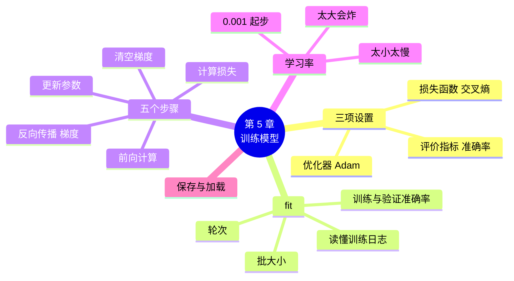

# 第 5 章 训练模型：fit 背后发生了什么

!!! abstract "本章学时"
    理论 6 学时（线上 5 + 线下 1）· 实验 1 学时（本章共 3 个实验，教师可任选）

## 学习目标

学完本章，你应该能够：

1. **说出**训练前要做的三项设置（损失函数、优化器、评价指标）和训练一批数据的五个步骤（记忆）；
2. **运行**代码训练一个花卉识别模型，保存它并用它预测新照片（应用）；
3. **读懂**训练日志中每一轮的损失和准确率（理解）；
4. **解释**一段训练循环代码中每一行对应五个步骤中的哪一步（理解）；
5. **分析**学习率、轮次对训练结果的影响（分析）。

!!! info "先修要求"
    学习本章前，你需要掌握：

    - 训练集、验证集和批（[3.3 节](../03-data/index.md#33)）；
    - 用积木搭出花卉卷积网络、读懂结构表（[4.3.5](../04-build-network/index.md#435)、[4.4 节](../04-build-network/index.md#44)）；
    - 神经元的权重和偏置就是要学的参数（[4.1.1](../04-build-network/index.md#411)）。

??? abstract "本章概念清单（7 个，点击查看定义和例子）"
    1. [损失函数](../../appendix/glossary.md#g-损失函数)
    2. [优化器](../../appendix/glossary.md#g-优化器)
    3. [准确率](../../appendix/glossary.md#g-准确率)
    4. [轮次](../../appendix/glossary.md#g-轮次)
    5. [反向传播](../../appendix/glossary.md#g-反向传播)
    6. [梯度](../../appendix/glossary.md#g-梯度)
    7. [学习率](../../appendix/glossary.md#g-学习率)

## 情景导入

上一章，小林搭好了一个有 83 万个参数的花卉网络，可它对每张照片都说“五种花各 20%”，完全是在瞎猜。

小周说：“该给它上课了。在 Keras 里，上课就一个词：`fit`。”她敲了几行代码，屏幕上开始一行一行地滚动：第 1 轮准确率 28%，第 2 轮 45%，第 3 轮 52%……第 10 轮 87%。

“87%！它学会了？”小林很兴奋。

“先别急，”小周指着旁边一列，“这是验证准确率，只有 55%。你看懂这两个数为什么差这么多，就算真正懂训练了。还有，`fit` 这一个词背后，框架每一批都悄悄做了五件事。不弄懂它们，模型训练出了问题，你连从哪儿查都不知道。”

## 5.1 训练前的三项设置 { #51 }

训练好比老师带学生备考。开课前要先定好三件事：**用什么标准判卷**、**用什么方法改错**、**最后看什么成绩**。

### 5.1.1 损失函数：判卷的扣分标准 { #511 }

[**损失函数**](../../appendix/glossary.md#g-损失函数 "衡量模型的预测和标准答案相差多少的计算方法，算出的数叫损失，越小越好"){ .term }用一个数来衡量模型的回答和标准答案差了多少，这个数叫**损失**，越小越好。好比考试扣分：答得离谱扣得多，答得接近扣得少。

分类任务最常用的损失函数叫**交叉熵**。它的规则可以简单理解为：只看模型给**正确答案**的概率，概率越高，损失越小。

| 模型给正确答案“玫瑰”的概率 | 损失 | 好比 |
|---|---|---|
| 90% | 0.11 | 很有把握地答对了，几乎不扣分 |
| 50% | 0.69 | 拿不准，扣一些 |
| 20%（五种花瞎猜） | 1.61 | 等于没学，扣得多 |
| 1% | 4.61 | 很有把握地答错了，扣得最多 |

记住 **1.61** 这个数：五选一瞎猜时的损失就是它。训练日志里如果损失一直停在 1.61 附近，说明模型什么都没学会。

### 5.1.2 优化器：改错的方法 { #512 }

知道扣了多少分还不够，还要知道怎么改。负责根据损失调整参数的，叫[**优化器**](../../appendix/glossary.md#g-优化器 "根据损失调整模型参数的方法；常用的有 SGD、Adam"){ .term }。最基本的优化器叫 SGD（随机梯度下降），目前最常用的是 **Adam**<sup class="cite">[[1]](#ref5-1)</sup>，它会根据每个参数过去的变化情况自动调整步子，大多数情况下用它都不会错。

优化器有一个最重要的设置：**学习率**，也就是每次改动的步子有多大。5.4 节专门讲。

### 5.1.3 评价指标：最后看什么成绩 { #513 }

损失是给模型“看”的，人看起来不直观。我们更关心的是“100 张照片认对了几张”，这叫[**准确率**](../../appendix/glossary.md#g-准确率 "预测正确的样本数占全部样本数的比例"){ .term }。评价指标只用来汇报成绩，不参与改错。

### 5.1.4 用代码写出三项设置 { #514 }

=== "通用版"

    ```python
    model.compile(
        loss="sparse_categorical_crossentropy",               # 损失函数：交叉熵
        optimizer=keras.optimizers.Adam(learning_rate=0.001), # 优化器：Adam，学习率 0.001
        metrics=["accuracy"])                                 # 评价指标：准确率
    ```

    `compile` 的意思是“编排好”。损失函数的名字很长：`categorical_crossentropy` 是“分类交叉熵”，前面的 `sparse`（稀疏）表示标签是 0、1、2 这样的编号，正好是第 3 章读出来的标签格式<sup class="cite">[[2]](#ref5-2)</sup>。

=== "国产版"

    ```python
    model = paddle.Model(net)                              # 给网络套上高层 API 的“外壳”
    model.prepare(
        optimizer=paddle.optimizer.Adam(learning_rate=0.001,
                                        parameters=model.parameters()),  # 优化器：Adam
        loss=nn.CrossEntropyLoss(use_softmax=False),       # 损失函数：交叉熵
        metrics=paddle.metric.Accuracy())                  # 评价指标：准确率
    ```

    飞桨先用 `paddle.Model` 把第 4 章搭的网络 `net` 包装一下，才能用 `prepare`、`fit` 这些方便的方法<sup class="cite">[[3]](#ref5-3)</sup>。优化器要告诉它“改哪些参数”：`parameters=model.parameters()`。我们的网络最后一层已经是 Softmax，输出的是概率，所以损失函数要写 `use_softmax=False`，告诉它“不用再算一遍 Softmax 了”。

## 5.2 开始训练：fit { #52 }

### 5.2.1 一行代码开始上课 { #521 }

=== "通用版"

    ```python
    history = model.fit(train_ds, validation_data=val_ds,   # 训练集、验证集
                        epochs=10, verbose=2)               # 学 10 轮，每轮显示一行
    ```

    批大小在第 3 章读数据时已经设成 32 了，这里不用再写。`fit` 会把每一轮的成绩记在 `history` 里，第 6 章用它画训练曲线。

=== "国产版"

    ```python
    model.fit(train_ds, val_ds,                            # 训练集、验证集
              epochs=10, batch_size=32, shuffle=True,      # 学 10 轮，每批 32 张，每轮打乱
              verbose=1, log_freq=100)                     # 每轮只显示一行
    ```

    飞桨在 `fit` 里设批大小和打乱，不用自己写 `DataLoader`。

[**轮次**](../../appendix/glossary.md#g-轮次 "把整个训练集从头到尾学一遍叫一轮；epochs 设定一共学几轮"){ .term }（epoch）是把整个训练集从头到尾学一遍。就像复习一本练习册，做完一遍是一轮，一般要做好几遍才能掌握。

### 5.2.2 读懂训练日志 { #522 }

=== "通用版"

    ```text
    Epoch 1/10
    19/19 - 2s - 106ms/step - accuracy: 0.2850 - loss: 1.5286 - val_accuracy: 0.3933 - val_loss: 1.3384
    Epoch 2/10
    19/19 - 1s - 38ms/step - accuracy: 0.4550 - loss: 1.2563 - val_accuracy: 0.3800 - val_loss: 1.4191
    ……（中间略）
    Epoch 10/10
    19/19 - 1s - 68ms/step - accuracy: 0.8683 - loss: 0.3703 - val_accuracy: 0.5467 - val_loss: 1.6601
    ```

    每一轮一行，从左到右是：

    | 内容 | 含义 |
    |---|---|
    | `19/19` | 这一轮 19 批全部学完 |
    | `2s - 106ms/step` | 这一轮用了 2 秒，平均每批 106 毫秒 |
    | `accuracy` / `loss` | **训练集**上的准确率和损失（这一轮各批的平均） |
    | `val_accuracy` / `val_loss` | **验证集**上的准确率和损失（这一轮学完后考的） |

=== "国产版"

    ```text
    Epoch 1/10
    step 19/19 [==============================] - loss: 1.4661 - acc: 0.2700 - 509ms/step
    Eval begin...
    step 5/5 [==============================] - loss: 1.4864 - acc: 0.4333 - 205ms/step
    ……（中间略）
    Epoch 10/10
    step 19/19 [==============================] - loss: 0.4595 - acc: 0.8667 - 504ms/step
    Eval begin...
    step 5/5 [==============================] - loss: 1.3309 - acc: 0.5067 - 190ms/step
    ```

    每一轮两行：第一行 `step 19/19` 是训练集上的成绩，`Eval begin...` 后面那行 `step 5/5` 是验证集上的成绩（150 张，每批 32 张，共 5 批）。飞桨日志里的 `loss` 是**最后一批**的损失，`acc` 是这一轮各批的平均准确率。

### 5.2.3 成绩单说明了什么 { #523 }

把第 1 轮和第 10 轮放在一起看：

| | 训练准确率 | 验证准确率 |
|---|---|---|
| 通用版 第 1 轮 | 28.5% | 39.3% |
| 通用版 第 10 轮 | **86.8%** | **54.7%** |
| 国产版 第 1 轮 | 27.0% | 43.3% |
| 国产版 第 10 轮 | **86.7%** | **50.7%** |

好消息：从瞎猜（20%）到训练集上认对 87%，模型确实学到了东西。两个框架的结果也很接近。

坏消息：验证集上只有五成多。模型在做过的“练习题”上很厉害，在没见过的“模拟考”上却一般，这说明它有不少是**死记硬背**下来的。只有 600 张训练照片、又是从零开始学，出现这种情况很正常。第 6 章会教你从训练曲线看出这个问题，并用数据增强、Dropout 等办法改善；第 7 章会用“迁移学习”把验证准确率提高到八成以上。

## 5.3 打开盒子：fit 背后的五个步骤 { #53 }

### 5.3.1 一批数据的五步 { #531 }

`fit` 是一个“黑盒子”：一行代码进去，训练好的模型出来。打开它，里面其实就是把下面五个步骤**一批一批、一轮一轮**地重复：

| 步骤 | 做什么 | 好比学生做练习 |
|---|---|---|
| ① 前向计算 | 把一批照片交给网络，算出预测 | 做一页练习题 |
| ② 计算损失 | 对照标签，用损失函数算出错了多少 | 对答案，算扣了多少分 |
| ③ 清空梯度 | 把上一批留下的“修改意见”擦掉 | 擦掉上一页的草稿 |
| ④ 反向传播 | 从损失往回算，得出每个参数该怎么改 | 找出每道错题错在哪一步 |
| ⑤ 更新参数 | 优化器让每个参数朝着减小损失的方向改一小步 | 把错的地方改过来 |

下面的动画用一张玫瑰照片演示这五步。点“下一步”看每一步发生了什么，再点“自动跑 20 批”，看损失怎样一批批下降。

<iframe class="sim-frame" src="../../sims/train-five-steps/main.html" height="560" loading="lazy" title="训练五步走"></iframe>

[全屏打开动画](../../sims/train-five-steps/main.html){ target=_blank }

### 5.3.2 梯度和反向传播：找出每个参数的“责任” { #532 }

第 ④ 步是整个训练最关键的一步。模型有 83 万个参数，损失大了，到底该怪谁、每个该改多少？

[**反向传播**](../../appendix/glossary.md#g-反向传播 "从损失出发、从输出层往输入层逐层倒推，算出每个参数的梯度的方法"){ .term }的做法是：从损失出发，从输出层往回一层层倒推，算出每个参数对这次出错有多大“责任”、往哪个方向改能让损失变小。算出来的这组“修改意见”叫[**梯度**](../../appendix/glossary.md#g-梯度 "每个参数该往哪个方向改、改多少才能让损失变小的指示，由反向传播算出"){ .term }。

好比一条流水线出了次品，质检员从最后一道工序往前查，每道工序该负多少责任、该怎么调整，都记在一张单子上。这张单子就是梯度。

反向传播背后的数学（求导、链式法则）很复杂<sup class="cite">[[4]](#ref5-4)</sup>，但我们不用自己算：**框架会自动完成**。这正是第 1 章说的，开发框架最核心的本领之一就是“自动求导”。

为什么要有第 ③ 步“清空梯度”？因为 PyTorch 和飞桨默认会把每次算出的梯度**累加**起来。不擦掉上一批的意见，新旧意见叠在一起，改动就乱了。

### 5.3.3 训练循环：五个步骤的代码 { #533 }

`fit` 在背后执行的代码，写出来大致是下面这样（实验 5-2 可以直接运行）。不要求会写，**能把每一行和五个步骤对上号就行**。

=== "通用版"

    通用版用 PyTorch 来展示。Keras 的 `fit` 把这些全都藏起来了，而 PyTorch 习惯让使用者自己写这个循环，所以读懂它也就能读懂网上大量的 PyTorch 代码<sup class="cite">[[5]](#ref5-5)</sup>。

    ```python
    for epoch in range(10):                       # 一共学 10 轮
        for images, labels in loader:             # 每轮把训练集一批一批拿出来
            pred = net(images)                    # ① 前向计算：网络做题
            loss = loss_fn(pred, labels)          # ② 计算损失：对答案
            opt.zero_grad()                       # ③ 清空梯度：擦掉上一批的修改意见
            loss.backward()                       # ④ 反向传播：算出每个参数该怎么改
            opt.step()                            # ⑤ 更新参数：每个参数改一小步
    ```

=== "国产版"

    国产版用飞桨的“动态图”写法来展示。`paddle.Model` 的 `fit` 在背后做的就是这些。

    ```python
    for epoch in range(10):                       # 一共学 10 轮
        for images, labels in loader:             # 每轮把训练集一批一批拿出来
            pred = net(images)                    # ① 前向计算：网络做题
            loss = loss_fn(pred, labels)          # ② 计算损失：对答案
            opt.clear_grad()                      # ③ 清空梯度：擦掉上一批的修改意见
            loss.backward()                       # ④ 反向传播：算出每个参数该怎么改
            opt.step()                            # ⑤ 更新参数：每个参数改一小步
    ```

两层 `for` 循环：外层是轮次，内层是一批一批。第 2 章学的 for 循环，在这里派上了大用场。

把“一行 `fit`”和“自己写循环”对照起来：

| `fit` 的参数或三项设置 | 在训练循环里对应 |
|---|---|
| `epochs=10` | 外层循环 `for epoch in range(10)` |
| 批大小 32、打乱 | `loader`（DataLoader）一次取 32 张，`shuffle=True` |
| 损失函数 | `loss_fn`，在第 ② 步用 |
| 优化器和学习率 | `opt`，在第 ③、⑤ 步用 |
| `validation_data` | 每轮结束后，在验证集上只做第 ① 步（不改参数） |

`fit` 省事，自己写循环灵活。初学用 `fit`，看懂循环，以后遇到需要特殊处理的任务时就知道从哪儿改起。

## 5.4 轮次、批大小和学习率 { #54 }

### 5.4.1 轮次和批大小 { #541 }

本章的设置是 10 轮、每批 32 张。600 张训练照片每轮分 19 批，所以 10 轮里参数一共被更新了 19 × 10 = **190 次**，每次就是一遍五个步骤。

- **轮次太少**，模型还没学够；**轮次太多**，模型会把训练照片背得滚瓜烂熟，在验证集上反而变差。实验 5-3 中，学 20 轮后训练准确率达到 99%～100%，验证准确率却没有提高（通用版从 10 轮时的 55% 降到了 52%）。第 6 章教你用“早停”自动找到合适的轮次。
- **批大小**常取 16、32、64。批越大，每轮更新的次数越少，每次更新越“稳”，但占用的内存越多。初学时用 32 就好。

### 5.4.2 学习率：每一步迈多大 { #542 }

[**学习率**](../../appendix/glossary.md#g-学习率 "每次更新参数时迈出的步子大小，太大学不稳，太小学得慢"){ .term }决定第 ⑤ 步每次改多少。可以把训练想成蒙着眼睛下山：每一步摸一摸脚下哪边低（梯度），就往那边走一步，步子大小就是学习率。

<iframe class="sim-frame" src="../../sims/learning-rate/main.html" height="520" loading="lazy" title="学习率大小的影响"></iframe>

[全屏打开动画](../../sims/learning-rate/main.html){ target=_blank }

- 步子**太小**：走得稳，但慢，要学很多轮；
- 步子**太大**：一步跨过谷底，落到对面更高的地方，越走越远，训练“炸了”；
- 步子**合适**：稳稳走到谷底附近。

实验 5-3 用三个学习率各训练 10 轮，结果如下：

| 学习率 | 通用版 训练准确率 | 通用版 验证准确率 | 国产版 训练准确率 | 国产版 验证准确率 | 表现 |
|---|---|---|---|---|---|
| 0.1 | 19.3% | 18.0% | 22.3% | 10.7% | 太大：通用版第 1 轮训练损失高达 308，之后停在 1.61 附近，两版的准确率都和瞎猜差不多 |
| 0.001 | 86.8% | 54.7% | 90.2% | 50.7% | 合适 |
| 0.00001 | 36.2% | 35.3% | 55.8% | 50.7% | 太小：通用版 10 轮后训练损失只从 1.61 降到 1.54；国产版降得快一些，但训练准确率也远不如 0.001 |

0.001 是 Adam 的默认学习率，也是大多数情况下的好起点。如果训练损失一开始就很大、或者一直停在瞎猜的水平，先试着把学习率调小 10 倍。

!!! cert "证书考点"
    Python 技术应用工程师（高级）、人工智能应用工程师（高级）证书中涉及深度学习框架的部分，都会考到损失函数、优化器、学习率、轮次等训练参数的含义和设置。

## 5.5 保存模型、加载并预测 { #55 }

训练好的模型要保存下来，下次直接加载使用，不用再训练一遍。

=== "通用版"

    ```python
    model.save("flowers_cnn.keras")                         # 保存：结构和参数都在这一个文件里
    model = keras.models.load_model("flowers_cnn.keras")    # 下次加载
    img = keras.utils.load_img("roses_1.jpg", target_size=(128, 128))
    x = np.expand_dims(keras.utils.img_to_array(img), 0)    # 包装成“一批只有一张”
    prob = model.predict(x, verbose=0)[0]                   # 5 种花的概率
    print(class_names[prob.argmax()], f"{prob.max():.1%}")  # roses 88.4%
    ```

    `.keras` 文件约 10 MB。`argmax()` 找出最大概率的位置（编号），再用索引 `class_names[...]` 翻译成花名（第 3 章学过）。注意不用自己除以 255，因为网络第一层 `Rescaling` 会做。

=== "国产版"

    ```python
    model.save("flowers_cnn")                               # 保存成 flowers_cnn.pdparams 等文件
    model.load("flowers_cnn")                               # 下次加载（要先搭好同样的网络）
    x = tf(Image.open("roses_1.jpg").convert("RGB")).unsqueeze(0)   # 和训练时同样处理
    prob = net(x)[0].numpy()                                # 5 种花的概率
    print(class_names[prob.argmax()], f"{prob.max():.1%}")  # roses 74.0%
    ```

    飞桨保存的 `.pdparams` 文件只有参数，没有结构，所以加载前要先用同样的代码搭好网络、包装成 `paddle.Model`。预测时照片要用和训练时同一条 `tf` 流水线处理。

两个模型都认对了这张玫瑰（第 2 章的现成模型把它认成了花瓶）。不过别高兴得太早，验证准确率只有五成多，换几张照片就会认错。

## 5.6 本章常见报错对照 { #56 }

| 报错原文 | 用大白话说 | 怎么改 |
|---|---|---|
| `You must call compile() before using the model.` | 还没做三项设置就开始训练了 | 先运行 `model.compile(...)` 那个单元格 |
| `Arguments target and output must have the same rank (ndim). Received: target.shape=(None,), output.shape=(None, 5)` | 标签是编号，却用了要求“独热编码”标签的损失函数 | 损失函数改成 `"sparse_categorical_crossentropy"` |
| `Received a label value of 5 which is outside the valid range of [0, 5)` | 标签有 6 类（0～5），输出层却只有 5 个神经元 | 输出层神经元个数改成类别数 |
| `File not found: filepath=flowers_cnn.keras` | 找不到模型文件 | 检查文件名和位置；云端 Notebook 重启后文件可能被清空，要重新训练或上传 |
| 训练损失一直在 1.61 左右不动 | 五选一瞎猜的损失就是 1.61，模型什么都没学会 | 检查学习率是否太大；检查标签是否正确 |
| 国产版加载后预测结果是乱的 | 加载前搭的网络和训练时的不一样 | 用和训练时完全相同的代码搭网络，再 `model.load` |

## 5.7 前沿视窗：训练一个大模型要花多少钱 { #57 }

本章的花卉网络在普通电脑的 CPU 上训练 10 轮，通用版只要十几秒。大模型的训练用的是同样的五个步骤，规模却是天壤之别：参数从 83 万变成几千亿，训练数据从 600 张照片变成十几万亿个字，计算要在成千上万块 GPU 上同时进行，叫**分布式训练**。

训练成本因此成了大模型竞争的关键。2024 年底，DeepSeek 在 DeepSeek-V3 的技术报告中披露，训练这个 6710 亿参数的模型共用了约 279 万 GPU 小时，按租用价格估算约 558 万美元<sup class="cite">[[6]](#ref5-6)</sup>，比业界普遍认为的成本低得多，引起了全球关注。降低成本的办法包括：只让一部分参数参与每次计算（混合专家模型）、用更低精度的数字计算、改进训练流程等。

另一个趋势是**国产算力**。华为昇腾、寒武纪等国产 AI 芯片已经用于大模型训练，飞桨、昇思等国产框架也针对这些芯片做了适配。第 12 章会再介绍国产 AI 生态。不管规模多大，原理都是本章的五个步骤：前向、损失、清零、反向、更新。

## 本章实验

!!! abstract "实验总览"
    | 实验 | 类型 | 建议时长 | 内容 |
    |---|---|---|---|
    | 实验 5-1 | ★ 必做 | 20 分钟 | 训练第一个花卉识别模型 |
    | 实验 5-2 | ★ 必做 | 20 分钟 | 打开盒子：训练循环逐行对应五个步骤 |
    | 实验 5-3 | ☆ 选做 | 30 分钟 | 改学习率和轮次，看训练结果怎么变 |

    代码见配套资源 `labs/ch05/` 目录（`keras/` 通用版，`paddle/` 国产版），数据在 `labs/data/flowers_small/`。CPU 上训练 10 轮，通用版约 15 秒，国产版约 2 分钟；有 GPU 会更快。

### 实验 5-1 ★ 训练第一个花卉识别模型 { #5-1 }

**实验目的**

1. 完整走一遍“读数据 → 搭网络 → 三项设置 → 训练 → 保存和预测”；
2. 读懂训练日志，比较训练准确率和验证准确率。

**实验环境**：云端 Notebook 或本机，CPU 即可。

**实验数据**：`labs/data/flowers_small/`（750 张），`labs/data/test_photos/roses_1.jpg`。

**实验步骤与代码**

第一档 · 跑通：打开 `lab5_1_train_flowers.ipynb`，依次运行五个单元格。第 1、2 步就是第 3、4 章的读数据和搭网络。第 3～5 步：

=== "通用版"

    ```python
    model.compile(
        loss="sparse_categorical_crossentropy",  # 损失函数：衡量答案和标准答案差多少
        optimizer=keras.optimizers.Adam(learning_rate=0.001),  # ← 改这里：学习率
        metrics=["accuracy"])                    # 评价指标：准确率
    history = model.fit(train_ds, validation_data=val_ds, epochs=10, verbose=2)  # ← 改这里：轮次
    model.save("flowers_cnn.keras")
    img = keras.utils.load_img("../../data/test_photos/roses_1.jpg", target_size=(128, 128))
    x = np.expand_dims(keras.utils.img_to_array(img), 0)        # 变成“一批只有一张”的形状
    prob = model.predict(x, verbose=0)[0]
    print("预测：", class_names[prob.argmax()], f"（把握 {prob.max():.1%}）")
    ```

    完整代码：`labs/ch05/keras/lab5_1_train_flowers.ipynb`

=== "国产版"

    ```python
    model.prepare(
        optimizer=paddle.optimizer.Adam(learning_rate=0.001,       # ← 改这里：学习率
                                        parameters=model.parameters()),
        loss=nn.CrossEntropyLoss(use_softmax=False),  # 损失函数：衡量答案和标准答案差多少
        metrics=paddle.metric.Accuracy())           # 评价指标：准确率
    model.fit(train_ds, val_ds, epochs=10, batch_size=32, shuffle=True,
              verbose=1, log_freq=100)              # ← 改这里：轮次 epochs
    model.save("flowers_cnn")                       # 保存为 flowers_cnn.pdparams 等文件
    x = tf(Image.open("../../data/test_photos/roses_1.jpg").convert("RGB")).unsqueeze(0)
    prob = net(x)[0].numpy()                        # 5 种花的概率
    print("预测：", class_names[prob.argmax()], f"（把握 {prob.max():.1%}）")
    ```

    完整代码：`labs/ch05/paddle/lab5_1_train_flowers.ipynb`

**运行结果**：训练日志见 5.2.2 节。最后一行：

=== "通用版"

    ```text
    预测： roses （把握 88.4%）
    ```

=== "国产版"

    ```text
    预测： roses （把握 74.0%）
    ```

固定了随机种子，你在 CPU 上的结果应该和书上一样或非常接近；用 GPU 或不同版本的框架，数字可能略有不同。

第二档 · 改一改：

1. 把预测的照片换成 `tulips_1.jpg`、`sunflowers_2.jpg`，看模型认得对不对；
2. 把 `epochs` 改成 5，重新运行，记录最后一轮的训练准确率和验证准确率。

**实验记录表**

| 设置 | 训练准确率 | 验证准确率 | 预测 roses_1.jpg |
|---|---|---|---|
| 10 轮 | | | |
| 5 轮 | | | |

| 照片 | 模型的回答 | 把握 | 对不对 |
|---|---|---|---|
| tulips_1.jpg | | | |
| sunflowers_2.jpg | | | |

**常见问题排查**

| 现象 | 原因 | 解决办法 |
|---|---|---|
| 每次运行结果都不一样 | 没有运行固定种子那一行，或者用了 GPU | 从第一个单元格开始依次运行；GPU 上有小差别是正常的 |
| 训练很慢 | CPU 较慢，或国产版在 CPU 上本来就慢一些 | 云平台上切换到 GPU 环境；或者把 `epochs` 先改小试试 |
| `You must call compile()` | 跳过了第 3 步 | 按顺序运行单元格 |

**思考与练习**

1. 训练准确率 87%、验证准确率 55%，你会怎样向小林解释这两个数的差别？

**实验报告要求**

提交训练日志截图、预测结果截图和实验记录表。

### 实验 5-2 ★ 打开盒子：训练循环逐行对应五个步骤 { #5-2 }

**实验目的**

1. 运行一段手写的训练循环，体会它和 `fit` 做的是同一件事；
2. 把循环中每一行代码和五个步骤对应起来。

**实验环境**：云端 Notebook 或本机，CPU 即可。通用版需要 PyTorch 和 torchvision（魔搭、AI Studio 等平台一般已预装，否则运行 `!pip install torch torchvision`）。

**实验数据**：`labs/data/flowers_small/`。

**实验步骤与代码**

第一档 · 跑通：打开 `lab5_2_training_loop.ipynb`，运行两个单元格。第一个单元格准备数据、网络、损失函数和优化器，和实验 5-1 一一对应；第二个单元格就是 5.3.3 节的训练循环，另外加了几行，每轮结束时在验证集上考一次：

=== "通用版"

    ```python
    with torch.no_grad():                              # 考试时不改参数，不用算梯度
        right = sum((net(x).argmax(1) == y).sum().item()
                    for x, y in torch.utils.data.DataLoader(val_ds, batch_size=50))
    print(f"第 {epoch + 1} 轮  最后一批损失 {loss.item():.4f}  验证准确率 {right / len(val_ds):.4f}")
    ```

    完整代码：`labs/ch05/keras/lab5_2_training_loop.ipynb`（通用版目录下，用的是 PyTorch）

=== "国产版"

    ```python
    with paddle.no_grad():                             # 考试时不改参数，不用算梯度
        right = sum(int((net(x).argmax(1) == y.flatten()).sum())
                    for x, y in paddle.io.DataLoader(val_ds, batch_size=50))
    print(f"第 {epoch + 1} 轮  最后一批损失 {float(loss):.4f}  验证准确率 {right / len(val_ds):.4f}")
    ```

    完整代码：`labs/ch05/paddle/lab5_2_training_loop.ipynb`

这几行只需看懂意思：`argmax(1)` 找出每张照片概率最大的类别，和标签 `y` 比较，数一数认对了几张。

**运行结果**

=== "通用版"

    ```text
    第 1 轮  最后一批损失 1.5644  验证准确率 0.2933
    第 2 轮  最后一批损失 1.7293  验证准确率 0.4467
    第 3 轮  最后一批损失 1.1466  验证准确率 0.5133
    ……（中间略）
    第 9 轮  最后一批损失 0.7791  验证准确率 0.6133
    第 10 轮  最后一批损失 0.5755  验证准确率 0.6267
    ```

=== "国产版"

    ```text
    第 1 轮  最后一批损失 1.4602  验证准确率 0.3067
    第 2 轮  最后一批损失 1.2975  验证准确率 0.3400
    第 3 轮  最后一批损失 1.4680  验证准确率 0.3467
    ……（中间略）
    第 9 轮  最后一批损失 0.4156  验证准确率 0.5133
    第 10 轮  最后一批损失 0.5684  验证准确率 0.5400
    ```

“最后一批损失”有时上升，是因为每轮最后一批只有 24 张、内容又是随机的，单看一批会忽高忽低；看整体趋势是在下降。验证准确率和实验 5-1 处在同一水平，说明手写循环和 `fit` 做的是同一件事。

第二档 · 改一改：

1. 在代码中给五个步骤各写一行注释，用自己的话说明它在做什么（不能照抄书上的）；
2. 把 `opt.zero_grad()`（国产版 `opt.clear_grad()`）这一行前面加 `#` 注释掉，重新运行，看验证准确率有什么变化，想想为什么。（编者用通用版试过：10 轮后验证准确率一直在 22% 左右，和瞎猜差不多。）

**实验记录表**

| 代码行 | 对应第几步 | 用自己的话说它在做什么 |
|---|---|---|
| `pred = net(images)` | | |
| `loss = loss_fn(pred, labels)` | | |
| `opt.zero_grad()` / `opt.clear_grad()` | | |
| `loss.backward()` | | |
| `opt.step()` | | |

**常见问题排查**

| 现象 | 原因 | 解决办法 |
|---|---|---|
| `No module named 'torch'` | 当前环境没有安装 PyTorch | 运行 `!pip install torch torchvision`，或换用预装 PyTorch 的环境 |
| `IndentationError` | 循环里的缩进不一致 | 内层循环的五行要对齐，比外层多缩进 4 个空格 |

**思考与练习**

1. 去掉“清空梯度”这一步后，为什么训练效果会变差？

**实验报告要求**

提交运行结果截图和填好的对照表。

### 实验 5-3 ☆ 改学习率和轮次，看训练结果怎么变 { #5-3 }

**实验目的**

1. 体会学习率太大、太小、合适时训练的不同表现；
2. 体会轮次太少和太多的影响。

**实验环境**：云端 Notebook 或本机，CPU 即可，有 GPU 更快。

**实验步骤与代码**

第一档 · 跑通：打开 `lab5_3_learning_rate.ipynb`。代码把要改的两个设置放在了最前面，其余和实验 5-1 一样：

```python
LR = 0.001          # ← 改这里：学习率，试试 0.1、0.001、0.00001
EPOCHS = 10         # ← 改这里：轮次，试试 3、10、20
```

完整代码：`labs/ch05/keras/lab5_3_learning_rate.ipynb`、`labs/ch05/paddle/lab5_3_learning_rate.ipynb`

**运行结果**（学习率 0.001、10 轮）

=== "通用版"

    ```text
    学习率 0.001，10 轮：训练损失 0.3703，训练准确率 0.8683，验证准确率 0.5467
    每轮训练损失： [1.529, 1.256, 1.154, 0.986, 0.852, 0.755, 0.755, 0.597, 0.442, 0.37]
    ```

=== "国产版"

    ```text
    学习率 0.001，10 轮：训练损失 0.2670，训练准确率 0.9017，验证准确率 0.5067
    ```

    国产版在训练结束后分别在训练集和验证集上各考一次，所以训练准确率比日志里的“各批平均”略高。

第二档 · 改一改：按下表修改 `LR` 和 `EPOCHS`，每次修改后从第一个单元格重新运行，填写结果。编者在 CPU 上的运行结果附在表后，供核对。

**实验记录表**

| LR | EPOCHS | 训练准确率 | 验证准确率 | 你的判断（太大／太小／合适；不够／太多） |
|---|---|---|---|---|
| 0.1 | 10 | | | |
| 0.001 | 10 | | | |
| 0.00001 | 10 | | | |
| 0.001 | 3 | | | |
| 0.001 | 20 | | | |

??? note "编者的运行结果（先自己做，再点开核对）"
    | LR | EPOCHS | 通用版 训练／验证准确率 | 国产版 训练／验证准确率 |
    |---|---|---|---|
    | 0.1 | 10 | 19.3% ／ 18.0% | 22.3% ／ 10.7% |
    | 0.001 | 10 | 86.8% ／ 54.7% | 90.2% ／ 50.7% |
    | 0.00001 | 10 | 36.2% ／ 35.3% | 55.8% ／ 50.7% |
    | 0.001 | 3 | 52.2% ／ 57.3% | 53.8% ／ 41.3% |
    | 0.001 | 20 | 99.3% ／ 52.0% | 100.0% ／ 51.3% |

    注意 Python 会把 0.00001 显示成 `1e-05`，意思是 1 × 10⁻⁵，是同一个数。

第三档 · 挑战（选做）：试试学习率 0.01 和 0.0001，找出你认为最好的学习率，说明理由。

**常见问题排查**

| 现象 | 原因 | 解决办法 |
|---|---|---|
| 改了 `LR` 结果却没变 | 只运行了后面的单元格，`LR` 没生效 | 改完后从第一个单元格开始依次运行 |
| 学习率 0.1 时出现 `nan` | 步子太大，数字大到计算机表示不了 | 这正是“训练炸了”的表现，调小学习率 |

**思考与练习**

1. 学 20 轮时训练准确率接近 100%，验证准确率却没有提高，说明了什么？

**实验报告要求**

提交实验记录表，并写出你对学习率和轮次的结论（3～5 句话）。

## 本章小结

- 训练前要做**三项设置**：**损失函数**（判卷标准，分类用交叉熵）、**优化器**（改错方法，常用 Adam）、评价指标（常用**准确率**）。Keras 用 `compile`，飞桨用 `paddle.Model` + `prepare`。
- `fit` 开始训练：设定**轮次**、批大小，同时给出验证集。日志中训练准确率和验证准确率要对比着看。
- 五选一瞎猜时损失约为 1.61；损失停在这里不动，说明模型没学到东西。
- `fit` 背后，每一批都做**五个步骤**：① 前向计算 → ② 计算损失 → ③ 清空梯度 → ④ **反向传播**算出**梯度** → ⑤ 更新参数。
- 训练循环是两层 for 循环：外层是轮次，内层是一批一批。
- **学习率**太大会“炸”，太小学得慢，0.001 是好起点；轮次太多会死记硬背。
- Keras 用 `save` / `load_model` 保存和加载整个模型；飞桨用 `save` / `load` 保存和加载参数，加载前要先搭好同样的网络。



**下一章预告**

本章的模型在训练集上 87%，在验证集上只有 55%，学 20 轮后差距更大。这就是“死记硬背”，专业的说法叫**过拟合**。下一章我们把每一轮的成绩画成训练曲线，学会一眼看出模型是学得不够还是在死记硬背，再用早停、Dropout、数据增强等办法对症下药。

## 参考文献

正文中的上标编号（如<sup class="cite">[[1]](#ref5-1)</sup>）对应下面的文献。带链接的可以直接打开；书籍可在图书馆或电子书平台查阅。

<div class="refs" markdown>

**经典论文**

- <span id="ref5-1"></span>[1] KINGMA D P, BA J. Adam: A Method for Stochastic Optimization[C/OL]//3rd International Conference on Learning Representations. San Diego, 2015[2026-10-31]. <https://arxiv.org/abs/1412.6980>.
    <span class="ref-note">Adam 优化器的原始论文，对应 5.1.2 节。</span>
- <span id="ref5-4"></span>[4] RUMELHART D E, HINTON G E, WILLIAMS R J. Learning Representations by Back-Propagating Errors[J]. Nature, 1986, 323(6088): 533-536.
    <span class="ref-note">让反向传播广为人知的经典论文，对应 5.3.2 节。</span>
- <span id="ref5-6"></span>[6] DeepSeek-AI. DeepSeek-V3 Technical Report[EB/OL]. (2024-12-27)[2026-10-31]. <https://arxiv.org/abs/2412.19437>.
    <span class="ref-note">报告第 1 节列出了训练所用的 GPU 小时数和估算成本，对应 5.7 节。</span>

**在线资源**

- <span id="ref5-2"></span>[2] Keras. Losses[EB/OL]. [2026-10-31]. <https://keras.io/api/losses/>.
    <span class="ref-note">Keras 各种损失函数的说明，包括 sparse_categorical_crossentropy 和 categorical_crossentropy 的区别，对应 5.1.4 节。</span>
- <span id="ref5-3"></span>[3] 飞桨. 模型训练、评估与推理[EB/OL]. [2026-10-31]. <https://www.paddlepaddle.org.cn/documentation/docs/zh/guides/beginner/train_eval_predict_cn.html>.
    <span class="ref-note">飞桨官方入门教程，同时讲了高层 API（paddle.Model）和基础 API（自己写训练循环）两种写法，对应 5.1.4 节和 5.3.3 节。</span>
- <span id="ref5-5"></span>[5] PyTorch. Optimizing Model Parameters[EB/OL]. [2026-10-31]. <https://docs.pytorch.org/tutorials/beginner/basics/optimization_tutorial.html>.
    <span class="ref-note">PyTorch 官方入门教程中讲训练循环的一节，对应 5.3.3 节。</span>

</div>

## 课后练习

选择题和判断题可以直接点击选项作答，系统会马上告诉你对错，并展开答案与解析；多选题选好后点“提交答案”。简答和实操题请先自己作答，再点开“答案与解析”核对。每道题的解析下方都有“回看”链接，做错了可以直接跳回正文复习。

**一、单项选择题**

<div class="quiz" data-answer="A" markdown>

**1.** 在训练前的三项设置中，用来衡量模型回答和标准答案差多少的是（　　）。

- A. 损失函数
- B. 优化器
- C. 评价指标
- D. 学习率

</div>

??? tip "答案与解析"
    **答案：A**

    损失函数是“判卷的扣分标准”；优化器是改错的方法；评价指标只用来汇报成绩。

    考查：三项设置 · 认知层次：记忆 · [回看 5.1](#51)
    { .quiz-meta }

<div class="quiz" data-answer="C" markdown>

**2.** 一个五分类模型训练了很多轮，训练损失一直在 1.61 左右，说明（　　）。

- A. 模型已经训练得很好
- B. 模型在死记硬背
- C. 模型什么都没学会，相当于瞎猜
- D. 学习率太小是唯一原因

</div>

??? tip "答案与解析"
    **答案：C**

    五选一瞎猜时，正确答案的概率是 20%，交叉熵损失约为 1.61。常见原因是学习率太大，也可能是数据或标签有问题。

    考查：读懂损失 · 认知层次：分析 · [回看 5.1.1](#511)
    { .quiz-meta }

<div class="quiz" data-answer="B" markdown>

**3.** 把整个训练集从头到尾学一遍叫（　　）。

- A. 一批
- B. 一轮
- C. 一步
- D. 一次推理

</div>

??? tip "答案与解析"
    **答案：B**

    一轮（epoch）包含很多批；每一批做一遍五个步骤。

    考查：轮次 · 认知层次：记忆 · [回看 5.2.1](#521)
    { .quiz-meta }

<div class="quiz" data-answer="D" markdown>

**4.** 训练循环中，`loss.backward()` 对应五个步骤中的（　　）。

- A. 前向计算
- B. 计算损失
- C. 更新参数
- D. 反向传播

</div>

??? tip "答案与解析"
    **答案：D**

    `backward` 是“向后”，从损失往回算出每个参数的梯度。真正改参数的是 `opt.step()`。

    考查：训练循环 · 认知层次：理解 · [回看 5.3.3](#533)
    { .quiz-meta }

<div class="quiz" data-answer="A" markdown>

**5.** 600 张训练照片，批大小 32，训练 10 轮，参数一共被更新了（　　）次。

- A. 190
- B. 10
- C. 600
- D. 6000

</div>

??? tip "答案与解析"
    **答案：A**

    每轮 19 批，每批更新一次，10 轮共 190 次。

    考查：轮次与批 · 认知层次：应用 · [回看 5.4.1](#541)
    { .quiz-meta }

<div class="quiz" data-answer="B" markdown>

**6.** 学习率设成 0.1 训练花卉模型，第 1 轮训练损失高达 308，之后准确率一直在 20% 左右。最可能的原因是（　　）。

- A. 学习率太小
- B. 学习率太大
- C. 轮次太多
- D. 批大小太小

</div>

??? tip "答案与解析"
    **答案：B**

    步子太大，一步跨过谷底、越走越远，训练“炸了”。应把学习率调小。

    考查：学习率 · 认知层次：分析 · [回看 5.4.2](#542)
    { .quiz-meta }

<div class="quiz" data-answer="C" markdown>

**7.** Keras 中，标签是 0、1、2 这样的编号时，分类任务应选的损失函数是（　　）。

- A. `"mse"`
- B. `"categorical_crossentropy"`
- C. `"sparse_categorical_crossentropy"`
- D. `"accuracy"`

</div>

??? tip "答案与解析"
    **答案：C**

    `sparse` 表示标签是编号；B 要求独热编码的标签，用错会报“rank 不一致”的错；D 是评价指标，不是损失函数。

    考查：损失函数的选择 · 认知层次：应用 · [回看 5.1.4](#514)
    { .quiz-meta }

<div class="quiz" data-answer="D" markdown>

**8.** 关于飞桨保存和加载模型，正确的说法是（　　）。

- A. `model.save` 只能保存成 `.keras` 文件
- B. 加载时不需要搭网络，文件里有完整结构
- C. 加载后预测时，照片不用做任何处理
- D. 加载前要先用同样的代码搭好网络

</div>

??? tip "答案与解析"
    **答案：D**

    飞桨的 `.pdparams` 文件只保存参数，加载前要先搭好同样的网络；预测时照片要按训练时的方法处理。

    考查：保存与加载 · 认知层次：理解 · [回看 5.5](#55)
    { .quiz-meta }

**二、多项选择题**

<div class="quiz quiz-multi" data-answer="ABD" markdown>

**1.** 下列属于训练前“三项设置”的有（　　）。

- A. 损失函数
- B. 优化器
- C. 批大小
- D. 评价指标

</div>

??? tip "答案与解析"
    **答案：ABD**

    批大小是读数据或 `fit` 时设的，不在 `compile` / `prepare` 里。

    考查：三项设置 · 认知层次：记忆 · [回看 5.1.4](#514)
    { .quiz-meta }

<div class="quiz quiz-multi" data-answer="BCD" markdown>

**2.** 关于训练一批数据的五个步骤，正确的有（　　）。

- A. 第一步是更新参数
- B. 反向传播算出的“修改意见”叫梯度
- C. 清空梯度是因为框架默认会把梯度累加
- D. 更新参数时，每一步改多少由学习率决定

</div>

??? tip "答案与解析"
    **答案：BCD**

    顺序是：前向计算 → 计算损失 → 清空梯度 → 反向传播 → 更新参数。

    考查：五个步骤 · 认知层次：理解 · [回看 5.3.1](#531)
    { .quiz-meta }

<div class="quiz quiz-multi" data-answer="AC" markdown>

**3.** 训练日志显示训练准确率 87%、验证准确率 55%，下列说法正确的有（　　）。

- A. 模型在训练集上学到了东西
- B. 模型已经可以放心地拿去用了
- C. 模型有不少是死记硬背下来的
- D. 应该把验证集也加进训练集，让验证准确率提高

</div>

??? tip "答案与解析"
    **答案：AC**

    验证准确率才代表模型面对新照片的水平，五成多还不够用。D 的做法等于“把模拟考题拿来练习”，验证集就失去了检查的作用。

    考查：读懂成绩 · 认知层次：评价 · [回看 5.2.3](#523)
    { .quiz-meta }

**三、判断题**

<div class="quiz quiz-judge" data-answer="√" markdown>

**1.** 反向传播中复杂的求导计算，由框架自动完成。

- √ 正确
- × 错误

</div>

??? tip "答案与解析"
    **答案：√**

    自动求导是开发框架最核心的本领之一。

    考查：反向传播 · 认知层次：理解 · [回看 5.3.2](#532)
    { .quiz-meta }

<div class="quiz quiz-judge" data-answer="×" markdown>

**2.** 评价指标（如准确率）会参与调整模型的参数。

- √ 正确
- × 错误

</div>

??? tip "答案与解析"
    **答案：×**

    参与改参数的是损失函数和优化器，评价指标只用来汇报成绩。

    考查：评价指标 · 认知层次：理解 · [回看 5.1.3](#513)
    { .quiz-meta }

<div class="quiz quiz-judge" data-answer="×" markdown>

**3.** 训练的轮次越多，验证准确率一定越高。

- √ 正确
- × 错误

</div>

??? tip "答案与解析"
    **答案：×**

    实验 5-3 中学 20 轮时训练准确率 99%，验证准确率反而比 10 轮时低，这是死记硬背的表现。

    考查：轮次 · 认知层次：分析 · [回看 5.4.1](#541)
    { .quiz-meta }

<div class="quiz quiz-judge" data-answer="√" markdown>

**4.** 模型对正确答案给出的概率越高，交叉熵损失越小。

- √ 正确
- × 错误

</div>

??? tip "答案与解析"
    **答案：√**

    概率 90% 时损失约 0.11，概率 20% 时约 1.61。

    考查：损失函数 · 认知层次：理解 · [回看 5.1.1](#511)
    { .quiz-meta }

<div class="quiz quiz-judge" data-answer="√" markdown>

**5.** 用验证集评估模型时，只做前向计算，不更新参数。

- √ 正确
- × 错误

</div>

??? tip "答案与解析"
    **答案：√**

    验证是“考试”，只看成绩不改错，所以代码里用 `no_grad()` 关掉梯度计算。

    考查：验证 · 认知层次：理解 · [回看 5.3.3](#533)
    { .quiz-meta }

**四、简答题**

**1.** 用“学生做练习”的比喻，按顺序说明训练一批数据的五个步骤。

??? tip "答案与解析"
    **参考答案：** ① 前向计算：做一页练习题（网络对一批照片给出预测）；② 计算损失：对答案、算扣分；③ 清空梯度：擦掉上一页的草稿；④ 反向传播：找出每道错题错在哪一步（算出每个参数的梯度）；⑤ 更新参数：把错的地方改过来（每个参数按梯度改一小步，步子由学习率决定）。

    考查：五个步骤 · 认知层次：理解 · [回看 5.3.1](#531)
    { .quiz-meta }

**2.** 训练时损失一开始非常大，之后一直停在瞎猜的水平。你会先检查哪个设置？怎样调整？

??? tip "答案与解析"
    **参考答案：** 先检查学习率。这是学习率太大、训练“炸了”的典型表现，应把学习率调小，比如从 0.1 调到 0.001，或者每次调小 10 倍试试。

    考查：学习率 · 认知层次：分析 · [回看 5.4.2](#542)
    { .quiz-meta }

**3.** 比较“用 `fit` 训练”和“自己写训练循环”的优缺点。

??? tip "答案与解析"
    **参考答案：** `fit` 一行代码就能训练，省事、不容易写错，适合初学和常规任务，但过程藏在黑盒子里，不好做特殊处理。自己写循环要多写十几行，容易出错，但每一步都看得见、改得了，适合需要特殊处理的任务，也是读懂网上大量 PyTorch 代码的基础。

    考查：fit 与训练循环 · 认知层次：评价 · [回看 5.3.3](#533)
    { .quiz-meta }

**五、实操题**

**1.** 用实验 5-1 训练好的模型，写一个 for 循环，依次预测 `test_photos` 文件夹中的 10 张照片，打印每张照片的文件名、预测的花名和把握，并统计认对了几张（文件名中下划线前面的部分就是正确答案）。

??? tip "答案与解析"
    **参考答案（通用版）：**

    ```python
    from pathlib import Path
    right = 0
    for photo in sorted(Path("../../data/test_photos").glob("*.jpg")):
        img = keras.utils.load_img(photo, target_size=(128, 128))
        prob = model.predict(np.expand_dims(keras.utils.img_to_array(img), 0), verbose=0)[0]
        guess = class_names[prob.argmax()]
        print(photo.name, guess, f"{prob.max():.1%}")
        if guess == photo.name.split("_")[0]:      # 下划线前面的部分是正确答案
            right += 1
    print("认对了", right, "张")
    ```

    国产版把循环中读图和预测的两行换成 `x = tf(Image.open(photo).convert("RGB")).unsqueeze(0)` 和 `prob = net(x)[0].numpy()`。`split("_")` 把文件名按下划线切开，`[0]` 取第一段。由于验证准确率只有五成多，一般能认对一半左右。

    考查：保存与预测、for 循环 · 认知层次：应用 · [回看 5.5](#55)
    { .quiz-meta }
