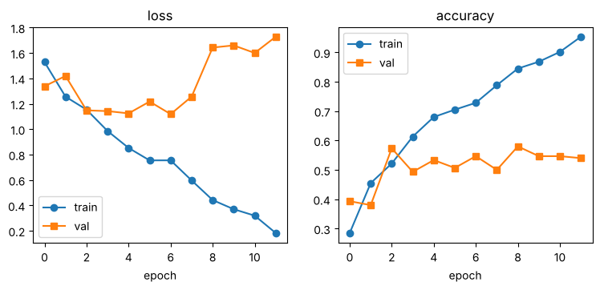
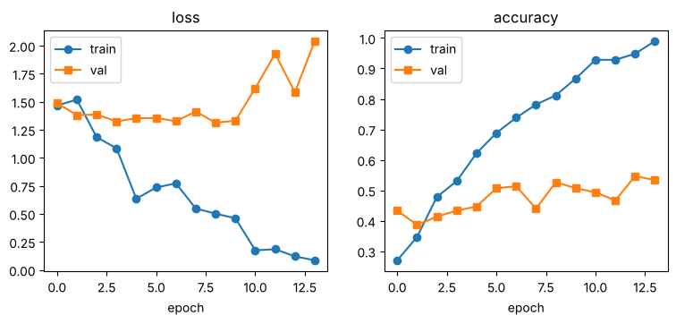
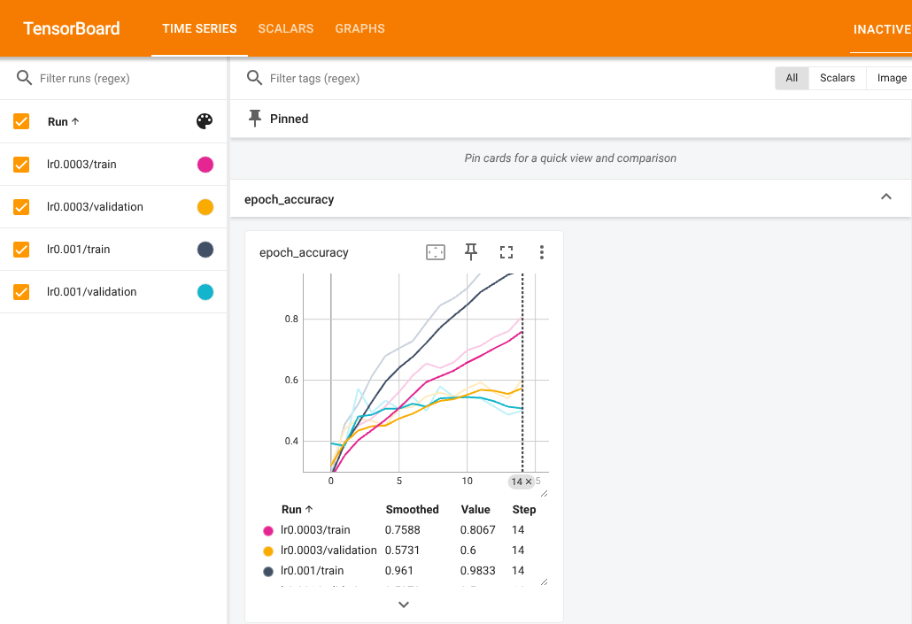
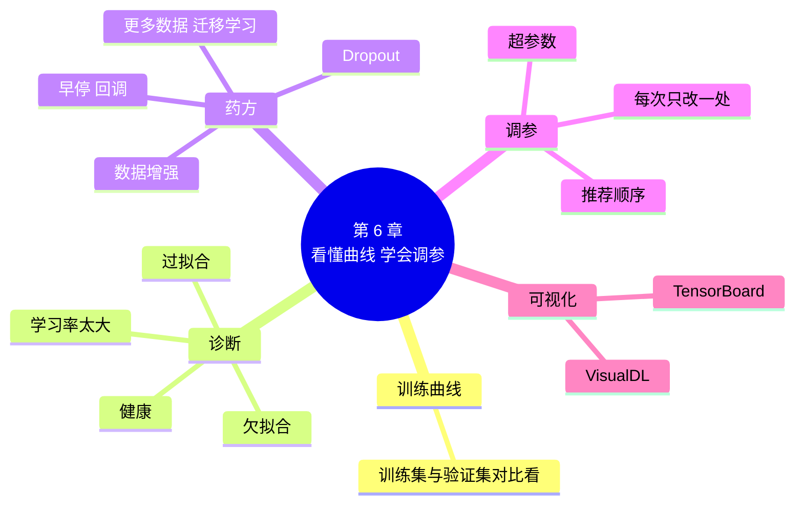

# 第 6 章 看懂训练曲线，学会调参

!!! abstract "本章学时"
    理论 5 学时（线上 4 + 线下 1）· 实验 1 学时（本章共 3 个实验，教师可任选）

## 学习目标

学完本章，你应该能够：

1. **说出**欠拟合、过拟合的含义和常见的改进办法（记忆）；
2. **读懂**训练曲线，判断模型是学得不够、死记硬背还是训练炸了（分析）；
3. **运行**带早停和自动保存的训练代码，并画出训练曲线（应用）；
4. **设计**对比实验，比较数据增强、Dropout 的效果，并得出有依据的结论（评价）；
5. **使用** TensorBoard 或 VisualDL 比较多次训练的曲线（应用）。

!!! info "先修要求"
    学习本章前，你需要掌握：

    - 训练集和验证集的作用（[3.3.2](../03-data/index.md#332)）；
    - 数据增强（[3.4 节](../03-data/index.md#34)）；
    - 用 `fit` 训练、读懂训练日志、学习率和轮次的影响（[5.2 节](../05-training/index.md#52)、[5.4 节](../05-training/index.md#54)）。

??? abstract "本章概念清单（7 个，点击查看定义和例子）"
    1. [训练曲线](../../appendix/glossary.md#g-训练曲线)
    2. [欠拟合](../../appendix/glossary.md#g-欠拟合)
    3. [过拟合](../../appendix/glossary.md#g-过拟合)
    4. [回调](../../appendix/glossary.md#g-回调)
    5. [早停](../../appendix/glossary.md#g-早停)
    6. [Dropout](../../appendix/glossary.md#g-Dropout)
    7. [超参数](../../appendix/glossary.md#g-超参数)

## 情景导入

小林把第 5 章的模型拿给店里的同事试用。同事拍了十张花，模型认对了五张。“一半都认不准，还不如我自己看。”

小林很郁闷：“训练的时候明明有 87% 啊！”

小周说：“训练日志那一长串数字，你只看了最后一行。把每一轮的成绩画成曲线，问题一眼就能看出来。看病得先诊断，再开药。这一章教你看‘病历’，再学几副常用的‘药方’。”

## 6.1 训练曲线：模型的成绩走势图 { #61 }

### 6.1.1 把每一轮的成绩画出来 { #611 }

第 5 章的训练日志每轮一行，几十个数字挤在一起很难看出规律。把它们画成折线图，横轴是轮次，纵轴是损失或准确率，训练集一条线、验证集一条线，就是[**训练曲线**](../../appendix/glossary.md#g-训练曲线 "把每一轮训练集和验证集的损失、准确率画成的折线图，用来判断训练情况"){ .term }。

=== "通用版"

    ```python
    import matplotlib.pyplot as plt
    h = history.history                          # fit 返回的成绩记录
    plt.plot(h["loss"], "o-", label="train")     # 训练集损失
    plt.plot(h["val_loss"], "s-", label="val")   # 验证集损失
    plt.legend(); plt.savefig("curves.png")
    ```

    `history.history` 是一个字典（第 3 章学过），键是 `"loss"`、`"accuracy"`、`"val_loss"`、`"val_accuracy"`，值是每一轮成绩组成的列表。`matplotlib` 是 Python 最常用的画图工具<sup class="cite">[[1]](#ref6-1)</sup>。

=== "国产版"

    ```python
    from history import History                  # 随书提供的记录成绩小工具
    rec = History()
    model.fit(train_ds, val_ds, epochs=30, callbacks=[rec], verbose=0)
    import matplotlib.pyplot as plt
    plt.plot(rec.h["loss"], "o-", label="train")     # 训练集损失
    plt.plot(rec.h["val_loss"], "s-", label="val")   # 验证集损失
    plt.legend(); plt.savefig("curves.png")
    ```

    飞桨的 `fit` 不直接返回成绩记录，随书在 `labs/ch06/paddle/history.py` 里写了一个小工具 `History`，交给 `fit` 后它会把每轮成绩记在 `rec.h` 这个字典里。小工具的代码照抄即可，不要求看懂。另一个办法是用 6.6 节的 VisualDL 直接看曲线。

### 6.1.2 读第 5 章那个模型的曲线 { #612 }

下面是实验 6-1 画出的曲线。左图是损失，右图是准确率；蓝线是训练集，橙线是验证集。

=== "通用版"

    

=== "国产版"

    

读曲线时，要两条线**对比着看**：

- **训练损失**（蓝线）一路下降，训练准确率一路上升到九成以上：模型在练习题上越做越好；
- **验证损失**（橙线）先降后升，大约在第 7～9 轮降到最低，之后反而越来越高；验证准确率在五成附近徘徊；
- 两条线**越分越开**。

这就是第 5 章说的“死记硬背”，下一节给它一个正式的名字。

## 6.2 看曲线诊断四种情况 { #62 }

### 6.2.1 欠拟合：学得不够 { #621 }

[**欠拟合**](../../appendix/glossary.md#g-欠拟合 "模型没学到规律，训练集和验证集上成绩都差的现象"){ .term }是指模型连练习题都没学好：训练集和验证集上的成绩**都差**，两条线挨得很近，损失下降得很慢。好比学生上课没听懂，练习和考试都不及格。

常见原因：学习率太小、训练轮次太少、网络太小。

### 6.2.2 过拟合：死记硬背 { #622 }

[**过拟合**](../../appendix/glossary.md#g-过拟合 "模型在训练集上表现好、在新数据上表现差的现象，好比死记硬背"){ .term }是指模型把训练数据的细节甚至“噪声”都背了下来：训练集上越来越好，验证集上却不跟着变好甚至变差，**两条线越分越开**。好比学生把练习册的答案背得滚瓜烂熟，换一道新题就不会。

常见原因：训练数据太少、网络参数太多、训练轮次太多。我们的花卉模型只有 600 张训练照片，却有 83 万个参数，过拟合几乎不可避免。

模型在没见过的新数据上表现好的能力，叫**泛化能力**。我们真正想要的，是泛化能力强的模型：不是“练习题全对”，而是“考试也能考好”。

### 6.2.3 训练炸了：学习率太大 { #623 }

第 5 章见过：学习率太大时，损失会突然变得很大，或者一直停在瞎猜的水平（五分类约 1.61）不动，准确率在 20% 上下。这种情况要先把学习率调小。

### 6.2.4 一张表记住诊断和药方 { #624 }

| 情况 | 训练曲线的样子 | 药方 |
|---|---|---|
| 欠拟合 | 训练、验证成绩都差，两条线挨得近，损失降得慢 | 调大学习率、多训练几轮、网络加大 |
| 过拟合 | 训练越来越好，验证不跟着变好甚至变差，两条线越分越开 | 早停、数据增强、Dropout、更多数据、迁移学习 |
| 训练炸了 | 损失突然很大，或一直停在瞎猜水平 | 学习率调小 |
| 比较健康 | 训练、验证都在进步，两条线差距不大 | 保持，可以再试着多训练几轮 |

下面的动画给出四组**真实的**训练曲线，看图诊断，点选你的答案。

<iframe class="sim-frame" src="../../sims/curve-doctor/main.html" height="560" loading="lazy" title="训练曲线诊断器"></iframe>

[全屏打开动画](../../sims/curve-doctor/main.html){ target=_blank }

## 6.3 早停：在最好的时候停下来 { #63 }

### 6.3.1 回调：训练时的“助手” { #631 }

从曲线看，验证损失在第 7 轮左右最低，之后越练越差。那就在那里停下来，并且留下那一轮的模型。

问题是，训练前我们不知道第几轮最好。框架提供了一种“助手”，叫[**回调**](../../appendix/glossary.md#g-回调 "交给 fit 的“助手”，在每一轮训练前后自动执行某些操作，如早停、保存模型、记录日志"){ .term }（callback）：把它交给 `fit`，它会在每一轮结束时自动检查成绩，做该做的事。最常用的两个助手是：

- [**早停**](../../appendix/glossary.md#g-早停 "验证成绩连续若干轮没有变好就自动停止训练，并保留最好那一轮的模型"){ .term }（Early Stopping）：验证成绩连续几轮都没有变好，就自动停下；
- **自动保存**（Checkpoint）：每当验证成绩创新高，就把当时的模型存下来。

好比请了一位教练盯着模拟考成绩：连续 5 次没有进步就喊停，并且记住你考得最好的那一次。

### 6.3.2 代码 { #632 }

=== "通用版"

    ```python
    helpers = [
        keras.callbacks.EarlyStopping(monitor="val_loss", patience=5,   # 验证损失连续 5 轮没变好就停
                                      restore_best_weights=True),       # 停下后退回最好的那一轮
        keras.callbacks.ModelCheckpoint("best.keras", monitor="val_loss",
                                        save_best_only=True),           # 只在变好时保存
    ]
    history = model.fit(train_ds, validation_data=val_ds, epochs=30,    # 最多 30 轮
                        callbacks=helpers, verbose=2)
    ```

    `monitor` 是盯着哪个成绩，`patience`（耐心）是最多等几轮<sup class="cite">[[2]](#ref6-2)</sup>。

=== "国产版"

    ```python
    stop = paddle.callbacks.EarlyStopping(monitor="loss", mode="min", patience=5,  # 验证损失连续 5 轮没变好就停
                                          save_best_model=True)                    # 保存最好的一轮
    model.fit(train_ds, val_ds, epochs=30, batch_size=32, shuffle=True,             # 最多 30 轮
              save_dir="checkpoint", save_freq=100,                                 # 存到 checkpoint 文件夹
              callbacks=[stop, rec], verbose=0)
    ```

    飞桨的早停在有验证集时盯的就是验证集的成绩，`monitor="loss"` 指验证损失，`mode="min"` 表示越小越好<sup class="cite">[[3]](#ref6-3)</sup>。最好的模型存在 `checkpoint/best_model.pdparams`。`save_freq=100` 让它不要每一轮都存一份。

### 6.3.3 结果 { #633 }

=== "通用版"

    ```text
    Epoch 12/30
    19/19 - 1s - 35ms/step - accuracy: 0.9533 - loss: 0.1826 - val_accuracy: 0.5400 - val_loss: 1.7282
    一共训练了 12 轮；验证损失最低的是第 7 轮
    ```

=== "国产版"

    ```text
    Epoch 14: Early stopping.
    Best checkpoint has been saved at .../checkpoint/best_model
    一共训练了 14 轮；验证损失最低的是第 9 轮
    ```

设了最多 30 轮，实际只训练了 12 轮（国产版 14 轮）就停了：验证损失在第 7 轮（国产版第 9 轮）最低，之后连续 5 轮都没有更低，教练喊停。不用再猜“训练几轮合适”，早停会帮你找。

早停能防止越练越差，但它只是“及时止损”，验证准确率还是五成多。要真正提高，得用下面的办法。

## 6.4 对付过拟合的两件武器 { #64 }

### 6.4.1 数据增强：让练习题“变着花样” { #641 }

第 3 章学过数据增强：训练时把照片随机翻转、旋转、缩放，让模型每次看到的都不完全一样，就很难死记硬背。

=== "通用版"

    把增强积木直接放进网络的最前面：

    ```python
    model = keras.Sequential([
        keras.Input(shape=(128, 128, 3)),
        layers.RandomFlip("horizontal"), layers.RandomRotation(0.1), layers.RandomZoom(0.2),  # 增强
        layers.Rescaling(1 / 255),
        ……（后面和原来一样）
    ])
    ```

    这几块积木只在训练时起作用，验证和预测时自动“关闭”，所以验证集不会被增强。

=== "国产版"

    增强要加在**训练集**的流水线上，验证集的流水线保持原样。所以训练集和验证集要用两条不同的流水线：

    ```python
    train_tf = T.Compose([T.Resize((128, 128)), T.RandomHorizontalFlip(),
                          T.RandomRotation(36), T.RandomResizedCrop(128, scale=(0.6, 1.0)),
                          T.ToTensor()])                              # 训练集：缩放 + 增强 + 变张量
    val_tf = T.Compose([T.Resize((128, 128)), T.ToTensor()])        # 验证集：只缩放 + 变张量
    ```

    第 5 章用的 `random_split` 只能让两份数据共用一条流水线，实验 6-2 换成了先打乱编号、再用 `paddle.io.Subset` 按编号挑选的写法，照抄即可。

### 6.4.2 Dropout：随机让一部分神经元“休息” { #642 }

[**Dropout**](../../appendix/glossary.md#g-Dropout "训练时每一批随机让一部分神经元暂时不工作，防止网络过分依赖某几个神经元，从而减轻过拟合"){ .term }（随机失活）<sup class="cite">[[4]](#ref6-4)</sup>的做法是：训练时每一批都随机挑一部分神经元，让它们这一次“休息”不工作。

好比一个小组做作业，如果总是同一两个人包办，其他人就学不到东西，换个题目全组都不会。每次随机让一半人请假，剩下的人就都得学会。网络也一样，不能只依赖某几个神经元记住训练照片的细节，只好学一些更普遍的规律。

=== "通用版"

    ```python
    layers.Flatten(),
    layers.Dropout(0.5),          # 每一批随机让 50% 的数“休息”  ← 改这里
    layers.Dense(64, activation="relu"),
    ```

=== "国产版"

    ```python
    nn.Flatten(),
    nn.Dropout(0.5),              # 每一批随机让 50% 的数“休息”  ← 改这里
    nn.Linear(64 * 14 * 14, 64), nn.ReLU(),
    ```

Dropout 一般放在全连接层前面，比例常用 0.2～0.5。和增强积木一样，它只在训练时起作用，预测时所有神经元都上班。

### 6.4.3 四组对比实验 { #643 }

管不管用，要用实验说话。实验 6-2 用同样的设置跑四次，每次训练 30 轮，只改“要不要数据增强”“要不要 Dropout”两个开关：

| 实验 | 数据增强 | Dropout | 通用版 最高验证准确率 | 通用版 第 30 轮 训练／验证 | 国产版 最高验证准确率 | 国产版 第 30 轮 训练／验证 |
|---|---|---|---|---|---|---|
| ① | 不要 | 不要 | 58.0% | 100% ／ 53.3% | 58.0% | 100% ／ 53.3% |
| ② | 不要 | 要 | 61.3% | 98.3% ／ 53.3% | 60.0% | 100% ／ 58.0% |
| ③ | 要 | 不要 | **68.7%** | 84.7% ／ 57.3% | **66.7%** | 77.7% ／ 59.3% |
| ④ | 要 | 要 | 66.7% | 81.8% ／ 57.3% | **66.7%** | 74.3% ／ 62.7% |

从这张表可以得出几个有依据的结论：

1. **数据增强效果明显**：两个版本都是 ③④ 两组最好，最高验证准确率比 ① 高了约 9～11 个百分点，训练准确率不再冲到 100%，说明死记硬背减轻了；
2. **Dropout 有一点帮助，但在这里不如增强**：② 比 ① 略好，④ 和 ③ 的最高值差不多；
3. **验证准确率每轮都有起伏**：150 张验证照片，认对或认错一张就差 0.7 个百分点，所以比较时看“最高”和“整体趋势”，不要只看某一轮；
4. **还远远不够**：最好也只有六成多。从零开始、只有 600 张照片，能做到的就这么多。第 7 章换一条路：借用别人在一百多万张照片上训练好的模型。

做对比实验有一条铁律：**每次只改一个地方，其他条件保持不变**（同样的数据、种子、轮次），否则说不清结果的变化是谁带来的。

## 6.5 超参数与调参的顺序 { #65 }

### 6.5.1 什么是超参数 { #651 }

模型参数（权重和偏置）是训练时模型自己学的。而学习率、轮次、批大小、网络有几层、Dropout 比例、要不要增强……这些是**人在训练前定好的设置**，叫[**超参数**](../../appendix/glossary.md#g-超参数 "训练前由人设定、不由模型自己学习的设置，如学习率、轮次、批大小、Dropout 比例"){ .term }。调整超参数让模型变好的过程，就叫**调参**。

### 6.5.2 调参的推荐顺序 { #652 }

超参数很多，一个个乱试很费时间。对初学者，推荐按下面的顺序：

1. **先让训练跑起来**：损失在下降，不炸、不卡在瞎猜（学习率先用 0.001）；
2. **再让它过拟合**：训练准确率能明显上升，说明网络有能力学；如果训练集都学不好（欠拟合），就加大网络、多训练几轮；
3. **然后对付过拟合**：加数据增强、Dropout，用早停找轮次；
4. **最后考虑换方法**：数据实在太少时，用迁移学习（第 7 章）往往比继续调参管用得多。

每做一次实验，都在表格里记下改了什么、结果如何。下面是一个记录表的例子：

| 编号 | 改了什么 | 最高验证准确率 | 结论 |
|---|---|---|---|
| 1 | 基准（学习率 0.001，30 轮） | 58.0% | 过拟合明显 |
| 2 | 加数据增强 | 68.7% | 有效，保留 |
| 3 | 再加 Dropout 0.5 | 66.7% | 没有明显提升 |

!!! cert "证书考点"
    人工智能数据处理工程师（高级）证书的“深度学习实战”要求掌握框架的搭建、优化、部署。判断过拟合与欠拟合、选用早停、Dropout、数据增强等方法，属于其中“优化”的内容。

## 6.6 TensorBoard 与 VisualDL：训练可视化工具 { #66 }

自己画曲线要写好几行代码，而且多次训练放在一起比较很麻烦。框架都配有专门的可视化工具：通用版用 TensorBoard<sup class="cite">[[5]](#ref6-5)</sup>，国产版用飞桨的 VisualDL<sup class="cite">[[6]](#ref6-6)</sup>。用法都是两步：训练时用一个回调把成绩写进日志文件夹，再打开工具看。

=== "通用版"

    ```python
    board = keras.callbacks.TensorBoard(log_dir="logs/lr0.001")  # 每次训练写进不同的文件夹
    model.fit(train_ds, validation_data=val_ds, epochs=15, callbacks=[board])
    ```

    在 Notebook 里运行下面两行，就会在下方打开 TensorBoard：

    ```text
    %load_ext tensorboard
    %tensorboard --logdir logs
    ```

    以 `%` 开头的是 Notebook 的“魔法命令”，不是 Python 代码，只能在 Notebook 里用。

    

    上图同时显示了学习率 0.001 和 0.0003 两次训练的准确率。左侧可以勾选要看哪几条线。

=== "国产版"

    ```python
    board = paddle.callbacks.VisualDL(log_dir="vdl_log/lr0.001")  # 每次训练写进不同的文件夹
    model.fit(train_ds, val_ds, epochs=15, batch_size=32, callbacks=[board])
    ```

    在 AI Studio 上，左侧有“可视化”面板，选择 `vdl_log` 文件夹即可查看；在自己电脑上，在命令行运行 `visualdl --logdir vdl_log --port 8040`，再用浏览器打开 `http://localhost:8040`。

    VisualDL 的页面和上面 TensorBoard 的样子很像：左边勾选要看的实验（文件夹），右边每个指标一张折线图，不同实验用不同颜色。看图的方法完全一样。

每次训练把日志写进不同名字的文件夹（比如按学习率命名），工具会把它们画在同一张图上，方便比较。实验 6-3 就是这样比较两个学习率的。

## 6.7 本章常见报错对照 { #67 }

| 报错原文 | 用大白话说 | 怎么改 |
|---|---|---|
| `Early stopping conditioned on metric val_acc which is not available. Available metrics are: accuracy,loss,val_accuracy,val_loss` | 早停要盯的成绩名字写错了，它找不到，所以不会早停 | 照着提示里列出的名字写，如 `"val_loss"`、`"val_accuracy"` |
| `EarlyStopping callback received monitor=val_acc, but Keras isn't able to automatically determine whether that metric should be maximized or minimized` | 不知道这个成绩是越大越好还是越小越好 | 改用标准名字，或加上 `mode="max"`（准确率）／`mode="min"`（损失） |
| `The filepath provided must end in .keras` | 保存的文件名要以 `.keras` 结尾 | 改成 `"best.keras"` |
| 国产版：`No module named 'history'` | 找不到随书的小工具 `history.py` | 把 `labs/ch06/paddle/history.py` 和实验代码上传到同一个文件夹 |
| 曲线图里只有一个点或一条横线 | 只训练了 1 轮，或者画错了数据 | 检查 `epochs`，检查画的是不是 `h["loss"]` 这样的列表 |
| TensorBoard 显示 “No dashboards are active” | 日志文件夹不对，或者还没训练完 | 检查 `--logdir` 是否和 `log_dir` 一致，训练完再刷新 |

## 6.8 前沿视窗：让机器自己调参 { #68 }

调参常被戏称为“炼丹”：配方（超参数）全靠经验和反复尝试。能不能让机器自己试？这就是**自动调参**，也是“自动机器学习”（AutoML）的一部分。

最简单的自动调参是**网格搜索**：把每个超参数的几个候选值排列组合，全部试一遍，挑最好的。更聪明的办法会根据前几次的结果，猜下一次该试什么，少走弯路。Keras 有配套的 KerasTuner，飞桨的 PaddleX 等工具也提供了自动调参和“一键训练”的功能，第 7 章的选做实验会体验 PaddleX。

大模型时代，调参的成本变得极高：训练一次可能要几百万元，根本不可能反复试。研究者会先在小模型上找规律，再推算大模型该用什么超参数，这类规律叫**规模定律**（Scaling Law）。不管是自动调参还是规模定律，基础都是本章这套方法：看曲线、做对比、每次只改一个地方、把结果记下来。

## 本章实验

!!! abstract "实验总览"
    | 实验 | 类型 | 建议时长 | 内容 |
    |---|---|---|---|
    | 实验 6-1 | ★ 必做 | 20 分钟 | 画训练曲线，用早停自动保存最好的模型 |
    | 实验 6-2 | ★ 必做 | 30 分钟 | 四组对比实验：数据增强和 Dropout 管不管用 |
    | 实验 6-3 | ☆ 选做 | 20 分钟 | 用 TensorBoard / VisualDL 比较两次训练 |

    代码见配套资源 `labs/ch06/` 目录（`keras/` 通用版，`paddle/` 国产版）。国产版的 `history.py` 要和实验代码放在同一个文件夹。CPU 上训练 30 轮，通用版约 1 分钟，国产版约 5 分钟。

### 实验 6-1 ★ 画训练曲线，用早停自动保存最好的模型 { #6-1 }

**实验目的**

1. 画出训练曲线，判断模型是否过拟合；
2. 学会用早停和自动保存。

**实验环境**：云端 Notebook 或本机，CPU 即可。

**实验数据**：`labs/data/flowers_small/`。

**实验步骤与代码**

第一档 · 跑通：打开 `lab6_1_early_stopping.ipynb`，依次运行三个单元格。第 1 步和第 5 章一样；第 2 步加了两个助手（代码见 6.3.2 节），最多训练 30 轮；第 3 步画曲线（代码见 6.1.1 节，加了准确率的一张图）。

完整代码：`labs/ch06/keras/lab6_1_early_stopping.ipynb`、`labs/ch06/paddle/lab6_1_early_stopping.ipynb`

**运行结果**：训练日志的最后几行见 6.3.3 节，曲线图见 6.1.2 节。运行后，文件夹里多了最好的模型：通用版是 `best.keras`，国产版是 `checkpoint/best_model.pdparams`。

第二档 · 改一改：

1. 把 `patience=5` 改成 2，再运行，看训练了几轮、停在哪里；
2. 把通用版的 `monitor` 改成 `"val_accuracy"`（同时加上 `mode="max"`），国产版改成 `monitor="acc", mode="max"`，比较停下的轮次。

**实验记录表**

| 设置 | 一共训练了几轮 | 最好的是第几轮 | 最好那轮的验证准确率 |
|---|---|---|---|
| patience=5，盯验证损失 | | | |
| patience=2，盯验证损失 | | | |
| patience=5，盯验证准确率 | | | |

**常见问题排查**

| 现象 | 原因 | 解决办法 |
|---|---|---|
| 训练满 30 轮都没停 | `monitor` 名字写错，早停没起作用（会有一行警告） | 见 6.7 节报错对照 |
| 国产版 `No module named 'history'` | 没上传 `history.py` | 和实验代码放在同一个文件夹 |

**思考与练习**

1. `patience` 设得太小或太大，各有什么问题？

**实验报告要求**

提交训练曲线图和实验记录表，并用一句话诊断这条曲线。

### 实验 6-2 ★ 四组对比实验：数据增强和 Dropout 管不管用 { #6-2 }

**实验目的**

1. 学会用对比实验检验一个办法是否有效；
2. 比较数据增强、Dropout 对过拟合的作用。

**实验环境**：云端 Notebook 或本机，CPU 即可，有 GPU 更快。

**实验数据**：`labs/data/flowers_small/`。

**实验步骤与代码**

第一档 · 跑通：打开 `lab6_2_four_experiments.ipynb`。最前面有两个开关：

```python
AUG = False         # ← 改这里：要不要数据增强（True 要 / False 不要）
DROP = False        # ← 改这里：要不要 Dropout
```

代码按开关搭网络：

=== "通用版"

    ```python
    aug = [layers.RandomFlip("horizontal"), layers.RandomRotation(0.1), layers.RandomZoom(0.2)] if AUG else []
    drop = [layers.Dropout(0.5)] if DROP else []
    model = keras.Sequential([
        keras.Input(shape=(128, 128, 3)), *aug, layers.Rescaling(1 / 255),   # 增强积木放在最前面
        ……（三组卷积 + 池化）
        layers.Flatten(), *drop, layers.Dense(64, activation="relu"), layers.Dense(5, activation="softmax")])
    ```

    完整代码：`labs/ch06/keras/lab6_2_four_experiments.ipynb`

=== "国产版"

    ```python
    extra = [T.RandomHorizontalFlip(), T.RandomRotation(36), T.RandomResizedCrop(128, scale=(0.6, 1.0))] if AUG else []
    idx = np.random.RandomState(42).permutation(750).tolist()   # 打乱 750 个编号
    train_ds = paddle.io.Subset(DatasetFolder(DATA, transform=T.Compose(plain[:1] + extra + plain[1:])), idx[:600])
    val_ds = paddle.io.Subset(DatasetFolder(DATA, transform=T.Compose(plain)), idx[600:])
    drop = [nn.Dropout(0.5)] if DROP else []
    ```

    `plain` 是“缩放 + 变张量”两步，`plain[:1] + extra + plain[1:]` 的意思是在这两步中间插入增强。完整代码：`labs/ch06/paddle/lab6_2_four_experiments.ipynb`

`… if AUG else []` 的意思是：如果开关是 True，就用前面的积木列表，否则用空列表 `[]`（什么都不加）。`*aug` 把列表里的积木“倒”进网络（第 4 章实验 4-3 见过）。

运行一次，得到第 ① 组（都关）的结果：

=== "通用版"

    ```text
    增强=False Dropout=False：最高验证准确率 0.5800（第 9 轮），最后一轮 训练 1.0000 / 验证 0.5333
    ```

=== "国产版"

    ```text
    增强=False Dropout=False：最高验证准确率 0.5800（第 12 轮），最后一轮 训练 1.0000 / 验证 0.5333
    ```

第二档 · 改一改：依次把开关改成 ②③④ 组，每次从第一个单元格重新运行，把结果填进记录表。编者的结果见 6.4.3 节，先自己做，再核对。

**实验记录表**

| 实验 | AUG | DROP | 最高验证准确率（第几轮） | 第 30 轮 训练／验证准确率 |
|---|---|---|---|---|
| ① | False | False | | |
| ② | False | True | | |
| ③ | True | False | | |
| ④ | True | True | | |

第三档 · 挑战（选做）：把 Dropout 比例从 0.5 改成 0.2 或 0.3，或者加大增强的幅度，看能不能超过表中最好的结果。

**常见问题排查**

| 现象 | 原因 | 解决办法 |
|---|---|---|
| 改了开关结果却没变 | 只运行了后面的单元格 | 从第一个单元格开始依次运行 |
| `NameError: name 'false' is not defined` | `True`、`False` 首字母要大写 | 写成 `True` / `False` |

**思考与练习**

1. 为什么做对比实验时，要固定随机种子、每次只改一个开关？

**实验报告要求**

提交四组实验的记录表，并写出你的结论（哪个办法有效、依据是什么）。

### 实验 6-3 ☆ 用 TensorBoard / VisualDL 比较两次训练 { #6-3 }

**实验目的**

1. 学会用可视化工具查看训练曲线；
2. 在同一张图上比较两次训练。

**实验环境**：云端 Notebook（魔搭、AI Studio 等平台已预装 TensorBoard 或 VisualDL）。

**实验步骤与代码**

第一档 · 跑通：打开 `lab6_3_tensorboard.ipynb`（国产版 `lab6_3_visualdl.ipynb`）。

1. 保持 `LR = 0.001`，运行第 1 个单元格，日志写进 `logs/lr0.001`（国产版 `vdl_log/lr0.001`）；
2. 把 `LR` 改成 `0.0003`，再运行一次第 1 个单元格；
3. 按 6.6 节的方法打开 TensorBoard / VisualDL，勾选两次训练，比较曲线。

完整代码：`labs/ch06/keras/lab6_3_tensorboard.ipynb`、`labs/ch06/paddle/lab6_3_visualdl.ipynb`

**运行结果**（通用版，两次训练每轮的验证准确率）

```text
lr0.001  [0.393, 0.38, 0.573, 0.493, 0.533, 0.507, 0.547, 0.5, 0.58, 0.547, 0.547, 0.54, 0.513, 0.487, 0.5]
lr0.0003 [0.32, 0.44, 0.473, 0.467, 0.453, 0.507, 0.513, 0.547, 0.56, 0.547, 0.573, 0.593, 0.56, 0.54, 0.6]
```

学习率 0.0003 时起步慢一些，但验证准确率上升得更平稳，第 15 轮达到 0.6；学习率 0.001 的训练准确率涨得快，过拟合也来得早。

第二档 · 改一改：再加一次学习率 0.003 的训练，三条曲线放在一起比较。

**常见问题排查**

| 现象 | 原因 | 解决办法 |
|---|---|---|
| `%tensorboard` 报 `UsageError` | 没先运行 `%load_ext tensorboard` | 先运行加载那一行 |
| 只看到一条线 | 两次训练写进了同一个文件夹 | `log_dir` 里带上学习率，每次不一样 |

**思考与练习**

1. 和自己用 matplotlib 画图比，可视化工具有什么方便的地方？

**实验报告要求**

提交可视化工具的截图，并说明你认为哪个学习率更好、为什么。

## 本章小结

- **训练曲线**把每一轮训练集、验证集的成绩画成折线，两条线要对比着看。
- **欠拟合**：训练、验证都差；**过拟合**：训练越来越好、验证不跟着好，两条线越分越开；学习率太大：损失暴涨或卡在瞎猜水平。
- **回调**是交给 `fit` 的助手。**早停**在验证成绩连续几轮不进步时自动停下，并保留最好的一轮。
- 对付过拟合：**数据增强**（只用在训练集）、**Dropout**（训练时随机让部分神经元休息）、更多数据、迁移学习。本章实验中数据增强把最高验证准确率提高了约 10 个百分点。
- **超参数**是人定的设置。调参顺序：先跑起来 → 再学得动 → 再防过拟合 → 最后考虑换方法。对比实验每次只改一个地方。
- TensorBoard（通用版）和 VisualDL（国产版）能把多次训练的曲线画在一起比较。



**下一章预告**

调了一整章参数，从零训练的花卉模型最好也只有六成多。下一章换一个思路：第 2 章那个在一百多万张照片上训练过的 MobileNetV2 虽然不认识郁金香，但它已经很会“看图”了。把它“借”过来，只换掉最后的输出层，用我们的 600 张照片稍微教一教，会发生什么？

## 参考文献

正文中的上标编号（如<sup class="cite">[[1]](#ref6-1)</sup>）对应下面的文献。带链接的可以直接打开；书籍可在图书馆或电子书平台查阅。

<div class="refs" markdown>

**经典论文**

- <span id="ref6-4"></span>[4] SRIVASTAVA N, HINTON G, KRIZHEVSKY A, et al. Dropout: A Simple Way to Prevent Neural Networks from Overfitting[J]. Journal of Machine Learning Research, 2014, 15(56): 1929-1958.
    <span class="ref-note">Dropout 方法的原始论文，用“每次随机让一部分神经元不工作”减轻过拟合，对应 6.4.2 节。</span>
- <span id="ref6-1"></span>[1] HUNTER J D. Matplotlib: A 2D Graphics Environment[J]. Computing in Science & Engineering, 2007, 9(3): 90-95.
    <span class="ref-note">matplotlib 画图工具的论文，对应 6.1.1 节。</span>

**在线资源**

- <span id="ref6-2"></span>[2] Keras. Callbacks API[EB/OL]. [2026-10-31]. <https://keras.io/api/callbacks/>.
    <span class="ref-note">Keras 回调的官方说明，包括 EarlyStopping、ModelCheckpoint、TensorBoard，对应 6.3 节和 6.6 节。</span>
- <span id="ref6-3"></span>[3] 飞桨. paddle.callbacks[EB/OL]. [2026-10-31]. <https://www.paddlepaddle.org.cn/documentation/docs/zh/api/paddle/callbacks/Overview_cn.html>.
    <span class="ref-note">飞桨回调的官方说明，包括 EarlyStopping 和 VisualDL，对应 6.3 节和 6.6 节。</span>
- <span id="ref6-5"></span>[5] TensorFlow. TensorBoard 入门[EB/OL]. [2026-10-31]. <https://www.tensorflow.org/tensorboard/get_started?hl=zh-cn>.
    <span class="ref-note">TensorBoard 的官方入门教程，含在 Notebook 中使用的方法，对应 6.6 节。</span>
- <span id="ref6-6"></span>[6] PaddlePaddle. VisualDL[EB/OL]. [2026-10-31]. <https://github.com/PaddlePaddle/VisualDL>.
    <span class="ref-note">飞桨可视化工具 VisualDL 的项目主页和中文文档，对应 6.6 节。</span>

</div>

## 课后练习

选择题和判断题可以直接点击选项作答，系统会马上告诉你对错，并展开答案与解析；多选题选好后点“提交答案”。简答和实操题请先自己作答，再点开“答案与解析”核对。每道题的解析下方都有“回看”链接，做错了可以直接跳回正文复习。

**一、单项选择题**

<div class="quiz" data-answer="B" markdown>

**1.** 训练准确率 99%，验证准确率只有 55%，这种现象叫（　　）。

- A. 欠拟合
- B. 过拟合
- C. 训练炸了
- D. 健康

</div>

??? tip "答案与解析"
    **答案：B**

    训练集上很好、新数据上差，是死记硬背，即过拟合。

    考查：过拟合 · 认知层次：理解 · [回看 6.2.2](#622)
    { .quiz-meta }

<div class="quiz" data-answer="A" markdown>

**2.** 训练 30 轮后，训练准确率和验证准确率都只有 45% 左右，两条曲线挨得很近，最可能是（　　）。

- A. 欠拟合
- B. 过拟合
- C. 数据增强用错了
- D. 早停设置错误

</div>

??? tip "答案与解析"
    **答案：A**

    训练集都学不好，说明学得不够。可以调大学习率、多训练几轮或加大网络。

    考查：欠拟合 · 认知层次：分析 · [回看 6.2.1](#621)
    { .quiz-meta }

<div class="quiz" data-answer="C" markdown>

**3.** Keras 的 `EarlyStopping(monitor="val_loss", patience=5)` 的意思是（　　）。

- A. 训练 5 轮后停止
- B. 验证损失低于 5 时停止
- C. 验证损失连续 5 轮没有变好就停止
- D. 每 5 轮保存一次模型

</div>

??? tip "答案与解析"
    **答案：C**

    patience 是“耐心”，最多等几轮没有进步。

    考查：早停 · 认知层次：理解 · [回看 6.3.2](#632)
    { .quiz-meta }

<div class="quiz" data-answer="D" markdown>

**4.** 下列关于 Dropout 的说法，正确的是（　　）。

- A. 永久删除一半神经元，让网络变小
- B. 预测时也会随机让神经元休息
- C. 用来加快训练速度
- D. 训练时每一批随机让一部分神经元休息，减轻过拟合

</div>

??? tip "答案与解析"
    **答案：D**

    Dropout 只在训练时起作用，每批随机选，预测时所有神经元都工作。

    考查：Dropout · 认知层次：理解 · [回看 6.4.2](#642)
    { .quiz-meta }

<div class="quiz" data-answer="B" markdown>

**5.** 下列属于超参数的是（　　）。

- A. 卷积层里的权重
- B. 学习率
- C. 全连接层的偏置
- D. 训练中算出的梯度

</div>

??? tip "答案与解析"
    **答案：B**

    权重、偏置是模型自己学的参数；梯度是训练中算出来的；学习率是人在训练前定的。

    考查：超参数 · 认知层次：理解 · [回看 6.5.1](#651)
    { .quiz-meta }

<div class="quiz" data-answer="A" markdown>

**6.** 实验 6-2 中，效果最明显的改进办法是（　　）。

- A. 数据增强
- B. Dropout
- C. 增加轮次到 30 轮
- D. 去掉验证集

</div>

??? tip "答案与解析"
    **答案：A**

    加了数据增强的两组，最高验证准确率比基准高约 10 个百分点；Dropout 的作用较小。

    考查：对比实验 · 认知层次：分析 · [回看 6.4.3](#643)
    { .quiz-meta }

<div class="quiz" data-answer="C" markdown>

**7.** 早停的回调和自动保存的回调，都要交给 `fit` 的哪个参数？（　　）

- A. `epochs`
- B. `validation_data`
- C. `callbacks`
- D. `metrics`

</div>

??? tip "答案与解析"
    **答案：C**

    回调放在一个列表里，交给 `callbacks` 参数。

    考查：回调 · 认知层次：应用 · [回看 6.3.2](#632)
    { .quiz-meta }

<div class="quiz" data-answer="D" markdown>

**8.** 飞桨中用于训练可视化的工具是（　　）。

- A. TensorBoard
- B. matplotlib
- C. PaddleOCR
- D. VisualDL

</div>

??? tip "答案与解析"
    **答案：D**

    VisualDL 是飞桨的可视化工具；TensorBoard 是 TensorFlow / Keras 配套的工具。

    考查：可视化工具 · 认知层次：记忆 · [回看 6.6](#66)
    { .quiz-meta }

**二、多项选择题**

<div class="quiz quiz-multi" data-answer="ABCD" markdown>

**1.** 下列能减轻过拟合的办法有（　　）。

- A. 数据增强
- B. Dropout
- C. 早停
- D. 收集更多训练数据

</div>

??? tip "答案与解析"
    **答案：ABCD**

    四种都是常用办法，迁移学习（第 7 章）也是。

    考查：对付过拟合 · 认知层次：记忆 · [回看 6.2.4](#624)
    { .quiz-meta }

<div class="quiz quiz-multi" data-answer="AC" markdown>

**2.** 关于数据增强，正确的有（　　）。

- A. 只用在训练集上
- B. 验证集也要增强，这样更公平
- C. Keras 的增强积木在预测时会自动关闭
- D. 增强幅度越大越好

</div>

??? tip "答案与解析"
    **答案：AC**

    验证集是“模拟考”，要保持原样；增强要“像真的”，不是越大越好。

    考查：数据增强 · 认知层次：理解 · [回看 6.4.1](#641)
    { .quiz-meta }

<div class="quiz quiz-multi" data-answer="ABD" markdown>

**3.** 做对比实验时，应该做到（　　）。

- A. 固定随机种子
- B. 每次只改一个地方
- C. 每次都换一份不同的验证集
- D. 把每次的设置和结果记下来

</div>

??? tip "答案与解析"
    **答案：ABD**

    换验证集会让结果没法比，说不清变化是谁带来的。

    考查：对比实验 · 认知层次：评价 · [回看 6.4.3](#643)
    { .quiz-meta }

**三、判断题**

<div class="quiz quiz-judge" data-answer="√" markdown>

**1.** 看训练曲线时，要把训练集和验证集两条线对比着看。

- √ 正确
- × 错误

</div>

??? tip "答案与解析"
    **答案：√**

    只看一条线判断不出是欠拟合还是过拟合。

    考查：读训练曲线 · 认知层次：理解 · [回看 6.1.2](#612)
    { .quiz-meta }

<div class="quiz quiz-judge" data-answer="×" markdown>

**2.** 用了早停以后，模型就一定不会过拟合，验证准确率会大幅提高。

- √ 正确
- × 错误

</div>

??? tip "答案与解析"
    **答案：×**

    早停只是在最好的时候停下，“及时止损”，不能根本解决过拟合。实验 6-1 用了早停，验证准确率仍是五成多。

    考查：早停 · 认知层次：评价 · [回看 6.3.3](#633)
    { .quiz-meta }

<div class="quiz quiz-judge" data-answer="√" markdown>

**3.** 验证准确率每轮都有起伏，比较实验结果时应看最高值和整体趋势，不只看某一轮。

- √ 正确
- × 错误

</div>

??? tip "答案与解析"
    **答案：√**

    150 张验证照片，多认对或认错一张就差 0.7 个百分点。

    考查：分析实验结果 · 认知层次：分析 · [回看 6.4.3](#643)
    { .quiz-meta }

<div class="quiz quiz-judge" data-answer="×" markdown>

**4.** 超参数是模型在训练中自己学到的。

- √ 正确
- × 错误

</div>

??? tip "答案与解析"
    **答案：×**

    超参数是人在训练前定的；模型自己学的是参数（权重和偏置）。

    考查：超参数 · 认知层次：记忆 · [回看 6.5.1](#651)
    { .quiz-meta }

<div class="quiz quiz-judge" data-answer="√" markdown>

**5.** 训练损失突然变得很大，或者一直停在 1.61 左右（五分类），应该先把学习率调小。

- √ 正确
- × 错误

</div>

??? tip "答案与解析"
    **答案：√**

    这是学习率太大、训练炸了的表现。

    考查：诊断学习率 · 认知层次：分析 · [回看 6.2.3](#623)
    { .quiz-meta }

**四、简答题**

**1.** 用“学生学习”的比喻，分别说明欠拟合和过拟合。

??? tip "答案与解析"
    **参考答案：** 欠拟合好比学生上课没听懂，练习题和考试都做不好；过拟合好比学生把练习册的答案背了下来，练习题全对，换一道新题就不会。我们想要的是“真懂了”，练习和考试都能做好，即泛化能力强。

    考查：欠拟合与过拟合 · 认知层次：理解 · [回看 6.2](#62)
    { .quiz-meta }

**2.** 说明 Dropout 为什么能减轻过拟合。

??? tip "答案与解析"
    **参考答案：** 训练时每一批随机让一部分神经元休息，网络就不能总依赖某几个神经元来记住训练照片的细节，每个神经元都得学到有用的东西，于是网络只好学一些更普遍的规律，在新照片上表现更稳定。好比小组作业每次随机让一半人请假，剩下的人都得学会。

    考查：Dropout · 认知层次：理解 · [回看 6.4.2](#642)
    { .quiz-meta }

**3.** 小林训练了一个模型，训练准确率 100%、验证准确率 50%。他下一步应该怎么做？请按优先顺序给出建议。

??? tip "答案与解析"
    **参考答案：** 这是明显的过拟合。① 先加数据增强，这是本章实验中最有效的办法；② 用早停找到合适的轮次，避免越练越差；③ 试试加 Dropout；④ 如果还是不够，考虑收集更多照片，或者用迁移学习（第 7 章）。每次只改一个地方，记录结果。

    考查：调参顺序 · 认知层次：评价 · [回看 6.5.2](#652)
    { .quiz-meta }

**五、实操题**

**1.** 在实验 6-2 第 ③ 组（只开数据增强）的基础上，加上早停（patience=5，盯验证损失，恢复最好的一轮），训练最多 50 轮。记录训练了几轮、最好的一轮是第几轮、最好一轮的验证准确率，并画出训练曲线，诊断它属于哪种情况。

??? tip "答案与解析"
    **参考做法（通用版）：** 把 `AUG` 设为 True，在 `fit` 前加入

    ```python
    stop = keras.callbacks.EarlyStopping(monitor="val_loss", patience=5, restore_best_weights=True)
    history = model.fit(train_ds, validation_data=val_ds, epochs=50, callbacks=[stop], verbose=2)
    ```

    再用 6.1.1 节的代码画曲线。国产版在 `model.fit` 的 `callbacks` 列表里加上 `paddle.callbacks.EarlyStopping(monitor="loss", mode="min", patience=5, save_best_model=True)`，并给 `fit` 加上 `save_dir="checkpoint"`。

    预期：加了增强后两条曲线的距离比基准组小，训练会比基准组多进行一些轮次才停下。具体数字以自己的运行结果为准，诊断时重点描述两条线的距离和验证损失的走势。

    考查：早停、数据增强、读曲线 · 认知层次：应用 · [回看 6.3](#63)
    { .quiz-meta }
