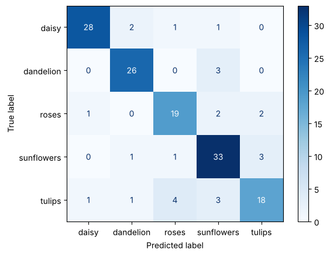
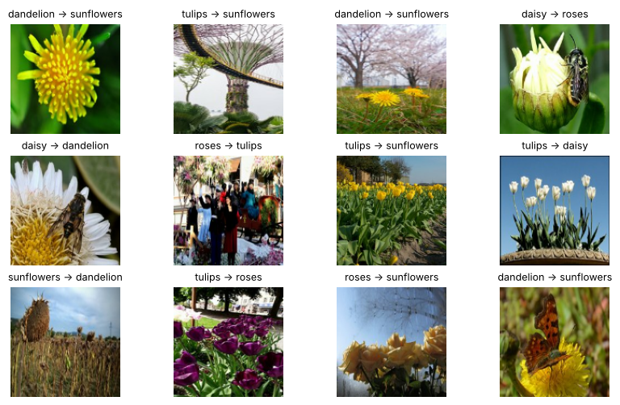
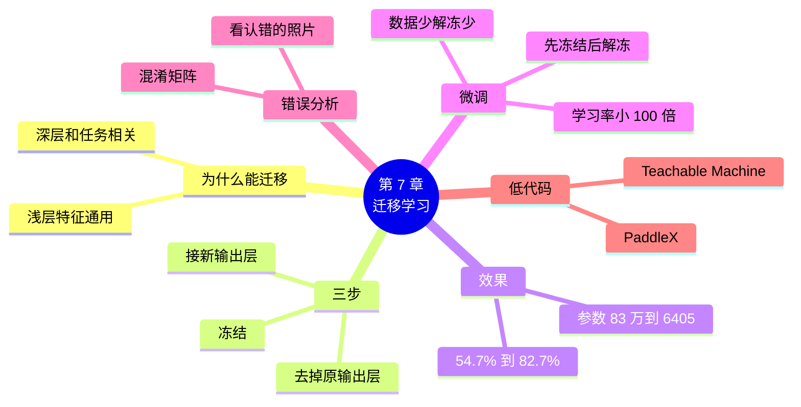

# 第 7 章 迁移学习：站在别人的肩膀上

!!! abstract "本章学时"
    理论 5 学时（线上 4 + 线下 1）· 实验 1 学时（本章共 3 个实验，教师可任选）

## 学习目标

学完本章，你应该能够：

1. **说出**迁移学习的含义，以及冻结、微调的作用（记忆）；
2. **解释**为什么数据少的时候，迁移学习比从零训练效果好得多（理解）；
3. **运行**代码，用预训练模型完成花卉识别的迁移学习，并预测新照片（应用）；
4. **读懂**混淆矩阵，找出模型最容易混淆的类别并分析原因（分析）；
5. **判断**一个任务该从零训练、迁移学习还是直接用现成模型（评价）。

!!! info "先修要求"
    学习本章前，你需要掌握：

    - 预训练模型和 ImageNet（[2.1.2](../02-pretrained/index.md#212)）；
    - 卷积层“浅层找简单图案、深层找复杂图案”（[4.3.2](../04-build-network/index.md#432)）；
    - 训练曲线、过拟合和早停（[6.2 节](../06-tuning/index.md#62)、[6.3 节](../06-tuning/index.md#63)）。

??? abstract "本章概念清单（5 个，点击查看定义和例子）"
    1. [迁移学习](../../appendix/glossary.md#g-迁移学习)
    2. [特征](../../appendix/glossary.md#g-特征)
    3. [冻结](../../appendix/glossary.md#g-冻结)
    4. [微调](../../appendix/glossary.md#g-微调)
    5. [混淆矩阵](../../appendix/glossary.md#g-混淆矩阵)

## 情景导入

小林有点泄气：调了一整章参数，花卉模型最好也只认对六成多。“是不是要再去拍几千张照片才行？”

小周笑了：“还记得第 2 章那个 MobileNetV2 吗？它不认识郁金香，可它在一百多万张照片上练过，边缘、颜色、花瓣、纹理这些‘看图的本领’早就学会了。你从零开始，等于让一个刚出生的婴儿只看 600 张照片就学会认花；而借用它，等于请一位见多识广的美术老师来认花，只需要告诉他这五种花各叫什么名字。”

“这也行？”

“这叫迁移学习。试试看，十几行代码，验证准确率能到八成以上。”

## 7.1 迁移学习：把学过的本领用到新任务上 { #71 }

### 7.1.1 生活中的迁移 { #711 }

会骑自行车的人学骑电动车，很快就会；学过五线谱的人学吉他，比完全零基础的人快得多。把在一件事上学到的本领用到另一件相关的事上，这就是迁移。

机器学习里的[**迁移学习**](../../appendix/glossary.md#g-迁移学习 "把在一个任务（通常是大数据集）上训练好的模型，拿来作为新任务的起点继续训练的方法"){ .term }也是这个意思：把一个在大数据集上训练好的模型，拿来做新任务的起点，而不是从一堆随机数开始<sup class="cite">[[1]](#ref7-1)</sup>。

### 7.1.2 为什么能迁移：浅层的本领是通用的 { #712 }

第 4 章说过，卷积网络是一层层看图的：浅层的“放大镜”找边缘、颜色、简单纹理，深层的放大镜在此基础上拼出花瓣、眼睛、轮子这些复杂的形状。研究者把训练好的网络每一层“喜欢”的图案画出来，发现确实如此<sup class="cite">[[2]](#ref7-2)</sup>。

关键在于：**越浅的层学到的本领越通用**。不管认猫、认车还是认花，都要先看出边缘和颜色。在 ImageNet 一百多万张照片上练出来的这些本领，拿来认花一样好用。只有最后几层、尤其是输出层，才和“认哪 1000 种东西”直接相关，需要换掉。

这些网络从图片中提炼出来的有用信息，叫[**特征**](../../appendix/glossary.md#g-特征 "网络从输入数据中提炼出来、对完成任务有用的信息，如边缘、纹理、形状"){ .term }。所以借来的那部分网络，也常被叫作“特征提取器”。

### 7.1.3 什么时候用迁移学习 { #713 }

| 情况 | 推荐做法 | 本书的例子 |
|---|---|---|
| 要认的东西，现成模型已经认识 | 直接用现成模型 | 第 2 章认雏菊、第 8 章检测行人 |
| 现成模型不认识，但自己的数据**不多** | **迁移学习** | 本章：600 张照片认 5 种花 |
| 数据非常多，或者任务和现有模型差别很大 | 从零训练 | 大公司训练新的基础模型 |

对绝大多数实际项目来说，迁移学习是首选。

## 7.2 三步做迁移学习 { #72 }

### 7.2.1 第一步：请出预训练模型，去掉原来的输出层 { #721 }

=== "通用版"

    ```python
    base = keras.applications.MobileNetV2(input_shape=(128, 128, 3),
                                          include_top=False,     # 不要原来 1000 类的输出层
                                          weights="imagenet")    # 要 ImageNet 上训练好的参数
    ```

    第 2 章用的是完整的 MobileNetV2；这里 `include_top=False` 表示只要前面“看图”的部分，不要最后那个输出 1000 类的“头”。MobileNetV2 有 128×128 输入的预训练版本，正好和我们的数据集大小一致。

=== "国产版"

    ```python
    net = paddle.vision.models.mobilenet_v2(pretrained=True)    # 带 ImageNet 上训练好的参数
    ```

    `paddle.vision.models` 是飞桨自带的模型库，`pretrained=True` 表示要训练好的参数<sup class="cite">[[3]](#ref7-3)</sup>。飞桨的 MobileNetV2 由两部分组成：`net.features`（看图的部分）和 `net.classifier`（输出 1000 类的头），第三步会把 `classifier` 换掉。

### 7.2.2 第二步：冻结 { #722 }

借来的本领很宝贵，不能被我们这 600 张照片“带偏”。所以先把它[**冻结**](../../appendix/glossary.md#g-冻结 "训练时让某些层的参数保持不变、不参与更新"){ .term }起来：训练时，这部分的参数一个都不改。

=== "通用版"

    ```python
    base.trainable = False                     # 冻结：训练时不改它的参数
    ```

=== "国产版"

    ```python
    for p in net.parameters():
        p.stop_gradient = True                 # 冻结：不给这些参数算梯度，也就不会改
    ```

    `stop_gradient` 的意思是“到此为止，不往这里传梯度”。第 5 章说过，参数是按梯度改的，没有梯度就不会被改。

### 7.2.3 第三步：接上自己的输出层 { #723 }

=== "通用版"

    ```python
    model = keras.Sequential([
        keras.Input(shape=(128, 128, 3)),
        layers.Rescaling(1 / 127.5, offset=-1),    # 0～255 换算成 -1～1（MobileNetV2 的规矩）
        base,                                      # 借来的“眼睛”，当成一块大积木
        layers.GlobalAveragePooling2D(),           # 把图案地图压成一串数
        layers.Dropout(0.2),
        layers.Dense(5, activation="softmax"),     # 新的输出层：5 种花
    ])
    ```

=== "国产版"

    ```python
    net.classifier = nn.Sequential(nn.Dropout(0.2),
                                   nn.Linear(1280, 5),       # 新的输出层：5 种花
                                   nn.Softmax())
    ```

    直接把 `net.classifier` 换成新的。`1280` 是 MobileNetV2 看图部分最后输出的数的个数。预处理要照预训练模型的规矩，用 ImageNet 的平均值和标准差做标准化：`T.Normalize(mean=[0.485, 0.456, 0.406], std=[0.229, 0.224, 0.225])`。

**全局平均池化**（GlobalAveragePooling2D）把每个通道的整张图案地图求一个平均数，4×4×1280 的地图就变成 1280 个数，比第 4 章的“展平”（会得到 20480 个数）少得多，后面输出层的参数也就少得多。

### 7.2.4 看结构表：要学的参数只剩几千个 { #724 }

=== "通用版"

    ```text
     Total params: 2,264,389 (8.64 MB)
     Trainable params: 6,405 (25.02 KB)
     Non-trainable params: 2,257,984 (8.61 MB)
    ```

=== "国产版"

    `paddle.summary` 同样会列出总参数和可训练参数。可训练参数是新输出层的 (1280 + 1) × 5 = 6405 个。

整个模型有 226 万个参数，但冻结之后，**要学的只有新输出层的 6405 个**：(1280 + 1) × 5 = 6405。第 5 章从零训练要学 83 万个参数，600 张照片根本不够；现在只学 6405 个，600 张就绰绰有余了。

## 7.3 效果：从五成多到八成多 { #73 }

### 7.3.1 训练日志 { #731 }

训练设置和第 5 章完全一样：Adam、学习率 0.001、10 轮。

=== "通用版"

    ```text
    Epoch 1/10
    19/19 - 7s - 344ms/step - accuracy: 0.3567 - loss: 1.5959 - val_accuracy: 0.6400 - val_loss: 0.9922
    Epoch 2/10
    19/19 - 2s - 118ms/step - accuracy: 0.7067 - loss: 0.8034 - val_accuracy: 0.7600 - val_loss: 0.7100
    ……（中间略）
    Epoch 10/10
    19/19 - 2s - 118ms/step - accuracy: 0.9433 - loss: 0.2055 - val_accuracy: 0.8267 - val_loss: 0.5178
    ```

=== "国产版"

    !!! warning "待实测"
        编者的编写环境无法连接飞桨的模型下载服务器，拿不到 `pretrained=True` 的参数，下面的代码只在不加载预训练参数的情况下检查过能否运行。请在 AI Studio 上运行实验 7-1，把结果填进实验记录表。飞桨的 MobileNetV2 也是在 ImageNet 上预训练的，预计验证准确率和通用版同在八成左右。

和第 5 章放在一起比：

| | 要学的参数 | 第 1 轮验证准确率 | 第 10 轮训练准确率 | 第 10 轮验证准确率 |
|---|---|---|---|---|
| 从零训练（第 5 章） | 826,789 | 39.3% | 86.8% | 54.7% |
| 迁移学习（本章） | 6,405 | **64.0%** | 94.3% | **82.7%** |

第 1 轮就到了 64%，比从零训练 10 轮的结果还好；10 轮后验证准确率 82.7%，提高了将近 30 个百分点。训练和验证的差距也从 32 个百分点缩小到 12 个百分点，死记硬背明显减轻。

### 7.3.2 再认一遍第 2 章那 10 张照片 { #732 }

第 2 章的现成模型 10 张只认对 2 张。换成迁移学习的模型：

=== "通用版"

    ```text
    daisy_1.jpg      → daisy      86.6%
    daisy_2.jpg      → sunflowers 56.9%
    dandelion_1.jpg  → dandelion  100.0%
    dandelion_2.jpg  → dandelion  52.6%
    roses_1.jpg      → roses      86.6%
    roses_2.jpg      → roses      97.2%
    sunflowers_1.jpg → sunflowers 93.2%
    sunflowers_2.jpg → sunflowers 81.7%
    tulips_1.jpg     → tulips     54.1%
    tulips_2.jpg     → tulips     81.2%
    ```

=== "国产版"

    !!! warning "待实测"
        请在 AI Studio 上运行实验 7-1 的第 4 步，记录结果。

10 张认对 9 张。唯一认错的 daisy_2 是一丛淡紫色花瓣、大大的黄色花心的花，被当成了向日葵，而且模型只有 56.9% 的把握，自己也拿不准。

## 7.4 微调：解冻后面几层 { #74 }

### 7.4.1 先冻结，再微调 { #741 }

只训练输出层，借来的本领原封不动。能不能让它更适应花卉？可以把预训练模型**最后几层**也“解冻”，跟着我们的照片一起调一调，这叫[**微调**](../../appendix/glossary.md#g-微调 "在迁移学习中解冻预训练模型的部分层，用很小的学习率继续训练，让它更适应新任务"){ .term }（Fine-tuning）。

微调有两条规矩：

1. **先冻结训练好输出层，再解冻微调**。新输出层刚开始是随机的，一上来就一起训练，乱七八糟的梯度会把借来的本领破坏掉；
2. **微调的学习率要很小**，一般比原来小 10～100 倍，只是“轻轻调一调”。

=== "通用版"

    ```python
    base.trainable = True                              # 先整体解冻
    for layer in base.layers[:len(base.layers) - 30]:
        layer.trainable = False                        # 再把前面的层重新冻结，只留最后 30 层
    model.compile(loss="sparse_categorical_crossentropy",
                  optimizer=keras.optimizers.Adam(0.00001), metrics=["accuracy"])  # 学习率小 100 倍
    model.fit(train_ds, validation_data=val_ds, epochs=10)
    ```

    改了哪些层可以训练之后，要重新 `compile` 才会生效。

=== "国产版"

    ```python
    blocks = list(net.features.children())            # 看图部分一共 19 块
    for b in blocks[-3:]:                              # 最后 3 块
        for p in b.parameters():
            p.stop_gradient = False                    # 解冻
    params = [p for p in net.parameters() if not p.stop_gradient]
    model.prepare(paddle.optimizer.Adam(learning_rate=0.00001, parameters=params),  # 学习率小 100 倍
                  nn.CrossEntropyLoss(use_softmax=False), paddle.metric.Accuracy())
    ```

    飞桨的 MobileNetV2 把 154 层组织成了 19 块，按块解冻更方便。优化器要重新告诉它“改哪些参数”。

### 7.4.2 解冻多少层好 { #742 }

实验 7-3 先只训练输出层 10 轮（验证准确率 82.7%），再分别解冻最后 0、30、60、154 层，用学习率 0.00001 训练 10 轮：

<iframe class="sim-frame" src="../../sims/freeze-layers/main.html" height="460" loading="lazy" title="冻结几层好"></iframe>

[全屏打开动画](../../sims/freeze-layers/main.html){ target=_blank }

| 解冻最后几层（通用版） | 可训练参数 | 微调后验证准确率 |
|---|---|---|
| 0（不微调） | 6,405 | 82.7% |
| 30 | 1,532,805 | **86.0%** |
| 60 | 1,962,117 | 85.3% |
| 154（全部） | 2,230,277 | 84.0% |

解冻最后 30 层效果最好；解冻得越多，要调的参数越多，600 张照片又“喂不饱”了，效果反而下降。经验是：**数据越少，解冻越少**。国产版的结果见实验 7-3（待实测）。

## 7.5 错误分析：混淆矩阵 { #75 }

### 7.5.1 准确率只告诉你“错了多少” { #751 }

82.7% 的准确率说明 150 张验证照片认错了 26 张。可到底哪种花最容易认错？错成了什么？准确率回答不了。这要用[**混淆矩阵**](../../appendix/glossary.md#g-混淆矩阵 "按“实际类别 × 预测类别”交叉统计样本数量的表格，用来看模型把哪些类别搞混了"){ .term }。

### 7.5.2 怎样读混淆矩阵 { #752 }

{ width="440" }

- **每一行**是一种花的真实类别，**每一列**是模型预测的类别；
- **对角线**（左上到右下）上的数是认对的：雏菊认对 28 张、蒲公英 26 张、玫瑰 19 张、向日葵 33 张、郁金香 18 张，加起来 124 张，124 ÷ 150 = 82.7%；
- **对角线以外**的数是认错的。比如郁金香那一行，有 4 张被认成了玫瑰、3 张认成了向日葵。

一眼看过去，**郁金香**最容易错（27 张里错了 9 张），它常被认成玫瑰和向日葵；蒲公英和向日葵之间也会互相认错。

### 7.5.3 看看认错的照片 { #753 }

光看数字还不够，要把认错的照片挑出来看看。每张图上方写的是“真实类别 → 模型预测”：



仔细看，认错的原因大致有三类：

1. **颜色、形状真的很像**：黄色的蒲公英和向日葵、红色的郁金香和玫瑰，人一眼扫过去也可能看错；
2. **主角不明显**：有的照片里花很小，画面主要是人群、天空、昆虫或其他东西；
3. **数据本身有问题**：有一张标着“郁金香”的照片，画面里几乎看不到郁金香。公开数据集里难免有这类拍得不典型甚至标错的照片。

找到原因，才知道怎么改进：容易混的类别多补一些照片；花太小的照片可以裁剪；标错的照片要改正或删掉。这种“先看错在哪、再对症改进”的做法叫**错误分析**，是做实际项目最有用的习惯之一。

!!! cert "证书考点"
    人工智能应用工程师（高级）、人工智能数据处理工程师（高级）证书中涉及深度学习框架的部分，都会考查迁移学习的思路和模型评估方法。混淆矩阵是分类模型评估的基本工具。

## 7.6 低代码训练：不写代码也能迁移学习 { #76 }

迁移学习的步骤很固定：选模型、冻结、换输出层、训练、评估。于是有了把这些步骤包装好的**低代码**工具，准备好数据、填几个设置就能训练。

=== "通用版"

    谷歌的 Teachable Machine 是一个网页工具<sup class="cite">[[4]](#ref7-4)</sup>：打开网页，用摄像头拍或上传每一类的照片，点“训练”，几十秒后就能在网页上试用，还能导出成 TensorFlow 模型。它背后用的就是本章的迁移学习，适合课堂演示和快速验证想法。

=== "国产版"

    飞桨的 **PaddleX** 是低代码开发工具<sup class="cite">[[5]](#ref7-5)</sup>，第 2 章用它调用过现成模型。它把图像分类、目标检测、文字识别等任务都做成了“产线”，按规定格式整理好数据后，修改配置文件中的几项设置（数据集路径、类别数、轮次等）就能训练和评估，训练出的模型可以直接用 `create_model` 加载。AI Studio 上还提供了图形界面版本。

    !!! warning "待实测"
        PaddleX 的训练需要先从飞桨服务器下载预训练参数和配置，编者的编写环境无法连接，这里只做介绍。PaddleX 的命令和配置项随版本变化较快，请以官方文档的“图像分类模块使用教程”为准。

低代码工具省事，但代价是“看不见里面”。学完本书，你知道这些按钮背后发生了什么，遇到效果不好时才知道从哪里下手：是数据不够、类别太像，还是过拟合了。

## 7.7 本章常见报错对照 { #77 }

| 报错原文 | 用大白话说 | 怎么改 |
|---|---|---|
| `layer 'global_average_pooling2d' is incompatible with the layer: expected ndim=4, found ndim=2. Full shape received: (None, 1000)` | 忘了去掉原来的输出层，借来的模型已经输出 1000 个数了 | 加上 `include_top=False` |
| 下载预训练参数时报 `URLError`、`403`、`Connection` | 当前环境连不上下载服务器 | 换一个云平台；或者请老师提前把参数文件放到共享目录 |
| 迁移学习后验证准确率反而很低（二三成） | 预处理没按预训练模型的规矩做，比如通用版忘了换算到 -1～1，国产版忘了 `Normalize` | 对照 7.2.3 节检查预处理 |
| 微调后准确率突然大跌 | 微调的学习率太大，把借来的本领破坏了 | 学习率调小到 0.00001 左右 |
| `No module named 'sklearn'` | 画混淆矩阵用的 scikit-learn 没有安装 | 运行 `!pip install scikit-learn` |
| 国产版 `model.load` 后预测全错 | 加载前搭的网络和训练时不一样（比如没换 `classifier`） | 先用和训练时完全相同的代码搭网络、换输出层，再加载 |

## 7.8 前沿视窗：预训练 + 微调，大模型时代的标准做法 { #78 }

本章“先在大数据上预训练、再在小数据上微调”的思路，正是今天大模型的标准做法。像文心、通义千问、DeepSeek 这样的大语言模型，先在海量文字上预训练，学会语言的通用本领，再用少量特定数据微调，变成会写代码、会答客服、会看病历的专用模型。这类能作为许多任务起点的大型预训练模型，被称为**基础模型**<sup class="cite">[[6]](#ref7-6)</sup>。

大模型参数太多，全部微调成本很高，于是出现了只调一小部分参数的方法，最常用的叫 **LoRA**：冻结原模型，只在旁边加上少量新参数来训练，要学的参数可以减少到原来的千分之一甚至更少<sup class="cite">[[7]](#ref7-7)</sup>。这和本章“冻结大部分、只训练一小部分”的思路一脉相承。

对普通开发者来说，未来做人工智能应用，大多数时候不是从零训练模型，而是**选一个合适的基础模型，用自己的数据微调**。本章学的，就是这项本领最基本的形式。

## 本章实验

!!! abstract "实验总览"
    | 实验 | 类型 | 建议时长 | 内容 |
    |---|---|---|---|
    | 实验 7-1 | ★ 必做 | 25 分钟 | 迁移学习：借 MobileNetV2 认花 |
    | 实验 7-2 | ★ 必做 | 20 分钟 | 错误分析：混淆矩阵和认错的照片 |
    | 实验 7-3 | ☆ 选做 | 25 分钟 | 微调：解冻后面几层 |

    代码见配套资源 `labs/ch07/` 目录（`keras/` 通用版，`paddle/` 国产版）。第一次运行要下载预训练参数（通用版约 9 MB）。实验 7-2 要用到实验 7-1 保存的模型。

### 实验 7-1 ★ 迁移学习：借 MobileNetV2 认花 { #7-1 }

**实验目的**

1. 完成冻结、换输出层、训练三步；
2. 比较迁移学习和从零训练的效果。

**实验环境**：云端 Notebook 或本机，CPU 即可，需要联网下载预训练参数。

**实验数据**：`labs/data/flowers_small/`，`labs/data/test_photos/`。

**实验步骤与代码**

第一档 · 跑通：打开 `lab7_1_transfer.ipynb`，依次运行。核心代码就是 7.2 节的三步。

完整代码：`labs/ch07/keras/lab7_1_transfer.ipynb`、`labs/ch07/paddle/lab7_1_transfer.ipynb`

**运行结果**：见 7.2.4、7.3.1、7.3.2 节（国产版待实测）。

第二档 · 改一改：

1. 去掉 `base.trainable = False`（国产版去掉冻结的两行，并把优化器的 `parameters` 改成 `net.parameters()`），用学习率 0.001 重新训练，看验证准确率怎么变；
2. 用手机拍一张身边的花（如果是这五种之一），让模型认一认。

**实验记录表**

| 设置 | 可训练参数 | 第 10 轮验证准确率 | 10 张测试照片认对几张 |
|---|---|---|---|
| 冻结，只训练输出层 | | | |
| 不冻结，学习率 0.001 | | | |

**常见问题排查**

| 现象 | 原因 | 解决办法 |
|---|---|---|
| 下载参数很慢或失败 | 网络问题 | 换一个云平台，或使用老师提供的参数文件 |
| 训练比第 5 章慢 | MobileNetV2 比我们自己的网络大 | 正常；有 GPU 会快很多 |

**思考与练习**

1. 不冻结时，为什么效果可能变差？（提示：联系第 6 章的过拟合）

**实验报告要求**

提交训练日志截图、10 张测试照片的识别结果和实验记录表。

### 实验 7-2 ★ 错误分析：混淆矩阵和认错的照片 { #7-2 }

**实验目的**

1. 学会计算和阅读混淆矩阵；
2. 通过查看认错的照片，分析模型出错的原因。

**实验环境**：云端 Notebook 或本机，CPU 即可。需要 scikit-learn（云平台一般已预装）。

**实验步骤与代码**

第一档 · 跑通：先完成实验 7-1，再打开 `lab7_2_confusion.ipynb`。核心是对验证集逐批预测，收集标准答案和预测结果，再交给 scikit-learn 计算：

=== "通用版"

    ```python
    y_true, y_pred, images = [], [], []
    for x, y in val_ds:                                              # 一批一批地预测
        y_true += list(y.numpy())                                    # 标准答案
        y_pred += list(model.predict(x, verbose=0).argmax(1))        # 模型的预测
        images += list(x.numpy())                                    # 照片留着后面看
    y_true, y_pred = np.array(y_true), np.array(y_pred)
    from sklearn.metrics import confusion_matrix, ConfusionMatrixDisplay
    cm = confusion_matrix(y_true, y_pred)                            # 行是真实类别，列是预测类别
    ```

    完整代码：`labs/ch07/keras/lab7_2_confusion.ipynb`

=== "国产版"

    ```python
    y_true, y_pred, images = [], [], []
    for x, y in paddle.io.DataLoader(val_ds, batch_size=50):       # 一批一批地预测
        y_true += y.numpy().ravel().tolist()                        # 标准答案
        y_pred += net(x).argmax(1).numpy().tolist()                 # 模型的预测
        images += list(x.numpy())                                   # 照片留着后面看
    y_true, y_pred = np.array(y_true), np.array(y_pred)
    from sklearn.metrics import confusion_matrix, ConfusionMatrixDisplay
    cm = confusion_matrix(y_true, y_pred)                           # 行是真实类别，列是预测类别
    ```

    完整代码：`labs/ch07/paddle/lab7_2_confusion.ipynb`

为什么要“一批一批地”预测，而不是把整个验证集一次交给 `predict`？因为数据集每次被读取都会重新打乱顺序，分两次读，标准答案和预测结果就对不上了。在同一个循环里同时记下两者，就不会出错。

**运行结果**

=== "通用版"

    ```text
    验证准确率： 0.8267
    [[28  2  1  1  0]
     [ 0 26  0  3  0]
     [ 1  0 19  2  2]
     [ 0  1  1 33  3]
     [ 1  1  4  3 18]]
    认错了 26 张
    ```

    混淆矩阵图和认错的照片见 7.5 节。

=== "国产版"

    !!! warning "待实测"
        依赖实验 7-1 的结果，请在 AI Studio 上运行。

第二档 · 改一改：

1. 根据混淆矩阵，算出每种花各自的准确率（对角线上的数 ÷ 这一行的总数）；
2. 在认错的照片中挑 3 张，写出你认为它被认错的原因。

**实验记录表**

| 花 | 这一行总数 | 认对几张 | 这种花的准确率 | 最常被认成 |
|---|---|---|---|---|
| daisy | | | | |
| dandelion | | | | |
| roses | | | | |
| sunflowers | | | | |
| tulips | | | | |

**常见问题排查**

| 现象 | 原因 | 解决办法 |
|---|---|---|
| `File not found: filepath=flowers_transfer.keras` | 没有先完成实验 7-1，或者不在同一个文件夹 | 先运行实验 7-1 |
| 混淆矩阵只有最后一行有数 | 读验证集时设了 `shuffle=False`，分出来的验证集和训练时不一样 | 用和训练时完全相同的读数据代码 |

**思考与练习**

1. 如果要让模型少把郁金香认成玫瑰，你会怎么做？

**实验报告要求**

提交混淆矩阵图、实验记录表和错误原因分析。

### 实验 7-3 ☆ 微调：解冻后面几层 { #7-3 }

**实验目的**

1. 学会两阶段训练：先训练输出层，再解冻微调；
2. 比较解冻不同层数的效果。

**实验环境**：云端 Notebook，建议用 GPU（CPU 上每次约 1～2 分钟）。

**实验步骤与代码**

第一档 · 跑通：打开 `lab7_3_fine_tune.ipynb`，最前面是要改的设置：

=== "通用版"

    ```python
    UNFREEZE = 30       # ← 改这里：解冻最后几层，试试 0、30、60、154（全部）
    ```

=== "国产版"

    ```python
    UNFREEZE = 3        # ← 改这里：解冻最后几块，试试 0、3、6、19（全部）
    ```

微调部分的代码见 7.4.1 节。完整代码：`labs/ch07/keras/lab7_3_fine_tune.ipynb`、`labs/ch07/paddle/lab7_3_fine_tune.ipynb`

**运行结果**

=== "通用版"

    ```text
    第一阶段（只训练输出层）验证准确率： 0.8267
    解冻最后 30 层：可训练参数 1,532,805，第二阶段后验证准确率 0.8600（最高 0.8600）
    ```

    其他设置的结果见 7.4.2 节的表格。

=== "国产版"

    !!! warning "待实测"
        需要预训练参数，请在 AI Studio 上运行，把结果填进记录表。

第二档 · 改一改：按记录表改 `UNFREEZE`，依次运行。

**实验记录表**

| UNFREEZE | 可训练参数 | 微调后验证准确率 |
|---|---|---|
| 0 | | |
| 30（国产版 3） | | |
| 60（国产版 6） | | |
| 全部 | | |

第三档 · 挑战（选做）：把微调的学习率改成 0.001（大 100 倍），看会发生什么。

**常见问题排查**

| 现象 | 原因 | 解决办法 |
|---|---|---|
| 改了 `UNFREEZE` 可训练参数却没变 | 通用版改完 `trainable` 后没有重新 `compile` | 解冻后要重新 `compile` |

**思考与练习**

1. 为什么微调要先冻结训练好输出层，而不是一开始就全部一起训练？

**实验报告要求**

提交实验记录表，并说明你会选择解冻多少层、为什么。

## 本章小结

- **迁移学习**把在大数据集上训练好的模型作为新任务的起点。浅层学到的边缘、颜色等**特征**是通用的，所以能迁移。
- 三步：请出预训练模型并去掉原输出层 → **冻结** → 接上自己的输出层。冻结后要学的参数从 83 万降到 6405 个。
- 效果：同样 600 张照片、10 轮，验证准确率从 54.7% 提高到 82.7%，测试照片 10 张认对 9 张。
- **微调**：先训练好输出层，再解冻最后几层，用很小的学习率继续训练；数据越少，解冻越少。本章解冻 30 层达到 86.0%。
- **混淆矩阵**的行是真实类别、列是预测类别，对角线是认对的。结合认错的照片做错误分析，才能对症改进。
- 低代码工具（Teachable Machine、PaddleX）把迁移学习的步骤包装好了，懂原理才能用好它们。



**下一章预告**

花卉识别助手已经能认对八成以上的花了。下一章走出“分类”，看看图像应用的另外两个大方向：**目标检测**，不光说出“有什么”，还要框出“在哪里、有几个”；**文字识别**，把照片里的文字变成表格。用的都是现成模型，几行代码就能做出实用的小工具。

## 参考文献

正文中的上标编号（如<sup class="cite">[[1]](#ref7-1)</sup>）对应下面的文献。带链接的可以直接打开；书籍可在图书馆或电子书平台查阅。

<div class="refs" markdown>

**经典论文**

- <span id="ref7-1"></span>[1] YOSINSKI J, CLUNE J, BENGIO Y, et al. How Transferable Are Features in Deep Neural Networks?[C]//Advances in Neural Information Processing Systems 27. Montreal: Curran Associates, 2014: 3320-3328.
    <span class="ref-note">研究卷积网络各层特征能迁移到什么程度，得出“浅层通用、深层专用”的结论，对应 7.1 节。</span>
- <span id="ref7-2"></span>[2] ZEILER M D, FERGUS R. Visualizing and Understanding Convolutional Networks[C]//Computer Vision – ECCV 2014. Zurich: Springer, 2014: 818-833.
    <span class="ref-note">把卷积网络每一层“喜欢”的图案画出来的经典论文，对应 7.1.2 节。</span>
- <span id="ref7-6"></span>[6] BOMMASANI R, HUDSON D A, ADELI E, et al. On the Opportunities and Risks of Foundation Models[EB/OL]. (2021-08-16)[2026-10-31]. <https://arxiv.org/abs/2108.07258>.
    <span class="ref-note">提出“基础模型”概念的长篇报告，对应 7.8 节。</span>
- <span id="ref7-7"></span>[7] HU E J, SHEN Y, WALLIS P, et al. LoRA: Low-Rank Adaptation of Large Language Models[C/OL]//International Conference on Learning Representations, 2022[2026-10-31]. <https://arxiv.org/abs/2106.09685>.
    <span class="ref-note">LoRA 微调方法的原始论文，对应 7.8 节。</span>

**在线资源**

- <span id="ref7-3"></span>[3] 飞桨. paddle.vision.models[EB/OL]. [2026-10-31]. <https://www.paddlepaddle.org.cn/documentation/docs/zh/api/paddle/vision/Overview_cn.html>.
    <span class="ref-note">飞桨自带视觉模型库的说明，含 mobilenet_v2 等预训练模型，对应 7.2.1 节。</span>
- <span id="ref7-4"></span>[4] Google. Teachable Machine[EB/OL]. [2026-10-31]. <https://teachablemachine.withgoogle.com/>.
    <span class="ref-note">谷歌的网页版低代码训练工具，对应 7.6 节。</span>
- <span id="ref7-5"></span>[5] PaddleX 文档[EB/OL]. [2026-10-31]. <https://paddlepaddle.github.io/PaddleX/>.
    <span class="ref-note">飞桨低代码开发工具 PaddleX 的官方文档，其中“图像分类模块使用教程”介绍了用自己的数据训练的方法，对应 7.6 节。</span>
- <span id="ref7-8"></span>[8] Keras. Transfer learning & fine-tuning[EB/OL]. [2026-10-31]. <https://keras.io/guides/transfer_learning/>.
    <span class="ref-note">Keras 官方的迁移学习与微调指南，本章通用版代码的写法参考了它，对应 7.2 节和 7.4 节。</span>

</div>

## 课后练习

选择题和判断题可以直接点击选项作答，系统会马上告诉你对错，并展开答案与解析；多选题选好后点“提交答案”。简答和实操题请先自己作答，再点开“答案与解析”核对。每道题的解析下方都有“回看”链接，做错了可以直接跳回正文复习。

**一、单项选择题**

<div class="quiz" data-answer="C" markdown>

**1.** 把在 ImageNet 上训练好的模型拿来做花卉识别的起点，这种方法叫（　　）。

- A. 数据增强
- B. 早停
- C. 迁移学习
- D. 从零训练

</div>

??? tip "答案与解析"
    **答案：C**

    迁移学习就是把学过的本领用到新任务上。

    考查：迁移学习 · 认知层次：记忆 · [回看 7.1.1](#711)
    { .quiz-meta }

<div class="quiz" data-answer="A" markdown>

**2.** 迁移学习能成功，主要是因为（　　）。

- A. 卷积网络浅层学到的边缘、颜色等特征是通用的
- B. 预训练模型已经认识所有的花
- C. 预训练模型的参数特别少
- D. 迁移学习不需要训练

</div>

??? tip "答案与解析"
    **答案：A**

    浅层的“看图本领”不管认什么都用得上；预训练模型并不认识郁金香等花，仍需要训练新输出层。

    考查：迁移的原理 · 认知层次：理解 · [回看 7.1.2](#712)
    { .quiz-meta }

<div class="quiz" data-answer="B" markdown>

**3.** Keras 中 `MobileNetV2(include_top=False)` 的作用是（　　）。

- A. 不下载预训练参数
- B. 不要原来输出 1000 类的输出层
- C. 冻结所有层
- D. 只保留最后一层

</div>

??? tip "答案与解析"
    **答案：B**

    top 指网络最上面的“头”，即原来的输出层。

    考查：去掉输出层 · 认知层次：理解 · [回看 7.2.1](#721)
    { .quiz-meta }

<div class="quiz" data-answer="D" markdown>

**4.** 冻结预训练模型后，花卉迁移模型要学的参数是 6405 个，它们属于（　　）。

- A. 第一个卷积层
- B. 全部 154 层
- C. 全局平均池化层
- D. 新接的输出层

</div>

??? tip "答案与解析"
    **答案：D**

    (1280 + 1) × 5 = 6405，正是新输出层的参数。池化层没有参数。

    考查：冻结与参数量 · 认知层次：应用 · [回看 7.2.4](#724)
    { .quiz-meta }

<div class="quiz" data-answer="C" markdown>

**5.** 微调时，学习率一般应（　　）。

- A. 比原来大 10 倍
- B. 和原来一样
- C. 比原来小 10～100 倍
- D. 设为 0

</div>

??? tip "答案与解析"
    **答案：C**

    微调只是“轻轻调一调”，学习率太大会破坏借来的本领；设为 0 等于不训练。

    考查：微调 · 认知层次：理解 · [回看 7.4.1](#741)
    { .quiz-meta }

<div class="quiz" data-answer="A" markdown>

**6.** 在混淆矩阵中，对角线上的数表示（　　）。

- A. 每一类认对的数量
- B. 每一类认错的数量
- C. 每一类的总数
- D. 模型的参数量

</div>

??? tip "答案与解析"
    **答案：A**

    行是真实类别、列是预测类别，行列相同的格子就是认对的。

    考查：混淆矩阵 · 认知层次：理解 · [回看 7.5.2](#752)
    { .quiz-meta }

<div class="quiz" data-answer="B" markdown>

**7.** 混淆矩阵中郁金香那一行是 [1, 1, 4, 3, 18]（列依次为雏菊、蒲公英、玫瑰、向日葵、郁金香），郁金香最常被认成（　　）。

- A. 雏菊
- B. 玫瑰
- C. 向日葵
- D. 郁金香

</div>

??? tip "答案与解析"
    **答案：B**

    对角线以外，玫瑰那一列的 4 最大。D 是认对的数量。

    考查：读混淆矩阵 · 认知层次：分析 · [回看 7.5.2](#752)
    { .quiz-meta }

<div class="quiz" data-answer="D" markdown>

**8.** 一家医院有 300 张某种皮肤病的照片，想做一个识别模型，最合适的做法是（　　）。

- A. 从零训练一个大网络
- B. 直接用 ImageNet 的现成模型，不做训练
- C. 先收集一百万张照片再说
- D. 用预训练模型做迁移学习

</div>

??? tip "答案与解析"
    **答案：D**

    现成模型不认识这种病，数据又不多，正是迁移学习的用武之地。

    考查：方法选择 · 认知层次：评价 · [回看 7.1.3](#713)
    { .quiz-meta }

**二、多项选择题**

<div class="quiz quiz-multi" data-answer="ABC" markdown>

**1.** 迁移学习的基本步骤包括（　　）。

- A. 请出预训练模型，去掉原来的输出层
- B. 冻结预训练模型
- C. 接上自己的输出层并训练
- D. 把预训练参数全部清零

</div>

??? tip "答案与解析"
    **答案：ABC**

    清零就等于从零训练，失去了迁移的意义。

    考查：迁移学习三步 · 认知层次：记忆 · [回看 7.2](#72)
    { .quiz-meta }

<div class="quiz quiz-multi" data-answer="AD" markdown>

**2.** 关于微调，正确的有（　　）。

- A. 要先训练好新输出层，再解冻
- B. 解冻的层越多，效果一定越好
- C. Keras 中改了 trainable 之后不用重新 compile
- D. 数据越少，一般解冻得越少

</div>

??? tip "答案与解析"
    **答案：AD**

    实验 7-3 中全部解冻反而比解冻 30 层差；Keras 改了可训练的层之后要重新 compile 才生效。

    考查：微调 · 认知层次：理解 · [回看 7.4](#74)
    { .quiz-meta }

<div class="quiz quiz-multi" data-answer="ABCD" markdown>

**3.** 根据错误分析，模型认错照片的可能原因有（　　）。

- A. 两种花颜色、形状很像
- B. 照片里花太小，主角不明显
- C. 照片本身标错了或很不典型
- D. 某一类的训练照片太少

</div>

??? tip "答案与解析"
    **答案：ABCD**

    前三种在本章认错的照片中都能看到；类别照片少也是常见原因。

    考查：错误分析 · 认知层次：分析 · [回看 7.5.3](#753)
    { .quiz-meta }

**三、判断题**

<div class="quiz quiz-judge" data-answer="√" markdown>

**1.** 冻结的层在训练时参数保持不变。

- √ 正确
- × 错误

</div>

??? tip "答案与解析"
    **答案：√**

    考查：冻结 · 认知层次：记忆 · [回看 7.2.2](#722)
    { .quiz-meta }

<div class="quiz quiz-judge" data-answer="×" markdown>

**2.** 迁移学习只适用于花卉识别，不能用于其他任务。

- √ 正确
- × 错误

</div>

??? tip "答案与解析"
    **答案：×**

    迁移学习广泛用于图像、文字、语音等各种任务，大模型的微调也是迁移学习。

    考查：迁移学习的应用 · 认知层次：理解 · [回看 7.8](#78)
    { .quiz-meta }

<div class="quiz quiz-judge" data-answer="√" markdown>

**3.** 只看准确率，看不出模型最容易把哪两类搞混。

- √ 正确
- × 错误

</div>

??? tip "答案与解析"
    **答案：√**

    要用混淆矩阵才能看出错在哪里。

    考查：混淆矩阵 · 认知层次：理解 · [回看 7.5.1](#751)
    { .quiz-meta }

<div class="quiz quiz-judge" data-answer="×" markdown>

**4.** 使用预训练模型时，预处理方式可以随便选，不影响效果。

- √ 正确
- × 错误

</div>

??? tip "答案与解析"
    **答案：×**

    要按预训练时的规矩做预处理（如 MobileNetV2 的 -1～1、飞桨的 ImageNet 标准化），否则效果会大打折扣。

    考查：预处理 · 认知层次：理解 · [回看 7.2.3](#723)
    { .quiz-meta }

<div class="quiz quiz-judge" data-answer="√" markdown>

**5.** 全局平均池化把每个通道的图案地图求一个平均数，得到的数比“展平”少得多。

- √ 正确
- × 错误

</div>

??? tip "答案与解析"
    **答案：√**

    4×4×1280 的地图，全局平均池化后是 1280 个数，展平后是 20480 个数。

    考查：全局平均池化 · 认知层次：理解 · [回看 7.2.3](#723)
    { .quiz-meta }

**四、简答题**

**1.** 用自己的话解释：为什么同样 600 张照片，迁移学习比从零训练的验证准确率高这么多？

??? tip "答案与解析"
    **参考答案：** 从零训练要用 600 张照片学 83 万个参数，数据远远不够，模型只能死记硬背，验证准确率五成多。迁移学习借用了在一百多万张照片上学到的看图本领（边缘、颜色、纹理、形状等通用特征），冻结后只需学新输出层的 6405 个参数，600 张照片足够把它学好，所以验证准确率提高到八成以上。

    考查：迁移学习的原理 · 认知层次：理解 · [回看 7.3.1](#731)
    { .quiz-meta }

**2.** 微调为什么要“先冻结训练好输出层，再解冻”？

??? tip "答案与解析"
    **参考答案：** 新输出层刚接上时参数是随机的，算出的梯度很大、很乱。如果一开始就把预训练层一起训练，这些乱七八糟的梯度会传进预训练层，破坏借来的本领。先冻结、把输出层训练好，梯度变得平稳，再解冻并用很小的学习率微调，就能在不破坏原有本领的前提下让模型更适应新任务。

    考查：微调 · 认知层次：理解 · [回看 7.4.1](#741)
    { .quiz-meta }

**3.** 根据本章的混淆矩阵和认错的照片，给小林提三条改进花卉识别助手的具体建议。

??? tip "答案与解析"
    **参考答案（言之有理即可）：** ① 郁金香最容易认错，多补充一些郁金香照片，尤其是红色郁金香，帮助模型和玫瑰区分；② 检查数据集，把标错或花几乎看不见的照片改正或删掉；③ 对花太小的照片裁剪出花的部分再训练；④ 加上数据增强并做适当微调（实验 7-3 中解冻 30 层提高到 86%）；⑤ 对把握很低的预测，让程序回答“我不确定”。

    考查：错误分析与改进 · 认知层次：评价 · [回看 7.5.3](#753)
    { .quiz-meta }

**五、实操题**

**1.** 在实验 7-1 的基础上，给模型加上数据增强（第 6 章的三块增强积木，放在 `Rescaling` 前面），训练 15 轮，记录验证准确率，和不加增强时比较。

??? tip "答案与解析"
    **参考做法（通用版）：**

    ```python
    model = keras.Sequential([
        keras.Input(shape=(128, 128, 3)),
        layers.RandomFlip("horizontal"), layers.RandomRotation(0.1), layers.RandomZoom(0.2),
        layers.Rescaling(1 / 127.5, offset=-1),
        base, layers.GlobalAveragePooling2D(), layers.Dropout(0.2),
        layers.Dense(5, activation="softmax"),
    ])
    ```

    国产版在训练集的流水线里加增强，写法见实验 6-2（训练集和验证集分别用两条流水线）。

    迁移学习时冻结的参数很多、要学的很少，过拟合本来就比从零训练轻，所以增强带来的提升一般没有第 6 章那么大，有时还要多训练几轮才能看出效果。以自己的运行结果为准，比较时看最高验证准确率和两条曲线的距离。

    考查：迁移学习与数据增强 · 认知层次：应用 · [回看 7.3](#73)
    { .quiz-meta }
