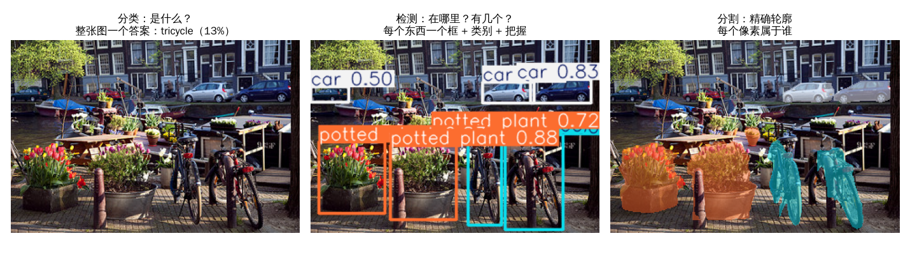
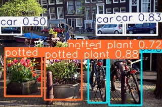
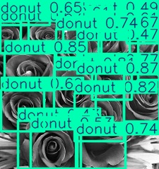
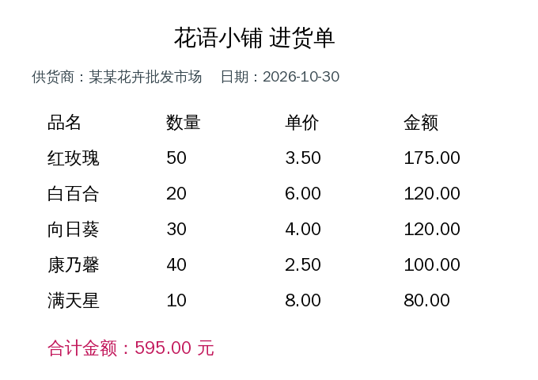
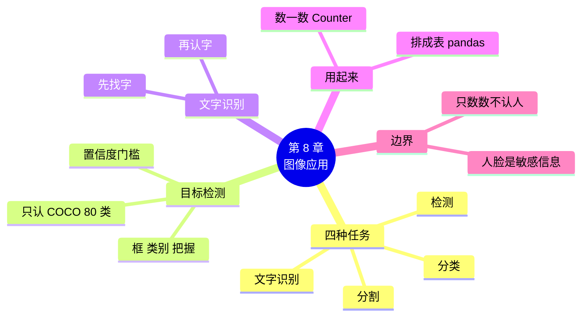

# 第 8 章 图像应用：检测与文字识别

!!! abstract "本章学时"
    理论 5 学时（线上 4 + 线下 1）· 实验 1 学时（本章共 3 个实验，教师可任选）

## 学习目标

学完本章，你应该能够：

1. **说出**分类、检测、分割、文字识别四种图像任务的区别（记忆）；
2. **解释**检测结果中边界框、类别、置信度的含义，以及置信度门槛的作用（理解）；
3. **运行**代码，用现成模型完成目标检测和文字识别，并把结果数一数、存成表格（应用）；
4. **分析**检测模型认错的原因，判断它是否适合自己的任务（分析）；
5. **判断**一个图像应用在隐私和授权上是否合规（评价）。

!!! info "先修要求"
    学习本章前，你需要掌握：

    - 预训练模型、置信度和文字识别（[2.1 节](../02-pretrained/index.md#21)、[2.3 节](../02-pretrained/index.md#23)）；
    - 图片是一堆数字、坐标从左上角算起（[3.1 节](../03-data/index.md#31)）；
    - 迁移学习“什么时候直接用现成模型”（[7.1.3](../07-transfer/index.md#713)）；
    - 附录 A 中的列表、字典和 for 循环。

??? abstract "本章概念清单（7 个，点击查看定义和例子）"
    1. [目标检测](../../appendix/glossary.md#g-目标检测)
    2. [边界框](../../appendix/glossary.md#g-边界框)
    3. [图像分割](../../appendix/glossary.md#g-图像分割)
    4. [置信度阈值](../../appendix/glossary.md#g-置信度阈值)
    5. [COCO 数据集](../../appendix/glossary.md#g-COCO-数据集)
    6. [文字检测](../../appendix/glossary.md#g-文字检测)
    7. [结构化数据](../../appendix/glossary.md#g-结构化数据)

## 情景导入

花店老板娘找到小林：“你那个认花的程序挺好玩。能不能帮我干两件实在的事？一是周末花田采摘园人多，我想知道每个时段大概来了多少人；二是每次进货都有一张手写或打印的进货单，我得一行行敲进 Excel，眼睛都看花了。”

小林犯了难：“认花是‘一张照片一个答案’，可数人要知道照片里**有几个人、在哪里**；进货单要把**每一个字**都读出来，还要排成表格。这得重新训练好几个模型吧？”

小周摇摇头：“这两件事太常见了，早就有人训练好了现成的模型。数人用[**目标检测**](../../appendix/glossary.md#g-目标检测 "找出图片中有哪些物体、各在什么位置的任务，每个物体用一个框加类别和置信度表示"){ .term }模型，读单据用**文字识别**模型，都是下载下来几行代码就能用。你要做的，是把它们的结果‘用起来’：数一数、排成表。”

这一章，我们就来做这两个实用的小工具。

## 8.1 图像任务一览 { #81 }

### 8.1.1 四种常见的图像任务 { #811 }

前面七章做的都是**分类**：给一整张照片，回答“这是什么”。可是一张街景照片里有车、有自行车、有花盆，一个答案说不清楚。下图是同一张照片交给三种不同模型的结果：



*图 8-1　分类、检测、分割的区别（编者用 YOLO11n 的三个版本实际运行；照片来自 TensorFlow 花卉数据集，Maks Karochkin 摄，CC BY 2.0）*

| 任务 | 回答的问题 | 输出 | 典型应用 |
|---|---|---|---|
| 分类 | 是什么？ | 一个类别 + 把握 | 认花、垃圾分类 |
| **目标检测** | 有什么？在哪里？有几个？ | 很多个框，每个框带类别和把握 | 数客流、数车辆、找缺陷 |
| [**图像分割**](../../appendix/glossary.md#g-图像分割 "判断图片中每个像素属于哪个物体或类别，得到物体精确轮廓的任务"){ .term } | 每个东西的精确轮廓？ | 每个像素属于谁 | 抠图、医学影像、自动驾驶 |
| **文字识别** | 图上写了什么字？ | 每块文字的位置和内容 | 扫描单据、车牌、证件 |

注意左图分类模型的答案：它把整张街景认成了“三轮车（tricycle）”，而且只有 13% 的把握。这不能怪它，一张照片里东西太多，硬要给一个答案，本来就答不好。**任务选对了，才谈得上效果好不好**。

### 8.1.2 先找现成的，再考虑自己训练 { #812 }

第 7 章说过：要认的东西，现成模型已经认识，就直接用。行人、汽车、自行车、文字这些“大家都要认”的东西，早就有人用几十万张标注好的照片训练好了模型，免费开源。本章用的现成模型如下：

| 任务 | 通用版 | 国产版 |
|---|---|---|
| 目标检测 | Ultralytics **YOLO11**<sup class="cite">[[1]](#ref8-1)</sup><sup class="cite">[[3]](#ref8-3)</sup> | 飞桨 **PP-YOLOE+**（通过 PaddleX 调用）<sup class="cite">[[4]](#ref8-4)</sup> |
| 文字识别 | **RapidOCR**<sup class="cite">[[5]](#ref8-5)</sup> | 飞桨 **PaddleOCR**<sup class="cite">[[6]](#ref8-6)</sup> |

有意思的是，RapidOCR 其实就是把 PaddleOCR 训练好的模型转换成通用的 ONNX 格式（第 11 章会讲），再用一个很小的运行库来跑，所以两版的文字识别效果很接近。

## 8.2 目标检测：框出照片里的东西 { #82 }

### 8.2.1 几行代码做检测 { #821 }

=== "通用版"

    ```python
    from ultralytics import YOLO                     # 先运行 !pip install ultralytics
    model = YOLO("yolo11n.pt")                       # n 表示最小的版本；第一次运行自动下载约 5 MB

    PHOTO = "../../data/detect_photos/canal_street.jpg"
    r = model.predict(PHOTO, conf=0.4, verbose=False)[0]   # conf：把握低于 40% 的不要
    for box, cls, score in zip(r.boxes.xyxy, r.boxes.cls, r.boxes.conf):
        x1, y1, x2, y2 = [int(v) for v in box]       # 框的左上角和右下角
        print(f"{r.names[int(cls)]:12s} 把握 {float(score):.0%}  框：({x1},{y1})-({x2},{y2})")
    r.save("result.jpg")                             # 把框画在照片上，存成新图片
    ```

    `predict` 一次可以检测好几张照片，所以返回的是一个列表，`[0]` 取第一张的结果。结果 `r` 里的 `r.boxes` 装着所有的框：`xyxy` 是坐标，`cls` 是类别编号，`conf` 是把握；`r.names` 把类别编号翻译成名字。

=== "国产版"

    ```python
    from paddlex import create_model                 # 先运行 !pip install paddlex
    model = create_model("PP-YOLOE_plus-S")          # S 表示小号版本；第一次运行自动下载参数

    PHOTO = "../../data/detect_photos/canal_street.jpg"
    r = next(model.predict(PHOTO, threshold=0.4))    # threshold：把握低于 40% 的不要
    for b in r["boxes"]:                             # 每个框是一个字典
        x1, y1, x2, y2 = [int(v) for v in b["coordinate"]]   # 框的左上角和右下角
        print(f"{b['label']:12s} 把握 {b['score']:.0%}  框：({x1},{y1})-({x2},{y2})")
    r.save_to_img("result.jpg")                      # 把框画在照片上，存成新图片
    ```

    PaddleX 的 `predict` 返回的是一个“生成器”，用 `next(...)` 取出第一个结果。结果 `r["boxes"]` 是一个列表，每个框是一个字典：`label` 是类别名，`score` 是把握，`coordinate` 是坐标<sup class="cite">[[4]](#ref8-4)</sup>。

    !!! warning "待实测"
        PP-YOLOE+ 的预训练参数要从飞桨服务器下载，编者的编写环境无法连接，国产版的运行结果请以自己实际运行为准。PP-YOLOE+ 同样是在 COCO 数据集上训练的，认识的 80 类和 YOLO 相同，结果应当和通用版相近，但把握数值和框的个数会有差别。

### 8.2.2 读懂检测结果：框、类别、把握 { #822 }

通用版对运河街景照片的实际输出：

```text
potted plant 把握 88%  框：(88,116)-(161,198)
potted plant 把握 83%  框：(9,112)-(82,191)
car          把握 83%  框：(243,43)-(310,69)
car          把握 77%  框：(190,46)-(247,69)
potted plant 把握 72%  框：(149,97)-(165,116)
bicycle      把握 60%  框：(174,102)-(211,204)
bicycle      把握 50%  框：(215,104)-(279,209)
car          把握 50%  框：(0,51)-(42,68)
一共找到 8 个东西，结果存在 result.jpg
```

{ width=420 }

*图 8-2　检测结果：3 个花盆、3 辆车、2 辆自行车（YOLO11n，门槛 40%）*

每一行是一个检测结果，包含三样东西：

1. **类别**：`potted plant`（盆栽）、`car`（汽车）、`bicycle`（自行车）。现成模型的类别名一般是英文；
2. **把握**：也就是第 2 章学过的**置信度**，越高说明模型越肯定；
3. **框**：[**边界框**](../../appendix/glossary.md#g-边界框 "检测结果中框住一个物体的矩形，通常用左上角和右下角两个点的坐标表示"){ .term }用两个点表示，`(x1,y1)` 是左上角，`(x2,y2)` 是右下角。第 3 章说过，图片的坐标从**左上角**算起，x 往右变大，y 往下变大。这张照片宽 320、高 213 像素，所以 `car (243,43)-(310,69)` 是右上方一个宽 67、高 26 像素的小框，正是远处停着的汽车。

有了框的坐标，就能算出东西的大小和位置，比如“这辆车在画面右半边”“这个框占了整张图的一半，说明离镜头很近”。

### 8.2.3 置信度门槛：多报还是少报 { #823 }

代码里的 `conf=0.4`（国产版 `threshold=0.4`）就是[**置信度阈值**](../../appendix/glossary.md#g-置信度阈值 "只保留置信度不低于某个值的结果的门槛；调低多报、调高少报"){ .term }，本书叫它“门槛”：把握低于 40% 的框直接丢掉，不显示。

其实模型内部会给出大量把握很低的“候选框”，门槛决定了最后留下哪些。拖动下面的门槛试一试：

<iframe class="sim-frame" src="../../sims/confidence-threshold/main.html" height="560" loading="lazy" title="置信度门槛"></iframe>

在“花田游客”这张照片上，实验 8-3 的实测结果是：

| 门槛 | 0.2 | 0.4 | 0.6 |
|---|---|---|---|
| 数出来的人数 | 13 | 10 | 6 |

到底有几个人？门槛低，远处很小、被挡住的人也能框出来，但可能把一根木桩也当成人（**误检**，多报了）；门槛高，框出来的都很可靠，但会漏掉一些人（**漏检**，少报了）。**没有完美的门槛，要看用途**：

- 安防系统发现可疑人员：宁可多报，不能漏，门槛**调低**；
- 自动售货机识别商品扣款：报错了顾客会投诉，门槛**调高**；
- 一般场景先用 0.25～0.5，再对照实际照片调整。

### 8.2.4 它只认识学过的东西 { #824 }

YOLO11 和 PP-YOLOE+ 都是在微软的 [**COCO 数据集**](../../appendix/glossary.md#g-COCO-数据集 "微软发布的常用目标检测数据集，标注了人、汽车、杯子等 80 类日常物体"){ .term }上训练的<sup class="cite">[[2]](#ref8-2)</sup>。COCO 有 33 万张照片，标注了 80 类日常物体：人、自行车、汽车、猫、狗、杯子、椅子、花瓶、甜甜圈……但是**没有“花”这一类**。

所以，把花卉照片交给它，会发生有趣的事：

{ width=240 }

*图 8-3　一张黑白玫瑰照片，YOLO11n 框出了 17 个“甜甜圈（donut）”*

一圈一圈的花瓣，在模型看来和甜甜圈最像；另一张玻璃罩里的玫瑰，被框成了 6 个“花瓶（vase）”。模型只能从**学过的 80 类里挑一个最像的**，它没法说“这个我不认识”。

这告诉我们两件事：

1. 用现成模型前，**先查它认识哪些类别**（通用版 `print(model.names)`；国产版看模型文档的类别列表）。要认的东西不在里面，就要像第 7 章那样，用自己的数据做迁移学习；
2. 把握高不等于对：图 8-3 里有好几个“甜甜圈”的把握超过 80%。

!!! cert "证书考点"
    人工智能应用工程师、计算机视觉应用开发类证书都会考查目标检测结果的含义（边界框、类别、置信度）和置信度阈值的选择，以及根据任务选择分类、检测还是分割。

## 8.3 文字识别：把图片里的字读出来 { #83 }

### 8.3.1 两步：先找字，再认字 { #831 }

第 2 章简单用过文字识别。它的内部其实分两步：

1. [**文字检测**](../../appendix/glossary.md#g-文字检测 "文字识别的第一步：在图片中找出哪里有文字，并把每一块文字框出来"){ .term }：先在图上找出“哪里有字”，把每一块文字框出来，和 8.2 节的目标检测很像，只不过要找的“东西”是一行行文字；
2. **文字识别**：再把每个框里的小图片读成文字。

所以 OCR 的结果和检测很像：每一块文字有一个框、一段文字和一个把握。

### 8.3.2 识别一张进货单 { #832 }

我们用一张编者生成的花店进货单（`labs/data/ocr_samples/purchase_list.png`）来试：

{ width=480 }

*图 8-4　实验用的进货单图片*

=== "通用版"

    ```python
    from rapidocr_onnxruntime import RapidOCR         # 先运行 !pip install rapidocr_onnxruntime
    ocr = RapidOCR()
    PHOTO = "../../data/ocr_samples/purchase_list.png"
    result, _ = ocr(PHOTO)                            # 返回两样东西，我们只要第一样
    for box, text, score in result:
        print(f"左上角 {[int(v) for v in box[0]]}  {text}  （把握 {score:.0%}）")
    ```

    `result` 是一个列表，每一项是 `(框, 文字, 把握)`。RapidOCR 的框用四个角的坐标表示，`box[0]` 是左上角。

=== "国产版"

    ```python
    from paddleocr import PaddleOCR                   # 先运行 !pip install paddleocr
    ocr = PaddleOCR(use_doc_orientation_classify=False, use_doc_unwarping=False,
                    use_textline_orientation=False)   # 关掉用不到的功能，速度更快
    PHOTO = "../../data/ocr_samples/purchase_list.png"
    res = ocr.predict(PHOTO)[0]
    for b, text, score in zip(res["rec_boxes"], res["rec_texts"], res["rec_scores"]):
        print(f"左上角 {[int(b[0]), int(b[1])]}  {text}  （把握 {score:.0%}）")
    ```

    PaddleOCR 3.x 的结果是一个字典：`rec_texts` 是所有文字，`rec_scores` 是把握，`rec_boxes` 是框（四个数：左、上、右、下）<sup class="cite">[[6]](#ref8-6)</sup>。

    !!! warning "待实测"
        PaddleOCR 第一次运行要从飞桨服务器下载模型，编者的编写环境无法连接。RapidOCR 用的就是 PaddleOCR 的模型，国产版的识别结果应当与下面通用版的结果相近，请以实际运行为准。PaddleOCR 2.x 的写法是 `ocr.ocr(PHOTO)`，结果格式不同，如果网上的老代码报错，先查看版本。

通用版的实际输出（节选）：

```text
左上角 [206, 141]  数量  （把握 100%）
左上角 [356, 141]  单价  （把握 100%）
左上角 [507, 141]  金额  （把握 100%）
左上角 [57, 187]  红玫瑰  （把握 100%）
左上角 [208, 188]  50  （把握 100%）
左上角 [358, 188]  3.50  （把握 100%）
左上角 [509, 188]  175.00  （把握 100%）
……
左上角 [60, 428]  合计金额：595.00元  （把握 100%）
```

打印清楚的单据，现成的 OCR 几乎可以全部认对。手写字、拍歪了、反光、字太小，准确率会下降，所以重要的数字（比如金额）最好让人再核对一遍。

## 8.4 把结果用起来 { #84 }

模型给出的是一堆框和文字，老板娘要的是“几个人”“一张表”。从模型输出到真正有用的结果，往往还要写几行“加工”的代码，这正是应用开发者的主要工作。

### 8.4.1 数一数：照片里各有几个 { #841 }

=== "通用版"

    ```python
    from collections import Counter                  # Counter：专门用来数数的工具

    def count_objects(photo, conf=0.4):              # 定义一个自己的函数，conf 默认 0.4
        r = model.predict(photo, conf=conf, verbose=False)[0]
        names = [r.names[int(c)] for c in r.boxes.cls]   # 每个框的类别名
        return Counter(names)                        # 数一数每种各有几个
    ```

=== "国产版"

    ```python
    from collections import Counter                  # Counter：专门用来数数的工具

    def count_objects(photo, conf=0.4):              # 定义一个自己的函数，conf 默认 0.4
        r = next(model.predict(photo, threshold=conf))
        names = [b["label"] for b in r["boxes"]]     # 每个框的类别名
        return Counter(names)                        # 数一数每种各有几个
    ```

`def` 用来定义一个**自己的函数**：把几行常用的代码打包起来，起个名字，以后一行就能调用，`conf=0.4` 表示不写门槛时默认用 0.4。`Counter` 是 Python 自带的数数工具，给它一串名字，它告诉你每个名字出现了几次：

```python
>>> Counter(["car", "bicycle", "car"])
Counter({'car': 2, 'bicycle': 1})
```

通用版对四张照片的实际运行结果：

```text
tulip_field {'person': 10}
canal_street {'potted plant': 3, 'car': 3, 'bicycle': 2}
glass_domes {'vase': 6}
grey_roses {'donut': 17}
```

有了这个函数，“数一数停车场有几辆车”“数一数货架上有几瓶水”都只要换一张照片、看对应的类别。

### 8.4.2 排一排：把文字变成表格 { #842 }

OCR 给出的是一块块零散的文字。怎样排成“品名、数量、单价、金额”的表格？观察 8.3.2 节的输出可以发现规律：**同一行的文字，左上角的纵坐标（y）差不多**，比如 `红玫瑰 50 3.50 175.00` 的 y 都在 187～188 之间。于是：

```python
rows = {}                                        # 字典：行号 → 这一行的文字
for box, text, score in result:
    y = round(box[0][1] / 20)                    # 纵坐标除以 20 再四舍五入，差不多的 y 得到同一个行号
    rows.setdefault(y, []).append((box[0][0], text))   # 记下横坐标和文字
table = [[t for x, t in sorted(cells)] for y, cells in sorted(rows.items())]   # 行从上到下、字从左到右
```

这几行的意思是：按 y 分组，每组就是一行；每行再按横坐标 x 从左到右排好。结果如下：

```text
['花语小铺进货单']
['供货商：某某花卉批发市场', '日期：2026-10-30']
['品名', '数量', '单价', '金额']
['红玫瑰', '50', '3.50', '175.00']
……
['合计金额：595.00元']
```

只留下正好 4 列的行，交给 **pandas** 做成表格。pandas 是 Python 里处理表格数据最常用的库，可以把它想象成“用代码操作的 Excel”，`DataFrame` 就是其中的一张表：

```python
import pandas as pd
data = [line for line in table if len(line) == 4]       # 只要 4 列的行
df = pd.DataFrame(data[1:], columns=data[0])            # 第一行当表头
df["金额"] = df["金额"].astype(float)                    # 文字变成数字，才能求和
print("合计：", df["金额"].sum())                        # 合计： 595.0，和单据上一致
df.to_csv("purchase_list.csv", index=False, encoding="utf-8-sig")   # 用 Excel 打开不会乱码
```

照片里的字是“一张图”，电脑没法求和、排序；排成行和列、每一列有固定含义的数据叫[**结构化数据**](../../appendix/glossary.md#g-结构化数据 "按行和列组织、每一列有固定含义的数据，便于计算、查询和导入系统"){ .term }，才能计算、查询、导入系统。OCR 应用的价值，大半在于这一步。程序算出的合计 595.0 和单据上印的一致，这也是一个简单有效的**自动核对**办法：对不上，就提醒人工检查。

## 8.5 能做和不能做：人脸、隐私与授权 { #85 }

本章的技术门槛很低，几行代码就能数人、读字，所以更要想清楚**哪些能做、哪些不能做**。

**人脸和人体属于敏感个人信息。**《中华人民共和国个人信息保护法》规定，生物识别信息属于敏感个人信息，处理它要有特定的目的和充分的必要性，并取得个人的单独同意<sup class="cite">[[7]](#ref8-7)</sup>。2025 年起施行的《人脸识别技术应用安全管理办法》进一步要求：使用人脸识别要有明显提示，有其他方式能达到同样目的的，不得把人脸识别作为唯一方式；公共场所安装人脸识别设备要符合规定，不得随意设置<sup class="cite">[[8]](#ref8-8)</sup>。

对照本章的两个小工具：

| 做法 | 是否合适 | 原因 |
|---|---|---|
| 统计花田每个时段**有几个人** | 一般可以 | 只数“人”这个类别，不识别是谁，也不保存人脸；最好在入口张贴告示 |
| 把游客照片存下来，**认出是谁**、记录他来过几次 | 不可以随意做 | 这是人脸识别，属于处理敏感个人信息，需要单独同意等严格条件 |
| 识别自己店里的**进货单** | 可以 | 自己的业务单据 |
| 拍别人的身份证、银行卡做 OCR 后上传网络 | 不可以 | 身份证号、银行卡号属于个人信息，泄露可能造成严重后果 |

几条简单的原则：**能不采集就不采集，能只数数就不认人，能在本机处理就不上传，用完就删除**。第 12 章还会专门讲个人信息脱敏。

## 8.6 本章常见报错对照 { #86 }

| 报错原文 | 用大白话说 | 怎么改 |
|---|---|---|
| `No module named 'ultralytics'`、`No module named 'rapidocr_onnxruntime'`、`No module named 'paddlex'` | 库还没有安装 | 运行 `!pip install ultralytics`（或对应的库名） |
| `FileNotFoundError: ... does not exist` | 照片路径写错了 | 检查文件名和 `../../data/...` 的层级，路径里不要有中文空格 |
| `AttributeError: 'list' object has no attribute 'boxes'` | 忘了 `[0]`，`predict` 返回的是“结果的列表” | 写成 `model.predict(...)[0]` |
| 下载模型时报 `ConnectionError`、`timed out` | 当前环境连不上下载服务器 | 换一个云平台；或请老师把模型文件放到共享目录，把文件路径传给模型 |
| 检测结果一个框都没有 | 门槛太高，或照片里没有模型认识的 80 类东西 | 把门槛调低到 0.2 试试；用 `print(model.names)` 查类别 |
| `ValueError: could not convert string to float: '175.0O'` | OCR 把数字 0 认成了字母 O，文字变不成数字 | 先人工检查这一格，或用 `.replace("O", "0")` 修正后再转换 |
| 用 Excel 打开 CSV 文件，中文是乱码 | 保存时没有用 Excel 认识的编码 | 保存时加上 `encoding="utf-8-sig"` |

## 8.7 前沿视窗：看图说话的多模态大模型 { #87 }

本章用了两个“专才”：检测模型只会框东西，OCR 只会读字，而且都只认识训练过的内容。近两年出现的**多模态大模型**把图像和文字放进同一个大模型里<sup class="cite">[[9]](#ref8-9)</sup>。你可以直接上传进货单照片，说一句“把这张单据整理成表格，并核对合计金额”，它就能读字、理解表格结构、做加法、给出结果；上传花田照片问“大概有多少人？他们在干什么？”，它也能回答。国内的通义千问、文心、豆包等都提供了这样的能力。

那还要学本章的专用模型吗？要。专用模型**又小又快又便宜**：YOLO11n 只有 5 MB，在普通电脑上检测一张照片只要几十毫秒，可以离线运行，适合摄像头每秒几十帧地处理；多模态大模型更聪明，但更慢、更贵，通常要联网，照片还要上传到别人的服务器。实际项目里两者常常配合使用：专用模型做大量、快速的初筛，大模型处理少量复杂的情况。第 9 章会学怎样用代码调用大模型。

## 本章实验

!!! abstract "实验总览"
    | 实验 | 类型 | 建议时长 | 内容 |
    |---|---|---|---|
    | 实验 8-1 | ★ 必做 | 20 分钟 | 目标检测：框出照片里的东西 |
    | 实验 8-2 | ★ 必做 | 25 分钟 | 文字识别：把进货单变成表格 |
    | 实验 8-3 | ☆ 选做 | 25 分钟 | 做一个“数一数”小应用 |

    代码见配套资源 `labs/ch08/` 目录（`keras/` 通用版，`paddle/` 国产版。本章不用 Keras，文件夹名沿用前面各章）。第一次运行要下载模型：通用版检测约 5 MB、文字识别随安装包附带；国产版从飞桨服务器下载。

### 实验 8-1 ★ 目标检测：框出照片里的东西 { #8-1 }

**实验目的**

1. 用现成的检测模型框出照片里的东西；
2. 读懂检测结果中的类别、把握和框的坐标。

**实验环境**：云端 Notebook 或本机，CPU 即可，需要联网下载模型。

**实验数据**：`labs/data/detect_photos/` 中的四张照片（来自 TensorFlow 花卉数据集，CC BY 2.0，作者见该文件夹的 `LICENSE.txt`）。

**实验步骤与代码**

第一档 · 跑通：打开 `lab8_1_detect.ipynb`，依次运行三个单元格，代码就是 8.2.1 节的内容。运行后在左侧文件列表里打开 `result.jpg`，看看画好框的照片。

完整代码：`labs/ch08/keras/lab8_1_detect.ipynb`、`labs/ch08/paddle/lab8_1_detect.ipynb`

**运行结果**：见 8.2.2 节（国产版待实测）。

第二档 · 改一改：

1. 把 `PHOTO` 换成 `tulip_field.jpg`，看看框出了几个人；
2. 用手机拍一张教室、宿舍或街道的照片，上传后检测，记录框出的东西；
3. 运行 `print(model.names)`（国产版查模型文档），找一找 80 类里有没有“花”“书包”“手机”。

**实验记录表**

| 照片 | 框出的东西（类别 × 个数） | 有没有认错或漏掉的 |
|---|---|---|
| canal_street.jpg | | |
| tulip_field.jpg | | |
| 自己拍的照片 | | |

**常见问题排查**

| 现象 | 原因 | 解决办法 |
|---|---|---|
| 找不到 `result.jpg` | 文件保存在 Notebook 所在的文件夹 | 刷新左侧文件列表 |
| 自己的照片检测很慢 | 手机照片分辨率很高 | 正常，模型内部会自动缩小；耐心等几秒 |
| 框出了很多奇怪的东西 | 照片里有模型不认识的东西，它只能挑最像的 | 对照 8.2.4 节分析原因 |

**思考与练习**

1. 框的坐标 `(243,43)-(310,69)` 说明这个东西在照片的哪个位置？大约多宽多高？

**实验报告要求**

提交 `result.jpg` 截图、程序输出和实验记录表。

### 实验 8-2 ★ 文字识别：把进货单变成表格 { #8-2 }

**实验目的**

1. 用现成的 OCR 模型识别图片里的文字；
2. 按位置把文字排成行，生成可以求和、能用 Excel 打开的表格。

**实验环境**：云端 Notebook 或本机，CPU 即可。

**实验数据**：`labs/data/ocr_samples/purchase_list.png`（编者用程序生成，生成代码见 `labs/data/make_ocr_samples.py`）。

**实验步骤与代码**

第一档 · 跑通：打开 `lab8_2_ocr_table.ipynb`，依次运行三个单元格：识别文字 → 排成行 → 存成表格。代码就是 8.3.2 节和 8.4.2 节的内容。

完整代码：`labs/ch08/keras/lab8_2_ocr_table.ipynb`、`labs/ch08/paddle/lab8_2_ocr_table.ipynb`

**运行结果**（通用版，第 3 步）：

```text
    品名  数量    单价     金额
0  红玫瑰  50  3.50  175.0
1  白百合  20  6.00  120.0
2  向日葵  30  4.00  120.0
3  康乃馨  40  2.50  100.0
4  满天星  10  8.00   80.0
合计： 595.0
```

国产版待实测，结果应当相同。运行后用 Excel 或 WPS 打开 `purchase_list.csv` 检查。

第二档 · 改一改：

1. 在第 3 步后面加一行 `df["数量"] = df["数量"].astype(int)`，再算一算一共进了多少枝花；
2. 拍一张自己的超市小票或课程表，用第 1 步识别，看看哪些字认错了。

**实验记录表**

| 图片 | 文字块个数 | 认错的字 | 合计是否和单据一致 |
|---|---|---|---|
| purchase_list.png | | | |
| 自己拍的图片 | | | — |

**常见问题排查**

| 现象 | 原因 | 解决办法 |
|---|---|---|
| 同一行的字被分成了两行 | 照片拍歪了，同一行的 y 相差超过 20 | 把 `/ 20` 改成 `/ 30`；拍照时尽量放正 |
| 表格里少了一行 | 那一行有一格没认出来，不是 4 列，被筛掉了 | 打印 `table` 找到这一行，人工补上 |
| `could not convert string to float` | 某个数字认错了，比如 0 认成 O | 见 8.6 节 |

**思考与练习**

1. 为什么程序要“只留下 4 列的行”？标题和合计那两行为什么会被筛掉？

**实验报告要求**

提交程序输出截图、用 Excel 打开 `purchase_list.csv` 的截图和实验记录表。

### 实验 8-3 ☆ 做一个“数一数”小应用 { #8-3 }

**实验目的**

1. 把检测模型包装成一个“数一数”函数；
2. 观察置信度门槛对计数结果的影响。

**实验环境**：同实验 8-1。

**实验数据**：同实验 8-1。

**实验步骤与代码**

第一档 · 跑通：打开 `lab8_3_count.ipynb`，依次运行：定义函数 → 数四张照片 → 用三个门槛数花田游客。代码见 8.4.1 节。

完整代码：`labs/ch08/keras/lab8_3_count.ipynb`、`labs/ch08/paddle/lab8_3_count.ipynb`

**运行结果**（通用版）：

```text
tulip_field {'person': 10}
canal_street {'potted plant': 3, 'car': 3, 'bicycle': 2}
glass_domes {'vase': 6}
grey_roses {'donut': 17}
门槛 0.2 {'person': 13}
门槛 0.4 {'person': 10}
门槛 0.6 {'person': 6}
```

国产版待实测。

第二档 · 改一改：

1. 把函数改成只数一种东西：加一个参数 `target="person"`，最后返回 `Counter(names)[target]`；
2. 用自己拍的停车场或路口照片，数一数有几辆车。

第三档 · 挑战：用 for 循环检测一个文件夹里的所有照片（比如每小时拍一张的花田照片），把“照片名、人数”存成一张 CSV 表格，再用 `df.plot(x="照片名", y="人数")` 画出人数随时间变化的折线图。

**实验记录表**

| 门槛 | 0.2 | 0.4 | 0.6 |
|---|---|---|---|
| 数出的人数 | | | |
| 你自己数出的人数 | | | |

**常见问题排查**

| 现象 | 原因 | 解决办法 |
|---|---|---|
| `Counter(names)[target]` 总是 0 | 类别名拼错了，比如写成了 `"people"` 或 `"Person"` | 类别名要和 `model.names` 里的完全一样 |
| 人多的时候数得明显偏少 | 人挤在一起，框互相重叠，有的被合并掉了 | 换角度拍；人很密集的场景需要专门的人群计数模型 |

**思考与练习**

1. 花田采摘园数客流，你会把门槛定在多少？说出理由。

**实验报告要求**

提交修改后的代码、运行结果和实验记录表，以及对门槛选择的思考。

## 本章小结

- 图像任务有四类：**分类**（是什么）、**目标检测**（在哪里、有几个）、**图像分割**（精确轮廓）、**文字识别**（写了什么）。先选对任务。
- 行人、车辆、文字这些常见的东西，直接用现成模型：通用版 YOLO11、RapidOCR，国产版 PP-YOLOE+、PaddleOCR。
- 检测结果的每个框包含**类别**、**置信度**和**边界框**坐标。**置信度阈值**决定留下哪些框：门槛低多报，门槛高少报，要看用途来定。
- 现成检测模型只认识 **COCO** 的 80 类，会把不认识的东西认成最像的类别（玫瑰 → 甜甜圈）。不在 80 类里的东西要自己做迁移学习。
- 文字识别分两步：**文字检测**找出哪里有字，再识别成文字。按位置把文字排成行，就能得到**结构化数据**，用 pandas 存成表格。
- 人脸属于敏感个人信息。能只数数就不认人，能不采集就不采集。



**下一章预告**

图片处理完了，下一章转向**文字**：让模型读懂一句话是好评还是差评，用外卖评论训练一个自己的分类器，再学会用代码调用大语言模型，让程序也能“会写会答”。

## 参考文献

正文中的上标编号（如<sup class="cite">[[1]](#ref8-1)</sup>）对应下面的文献。带链接的可以直接打开；书籍可在图书馆或电子书平台查阅。

<div class="refs" markdown>

**经典论文**

- <span id="ref8-1"></span>[1] REDMON J, DIVVALA S, GIRSHICK R, et al. You Only Look Once: Unified, Real-Time Object Detection[C]//2016 IEEE Conference on Computer Vision and Pattern Recognition. Las Vegas: IEEE, 2016: 779-788.
    <span class="ref-note">YOLO 系列的第一篇论文，“看一眼就把所有框都找出来”，对应 8.1.2 节和 8.2 节。</span>
- <span id="ref8-2"></span>[2] LIN T Y, MAIRE M, BELONGIE S, et al. Microsoft COCO: Common Objects in Context[C]//Computer Vision – ECCV 2014. Zurich: Springer, 2014: 740-755.
    <span class="ref-note">COCO 数据集的原始论文，介绍了 80 类物体的标注方法，对应 8.2.4 节。</span>
- <span id="ref8-9"></span>[9] BAI J, BAI S, YANG S, et al. Qwen-VL: A Versatile Vision-Language Model for Understanding, Localization, Text Reading, and Beyond[EB/OL]. (2023-08-24)[2026-10-31]. <https://arxiv.org/abs/2308.12966>.
    <span class="ref-note">通义千问团队的多模态大模型论文，它既能看图回答问题，也能读字、给出物体的位置，对应 8.7 节。</span>

**在线资源**

- <span id="ref8-3"></span>[3] Ultralytics. Ultralytics YOLO Docs[EB/OL]. [2026-10-31]. <https://docs.ultralytics.com/>.
    <span class="ref-note">通用版检测模型的官方文档，“Predict”页面介绍了结果中 boxes 的各个属性，对应 8.2 节。</span>
- <span id="ref8-4"></span>[4] PaddleX 文档：目标检测模块使用教程[EB/OL]. [2026-10-31]. <https://paddlepaddle.github.io/PaddleX/>.
    <span class="ref-note">国产版检测模型的使用说明，含 PP-YOLOE+ 等模型列表和结果格式，对应 8.2 节。</span>
- <span id="ref8-5"></span>[5] RapidAI. RapidOCR[EB/OL]. [2026-10-31]. <https://github.com/RapidAI/RapidOCR>.
    <span class="ref-note">通用版文字识别工具，基于 PaddleOCR 模型的 ONNX 版本，安装简单，对应 8.3 节。</span>
- <span id="ref8-6"></span>[6] PaddlePaddle. PaddleOCR[EB/OL]. [2026-10-31]. <https://github.com/PaddlePaddle/PaddleOCR>.
    <span class="ref-note">国产版文字识别工具，支持 80 多种语言，还能识别表格和版面，对应 8.3 节。</span>

**法律法规**

- <span id="ref8-7"></span>[7] 中华人民共和国个人信息保护法[Z]. 2021-08-20.
    <span class="ref-note">第二十八条、第二十九条规定了敏感个人信息（含生物识别信息）的处理规则，对应 8.5 节。</span>
- <span id="ref8-8"></span>[8] 国家互联网信息办公室, 公安部. 人脸识别技术应用安全管理办法[Z]. 2025-03-13.
    <span class="ref-note">2025 年 6 月 1 日起施行，对人脸识别的告知、同意、替代方式和公共场所设备作了具体规定，对应 8.5 节。</span>

</div>

## 课后练习

选择题和判断题可以直接点击选项作答，系统会马上告诉你对错，并展开答案与解析；多选题选好后点“提交答案”。简答和实操题请先自己作答，再点开“答案与解析”核对。每道题的解析下方都有“回看”链接，做错了可以直接跳回正文复习。

**一、单项选择题**

<div class="quiz" data-answer="B" markdown>

**1.** 花店老板娘想知道一张照片里有几个游客，应该用哪种图像任务？（　　）

- A. 图像分类
- B. 目标检测
- C. 文字识别
- D. 数据增强

</div>

??? tip "答案与解析"
    **答案：B**

    分类只给整张图一个答案，回答不了“有几个”；目标检测给每个东西一个框，数框就知道有几个。数据增强是训练技巧，不是任务。

    考查：图像任务的区别 · 认知层次：理解 · [回看 8.1.1](#811)
    { .quiz-meta }

<div class="quiz" data-answer="C" markdown>

**2.** 检测结果 `car 把握 83%  框：(243,43)-(310,69)` 中，`(243,43)` 表示（　　）。

- A. 框的中心点
- B. 框的宽和高
- C. 框的左上角
- D. 框的右下角

</div>

??? tip "答案与解析"
    **答案：C**

    `(x1,y1)` 是左上角，`(x2,y2)` 是右下角。宽 = 310 − 243 = 67，高 = 69 − 43 = 26。

    考查：边界框 · 认知层次：记忆 · [回看 8.2.2](#822)
    { .quiz-meta }

<div class="quiz" data-answer="A" markdown>

**3.** 把置信度门槛从 0.4 调到 0.6，检测出的框一般会（　　）。

- A. 变少，漏检可能增加
- B. 变多，误检可能增加
- C. 不变
- D. 框变大

</div>

??? tip "答案与解析"
    **答案：A**

    门槛提高，把握不够的框被丢掉，框变少。实验 8-3 中，花田游客从 10 人变成 6 人。

    考查：置信度阈值 · 认知层次：理解 · [回看 8.2.3](#823)
    { .quiz-meta }

<div class="quiz" data-answer="D" markdown>

**4.** YOLO11 把黑白玫瑰照片检测成了一堆“甜甜圈”，最主要的原因是（　　）。

- A. 照片是黑白的，模型看不清
- B. 门槛设得太低
- C. 模型太小，参数不够
- D. 模型训练用的 COCO 数据集里没有“花”这一类

</div>

??? tip "答案与解析"
    **答案：D**

    检测模型只能从学过的 80 类里挑一个最像的，没有“花”这个选项，一圈圈的花瓣就被认成了甜甜圈。即使提高门槛，剩下的也还是“甜甜圈”。

    考查：模型只认识学过的类别 · 认知层次：分析 · [回看 8.2.4](#824)
    { .quiz-meta }

<div class="quiz" data-answer="B" markdown>

**5.** 文字识别（OCR）的内部一般分为两步，顺序是（　　）。

- A. 先认字，再找字
- B. 先找出哪里有字，再把每块字读出来
- C. 先分类，再分割
- D. 先训练，再增强

</div>

??? tip "答案与解析"
    **答案：B**

    第一步是文字检测，第二步是文字识别。

    考查：文字检测 · 认知层次：记忆 · [回看 8.3.1](#831)
    { .quiz-meta }

<div class="quiz" data-answer="C" markdown>

**6.** 把 OCR 识别出的文字块排成一行一行，依据的是（　　）。

- A. 文字的长短
- B. 识别的把握
- C. 同一行文字的纵坐标（y）差不多
- D. 文字的颜色

</div>

??? tip "答案与解析"
    **答案：C**

    同一行的文字上下位置相同，左上角的 y 很接近；再按横坐标 x 从左到右排好每一行。

    考查：结构化数据 · 认知层次：理解 · [回看 8.4.2](#842)
    { .quiz-meta }

<div class="quiz" data-answer="A" markdown>

**7.** 运行 `Counter(["car", "bicycle", "car"])` 的结果是（　　）。

- A. `Counter({'car': 2, 'bicycle': 1})`
- B. `3`
- C. `['car', 'bicycle']`
- D. `{'car': 1, 'bicycle': 1}`

</div>

??? tip "答案与解析"
    **答案：A**

    Counter 数出每个名字出现的次数。

    考查：数一数 · 认知层次：应用 · [回看 8.4.1](#841)
    { .quiz-meta }

<div class="quiz" data-answer="D" markdown>

**8.** 下列做法中，最符合个人信息保护要求的是（　　）。

- A. 把每位游客的照片存下来，认出是谁并记录来访次数
- B. 拍下顾客的身份证，识别后上传到网盘备份
- C. 在店里装人脸识别门禁，作为顾客进店的唯一方式
- D. 只统计每个时段的人数，不识别身份、不保存人脸，并张贴告示

</div>

??? tip "答案与解析"
    **答案：D**

    A 是人脸识别，需要单独同意等严格条件；B 泄露风险大；C 违反“有其他方式时不得把人脸识别作为唯一方式”的规定。

    考查：隐私与授权 · 认知层次：评价 · [回看 8.5](#85)
    { .quiz-meta }

**二、多项选择题**

<div class="quiz quiz-multi" data-answer="ABC" markdown>

**1.** 目标检测模型对每个检测结果给出的信息包括（　　）。

- A. 类别
- B. 置信度（把握）
- C. 边界框坐标
- D. 物体的真实重量

</div>

??? tip "答案与解析"
    **答案：ABC**

    检测结果只有类别、把握和框，看不出重量。

    考查：读懂检测结果 · 认知层次：记忆 · [回看 8.2.2](#822)
    { .quiz-meta }

<div class="quiz quiz-multi" data-answer="AC" markdown>

**2.** 下列场景中，置信度门槛适合**调低**一些的有（　　）。

- A. 安防系统发现可疑人员，宁可多报不能漏
- B. 自动售货机识别商品后直接扣款
- C. 工厂质检初筛，发现疑似缺陷再交给人复查
- D. 自动给照片加“已确认”的标签，不再人工检查

</div>

??? tip "答案与解析"
    **答案：AC**

    后面有人复查、漏掉代价大的场景，门槛调低；结果直接生效、报错代价大的场景，门槛调高。

    考查：置信度阈值的选择 · 认知层次：评价 · [回看 8.2.3](#823)
    { .quiz-meta }

<div class="quiz quiz-multi" data-answer="ABD" markdown>

**3.** 会让 OCR 准确率下降的情况有（　　）。

- A. 手写字比较潦草
- B. 照片拍歪了、有反光
- C. 单据是清楚的打印字
- D. 字太小、照片很模糊

</div>

??? tip "答案与解析"
    **答案：ABD**

    清楚的打印字是最容易识别的，本章的进货单全部认对。

    考查：文字识别 · 认知层次：理解 · [回看 8.3.2](#832)
    { .quiz-meta }

**三、判断题**

<div class="quiz quiz-judge" data-answer="×" markdown>

**1.** 检测模型给出的把握超过 80%，结果就一定是对的。

- √ 正确
- × 错误

</div>

??? tip "答案与解析"
    **答案：×**

    黑白玫瑰照片里，好几个“甜甜圈”的把握都超过 80%。把握高不等于对。

    考查：置信度 · 认知层次：理解 · [回看 8.2.4](#824)
    { .quiz-meta }

<div class="quiz quiz-judge" data-answer="√" markdown>

**2.** 图像分割比目标检测更精细，能给出每个东西的精确轮廓。

- √ 正确
- × 错误

</div>

??? tip "答案与解析"
    **答案：√**

    检测只给一个矩形框，分割判断每个像素属于谁。

    考查：图像分割 · 认知层次：记忆 · [回看 8.1.1](#811)
    { .quiz-meta }

<div class="quiz quiz-judge" data-answer="×" markdown>

**3.** 想检测照片里的郁金香，可以直接用在 COCO 上训练的 YOLO11 现成模型。

- √ 正确
- × 错误

</div>

??? tip "答案与解析"
    **答案：×**

    COCO 的 80 类里没有花。要检测郁金香，需要用自己标注的数据做迁移学习。

    考查：COCO 数据集 · 认知层次：应用 · [回看 8.2.4](#824)
    { .quiz-meta }

<div class="quiz quiz-judge" data-answer="√" markdown>

**4.** 保存 CSV 文件时加上 `encoding="utf-8-sig"`，可以避免用 Excel 打开时中文乱码。

- √ 正确
- × 错误

</div>

??? tip "答案与解析"
    **答案：√**

    考查：存成表格 · 认知层次：记忆 · [回看 8.4.2](#842)
    { .quiz-meta }

<div class="quiz quiz-judge" data-answer="×" markdown>

**5.** 只要技术上做得到，在店门口装摄像头识别每位顾客是谁，不需要告知顾客。

- √ 正确
- × 错误

</div>

??? tip "答案与解析"
    **答案：×**

    人脸属于敏感个人信息，处理它要有明显提示、取得单独同意，并且有其他方式时不得作为唯一方式。

    考查：隐私与授权 · 认知层次：评价 · [回看 8.5](#85)
    { .quiz-meta }

**四、简答题**

**1.** 用自己的话说明分类、目标检测、文字识别分别回答什么问题，各举一个生活中的应用例子。

??? tip "答案与解析"
    **参考答案：** 分类回答“整张图是什么”，如拍照认花、垃圾分类；目标检测回答“有什么、在哪里、有几个”，如数停车场的车、数客流；文字识别回答“图上写了什么字”，如扫描小票、识别车牌。

    考查：图像任务的区别 · 认知层次：理解 · [回看 8.1.1](#811)
    { .quiz-meta }

**2.** 实验 8-3 中，门槛从 0.2 调到 0.6，花田游客从 13 人变成 6 人。到底该用哪个数？请说明你的思路。

??? tip "答案与解析"
    **参考答案（言之有理即可）：** 没有绝对正确的数。门槛低会把远处很小、被挡住的人也数进去，但可能误检；门槛高的结果可靠，但会漏掉人。可以先自己数一数照片里的真实人数，看哪个门槛最接近；再根据用途定：统计客流趋势，用 0.4 左右、每次保持一致就行；需要尽量不漏，就调低一些，再人工检查。

    考查：置信度阈值 · 认知层次：评价 · [回看 8.2.3](#823)
    { .quiz-meta }

**3.** 为什么说“模型给出的框和文字”还不是老板娘想要的结果？从模型输出到有用的结果，本章做了哪些加工？

??? tip "答案与解析"
    **参考答案：** 模型输出的是一堆零散的框、类别和文字块，老板娘需要的是“几个人”和“一张能求和的表格”。本章做了两种加工：① 用 Counter 按类别数一数框的个数；② 按纵坐标把文字块排成行，再按横坐标排序，挑出 4 列的行，用 pandas 做成表格、转换成数字求和并存成 CSV，用合计金额和单据核对。

    考查：结果的加工 · 认知层次：分析 · [回看 8.4](#84)
    { .quiz-meta }

**五、实操题**

**1.** 修改实验 8-3 的 `count_objects` 函数，增加一个参数 `target`，只返回指定类别的个数。用它数一数 `canal_street.jpg` 里有几辆车。

??? tip "答案与解析"
    **参考做法（通用版）：**

    ```python
    def count_objects(photo, target="person", conf=0.4):
        r = model.predict(photo, conf=conf, verbose=False)[0]
        names = [r.names[int(c)] for c in r.boxes.cls]
        return Counter(names)[target]

    print(count_objects("../../data/detect_photos/canal_street.jpg", "car"))   # 3
    ```

    国产版把第一、二行换成 8.4.1 节国产版的写法即可。注意类别名要和模型里的完全一样（`car`，不是 `Car` 或 `cars`）。

    考查：数一数 · 认知层次：应用 · [回看 8.4.1](#841)
    { .quiz-meta }
