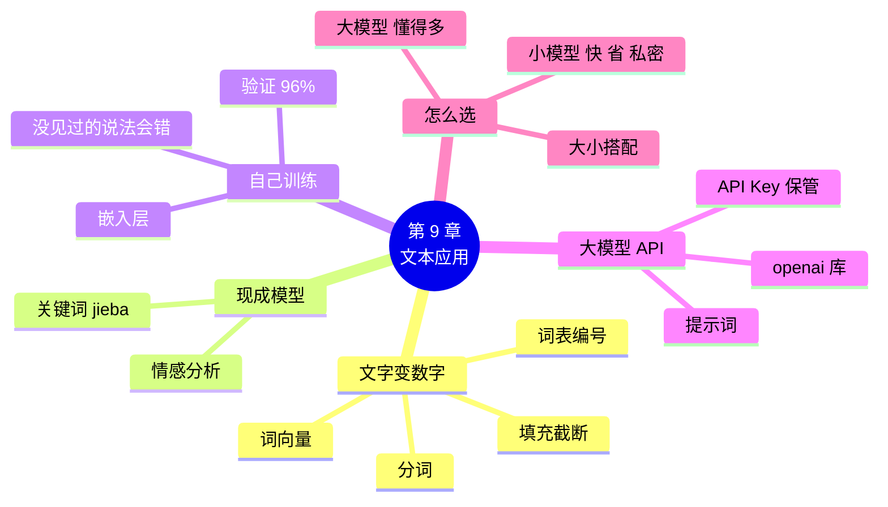

# 第 9 章 文本应用：让模型读懂文字

!!! abstract "本章学时"
    理论 5 学时（线上 4 + 线下 1）· 实验 1 学时（本章共 3 个实验，教师可任选）

## 学习目标

学完本章，你应该能够：

1. **说出**文字变成数字的四步：分词、编号、填充、词向量（记忆）；
2. **解释**词表外的字、截断会让模型丢失哪些信息（理解）；
3. **运行**代码，用现成模型做情感分析，并训练一个自己的评论分类器（应用）；
4. **分析**模型判断错误的评论，找出和训练数据有关的原因（分析）；
5. **比较**自己训练的小模型和大模型 API 在效果、速度、费用和隐私上的差别，为具体任务做出选择（评价）。

!!! info "先修要求"
    学习本章前，你需要掌握：

    - 训练模型的五个步骤和 `compile`、`fit`（[5.1 节](../05-training/index.md#51)、[5.2 节](../05-training/index.md#52)）；
    - 全连接层、展平和参数个数（[第 4 章](../04-build-network/index.md)）；
    - 过拟合和验证集（[6.2 节](../06-tuning/index.md#62)）；
    - 附录 A 中的字符串、列表、字典和函数。

??? abstract "本章概念清单（8 个，点击查看定义和例子）"
    1. [分词](../../appendix/glossary.md#g-分词)
    2. [词表](../../appendix/glossary.md#g-词表)
    3. [填充](../../appendix/glossary.md#g-填充)
    4. [词向量](../../appendix/glossary.md#g-词向量)
    5. [情感分析](../../appendix/glossary.md#g-情感分析)
    6. [大语言模型](../../appendix/glossary.md#g-大语言模型)
    7. [提示词](../../appendix/glossary.md#g-提示词)
    8. [API](../../appendix/glossary.md#g-API)

## 情景导入

花店开通了外卖，每周都有几百条顾客评论。老板娘说：“我没时间一条条看。能不能让电脑帮我分一分，哪些是夸的、哪些是骂的？骂的主要骂什么？”

小林想：照片是一堆像素，本来就是数字；可文字是“味道很好，下次还点”这样的字，模型怎么算？

小周说：“办法和图片一样，先把文字变成数字。变好以后，后面的事你全会：搭网络、`compile`、`fit`，和第 5 章一模一样。当然，也可以直接问大模型。这一章三种办法都试一遍：用现成模型、自己训练、调用大模型，看看各有什么长处。”

## 9.1 文字怎样变成数字 { #91 }

### 9.1.1 第一步：分词 { #911 }

模型一次只能处理一个个小单位。把一句话切成一个个小单位，叫[**分词**](../../appendix/glossary.md#g-分词 "把一段文字切分成一个个小单位（字、词或词元）的过程，是文字变数字的第一步"){ .term }。中文有两种常见的切法：

| 切法 | “骑手态度很好，汤一点没洒”切出来是 | 特点 |
|---|---|---|
| 按字切 | 骑 / 手 / 态 / 度 / 很 / 好 / ， / 汤 / 一 / 点 / 没 / 洒 | 最简单，常用汉字只有几千个 |
| 按词切 | 骑手 / 态度 / 很 / 好 / ， / 汤 / 一点 / 没洒 | 意思更完整，但要有分词工具 |

按词切的结果是编者用中文分词工具 jieba 实际运行得到的<sup class="cite">[[5]](#ref9-5)</sup>。本章自己训练的模型采用最简单的**按字切**；大模型用的是介于字和词之间的切法，切出来的小单位叫“词元”（token），大模型按词元个数计费，9.4 节会用到。

### 9.1.2 第二步：查词表编号 { #912 }

把训练数据里出现过的所有字收集起来，按出现次数从多到少排好，每个字给一个编号，这张对照表叫[**词表**](../../appendix/glossary.md#g-词表 "训练数据中出现的所有字或词与编号的对照表；本书 0 留给填充、1 留给词表外的字"){ .term }。实验 9-2 的 1200 条训练评论一共用到 154 个不同的字（国产版的统计），词表开头是这样的：

| 编号 | 0 | 1 | 2 | 3 | 4 | 5 | 6 | 7 | … |
|---|---|---|---|---|---|---|---|---|---|
| 字 | &lt;pad&gt; | &lt;unk&gt; | ， | 了 | 很 | 不 | 送 | 好 | … |

有两个编号是特意留出来的：**0 留给填充**（下一步用），**1 留给词表里没有的字**（unknown）。查表时遇到训练数据里没见过的字，统统变成 1。这意味着：模型对没见过的字**完全看不出是什么**。

### 9.1.3 第三步：填充和截断 { #913 }

评论有长有短，但网络要求每次输入的数字个数一样（就像第 3 章要把照片都缩放成 128×128）。办法是规定一个固定长度，本章是 40 个字：不够 40 个，后面补 0，这叫[**填充**](../../appendix/glossary.md#g-填充 "在长度不够的序列后面补 0，使每条数据长度相同；超出的部分则截断"){ .term }；超过 40 个，后面的截掉。

“味道很好，下次还点”9 个字，变成 40 个数是这样的（国产版实际输出）：

```text
[28, 63, 4, 7, 2, 68, 69, 37, 13, 0, 0, 0, 0, 0, 0, 0, 0, 0, 0, 0, 0, 0, 0, 0, 0, 0, 0, 0, 0, 0, 0, 0, 0, 0, 0, 0, 0, 0, 0, 0]
```

自己输入几句话试一试，特别是试试网络用语和很长的评论：

<iframe class="sim-frame" src="../../sims/text-to-numbers/main.html" height="520" loading="lazy" title="文字变数字"></iframe>

### 9.1.4 第四步：词向量，给每个字一串数 { #914 }

编号只是“代号”，数字大小没有意义：“很”是 4，“好”是 7，不代表“好”比“很”大。所以还要再走一步：给每个字分配一串数，比如 16 个，这串数叫[**词向量**](../../appendix/glossary.md#g-词向量 "用一串数表示一个字或词，由嵌入层在训练中学出来，意思相近的字或词彼此靠近"){ .term }（按字切时也叫字向量）。

可以把词向量想象成每个字在一张“意思地图”上的坐标。刚开始坐标是随机的；训练过程中，模型会自己调整这些坐标，让意思相近的字靠得近：比如“快”和“准”都常出现在好评里，它们的坐标会慢慢靠近；“慢”和“凉”会跑到地图的另一边。

在代码里，这一步由**嵌入层**（Embedding）完成。它的参数就是整张“坐标表”：154 个字 × 每个字 16 个数 = 2464 个参数，和训练其他层一样，靠梯度一点点学出来。

!!! tip "小结：文字变数字四步走"
    “味道很好” → 分词：味 / 道 / 很 / 好 → 编号：28, 63, 4, 7 → 填充：28, 63, 4, 7, 0, 0, … → 词向量：每个编号换成 16 个数，得到 40×16 的一张“表”，就可以交给网络了。

## 9.2 一行代码用现成模型 { #92 }

### 9.2.1 情感分析 { #921 }

判断一段文字是褒义还是贬义（好评还是差评），叫[**情感分析**](../../appendix/glossary.md#g-情感分析 "判断一段文字表达的是正面还是负面态度的任务"){ .term }。这是最常见的文本任务之一，早就有人用几十万条评论训练好了现成模型：

=== "通用版"

    ```python
    from transformers import pipeline                # 先运行 !pip install transformers torch
    clf = pipeline("text-classification",
                   model="uer/roberta-base-finetuned-jd-binary-chinese")   # 用京东评论训练的中文情感模型
    for r in clf(["味道很好，送得也快", "等了两个小时，菜都凉了"]):
        print(r["label"], r["score"])
    ```

    Hugging Face 的 Transformers 库<sup class="cite">[[1]](#ref9-1)</sup>是全世界最大的现成模型库，`pipeline`（流水线）把“分词、编号、送进模型、翻译结果”全包好了，`model=` 指定用哪个模型。这里选的是一个在京东商品评论上训练好的中文情感模型<sup class="cite">[[2]](#ref9-2)</sup>，输出 `positive`（好评）或 `negative`（差评）和把握。国内下载 Hugging Face 的模型通常要设置镜像，见实验 9-1 的代码。

=== "国产版"

    ```python
    from paddlenlp import Taskflow                   # 先运行 !pip install paddlenlp
    senta = Taskflow("sentiment_analysis")           # 飞桨训练好的中文情感分析模型
    print(senta(["味道很好，送得也快", "等了两个小时，菜都凉了"]))
    ```

    PaddleNLP 的 `Taskflow`（任务流）是飞桨的“开箱即用”工具<sup class="cite">[[3]](#ref9-3)</sup>，写上任务名就能用：`sentiment_analysis` 情感分析、`word_segmentation` 分词、`text_correction` 文本纠错等。结果是一个列表，每一项形如 `{'text': ..., 'label': 'positive', 'score': 0.98}`。

!!! warning "待实测"
    两版的现成模型都要从模型平台下载（通用版从 Hugging Face，国产版从飞桨服务器），编者的编写环境无法连接，运行结果请以实际运行为准。可以预期：意思明确的评论两个模型都能判断对，把握在 90% 以上；“虽然……但是……”这类转折句，结果可能因模型而不同。

### 9.2.2 关键词提取 { #922 }

老板娘还想知道“骂的主要骂什么”。把所有差评拼在一起，找出最有代表性的词，叫关键词提取。jieba 自带这个功能，不用下载模型，两版通用：

```python
import jieba, jieba.analyse                          # 先运行 !pip install jieba
bad = "，".join(df[df["label"] == 0]["text"])        # 把所有差评拼成一大段
print(jieba.analyse.extract_tags(bad, topK=10))      # 找出最有代表性的 10 个词
```

在实验 9-2 的评论数据上，编者的实际运行结果：

```text
差评关键词： ['骑手', '差评', '退款', '不点', '包装', '餐盒', '送错', '可怜', '肉少', '失望']
```

一眼就能看出：差评集中在骑手、包装、送错、分量（“肉少得可怜”）上。`extract_tags` 的原理是：一个词在这段文字里出现得多、在一般文章里又不常见，就越可能是关键词。

## 9.3 自己训练一个评论分类器 { #93 }

现成模型是在京东商品评论之类的数据上训练的，未必懂“汤洒了”“骑手迟到”这些外卖特有的说法。如果有自己的数据，可以照第 5 章的流程训练一个专用的分类器。

### 9.3.1 数据：1600 条外卖评论 { #931 }

`labs/data/reviews/reviews.csv` 有 1600 条外卖评论，两列：`text` 是评论，`label` 是标签（1 好评，0 差评），好评差评各一半：

```text
                             text  label
0                    油太多，少送了一份，失望      0
1  虽然配送超快，但是袋子都湿了，骑手态度差，肉不新鲜，退款了~      0
2              分量足，味道不错，骑手态度好，推荐~      1
```

!!! note "关于数据来源"
    真实平台的评论涉及用户隐私和平台的版权，不能随便拿来用。这份数据是编者用程序把“味道、速度、包装、分量、服务”五个方面的常见说法随机组合生成的（生成代码 `labs/data/make_reviews.py`），可以自由使用。为了接近真实情况，四分之一的评论夹了一句相反的话（“虽然配送超快，但是……”），还故意把 3% 的标签标错。它比真实评论规整得多，所以准确率会偏高。

前 1200 条用来训练，后 400 条做验证集。

### 9.3.2 文字变数字 { #932 }

=== "通用版"

    ```python
    vec = layers.TextVectorization(split="character",          # 按单个字切分
                                   output_sequence_length=40)  # 不够 40 个字补 0，多了截掉
    vec.adapt(train["text"])                                   # 看一遍训练集，给每个字编号
    x_train, x_val = vec(train["text"]), vec(val["text"])
    ```

    Keras 的 `TextVectorization`（文本向量化层）把 9.1 节的前三步全包了：`adapt` 统计训练集建立词表，之后 `vec(...)` 就能把一批文字变成编号<sup class="cite">[[4]](#ref9-4)</sup>。它的词表里 0 是空字符串 `''`（填充），1 是 `[UNK]`（不认识的字）。

=== "国产版"

    ```python
    count = Counter(ch for text in train["text"] for ch in text)        # 数一数每个字出现几次
    vocab = ["<pad>", "<unk>"] + [ch for ch, n in count.most_common()]  # 词表：0 填充，1 不认识的字
    word2id = {ch: i for i, ch in enumerate(vocab)}                     # 字 → 编号 的字典

    def encode(text, length=40):
        ids = [word2id.get(ch, 1) for ch in text][:length]   # 查编号，查不到用 1；多了截掉
        return ids + [0] * (length - len(ids))               # 不够 40 个补 0
    ```

    飞桨这里我们自己动手写，正好把 9.1 节的三步看得清清楚楚：`Counter` 数字数（第 8 章用过），`most_common()` 按次数从多到少排；`word2id.get(ch, 1)` 的意思是“查字典，查不到就给 1”；最后补 0 到 40 个。

### 9.3.3 搭网络：嵌入层 + 展平 + 全连接 { #933 }

=== "通用版"

    ```python
    model = keras.Sequential([
        keras.Input(shape=(40,)),
        layers.Embedding(len(vocab), 16),        # 每个字的编号 → 16 个数（字向量）
        layers.Flatten(),                        # 40×16 展平成 640 个数
        layers.Dense(16, activation="relu"),
        layers.Dense(2, activation="softmax"),   # 两类：差评、好评
    ])
    ```

=== "国产版"

    ```python
    net = nn.Sequential(
        nn.Embedding(len(vocab), 16),            # 每个字的编号 → 16 个数（字向量）
        nn.Flatten(),                            # 40×16 展平成 640 个数
        nn.Linear(640, 16), nn.ReLU(),
        nn.Linear(16, 2), nn.Softmax(),          # 两类：差评、好评
    )
    ```

除了第一层换成嵌入层，其余都是第 4 章的老朋友。结构表（通用版）：

| 层 | 输出形状 | 参数个数 | 怎么算 |
|---|---|---|---|
| 嵌入层 | (40, 16) | 2,448 | 153 个字 × 16 |
| 展平 | (640,) | 0 | 40 × 16 = 640 |
| 全连接 | (16,) | 10,256 | 640 × 16 + 16 |
| 输出层 | (2,) | 34 | 16 × 2 + 2 |
| **合计** | | **12,738** | |

国产版词表多一个字（154 个，通用版的 `TextVectorization` 默认去掉了 `~` 这类英文标点），所以嵌入层是 2464 个参数，合计 12,754 个。一万多个参数，比花卉识别的网络小得多。

### 9.3.4 训练和测试 { #934 }

训练的代码和第 5 章一字不差（`compile` 或 `prepare`，再 `fit`），训练 10 轮。两版的实测结果：

| | 第 10 轮训练准确率 | 第 10 轮验证准确率 | 预测 400 条用时 |
|---|---|---|---|
| 通用版 | 98.3% | 96.0% | 0.13 秒 |
| 国产版 | 98.2% | 95.5% | 0.01 秒 |

数据里有 3% 的标签是故意标错的，所以验证准确率到 96% 左右已经接近上限了。再用 5 条新写的评论测试（通用版实测）：

```text
味道很好，送得也快        → 好评（好评的把握 98%）
等了两个小时，菜都凉了      → 差评（好评的把握 1%）
虽然有点贵，但是真的好吃     → 好评（好评的把握 52%）
一点都不好吃           → 差评（好评的把握 1%）
包装很好，可惜味道太咸了     → 好评（好评的把握 86%）
```

前四条都对了，最后一条明明是差评，模型却以 86% 的把握判成好评。国产版的结果几乎一样（第三条把握 85%，最后一条同样错判为好评，把握 83%）。为什么？

- **“可惜”这个词，训练数据里一次也没出现过**。“可”“惜”两个字在词表里都没有，都变成了 1，模型完全看不出这是个转折；
- 剩下的“包装很好”是明显的好评说法，“太咸了”虽然是差评说法，但“很好”的分量更重。

这再次说明第 7 章的结论：**模型只懂它见过的东西**，训练数据决定了模型的上限。真实项目要尽量收集覆盖各种说法的数据，并且经常用新数据检查模型。

!!! cert "证书考点"
    人工智能应用工程师、人工智能数据处理工程师（高级）证书中的自然语言处理部分，会考查文本预处理（分词、构建词表、填充）、词向量的作用和文本分类模型的搭建与评估。

## 9.4 调用大模型 API 做同一件事 { #94 }

### 9.4.1 什么是 API { #941 }

[**大语言模型**](../../appendix/glossary.md#g-大语言模型 "参数规模巨大、在海量文本上预训练、具有通用语言理解与生成能力的模型"){ .term }（简称大模型）参数有几百亿甚至上万亿个，普通电脑根本跑不动。大模型公司把模型放在自己的服务器上，开放一个[**API**](../../appendix/glossary.md#g-API "应用程序接口：程序之间约定好的调用方式，程序把请求发给服务，服务把结果返回"){ .term }（应用程序接口）：你的程序把问题发过去，服务器把答案发回来，就像去饭店点菜，不用自己有厨房。

给大模型的指令叫[**提示词**](../../appendix/glossary.md#g-提示词 "给大模型的指令和输入，一般要说清角色、任务和输出格式"){ .term }。想让它判断好评差评，就要把任务说清楚：

```text
你是外卖平台的评论审核员。判断下面这条评论是好评还是差评，只回答“好评”或“差评”两个字。
评论：包装很好，可惜味道太咸了
```

写提示词的要点是：说清**角色**（审核员）、**任务**（判断好评差评）和**输出格式**（只回答两个字），格式规定得越死，程序越好处理。

### 9.4.2 API Key：你的“钥匙”，千万保管好 { #942 }

调用 API 要先在平台注册，获得一串 **API Key**（接口密钥），形如 `sk-3f8a……`。服务器凭它认出是谁在调用、从谁的账户扣费。**API Key 相当于你账户的钥匙，泄露了别人就能花你的钱**。几条规矩：

1. **不要直接写进代码**，更不要把带 Key 的代码上传到 GitHub、发到群里。网上有程序专门扫描公开代码里的 Key；
2. 用**环境变量**保存，或者运行时用 `getpass` 粘贴（屏幕上不显示）；
3. 在平台上设置**消费上限**，发现泄露立刻删除旧 Key、重新生成。

### 9.4.3 代码：两版写法几乎一样 { #943 }

国内外的大模型平台大多提供和 OpenAI 相同格式的接口，所以都可以用 `openai` 这个库来调用，换平台只需改 `base_url`（服务器地址）和 `model`（模型名）：

=== "通用版"

    ```python
    import os
    from openai import OpenAI                        # 先运行 !pip install openai
    client = OpenAI(api_key=os.environ["DEEPSEEK_API_KEY"],   # 从环境变量读取 Key
                    base_url="https://api.deepseek.com")      # 以 DeepSeek 为例
    r = client.chat.completions.create(
            model="deepseek-chat",
            messages=[{"role": "user", "content": PROMPT.format(text)}],   # 提示词 + 评论
            temperature=0)                           # 0 表示回答尽量稳定，不要“发挥”
    print(r.choices[0].message.content)              # 大模型的回答
    ```

=== "国产版"

    ```python
    import os
    from openai import OpenAI                        # 先运行 !pip install openai
    client = OpenAI(api_key=os.environ["QIANFAN_API_KEY"],    # 从环境变量读取 Key
                    base_url="https://qianfan.baidubce.com/v2")   # 百度千帆平台（文心大模型）
    r = client.chat.completions.create(
            model="ernie-4.5-turbo-32k",
            messages=[{"role": "user", "content": PROMPT.format(text)}],   # 提示词 + 评论
            temperature=0)                           # 0 表示回答尽量稳定，不要“发挥”
    print(r.choices[0].message.content)              # 大模型的回答
    ```

`messages` 是“对话记录”，`"role": "user"` 表示这句话是用户说的；`temperature`（温度）越高回答越有变化，做分类这种要稳定答案的任务设成 0。

!!! warning "待实测"
    编者的编写环境无法连接大模型平台，这一节的代码已用一个模拟服务器检查过调用流程，真实的回答请以实际运行为准。各平台的地址和模型名会更新（比如新版本的模型名不同），请以平台文档为准<sup class="cite">[[6]](#ref9-6)</sup><sup class="cite">[[7]](#ref9-7)</sup>。阿里云百炼（通义千问）、智谱等平台也提供兼容接口，改 `base_url` 和 `model` 即可。可以预期：大模型对“可惜味道太咸了”这类转折句的判断明显好于我们的小模型。

### 9.4.4 小模型还是大模型 { #944 }

| 比较项 | 自己训练的小模型（实验 9-2） | 大模型 API（实验 9-3） |
|---|---|---|
| 准备工作 | 要有标注好的数据，要训练 | 不用数据，写好提示词就行 |
| 效果 | 在见过的说法上很准，没见过的说法容易错 | 理解能力强，转折、反话、新说法也能懂 |
| 速度 | 400 条约 0.1 秒（本机 CPU 实测） | 每条要联网往返，一般零点几秒到几秒 |
| 费用 | 训练好以后几乎免费 | 按词元个数收费，每一次调用都要花钱 |
| 隐私 | 数据不出本机 | 评论要发到平台的服务器 |
| 离线 | 可以 | 不行 |

没有谁绝对更好。评论量少、说法五花八门、又没有标注数据，用大模型；评论量很大（每天几十万条）、要求快、数据敏感，训练一个小模型更划算。实际项目中还常常**用大模型来标注数据，再用这些数据训练小模型**，兼顾两者的长处。

## 9.5 本章常见报错对照 { #95 }

| 报错原文 | 用大白话说 | 怎么改 |
|---|---|---|
| `No module named 'transformers'`、`No module named 'paddlenlp'`、`No module named 'jieba'` | 库还没有安装 | 运行 `!pip install 库名` |
| 下载模型时报 `ConnectionError`、`timed out`、`We couldn't connect to 'https://huggingface.co'` | 连不上模型平台 | 通用版设置镜像 `HF_ENDPOINT`；或请老师把模型文件放到共享目录 |
| `KeyError: 'text'` | 表格里没有叫 `text` 的列，可能列名写错了 | `print(df.columns)` 看看真实的列名 |
| `KeyError: 'DEEPSEEK_API_KEY'` | 环境变量里没有这个 Key | 先设置环境变量，或改用 `getpass` 粘贴 |
| `AuthenticationError`、`401` | API Key 错了、过期了，或者复制时多了空格 | 到平台重新复制 Key；检查有没有多余的空格 |
| `RateLimitError`、`429` | 调用太快或者余额不足 | 每次调用之间加 `time.sleep(1)`；到平台查余额 |
| 训练时报 `IndexError` 或 `out of range`（嵌入层） | 编号超出了嵌入层的大小，通常是词表变了但嵌入层大小没改 | 嵌入层第一个参数用 `len(vocab)`，不要手写数字 |

## 9.6 前沿视窗：大模型和小模型怎么分工 { #96 }

大模型越来越强，小模型会被淘汰吗？目前看，恰恰相反，两者正在形成分工。

一方面，大模型公司自己也在做小模型：DeepSeek、通义千问等都会发布从几亿到几百亿参数的多个版本，小的能在手机和普通电脑上运行。把大模型的本领“教”给小模型的技术叫**知识蒸馏**<sup class="cite">[[8]](#ref9-8)</sup>，就像老教师把经验浓缩成一本复习提纲交给学生。

另一方面，实际应用里常见“**大小搭配**”：小模型守在前面，快速处理绝大多数简单、常见的情况；遇到把握低的、难判断的，再交给大模型。比如外卖平台每天几百万条评论，用小模型秒级分完类，只把小模型拿不准的几千条交给大模型复核，既准又省钱。

对你来说，会用 API 调大模型和会训练一个小模型都很重要，知道什么时候用哪个更重要。

## 本章实验

!!! abstract "实验总览"
    | 实验 | 类型 | 建议时长 | 内容 |
    |---|---|---|---|
    | 实验 9-1 | ★ 必做 | 15 分钟 | 一行代码做情感分析，提取差评关键词 |
    | 实验 9-2 | ★ 必做 | 30 分钟 | 训练一个外卖评论分类器 |
    | 实验 9-3 | ☆ 选做 | 25 分钟 | 用大模型 API 做同一件事 |

    代码见配套资源 `labs/ch09/` 目录（`keras/` 通用版，`paddle/` 国产版）。数据 `labs/data/reviews/reviews.csv` 由编者生成，可自由使用。实验 9-1 要下载模型，实验 9-3 要有大模型平台的 API Key。

### 实验 9-1 ★ 一行代码做情感分析 { #9-1 }

**实验目的**

1. 用现成模型判断评论是好评还是差评；
2. 用 jieba 分词并提取差评关键词。

**实验环境**：云端 Notebook 或本机，CPU 即可，需要联网下载模型。

**实验数据**：自己写的评论；`labs/data/reviews/reviews.csv`。

**实验步骤与代码**

第一档 · 跑通：打开 `lab9_1_ready_models.ipynb`，依次运行三个单元格：请出模型 → 判断 5 条评论 → 分词和关键词。代码见 9.2 节。

完整代码：`labs/ch09/keras/lab9_1_ready_models.ipynb`、`labs/ch09/paddle/lab9_1_ready_models.ipynb`

**运行结果**：第 3 步的结果见 9.2.2 节；第 1、2 步待实测。

第二档 · 改一改：

1. 写 5 条自己的评论（可以是奶茶、电影、课程的评价），包括一条反话（如“这服务真是‘太好了’，等了一小时”），看模型能不能判断对；
2. 把 `bad` 换成所有好评，看看好评的关键词是什么。

**实验记录表**

| 评论 | 你的判断 | 模型的判断 | 把握 | 对不对 |
|---|---|---|---|---|
| | | | | |

**常见问题排查**

| 现象 | 原因 | 解决办法 |
|---|---|---|
| 第一次运行很久没反应 | 正在下载模型（几百 MB） | 耐心等待；或换网络更快的平台 |
| jieba 第一次运行打印 `Building prefix dict` | jieba 在加载词典，不是报错 | 正常 |

**思考与练习**

1. 现成模型对哪类评论最容易判断错？为什么？

**实验报告要求**

提交实验记录表和关键词提取的结果截图。

### 实验 9-2 ★ 训练一个外卖评论分类器 { #9-2 }

**实验目的**

1. 完成“文字变数字”的全过程；
2. 照第 5 章的流程训练一个文本分类模型，并分析判断错误的评论。

**实验环境**：云端 Notebook 或本机，CPU 即可，训练不到 1 分钟。

**实验数据**：`labs/data/reviews/reviews.csv`。

**实验步骤与代码**

第一档 · 跑通：打开 `lab9_2_review_classifier.ipynb`，依次运行六个单元格：读数据 → 文字变数字 → 搭网络 → 训练 → 试新评论 → 测速。代码见 9.3 节。

完整代码：`labs/ch09/keras/lab9_2_review_classifier.ipynb`、`labs/ch09/paddle/lab9_2_review_classifier.ipynb`

**运行结果**：见 9.3.4 节。

第二档 · 改一改：

1. 在第 5 步的 `tests` 里加上 5 条自己写的评论，找出模型判断错的，用“文字变数字”动画看看有没有红色（词表外）的字；
2. 把 `Flatten()` 换成 `GlobalAveragePooling1D()`（国产版不做这一项），重新训练。编者实测：验证准确率 94.5%，参数更少，而且“包装很好，可惜味道太咸了”判断对了（好评把握 28%）。想一想：对 40 个字向量求平均，和按位置展平，有什么不同？

第三档 · 挑战：在 `reviews.csv` 后面加上 20 条带“可惜”“遗憾”“还行”等新说法的评论（自己写并标好标签），重新训练，看看最后一条测试评论能不能判断对。

**实验记录表**

| 设置 | 验证准确率 | 5 条测试评论对了几条 | 判断错的是哪条 |
|---|---|---|---|
| 原始代码 | | | |
| 改一改 2 | | | |
| 挑战 | | | |

**常见问题排查**

| 现象 | 原因 | 解决办法 |
|---|---|---|
| `FileNotFoundError: ... reviews.csv` | 数据路径不对 | 确认 Notebook 在 `labs/ch09/keras`（或 `paddle`）里，数据在 `labs/data/reviews/` |
| 自己加了数据后报 `ParserError` | CSV 里的评论含有英文逗号，列被分错了 | 评论里用中文逗号“，”，或者把评论用英文双引号括起来 |
| 准确率一直在 50% 左右 | 标签列读错了，或数据没打乱，一批里全是同一类 | 检查 `df.head()`；国产版确认 `shuffle=True` |

**思考与练习**

1. 为什么验证准确率很难超过 97%？（提示：数据是怎么生成的？）

**实验报告要求**

提交训练日志截图、测试评论的结果和实验记录表，并分析至少一条判断错的评论。

### 实验 9-3 ☆ 用大模型 API 做同一件事 { #9-3 }

**实验目的**

1. 用提示词让大模型完成评论分类；
2. 比较大模型和自己训练的小模型在准确率、速度和费用上的差别；
3. 学会安全地保管 API Key。

**实验环境**：云端 Notebook 或本机，需要联网，需要在大模型平台注册并获得 API Key（新用户一般有免费额度，本实验的用量很小）。

**实验数据**：`labs/data/reviews/reviews.csv` 的第 1201～1250 条（实验 9-2 验证集的前 50 条）。

**实验步骤与代码**

第一档 · 跑通：打开 `lab9_3_llm_api.ipynb`，运行第 1 个单元格时按提示粘贴 API Key，再依次运行后面两个单元格。代码见 9.4 节。

完整代码：`labs/ch09/keras/lab9_3_llm_api.ipynb`（DeepSeek）、`labs/ch09/paddle/lab9_3_llm_api.ipynb`（百度千帆）

**运行结果**：待实测。

第二档 · 改一改：

1. 把提示词改成“判断这条评论在抱怨什么：味道、速度、包装、分量还是服务？只回答一个词。”，看看大模型能不能帮老板娘找出问题；
2. 把 `temperature` 改成 1，同一条评论问三次，看回答是否一样。

**实验记录表**

| 方法 | 50 条的准确率 | 用时 | 花费（到平台查看） |
|---|---|---|---|
| 实验 9-2 小模型 | | | 0 |
| 大模型 API | | | |

**常见问题排查**

| 现象 | 原因 | 解决办法 |
|---|---|---|
| `AuthenticationError` | Key 错了或复制时多了空格 | 重新复制 Key |
| 大模型回答“这条评论是好评，因为……”，准确率算出来很低 | 没按要求只回答两个字，和“好评”不完全相等 | 在提示词里强调“只回答两个字”；或把判断改成 `"好评" in a` |
| `RateLimitError` | 调用太快 | 在 `ask` 函数里加 `time.sleep(1)` |

**思考与练习**

1. 如果老板娘的评论数据涉及顾客的手机号和地址，能直接发给大模型 API 吗？应该怎么处理？（提示：第 12 章会讲脱敏）

**实验报告要求**

提交实验记录表和比较结论（不少于 100 字）。**截图时注意遮住 API Key。**

## 本章小结

- 文字变数字四步：**分词**（本章按字切）→ 查**词表**编号（0 填充，1 不认识的字）→ **填充**或截断到固定长度 → 嵌入层把每个编号变成一串数（**词向量**）。
- 用现成模型做**情感分析**只要一行：通用版 Transformers `pipeline`，国产版 PaddleNLP `Taskflow`；jieba 可以分词和提取关键词。
- 自己训练评论分类器：嵌入层 + 展平 + 全连接，训练流程和第 5 章完全相同。实测验证准确率约 96%，但没见过的说法（“可惜”）会判断错。
- **大语言模型**通过 **API** 调用，用**提示词**说清角色、任务和输出格式。API Key 不能写进代码。
- 小模型快、便宜、数据不出本机；大模型理解力强、不用标注数据。常见做法是大小搭配。



**下一章预告**

看懂了图片，读懂了文字，下一章让模型**听懂声音**。你会发现，声音也能变成一张“照片”（声谱图），于是第 5 章训练花卉识别的那套方法，可以原封不动地用来训练一个听懂“上、下、左、右”的语音指令识别器。

## 参考文献

正文中的上标编号（如<sup class="cite">[[1]](#ref9-1)</sup>）对应下面的文献。带链接的可以直接打开；书籍可在图书馆或电子书平台查阅。

<div class="refs" markdown>

**经典论文**

- <span id="ref9-1"></span>[1] WOLF T, DEBUT L, SANH V, et al. Transformers: State-of-the-Art Natural Language Processing[C]//Proceedings of the 2020 Conference on Empirical Methods in Natural Language Processing: System Demonstrations. Online: Association for Computational Linguistics, 2020: 38-45.
    <span class="ref-note">Hugging Face Transformers 库的论文，介绍了 pipeline 等开箱即用的设计，对应 9.2.1 节。</span>
- <span id="ref9-2"></span>[2] ZHAO Z, CHEN H, ZHANG J, et al. UER: An Open-Source Toolkit for Pre-training Models[C]//Proceedings of the 2019 Conference on Empirical Methods in Natural Language Processing and the 9th International Joint Conference on Natural Language Processing: System Demonstrations. Hong Kong: Association for Computational Linguistics, 2019: 241-246.
    <span class="ref-note">通用版所用中文情感模型的开发工具包论文，对应 9.2.1 节。</span>
- <span id="ref9-8"></span>[8] HINTON G, VINYALS O, DEAN J. Distilling the Knowledge in a Neural Network[EB/OL]. (2015-03-09)[2026-10-31]. <https://arxiv.org/abs/1503.02531>.
    <span class="ref-note">提出“知识蒸馏”的经典论文，用大模型的输出来训练小模型，对应 9.6 节。</span>

**在线资源**

- <span id="ref9-3"></span>[3] PaddlePaddle. PaddleNLP[EB/OL]. [2026-10-31]. <https://github.com/PaddlePaddle/PaddleNLP>.
    <span class="ref-note">飞桨自然语言处理开发库，Taskflow 的任务列表和用法见其文档，对应 9.2.1 节。</span>
- <span id="ref9-4"></span>[4] Keras. TextVectorization layer[EB/OL]. [2026-10-31]. <https://keras.io/api/layers/preprocessing_layers/text/text_vectorization/>.
    <span class="ref-note">通用版“文字变数字”所用的预处理层，对应 9.3.2 节。</span>
- <span id="ref9-5"></span>[5] SUN J. jieba 中文分词[EB/OL]. [2026-10-31]. <https://github.com/fxsjy/jieba>.
    <span class="ref-note">最常用的 Python 中文分词工具，支持关键词提取，MIT 许可，对应 9.1.1 节和 9.2.2 节。</span>
- <span id="ref9-6"></span>[6] DeepSeek API 文档[EB/OL]. [2026-10-31]. <https://api-docs.deepseek.com/zh-cn/>.
    <span class="ref-note">通用版实验 9-3 所用平台的接口说明，含兼容 OpenAI 格式的调用方法和价格，对应 9.4.3 节。</span>
- <span id="ref9-7"></span>[7] 百度智能云千帆大模型平台文档[EB/OL]. [2026-10-31]. <https://cloud.baidu.com/doc/qianfan/index.html>.
    <span class="ref-note">国产版实验 9-3 所用平台的文档，含文心大模型的 API Key 创建和兼容 OpenAI 的调用方法，对应 9.4.3 节。</span>

</div>

## 课后练习

选择题和判断题可以直接点击选项作答，系统会马上告诉你对错，并展开答案与解析；多选题选好后点“提交答案”。简答和实操题请先自己作答，再点开“答案与解析”核对。每道题的解析下方都有“回看”链接，做错了可以直接跳回正文复习。

**一、单项选择题**

<div class="quiz" data-answer="B" markdown>

**1.** 把“骑手态度很好”切成“骑手 / 态度 / 很 / 好”，这一步叫（　　）。

- A. 填充
- B. 分词
- C. 嵌入
- D. 截断

</div>

??? tip "答案与解析"
    **答案：B**

    把一句话切成一个个小单位叫分词。这里是按词切；本章自己训练的模型用的是按字切。

    考查：分词 · 认知层次：记忆 · [回看 9.1.1](#911)
    { .quiz-meta }

<div class="quiz" data-answer="C" markdown>

**2.** 本章的词表中，编号 1 留给（　　）。

- A. 出现次数最多的字
- B. 填充
- C. 词表里没有的字
- D. 句号

</div>

??? tip "答案与解析"
    **答案：C**

    0 留给填充，1 留给词表里没有的字（`<unk>` 或 `[UNK]`）。

    考查：词表 · 认知层次：记忆 · [回看 9.1.2](#912)
    { .quiz-meta }

<div class="quiz" data-answer="A" markdown>

**3.** 固定长度为 40，一条评论有 9 个字，变成编号后会（　　）。

- A. 在后面补 31 个 0
- B. 截掉 31 个字
- C. 重复 4 遍凑够 40 个
- D. 保持 9 个不变

</div>

??? tip "答案与解析"
    **答案：A**

    不够固定长度就在后面补 0，这叫填充；超过才截断。

    考查：填充 · 认知层次：应用 · [回看 9.1.3](#913)
    { .quiz-meta }

<div class="quiz" data-answer="D" markdown>

**4.** 嵌入层 `Embedding(153, 16)` 有多少个参数？（　　）

- A. 153
- B. 16
- C. 169
- D. 2448

</div>

??? tip "答案与解析"
    **答案：D**

    嵌入层的参数是一张“坐标表”：153 个字，每个字 16 个数，153 × 16 = 2448，没有偏置。

    考查：词向量 · 认知层次：应用 · [回看 9.3.3](#933)
    { .quiz-meta }

<div class="quiz" data-answer="B" markdown>

**5.** 为什么不能直接把字的编号（如“很”是 4、“好”是 7）当作特征送进全连接层，而要先经过嵌入层？（　　）

- A. 编号太大，计算会溢出
- B. 编号只是代号，大小没有意义；词向量能在训练中学到字的意思
- C. 全连接层不能接收整数
- D. 嵌入层可以提高训练速度

</div>

??? tip "答案与解析"
    **答案：B**

    “好”是 7 不代表比“很”（4）大。词向量是每个字在“意思地图”上的坐标，训练中会让意思相近的字靠近。

    考查：词向量 · 认知层次：理解 · [回看 9.1.4](#914)
    { .quiz-meta }

<div class="quiz" data-answer="C" markdown>

**6.** 自己训练的评论分类器把“包装很好，可惜味道太咸了”判成了好评，最主要的原因是（　　）。

- A. 训练轮次太少
- B. 学习率太大
- C. 训练数据里没有出现过“可惜”，这两个字都变成了“不认识的字”
- D. 嵌入层的维度太小

</div>

??? tip "答案与解析"
    **答案：C**

    验证准确率已经 96%，说明训练是成功的。错在模型从没见过“可惜”这种转折说法，训练数据决定了模型的上限。

    考查：错误分析 · 认知层次：分析 · [回看 9.3.4](#934)
    { .quiz-meta }

<div class="quiz" data-answer="A" markdown>

**7.** 关于 API Key，正确的做法是（　　）。

- A. 用环境变量保存，或运行时用 getpass 粘贴
- B. 直接写在代码第一行，方便使用
- C. 发到班级群里和同学共用
- D. 把带 Key 的代码上传到 GitHub 备份

</div>

??? tip "答案与解析"
    **答案：A**

    API Key 是账户的钥匙，泄露了别人就能花你的钱。不能写进代码、不能公开。

    考查：API Key 安全 · 认知层次：应用 · [回看 9.4.2](#942)
    { .quiz-meta }

<div class="quiz" data-answer="D" markdown>

**8.** 用大模型做评论分类时，把 `temperature` 设成 0 的目的是（　　）。

- A. 让回答更有创意
- B. 降低费用
- C. 提高回答速度
- D. 让回答尽量稳定，同样的问题给出同样的答案

</div>

??? tip "答案与解析"
    **答案：D**

    温度越高回答越有变化。分类任务需要稳定的答案，所以设成 0。

    考查：调用大模型 API · 认知层次：理解 · [回看 9.4.3](#943)
    { .quiz-meta }

**二、多项选择题**

<div class="quiz quiz-multi" data-answer="ABCD" markdown>

**1.** 文字变成模型能处理的数字，要经过的步骤有（　　）。

- A. 分词
- B. 查词表编号
- C. 填充或截断到固定长度
- D. 用嵌入层变成词向量

</div>

??? tip "答案与解析"
    **答案：ABCD**

    考查：文字变数字四步 · 认知层次：记忆 · [回看 9.1](#91)
    { .quiz-meta }

<div class="quiz quiz-multi" data-answer="ACD" markdown>

**2.** 一个好的分类提示词应该说清楚（　　）。

- A. 角色
- B. 越长越好，尽量多写背景
- C. 任务
- D. 输出格式

</div>

??? tip "答案与解析"
    **答案：ACD**

    提示词不是越长越好，要把角色、任务和输出格式说清楚。格式规定得越死，程序越好处理。

    考查：提示词 · 认知层次：理解 · [回看 9.4.1](#941)
    { .quiz-meta }

<div class="quiz quiz-multi" data-answer="BC" markdown>

**3.** 与大模型 API 相比，自己训练的小模型的优点有（　　）。

- A. 能理解训练数据里没有的新说法
- B. 速度快，训练好后几乎不花钱
- C. 数据不出本机，可以离线运行
- D. 不需要任何标注数据

</div>

??? tip "答案与解析"
    **答案：BC**

    A 和 D 是大模型的优点。小模型需要标注数据，没见过的说法容易错。

    考查：小模型与大模型的比较 · 认知层次：评价 · [回看 9.4.4](#944)
    { .quiz-meta }

**三、判断题**

<div class="quiz quiz-judge" data-answer="×" markdown>

**1.** 词表中编号越大的字，在句子里越重要。

- √ 正确
- × 错误

</div>

??? tip "答案与解析"
    **答案：×**

    编号只是代号，本章按出现次数排序，编号越小出现越多，和重要程度无关。

    考查：词表 · 认知层次：理解 · [回看 9.1.2](#912)
    { .quiz-meta }

<div class="quiz quiz-judge" data-answer="√" markdown>

**2.** 训练文本分类模型时，除了第一层换成嵌入层，`compile`、`fit` 等流程和训练花卉识别模型完全一样。

- √ 正确
- × 错误

</div>

??? tip "答案与解析"
    **答案：√**

    考查：训练评论分类器 · 认知层次：理解 · [回看 9.3.4](#934)
    { .quiz-meta }

<div class="quiz quiz-judge" data-answer="√" markdown>

**3.** 词向量一开始是随机的，在训练中会被不断调整。

- √ 正确
- × 错误

</div>

??? tip "答案与解析"
    **答案：√**

    嵌入层的参数和其他层一样，靠梯度一点点学出来。

    考查：词向量 · 认知层次：理解 · [回看 9.1.4](#914)
    { .quiz-meta }

<div class="quiz quiz-judge" data-answer="×" markdown>

**4.** 验证准确率达到 96%，说明模型对任何外卖评论都能判断对。

- √ 正确
- × 错误

</div>

??? tip "答案与解析"
    **答案：×**

    验证集和训练集来自同一份数据，说法相近。遇到没见过的说法（如“可惜”），模型照样会错。

    考查：错误分析 · 认知层次：评价 · [回看 9.3.4](#934)
    { .quiz-meta }

<div class="quiz quiz-judge" data-answer="√" markdown>

**5.** 很多国产大模型平台提供兼容 OpenAI 格式的接口，用 `openai` 库调用时，换平台主要改 `base_url` 和 `model`。

- √ 正确
- × 错误

</div>

??? tip "答案与解析"
    **答案：√**

    考查：调用大模型 API · 认知层次：记忆 · [回看 9.4.3](#943)
    { .quiz-meta }

**四、简答题**

**1.** 用“味道很好”为例，说明一句话变成模型能处理的数字要经过哪几步。

??? tip "答案与解析"
    **参考答案：** ① 分词：按字切成“味 / 道 / 很 / 好”；② 查词表编号：变成 28, 63, 4, 7（以本章词表为例）；③ 填充：在后面补 0 到 40 个数；④ 词向量：嵌入层把每个编号换成 16 个数，得到 40×16 的数据，交给网络。

    考查：文字变数字四步 · 认知层次：理解 · [回看 9.1](#91)
    { .quiz-meta }

**2.** 老板娘的店每周只有几百条评论，没有标注过的数据，评论里还有很多网络用语。你建议用自己训练的小模型还是大模型 API？说明理由。

??? tip "答案与解析"
    **参考答案（言之有理即可）：** 建议用大模型 API。评论量小，调用费用很低；没有标注数据，没法训练小模型；网络用语五花八门，小模型没见过就会判断错，大模型理解能力强。需要注意：发送前去掉顾客的手机号、地址等个人信息，API Key 要保管好。如果以后评论量变得很大，可以用大模型标注的结果训练一个小模型。

    考查：小模型与大模型的选择 · 认知层次：评价 · [回看 9.4.4](#944)
    { .quiz-meta }

**3.** 为什么说“API Key 相当于账户的钥匙”？列出至少三条保管 API Key 的做法。

??? tip "答案与解析"
    **参考答案：** 平台凭 API Key 认出调用者并从其账户扣费，别人拿到 Key 就能以你的名义调用、花你的钱。做法：① 不写进代码，用环境变量或 getpass；② 不上传到 GitHub、不发到群里，截图时遮住；③ 在平台设置消费上限；④ 发现泄露立刻删除旧 Key 并重新生成。

    考查：API Key 安全 · 认知层次：理解 · [回看 9.4.2](#942)
    { .quiz-meta }

**五、实操题**

**1.** 修改实验 9-2 的代码，把固定长度从 40 改成 10，重新训练，记录验证准确率；再用“文字变数字”动画看一看长评论被截掉了什么，说明截断可能带来的问题。

??? tip "答案与解析"
    **参考做法（通用版）：** 把 `output_sequence_length=40` 改成 `10`，`keras.Input(shape=(40,))` 改成 `(10,)`；国产版把 `encode` 的 `length=40` 改成 `10`，`nn.Linear(640, 16)` 改成 `nn.Linear(160, 16)`。

    编者实测（通用版）：长度 10 时验证准确率 96.5%，和长度 40 差不多。原因是本章的数据比较规整，好评差评的关键说法大多出现在前面。但截断会丢掉评论后面的内容，比如“味道还行，就是送了两个小时，再也不点了”截到 10 个字只剩“味道还行，就是送了两个”，最关键的“再也不点了”没了。真实评论常常在结尾表态，所以固定长度要根据评论的实际长度来定，一般取能覆盖大多数评论的长度。

    考查：填充与截断 · 认知层次：应用 · [回看 9.1.3](#913)
    { .quiz-meta }
