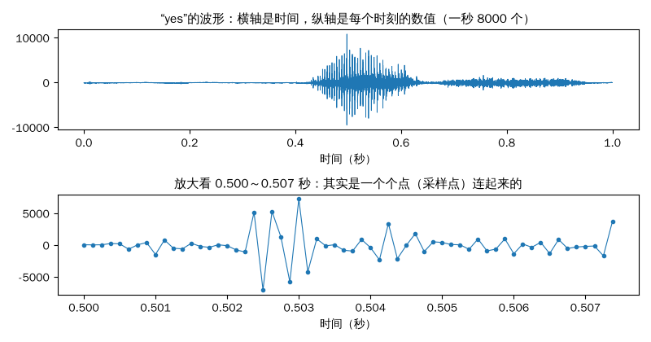
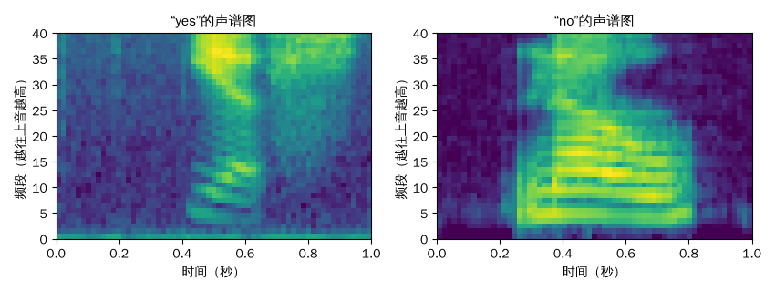
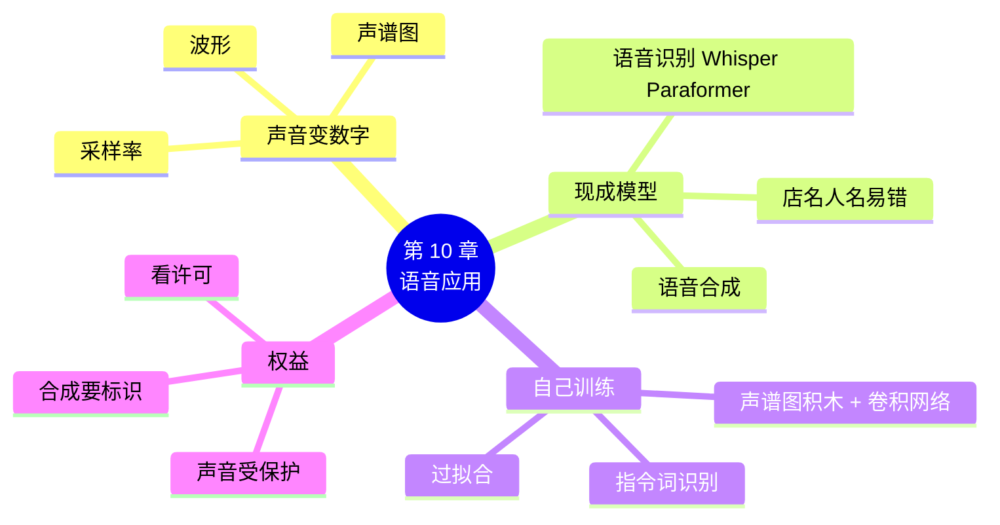

# 第 10 章 语音应用：让模型听懂声音

!!! abstract "本章学时"
    理论 5 学时（线上 4 + 线下 1）· 实验 1 学时（本章共 3 个实验，教师可任选）

## 学习目标

学完本章，你应该能够：

1. **说出**采样率、波形、声谱图的含义（记忆）；
2. **解释**为什么可以把声谱图当图片，用卷积网络来识别声音（理解）；
3. **运行**代码，完成语音合成和语音识别，并训练一个语音指令识别器（应用）；
4. **比较**不同语音识别模型的识别结果，分析出错的原因（分析）；
5. **判断**一个语音应用在录音授权和合成内容标识方面是否合规（评价）。

!!! info "先修要求"
    学习本章前，你需要掌握：

    - 图片是一堆数字，读数据集的方法（[3.1 节](../03-data/index.md#31)、[3.2 节](../03-data/index.md#32)）；
    - 卷积层、池化层（[4.3 节](../04-build-network/index.md#43)）；
    - 训练模型的流程（[第 5 章](../05-training/index.md)），过拟合（[6.2 节](../06-tuning/index.md#62)）；
    - 文字变数字（[9.1 节](../09-text-apps/index.md#91)）。

??? abstract "本章概念清单（6 个，点击查看定义和例子）"
    1. [采样率](../../appendix/glossary.md#g-采样率)
    2. [波形](../../appendix/glossary.md#g-波形)
    3. [声谱图](../../appendix/glossary.md#g-声谱图)
    4. [语音识别](../../appendix/glossary.md#g-语音识别)
    5. [语音合成](../../appendix/glossary.md#g-语音合成)
    6. [指令词识别](../../appendix/glossary.md#g-指令词识别)

## 情景导入

外卖订单越来越多，老板娘忙得顾不上看手机：“要是新订单来了，能有个声音喊一句‘您有新的外卖订单’就好了。还有，我手上全是水的时候，能不能对着手机说一句‘下一单’就翻页？”

小林说：“前一个是把文字变成声音，叫语音合成；后一个是听懂一句话，叫语音识别。手机上的语音助手天天在用。”

小周补充：“而且你会发现，声音也能变成一张‘照片’。一旦变成照片，第 5 章认花的那套办法，几乎原封不动就能拿来认词。”

## 10.1 声音怎样变成数字 { #101 }

### 10.1.1 采样：每秒记下几千个数 { #1011 }

声音是空气的振动。麦克风把振动变成电信号，电脑每隔一小段时间“看”一眼信号有多大，记下一个数，这叫采样。每秒记多少个数，叫[**采样率**](../../appendix/glossary.md#g-采样率 "每秒对声音信号记录多少个数值，单位赫兹（Hz）；越高声音越细致，数据也越多"){ .term }，单位是赫兹（Hz）。

| 采样率 | 每秒记几个数 | 常见用途 |
|---|---|---|
| 8000 Hz | 8000 | 电话、本章的语音指令数据 |
| 16000 Hz | 16000 | 大多数语音识别模型 |
| 44100 Hz | 44100 | 音乐 CD |

采样率越高，记录的声音越细致，数据也越多。人说话的主要信息在 4000 Hz 以下，8000 Hz 的采样率已经能听清说的是什么词。

### 10.1.2 波形：声音的“心电图” { #1012 }

把这些数按时间顺序画出来，就是[**波形**](../../appendix/glossary.md#g-波形 "把声音的采样值按时间顺序画出来的图，能看出声音何时开始、何时结束、哪里大哪里小"){ .term }。下面是一段 1 秒的英文“yes”录音（8000 Hz，一共 8000 个数）：



*图 10-1　“yes”的波形（上），放大以后能看到一个个采样点（下）（录音来自谷歌 Speech Commands 数据集，CC BY 4.0）*

从波形能看出声音什么时候开始、什么时候结束、哪里大哪里小：0.43 秒左右开始说“ye”，声音很大；0.65 秒以后是“s”，声音小而密。但光看波形，很难看出说的是“yes”还是“no”。

### 10.1.3 声谱图：声音的“照片” { #1013 }

人能分辨不同的字音，靠的是听出声音里**有哪些高低不同的音、各有多强**。把每一小段时间里各个频率的强弱算出来，画成一张图，就是[**声谱图**](../../appendix/glossary.md#g-声谱图 "横轴为时间、纵轴为频率、亮度表示强弱的图，展示每一小段时间里各频率声音的强弱，可以当图片来识别"){ .term }：横轴是时间，纵轴是频率（越往上音越高），越亮表示这个频率的声音越强。



*图 10-2　“yes”和“no”的声谱图：40 个频段 × 63 个时间片（Keras `MelSpectrogram` 实际计算）*

两张图一眼就能分开：“yes”前半段的元音下面有一条条横纹，后半段的“s”是上方一片亮的“沙沙声”；“no”整段都是又多又清楚的横纹。

播放下面几段声音，看看波形和声谱图怎样跟着变：

<iframe class="sim-frame" src="../../sims/hear-sound/main.html" height="560" loading="lazy" title="看见声音"></iframe>

关键的一步来了：声谱图就是一张 40 × 63 的“单色图片”。**不同的词，声谱图长得不一样**，那么第 4 章认花的卷积网络，拿来认声谱图也一样可以。10.3 节就这么做。

!!! tip "图片、文字、声音，都是先变成数字"
    图片：像素 → 一张数字表（第 3 章）；文字：分词、编号、词向量（第 9 章）；声音：采样 → 波形 → 声谱图。变成数字以后，搭网络、训练的方法都是一样的。这正是深度学习框架的威力：**同一套工具，处理各种各样的数据**。

## 10.2 用现成模型识别和合成语音 { #102 }

### 10.2.1 两个最常用的语音任务 { #1021 }

- [**语音识别**](../../appendix/glossary.md#g-语音识别 "把说话的声音转换成文字的技术"){ .term }：把说的话变成文字，比如语音输入法、会议字幕、“下一单”；
- [**语音合成**](../../appendix/glossary.md#g-语音合成 "把文字转换成说话声音的技术"){ .term }：把文字变成说话的声音，比如导航播报、“您有新的外卖订单”、有声书。

这两件事都有大量现成的开源模型。本章用 **sherpa-onnx** 来调用它们<sup class="cite">[[3]](#ref10-3)</sup>：它是新一代 Kaldi 团队开发的开源语音工具，能把各家训练好的模型（转换成 ONNX 格式后）放在普通电脑上离线运行，不用联网、CPU 就很快，安装只要一行 `pip install sherpa-onnx`。

| 任务 | 通用版 | 国产版 |
|---|---|---|
| 语音识别 | OpenAI **Whisper**（tiny 最小版，支持近百种语言）<sup class="cite">[[1]](#ref10-1)</sup> | 阿里达摩院 FunASR 的 **Paraformer**（中文小号版）<sup class="cite">[[2]](#ref10-2)</sup> |
| 语音合成 | Matcha-TTS 中文女声模型（两版相同） | 同左 |

Whisper 和 Paraformer 也有各自的原版工具（`openai-whisper`、`funasr`），国产版还可以用飞桨的 PaddleSpeech<sup class="cite">[[4]](#ref10-4)</sup>。原版工具功能更多，但要安装 PyTorch 或飞桨并在线下载模型，适合在云平台上使用；这里统一用 sherpa-onnx，是为了在普通电脑上也能跑起来。

### 10.2.2 合成一句话，再识别回来 { #1022 }

先让模型说一句话，存成声音文件；再让识别模型听这个文件，看能不能把原文写回来。

```python
TEXT = "您好，您的外卖已经送到门口了。"
audio = tts.generate(TEXT, sid=0, speed=0.9)          # 语音合成：文字 → 声音
sf.write("tts.wav", audio.samples, audio.sample_rate)  # 存成声音文件
```

=== "通用版"

    ```python
    asr = sherpa_onnx.OfflineRecognizer.from_whisper(
        encoder=W + "tiny-encoder.int8.onnx", decoder=W + "tiny-decoder.int8.onnx",
        tokens=W + "tiny-tokens.txt", language="zh")      # 告诉它说的是中文
    ```

=== "国产版"

    ```python
    asr = sherpa_onnx.OfflineRecognizer.from_paraformer(
        paraformer=P + "model.int8.onnx", tokens=P + "tokens.txt")
    ```

```python
def listen(path):
    x, sr = sf.read(path, dtype="float32")              # 读声音文件
    s = asr.create_stream(); s.accept_waveform(sr, x); asr.decode_stream(s)
    return s.result.text

print("识别：", listen("tts.wav"))
```

创建 `tts` 的那几行是固定写法，完整代码见实验 10-3。`listen` 函数的三步是：建一个“音频流”，把声音送进去，解码出文字。

### 10.2.3 识别结果比一比 { #1023 }

编者用同一个合成模型说了四句话，再交给两个识别模型（实测结果，标点是合成时有、识别时没有的）：

| 原文 | 通用版 Whisper tiny | 国产版 Paraformer |
|---|---|---|
| 您好，您的外卖已经送到门口了。 | 您好您的外賣已經送到門口了 | 您好您的外卖已经送到门口了 |
| 请问明天上午九点有空吗？ | 請問明天上午九點有空嗎 | 请问明天上午九点有空吗 |
| 今天的玫瑰八折，欢迎选购。 | 今天的美閣八者會影選購 | 今天的玫瑰八折欢迎选购 |
| 花语小铺今天玫瑰八折，欢迎选购。 | 巴魚小鋪今天玫瑰巴折 會影選購 | 花鱼小铺今天玫瑰八折会迎选购 |

可以看出：

1. Whisper tiny 输出的是**繁体字**，因为它的训练数据里中文繁体占了不少；它是最小的版本（约 4000 万个参数），专门在中文上训练的 Paraformer 对中文更准。Whisper 的长处是支持近百种语言，更大的版本（small、medium）中文准确率也高得多；
2. “花语小铺”这样的**店名、人名**最容易认错，Paraformer 认成了“花鱼小铺”。因为“花语”在日常说话里很少见，模型更倾向于常见的说法。实际应用中，可以给模型提供“热词”列表，或者对识别结果做纠错。

## 10.3 把声谱图当图片：训练语音指令识别器 { #103 }

### 10.3.1 数据：8 个英文指令词 { #1031 }

手机上的“小爱同学”“小度小度”，智能音箱一直在“听”，但它并不是时时刻刻做完整的语音识别，而是用一个很小的模型只盯着几个固定的词，听到了再“醒来”。这种只识别少数几个固定词的任务，叫[**指令词识别**](../../appendix/glossary.md#g-指令词识别 "只识别少数几个固定词的语音任务，常用于语音唤醒和语音控制，模型小、反应快"){ .term }（也叫关键词识别、语音唤醒）。

我们用谷歌 Speech Commands 数据集<sup class="cite">[[5]](#ref10-5)</sup>的一部分：8 个英文单词 down、go、left、no、right、stop、up、yes，每个词 100 条录音，由很多不同的人录制，每条最长 1 秒，采样率 8000 Hz。放在 `labs/data/speech_commands_small/` 里，每个词一个子文件夹，和第 3 章花卉照片的摆放方式一模一样。

### 10.3.2 读入声音数据 { #1032 }

=== "通用版"

    ```python
    train_ds, val_ds = keras.utils.audio_dataset_from_directory(
        "../../data/speech_commands_small",              # 每个子文件夹是一个词
        batch_size=32, validation_split=0.2, subset="both", seed=42,
        output_sequence_length=8000)                     # 每条统一成 8000 个数（不够的补 0）
    ```

    和第 3 章的 `image_dataset_from_directory` 几乎一样，只是 image 换成了 audio。`output_sequence_length` 的作用和第 9 章的填充一样。

=== "国产版"

    ```python
    def load_wav(path):                                  # 告诉 DatasetFolder 怎样读一个声音文件
        wav, sr = paddle.audio.load(path)                # wav 的形状是 (1, 采样点个数)
        x = wav[0].numpy()[:8000]                        # 最多取 8000 个数（1 秒）
        return np.pad(x, (0, 8000 - len(x))).astype("float32")   # 不够的补 0

    full = DatasetFolder("../../data/speech_commands_small", loader=load_wav, extensions=(".wav",))
    train_ds, val_ds = paddle.io.random_split(full, [640, 160])   # 640 条训练，160 条验证
    ```

    还是第 3 章的 `DatasetFolder`，只是多告诉它一件事：用 `load_wav` 函数来读 `.wav` 文件。

### 10.3.3 搭网络：第一块积木把声音变成声谱图 { #1033 }

=== "通用版"

    ```python
    model = keras.Sequential([
        keras.Input(shape=(8000, 1)),
        layers.Reshape((8000,)),                         # 变成一串 8000 个数
        layers.MelSpectrogram(sampling_rate=8000, fft_length=256, sequence_stride=128,
                              num_mel_bins=40),          # 声音 → 声谱图（40 × 63）
        layers.Reshape((40, 63, 1)),                     # 加一个“通道”，当成单色图片
        layers.BatchNormalization(),                     # 把数值调整到合适的范围
        layers.Conv2D(16, 3, activation="relu"), layers.MaxPooling2D(),
        layers.Conv2D(32, 3, activation="relu"), layers.MaxPooling2D(),
        layers.Flatten(), layers.Dropout(0.3),
        layers.Dense(64, activation="relu"),
        layers.Dense(8, activation="softmax"),           # 8 个词
    ])
    ```

=== "国产版"

    ```python
    net = nn.Sequential(
        paddle.audio.features.LogMelSpectrogram(sr=8000, n_fft=256, hop_length=128,
                                                n_mels=40),   # 声音 → 声谱图（40 × 63）
        nn.Unflatten(1, [1, 40]),                        # 加一个“通道”，当成单色图片
        nn.BatchNorm2D(1),                               # 把数值调整到合适的范围
        nn.Conv2D(1, 16, 3), nn.ReLU(), nn.MaxPool2D(2),
        nn.Conv2D(16, 32, 3), nn.ReLU(), nn.MaxPool2D(2),
        nn.Flatten(), nn.Dropout(0.3),
        nn.Linear(32 * 8 * 14, 64), nn.ReLU(),
        nn.Linear(64, 8), nn.Softmax(),                  # 8 个词
    )
    ```

把这个网络和第 4 章的花卉网络对比一下，只有前面几块不一样：

1. **声谱图积木**（`MelSpectrogram` / `LogMelSpectrogram`）：把 8000 个数变成 40 个频段 × 63 个时间片的声谱图。它没有要学的参数，就是一个固定的计算步骤，放进网络里的好处是：以后预测时直接把录音送进来就行；
2. **加通道**：卷积层要求输入有“通道”这一维，花卉照片是 3 个通道（红绿蓝），声谱图只有 1 个；
3. **批归一化**（BatchNormalization）：声谱图的数值范围和照片很不一样，这块积木会自动把数值调整到适合训练的范围。

后面的卷积、池化、展平、全连接，和第 4 章完全一样。两版的结构和参数个数完全相同：234,764 个。

### 10.3.4 训练结果 { #1034 }

训练流程和第 5 章一字不差，训练 20 轮（CPU 上每轮不到 1 秒）。两版的实测结果：

| | 第 20 轮训练准确率 | 第 20 轮验证准确率 |
|---|---|---|
| 通用版 | 96.7% | 66.9% |
| 国产版 | 99.4% | 55.0% |

8 个词随便猜只有 12.5% 的准确率，模型确实学到了东西。但训练准确率接近 100%、验证准确率只有五六成，这个情形你一定很熟悉：和第 5 章的花卉模型一样，是**过拟合**。原因也一样：每个词只有 80 条训练录音，而说话的人、语速、口音、背景噪声千差万别。

改进的方法第 6 章、第 7 章都学过：数据增强（给录音加一点噪声、稍微平移）、早停、Dropout，以及用在大量语音上预训练过的模型做迁移学习。谷歌原始的 Speech Commands 有十万多条录音，用它训练，同样的网络可以达到九成左右。两版结果差 10 个百分点左右，主要是因为划分验证集的方式不同（随机抽到的 160 条录音不一样），验证集小的时候，这种差别很正常。

!!! cert "证书考点"
    人工智能应用工程师证书中的语音处理部分，会考查采样率、声谱图等基本概念，语音识别和语音合成的应用场景，以及使用现成模型完成语音识别的方法。

## 10.4 声音的权益：录音要授权、合成要标识 { #104 }

语音合成已经可以做到以假乱真，几秒钟的录音就能“克隆”出一个人的声音。这带来了新的风险：冒充亲友打电话诈骗、伪造名人发言。所以：

1. **声音受法律保护**。《民法典》第一千零二十三条规定，对自然人声音的保护，参照适用肖像权保护的有关规定<sup class="cite">[[6]](#ref10-6)</sup>。也就是说，未经本人同意，不能用他的声音训练模型、合成他的声音。录别人的声音做数据，要事先说明用途、取得同意；
2. **合成的内容要标识**。《人工智能生成合成内容标识办法》自 2025 年 9 月 1 日起施行，要求合成的语音等内容添加标识，例如在音频的开头或结尾加上语音提示，并在文件中加入隐式标识<sup class="cite">[[7]](#ref10-7)</sup>；
3. **注意模型和数据的许可**。本章的语音合成模型是用标贝公司的开放数据训练的，这份数据**只允许非商业使用**，课堂学习可以，做成产品去卖就不行。用别人的模型和数据之前，先看许可说明。

对照老板娘的需求：用合成语音播报“您有新的外卖订单”，自己店里用，没问题；如果要把合成的语音发到网上，就要按规定标明“AI 合成”。

## 10.5 本章常见报错对照 { #105 }

| 报错原文 | 用大白话说 | 怎么改 |
|---|---|---|
| `No module named 'sherpa_onnx'`、`No module named 'soundfile'` | 库还没有安装 | 运行 `!pip install sherpa-onnx soundfile` |
| 下载模型时报 `URLError`、`timed out` | 连不上 GitHub | 换网络更好的平台；或请老师把模型文件放到共享目录 |
| `ValueError: Cannot reshape array of size ... into shape (40,63,1)` | 声谱图的大小和 `Reshape` 写的不一致，通常是改了采样率、长度或 `sequence_stride` | 先用 `model.summary()` 看声谱图层输出的真实形状，再改 `Reshape` |
| 自己录的声音识别结果是空的或乱的 | 录音格式不对（比如手机录的 m4a），或者声音太小、噪声太大 | 转换成 wav 格式；靠近麦克风、在安静的地方录 |
| 识别出来全是繁体字 | Whisper 的特点 | 正常；可以用 `pip install opencc` 把繁体转简体，或改用 Paraformer |
| 国产版报 `RuntimeError: ... audio backend` | 飞桨读声音文件的后端没装好 | 运行 `!pip install soundfile` 后重启内核 |

## 10.6 前沿视窗：能实时对话的语音大模型 { #106 }

本章的语音应用是“三段式”：先把声音识别成文字，再处理文字（比如交给第 9 章的大模型），最后把回答合成成声音。每一段都要花时间，而且语气、情绪这些信息在变成文字时就丢了。

最新的**语音大模型**把这三段合成了一个模型：直接听声音、直接说声音，可以像打电话一样实时对话，能被随时打断，还能听出你的语气、用不同的情绪回答。国内的豆包、通义千问、讯飞星火等都推出了实时语音对话功能；开源模型中，通义千问团队发布的 Qwen2.5-Omni 能同时理解文字、图片、声音和视频，并实时用语音回答<sup class="cite">[[8]](#ref10-8)</sup>。

但“三段式”不会消失：它每一段都能单独替换、单独检查，便宜、可控、能离线运行，在客服质检、会议记录、车载语音等场景仍然最常用。

## 本章实验

!!! abstract "实验总览"
    | 实验 | 类型 | 建议时长 | 内容 |
    |---|---|---|---|
    | 实验 10-1 | ★ 必做 | 15 分钟 | 看见声音：波形和声谱图 |
    | 实验 10-2 | ★ 必做 | 25 分钟 | 训练一个语音指令识别器 |
    | 实验 10-3 | ☆ 选做 | 25 分钟 | 语音合成与语音识别体验 |

    代码见配套资源 `labs/ch10/` 目录（`keras/` 通用版，`paddle/` 国产版）。数据 `labs/data/speech_commands_small/`（CC BY 4.0，见其中的 `LICENSE.txt`）。实验 10-3 要从 GitHub 下载约 300 MB 的模型。

### 实验 10-1 ★ 看见声音：波形和声谱图 { #10-1 }

**实验目的**

1. 读入声音文件，理解采样率和采样点；
2. 画出波形和声谱图，比较不同的词。

**实验环境**：云端 Notebook 或本机，CPU 即可。

**实验数据**：`labs/data/speech_commands_small/`。

**实验步骤与代码**

第一档 · 跑通：打开 `lab10_1_see_sound.ipynb`，依次运行三个单元格：读入并播放一段录音 → 画波形 → 画 yes 和 no 的声谱图。

完整代码：`labs/ch10/keras/lab10_1_see_sound.ipynb`、`labs/ch10/paddle/lab10_1_see_sound.ipynb`

**运行结果**（通用版第 1 步）：

```text
采样率 8000 ，一共 8000 个数，时长 1.0 秒
中间 10 个数： [   27     5    23   220   168  -668    13   383 -1505   779]
```

国产版的 `paddle.audio.load` 会把数值换算到 -1～1 之间（除以 32768），所以中间 10 个数是 `0.00082397 0.00015259 …`，形状一样。第 2、3 步的图见图 10-1、图 10-2。

第二档 · 改一改：

1. 把 `YES` 换成 `up`、`down` 文件夹里的录音，画出声谱图，说说和 yes 有什么不同；
2. 同一个词，换两个不同的人（同一个文件夹里的不同文件），比较声谱图，相同的地方在哪里？

**实验记录表**

| 词 | 声音从几秒开始到几秒结束 | 声谱图的特点 |
|---|---|---|
| yes | | |
| no | | |
| 自选 | | |

**常见问题排查**

| 现象 | 原因 | 解决办法 |
|---|---|---|
| 播放器没有声音 | 电脑静音，或浏览器不允许自动播放 | 点一下播放器的播放按钮，检查音量 |
| 声谱图上下颠倒 | 没写 `origin="lower"` | 加上它，低频画在下面 |

**思考与练习**

1. 采样率 8000 Hz、长 1 秒的录音有多少个数？如果改成 16000 Hz 呢？

**实验报告要求**

提交波形图、两个词的声谱图和实验记录表。

### 实验 10-2 ★ 训练一个语音指令识别器 { #10-2 }

**实验目的**

1. 体会“声谱图当图片”的思路，把第 5 章的训练流程用到声音上；
2. 观察并分析过拟合。

**实验环境**：云端 Notebook 或本机，CPU 即可，训练约 1 分钟。

**实验数据**：`labs/data/speech_commands_small/`。

**实验步骤与代码**

第一档 · 跑通：打开 `lab10_2_speech_commands.ipynb`，依次运行四个单元格：读数据 → 搭网络 → 训练 → 看看前 8 条验证录音的预测。代码见 10.3 节。

完整代码：`labs/ch10/keras/lab10_2_speech_commands.ipynb`、`labs/ch10/paddle/lab10_2_speech_commands.ipynb`

**运行结果**：见 10.3.4 节。第 4 步通用版的实际输出：

```text
真实：yes    预测：yes   （把握 62%）
真实：yes    预测：yes   （把握 50%）
真实：yes    预测：yes   （把握 72%）
真实：up     预测：down  （把握 59%）
真实：up     预测：go    （把握 48%）
真实：up     预测：up    （把握 95%）
真实：up     预测：no    （把握 43%）
真实：stop   预测：stop  （把握 74%）
```

第二档 · 改一改：

1. 加上第 6 章的早停（`EarlyStopping`，盯着验证损失，耐心 5 轮），看看最好的验证准确率是多少、在第几轮；
2. 把 `Dropout(0.3)` 改成 `Dropout(0.5)`，比较两条训练曲线的距离。

第三档 · 挑战：用手机录自己说的“yes”“no”（安静环境，1 秒内说完），转换成 8000 Hz 的 wav 文件，让模型认一认。认得准吗？为什么？

**实验记录表**

| 设置 | 最好的验证准确率 | 在第几轮 | 训练准确率 |
|---|---|---|---|
| 原始代码 | | | |
| 加早停 | | | |
| Dropout 0.5 | | | |

**常见问题排查**

| 现象 | 原因 | 解决办法 |
|---|---|---|
| 训练准确率一直在 12% 左右 | 没有批归一化，数值范围不合适，模型学不动 | 确认网络里有 `BatchNormalization` / `BatchNorm2D` |
| 国产版报 `Unflatten` 不存在 | 飞桨版本太旧 | 升级到 2.6 以上：`!pip install -U paddlepaddle` |
| 自己的录音总被认错 | 训练数据都是外国人的英语录音，和你的口音、麦克风、环境都不同 | 正常现象，这就是“数据决定上限” |

**思考与练习**

1. “up”被认成了“down”“go”“no”，你觉得为什么最容易认错的是它？（提示：看看“看见声音”动画里 up 的声谱图）

**实验报告要求**

提交训练日志截图、实验记录表，以及对过拟合原因和改进方法的分析。

### 实验 10-3 ☆ 语音合成与语音识别体验 { #10-3 }

**实验目的**

1. 用现成模型把文字变成声音、把声音变回文字；
2. 比较不同识别模型的结果，理解识别出错的原因。

**实验环境**：云端 Notebook 或本机，CPU 即可，需要能访问 GitHub 下载模型（约 300 MB）。

**实验数据**：自己输入的文字；自己录的声音（可选）。

**实验步骤与代码**

第一档 · 跑通：打开 `lab10_3_asr_tts.ipynb`，依次运行三个单元格：下载模型 → 合成一句话并播放 → 识别回来。代码见 10.2.2 节。

完整代码：`labs/ch10/keras/lab10_3_asr_tts.ipynb`（Whisper）、`labs/ch10/paddle/lab10_3_asr_tts.ipynb`（Paraformer）

**运行结果**：

```text
原文： 您好，您的外卖已经送到门口了。
识别： 您好您的外賣已經送到門口了        ← 通用版
识别： 您好您的外卖已经送到门口了        ← 国产版
```

更多句子的结果见 10.2.3 节。

第二档 · 改一改：

1. 把 `TEXT` 换成带店名、人名、数字的句子（如“张三在花语小铺买了 12 枝玫瑰”），看看识别结果哪里错了；
2. 把 `speed` 改成 0.7 和 1.3，听听语速的变化，识别结果有没有变化。

第三档 · 挑战：用手机录一句话，转换成 wav 文件上传，用 `listen("你的文件.wav")` 识别。

**实验记录表**

| 原文 | 识别结果 | 错了几个字 | 错的原因 |
|---|---|---|---|
| | | | |

**常见问题排查**

| 现象 | 原因 | 解决办法 |
|---|---|---|
| 下载很慢或失败 | GitHub 访问不稳定 | 老师提前下载好，放在共享目录，把模型文件夹复制到 Notebook 所在的文件夹 |
| 合成的数字读法不对 | 数字的读法规则没加载 | 确认代码里有 `rule_fsts=M + "number.fst"` |

**思考与练习**

1. 如果要用你同学的声音合成一段话发到网上，需要做哪些事？

**实验报告要求**

提交实验记录表，以及“合成语音的权益与标识”的思考（不少于 100 字）。

## 本章小结

- 声音的数字化：按**采样率**每秒记下几千个数，画出来是**波形**；把每一小段时间里各个频率的强弱画出来，是**声谱图**。
- 声谱图就是一张单色图片，不同的词长得不一样，所以可以用卷积网络来认。
- **语音识别**把声音变成文字，**语音合成**把文字变成声音。用 sherpa-onnx 可以离线调用 Whisper、Paraformer 等现成模型；店名、人名最容易认错。
- **指令词识别**：网络第一块积木把声音变成声谱图，后面就是第 4 章的卷积网络。实测验证准确率五六成，过拟合，原因和办法都和花卉识别一样。
- 声音受法律保护，用别人的声音要同意；合成的语音发布要标识；用模型和数据要看许可。



**下一章预告**

花卉识别、评论分类、语音指令，你已经做出了好几个模型，但它们都还躺在 Notebook 里，只有你自己能用。下一章把模型做成**真正的应用**：十几行代码做一个网页，上传照片就能认花，再发布到网上，生成一个链接发给同学。

## 参考文献

正文中的上标编号（如<sup class="cite">[[1]](#ref10-1)</sup>）对应下面的文献。带链接的可以直接打开；书籍可在图书馆或电子书平台查阅。

<div class="refs" markdown>

**经典论文**

- <span id="ref10-1"></span>[1] RADFORD A, KIM J W, XU T, et al. Robust Speech Recognition via Large-Scale Weak Supervision[C]//Proceedings of the 40th International Conference on Machine Learning. Honolulu: PMLR, 2023: 28492-28518.
    <span class="ref-note">Whisper 的论文，用 68 万小时的多语言录音训练，对应 10.2 节。</span>
- <span id="ref10-2"></span>[2] GAO Z, ZHANG S, MCLOUGHLIN I, et al. Paraformer: Fast and Accurate Parallel Transformer for Non-autoregressive End-to-End Speech Recognition[C]//Interspeech 2022. Incheon: ISCA, 2022.
    <span class="ref-note">阿里达摩院 Paraformer 的论文，国产版语音识别所用的模型，对应 10.2 节。</span>
- <span id="ref10-5"></span>[5] WARDEN P. Speech Commands: A Dataset for Limited-Vocabulary Speech Recognition[EB/OL]. (2018-04-09)[2026-10-31]. <https://arxiv.org/abs/1804.03209>.
    <span class="ref-note">本章语音指令数据的来源，CC BY 4.0 许可，对应 10.3 节。</span>
- <span id="ref10-8"></span>[8] XU J, GUO Z, HE J, et al. Qwen2.5-Omni Technical Report[EB/OL]. (2025-03-26)[2026-10-31]. <https://arxiv.org/abs/2503.20215>.
    <span class="ref-note">通义千问团队的全模态模型技术报告，能听、能看、能实时用语音回答，对应 10.6 节。</span>

**在线资源**

- <span id="ref10-3"></span>[3] k2-fsa. sherpa-onnx[EB/OL]. [2026-10-31]. <https://github.com/k2-fsa/sherpa-onnx>.
    <span class="ref-note">本章调用语音模型所用的开源工具，Apache 2.0 许可，模型下载地址见其 Releases 页面，对应 10.2 节。</span>
- <span id="ref10-4"></span>[4] PaddlePaddle. PaddleSpeech[EB/OL]. [2026-10-31]. <https://github.com/PaddlePaddle/PaddleSpeech>.
    <span class="ref-note">飞桨的语音工具库，提供语音识别、语音合成等现成模型，适合在 AI Studio 上使用，对应 10.2.1 节。</span>

**法律法规**

- <span id="ref10-6"></span>[6] 中华人民共和国民法典[Z]. 2020-05-28.
    <span class="ref-note">第一千零二十三条第二款：对自然人声音的保护，参照适用肖像权保护的有关规定，对应 10.4 节。</span>
- <span id="ref10-7"></span>[7] 国家互联网信息办公室, 工业和信息化部, 公安部, 等. 人工智能生成合成内容标识办法[Z]. 2025-03-07.
    <span class="ref-note">2025 年 9 月 1 日起施行，规定了合成语音等内容的显式和隐式标识要求，对应 10.4 节。</span>

</div>

## 课后练习

选择题和判断题可以直接点击选项作答，系统会马上告诉你对错，并展开答案与解析；多选题选好后点“提交答案”。简答和实操题请先自己作答，再点开“答案与解析”核对。每道题的解析下方都有“回看”链接，做错了可以直接跳回正文复习。

**一、单项选择题**

<div class="quiz" data-answer="C" markdown>

**1.** 采样率 16000 Hz 的意思是（　　）。

- A. 声音的最高频率是 16000 Hz
- B. 每秒有 16000 个字
- C. 每秒记录 16000 个数
- D. 声音文件大小为 16000 字节

</div>

??? tip "答案与解析"
    **答案：C**

    采样率是每秒采样（记录数值）的次数。

    考查：采样率 · 认知层次：记忆 · [回看 10.1.1](#1011)
    { .quiz-meta }

<div class="quiz" data-answer="B" markdown>

**2.** 一段采样率 8000 Hz、长 2 秒的录音，一共有多少个采样点？（　　）

- A. 4000
- B. 16000
- C. 8000
- D. 2

</div>

??? tip "答案与解析"
    **答案：B**

    8000 × 2 = 16000。

    考查：采样率 · 认知层次：应用 · [回看 10.1.1](#1011)
    { .quiz-meta }

<div class="quiz" data-answer="A" markdown>

**3.** 声谱图的横轴和纵轴分别表示（　　）。

- A. 时间、频率
- B. 频率、时间
- C. 时间、声音大小
- D. 采样点、通道

</div>

??? tip "答案与解析"
    **答案：A**

    横轴是时间，纵轴是频率（越往上音越高），亮度表示强弱。C 描述的是波形。

    考查：声谱图 · 认知层次：记忆 · [回看 10.1.3](#1013)
    { .quiz-meta }

<div class="quiz" data-answer="D" markdown>

**4.** 能用卷积网络来识别语音指令，关键原因是（　　）。

- A. 声音文件很小
- B. 卷积网络专门为声音设计
- C. 声音只有 8 个词
- D. 声音可以变成声谱图，不同的词声谱图长得不一样，可以当图片来识别

</div>

??? tip "答案与解析"
    **答案：D**

    声谱图是一张单色“图片”，第 4 章认图片的卷积网络就能用。

    考查：声谱图当图片 · 认知层次：理解 · [回看 10.1.3](#1013)
    { .quiz-meta }

<div class="quiz" data-answer="B" markdown>

**5.** 把“您有新的外卖订单”这句文字变成声音，用的是（　　）。

- A. 语音识别
- B. 语音合成
- C. 指令词识别
- D. 情感分析

</div>

??? tip "答案与解析"
    **答案：B**

    文字 → 声音是语音合成；声音 → 文字是语音识别。

    考查：语音合成 · 认知层次：记忆 · [回看 10.2.1](#1021)
    { .quiz-meta }

<div class="quiz" data-answer="C" markdown>

**6.** 语音指令识别器网络中，`MelSpectrogram`（国产版 `LogMelSpectrogram`）这块积木的作用是（　　）。

- A. 播放声音
- B. 去除噪声
- C. 把一串采样点变成声谱图
- D. 输出 8 个词的概率

</div>

??? tip "答案与解析"
    **答案：C**

    它把 8000 个采样点变成 40 × 63 的声谱图，没有要学的参数。

    考查：声谱图积木 · 认知层次：理解 · [回看 10.3.3](#1033)
    { .quiz-meta }

<div class="quiz" data-answer="A" markdown>

**7.** 语音指令识别器训练准确率 96.7%，验证准确率 66.9%，最可能的问题是（　　）。

- A. 过拟合，训练数据太少
- B. 欠拟合，网络太小
- C. 学习率太小
- D. 声谱图算错了

</div>

??? tip "答案与解析"
    **答案：A**

    训练准确率远高于验证准确率，是过拟合。每个词只有 80 条训练录音。

    考查：过拟合 · 认知层次：分析 · [回看 10.3.4](#1034)
    { .quiz-meta }

<div class="quiz" data-answer="D" markdown>

**8.** 想用同学的声音训练一个语音合成模型，并把合成的语音发到网上，下列做法正确的是（　　）。

- A. 声音不属于个人权益，可以随便用
- B. 只要不说是谁的声音就行
- C. 只在晚上发布就行
- D. 先取得同学同意，发布时标明是 AI 合成

</div>

??? tip "答案与解析"
    **答案：D**

    声音参照肖像权保护，要取得本人同意；合成内容发布要按规定标识。

    考查：声音的权益 · 认知层次：评价 · [回看 10.4](#104)
    { .quiz-meta }

**二、多项选择题**

<div class="quiz quiz-multi" data-answer="ABD" markdown>

**1.** 和第 4 章的花卉识别网络相比，语音指令识别器网络前面多出来或不同的有（　　）。

- A. 把声音变成声谱图的积木
- B. 给声谱图加一个“通道”
- C. 卷积层的写法完全不同
- D. 批归一化，把数值调整到合适的范围

</div>

??? tip "答案与解析"
    **答案：ABD**

    卷积、池化、展平、全连接的写法和第 4 章完全一样。

    考查：语音指令识别器的网络 · 认知层次：理解 · [回看 10.3.3](#1033)
    { .quiz-meta }

<div class="quiz quiz-multi" data-answer="AC" markdown>

**2.** 语音识别中最容易出错的有（　　）。

- A. 不常见的店名、人名
- B. 很常见的日常用语
- C. 噪声大、声音小的录音
- D. 安静环境下清楚的普通话

</div>

??? tip "答案与解析"
    **答案：AC**

    模型倾向于常见的说法，“花语小铺”被认成“花鱼小铺”；录音质量差也会出错。

    考查：语音识别 · 认知层次：分析 · [回看 10.2.3](#1023)
    { .quiz-meta }

<div class="quiz quiz-multi" data-answer="ABC" markdown>

**3.** 改进语音指令识别器过拟合的办法有（　　）。

- A. 收集更多的录音
- B. 数据增强，比如加一点噪声、稍微平移
- C. 早停
- D. 训练更多轮

</div>

??? tip "答案与解析"
    **答案：ABC**

    训练更多轮会让过拟合更严重。

    考查：过拟合的改进 · 认知层次：应用 · [回看 10.3.4](#1034)
    { .quiz-meta }

**三、判断题**

<div class="quiz quiz-judge" data-answer="×" markdown>

**1.** 只看波形，就能很容易地分辨出说的是“yes”还是“no”。

- √ 正确
- × 错误

</div>

??? tip "答案与解析"
    **答案：×**

    波形能看出声音的开始、结束和大小，但很难看出说的是什么，声谱图更容易分辨。

    考查：波形 · 认知层次：理解 · [回看 10.1.2](#1012)
    { .quiz-meta }

<div class="quiz quiz-judge" data-answer="√" markdown>

**2.** 一个纯音在声谱图上是一条横线，音越高，线越靠上。

- √ 正确
- × 错误

</div>

??? tip "答案与解析"
    **答案：√**

    可以在“看见声音”动画的“哆咪嗦”里看到。

    考查：声谱图 · 认知层次：理解 · [回看 10.1.3](#1013)
    { .quiz-meta }

<div class="quiz quiz-judge" data-answer="√" markdown>

**3.** 智能音箱的语音唤醒，通常用一个只盯着几个固定词的小模型，而不是时刻做完整的语音识别。

- √ 正确
- × 错误

</div>

??? tip "答案与解析"
    **答案：√**

    这就是指令词识别（关键词识别），小模型省电、反应快。

    考查：指令词识别 · 认知层次：记忆 · [回看 10.3.1](#1031)
    { .quiz-meta }

<div class="quiz quiz-judge" data-answer="×" markdown>

**4.** 声谱图积木有很多要学的参数，训练时会被不断调整。

- √ 正确
- × 错误

</div>

??? tip "答案与解析"
    **答案：×**

    它是固定的计算步骤，没有要学的参数。

    考查：声谱图积木 · 认知层次：理解 · [回看 10.3.3](#1033)
    { .quiz-meta }

<div class="quiz quiz-judge" data-answer="×" markdown>

**5.** 开源的语音合成模型都可以随意用于商业产品。

- √ 正确
- × 错误

</div>

??? tip "答案与解析"
    **答案：×**

    要看模型和训练数据的许可。本章的合成模型所用数据只允许非商业使用。

    考查：模型与数据的许可 · 认知层次：评价 · [回看 10.4](#104)
    { .quiz-meta }

**四、简答题**

**1.** 用自己的话说明：图片、文字、声音分别是怎样变成模型能处理的数字的？

??? tip "答案与解析"
    **参考答案：** 图片由像素组成，每个像素是红绿蓝三个 0～255 的数，本来就是一张数字表；文字要分词、查词表编号、填充到固定长度，再用嵌入层变成词向量；声音先按采样率采样得到一串数（波形），再变成声谱图（频率 × 时间的一张图）。变成数字后，搭网络、训练的方法都一样。

    考查：数据数字化 · 认知层次：理解 · [回看 10.1.3](#1013)
    { .quiz-meta }

**2.** 根据 10.2.3 节的对比表，比较 Whisper tiny 和 Paraformer 的识别结果，说说各自的特点，以及给老板娘的小店做语音下单应该选哪个。

??? tip "答案与解析"
    **参考答案：** Whisper tiny 支持近百种语言，但它是最小的版本，中文输出繁体字，而且错得较多（“玫瑰”认成“美閣”）；Paraformer 是专门为中文训练的，四句话中只有店名“花语”认错，还有一个字“欢”认成“会”。小店的顾客说中文，应该选 Paraformer；店名、菜名可以通过热词或纠错来改进。

    考查：语音识别模型的比较 · 认知层次：评价 · [回看 10.2.3](#1023)
    { .quiz-meta }

**3.** 实验 10-2 中，你用手机录的“yes”“no”很可能被认错。请从数据的角度分析原因。

??? tip "答案与解析"
    **参考答案：** 训练数据是谷歌收集的外国人的英语录音，你的口音、麦克风、录音环境（噪声、回声）、音量、说话的位置（录音里从第几秒开始说）都和训练数据不同；加上每个词只有 80 条训练录音，模型过拟合，没学到足够通用的特征。模型只懂它见过的东西，要认得准，需要收集和使用场景相似的数据。

    考查：数据决定上限 · 认知层次：分析 · [回看 10.3.4](#1034)
    { .quiz-meta }

**五、实操题**

**1.** 在实验 10-2 的基础上加上早停（盯着验证损失，耐心 5 轮，恢复最好的参数），重新训练最多 40 轮，记录停在第几轮、最好的验证准确率是多少。

??? tip "答案与解析"
    **参考做法（通用版）：**

    ```python
    stop = keras.callbacks.EarlyStopping(monitor="val_loss", patience=5,
                                         restore_best_weights=True)
    model.fit(train_ds, validation_data=val_ds, epochs=40, callbacks=[stop], verbose=2)
    ```

    国产版：`paddle.callbacks.EarlyStopping(monitor="loss", mode="min", patience=5, save_best_model=True)`，写法见实验 6-1。

    验证损失通常在十几轮时最低，之后开始上升，早停会在那之后 5 轮停下来。结果以自己运行为准，重点观察：早停能避免越训练越过拟合，但不能根本解决数据太少的问题。

    考查：早停 · 认知层次：应用 · [回看 10.3.4](#1034)
    { .quiz-meta }
