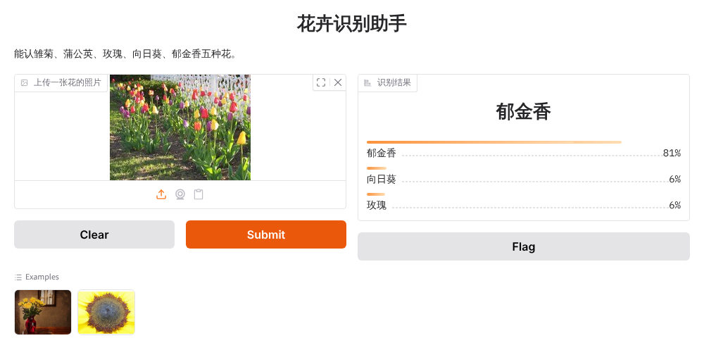
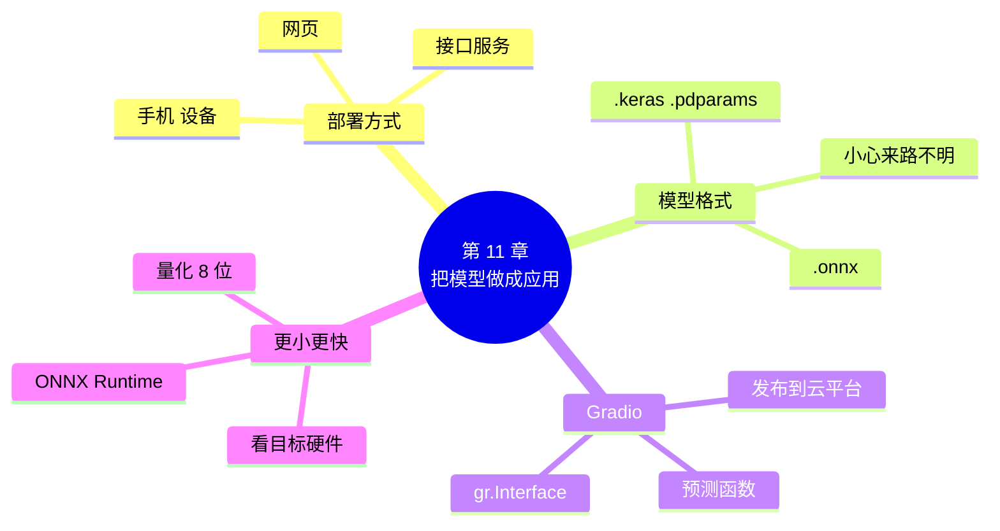

# 第 11 章 把模型做成应用

!!! abstract "本章学时"
    理论 6 学时（线上 4 + 线下 2）· 实验 1 学时（本章共 3 个实验，教师可任选）

## 学习目标

学完本章，你应该能够：

1. **说出**部署的含义和几种常见的部署方式（记忆）；
2. **认出**常见的模型文件格式，说出 ONNX 的作用（记忆、理解）；
3. **运行**代码，用 Gradio 把模型做成网页，并发布给别人使用（应用）；
4. **解释**量化的原理，根据实测结果分析它的得失（理解、分析）；
5. **选择**适合具体场景的部署方式（评价）。

!!! info "先修要求"
    学习本章前，你需要掌握：

    - 迁移学习得到的花卉识别模型，以及保存和加载模型（[第 7 章](../07-transfer/index.md)，需要先完成实验 7-1）；
    - 推理和预测（[2.1 节](../02-pretrained/index.md#21)）；
    - 函数和字典（附录 A）。

??? abstract "本章概念清单（4 个，点击查看定义和例子）"
    1. [部署](../../appendix/glossary.md#g-部署)
    2. [Gradio](../../appendix/glossary.md#g-Gradio)
    3. [ONNX](../../appendix/glossary.md#g-ONNX)
    4. [量化](../../appendix/glossary.md#g-量化)

## 情景导入

小林把花卉识别助手演示给老板娘看。老板娘很喜欢：“能不能让店员也用上？他们不会写代码，手机上点一点就行。”

小林看着满屏的代码犯了难：模型只在自己的 Notebook 里，换一台电脑都不会用，更别说手机了。

小周说：“训练好模型只是走完了一半路。后一半叫部署：把模型包装成别人会用的东西，比如一个网页。现在有专门的工具，十几行代码就能做出网页，再放到云平台上，生成一个链接，谁打开都能用。顺便还可以给模型‘瘦瘦身’，让它跑得更快、占的地方更小。”

## 11.1 训练完以后：让模型变成别人能用的东西 { #111 }

把训练好的模型放到实际使用的环境里，让用户能用上，这叫[**部署**](../../appendix/glossary.md#g-部署 "把训练好的模型放到实际使用的环境中（网页、接口服务、手机、设备等），让用户能用上"){ .term }。同一个模型，可以部署成不同的样子：

| 部署成 | 用户怎么用 | 例子 | 本书 |
|---|---|---|---|
| 网页 | 打开链接，上传照片 | 在线识花、在线抠图 | 本章重点 |
| 接口服务 | 其他程序发请求、拿结果 | 第 9 章调用的大模型 API | 11.6 节了解 |
| 手机 App、小程序 | 手机上拍照就识别 | 拍照识花、扫一扫识物 | 11.6 节了解 |
| 设备端 | 装在摄像头、音箱、汽车里 | 门禁、智能音箱、车载语音 | 11.6 节了解 |

不管哪种方式，核心都一样：**加载训练好的模型 → 接收用户的输入 → 预处理（和训练时一模一样）→ 预测 → 把结果变成用户看得懂的样子**。

## 11.2 模型文件长什么样 { #112 }

训练好的模型保存成文件，才能带走。不同框架有自己的格式，认识一下就好，不用深究：

| 扩展名 | 来自 | 里面装着什么 | 本书在哪用过 |
|---|---|---|---|
| `.keras` | Keras 3 | 网络结构 + 参数 + 训练设置，一个文件全包 | 第 6、7 章通用版 |
| `.h5` | Keras 旧版 | 同上，老格式 | 网上的老代码 |
| `.pdparams` | 飞桨 | 只有参数，加载前要先搭好一样的网络 | 第 6、7 章国产版 |
| `.json` + `.pdiparams` | 飞桨 | 结构 + 参数，用于部署 | 飞桨部署工具 |
| `.pt` / `.pth` | PyTorch | 参数（有时也含结构） | 第 8 章的 YOLO 模型 |
| `.onnx` | 通用交换格式 | 结构 + 参数，各种框架都能读 | 本章、第 10 章 |
| `.gguf` | 大模型社区 | 压缩过的大语言模型 | 11.7 节 |

注意第三行：飞桨的 `.pdparams` 只存参数，加载时要先用代码搭出和训练时**一模一样**的网络，再把参数装进去（第 7 章报错对照表里提到过）。Keras 的 `.keras` 文件连结构一起存了，`load_model` 一行就能恢复。

!!! warning "不要随便打开来路不明的模型文件"
    `.pt`、`.pth`、`.pkl` 这类文件在加载时**可以执行任意代码**，别有用心的人可以把病毒藏在里面。只从官方或可信的模型社区下载模型；ONNX、safetensors 等格式只存数据，相对安全。第 12 章还会讲到。

## 11.3 用 Gradio 做一个网页 { #113 }

### 11.3.1 只要写一个函数 { #1131 }

[**Gradio**](../../appendix/glossary.md#g-Gradio "为机器学习模型快速生成网页的 Python 库，只需提供预测函数和输入、输出组件"){ .term } 是一个专门为机器学习模型做网页的 Python 库<sup class="cite">[[1]](#ref11-1)</sup>。你只要写一个“预测函数”，告诉它输入是什么、输出是什么，它就自动生成网页，不用学 HTML。

第一步，加载第 7 章的模型，写预测函数：

=== "通用版"

    ```python
    model = keras.models.load_model("../../ch07/keras/flowers_transfer.keras")   # 先完成实验 7-1
    NAMES = ["雏菊", "蒲公英", "玫瑰", "向日葵", "郁金香"]   # 和训练时的类别顺序一致

    def predict(img):
        img = img.convert("RGB").resize((128, 128))          # 统一成训练时的大小
        x = np.array(img, dtype="float32")[None]             # [None]：变成“只有一张的一批”
        p = model.predict(x, verbose=0)[0]
        return {NAMES[i]: float(p[i]) for i in range(5)}     # 字典：花名 → 概率
    ```

=== "国产版"

    ```python
    net = paddle.vision.models.mobilenet_v2()                # 先搭出和训练时一模一样的网络
    net.classifier = nn.Sequential(nn.Dropout(0.2), nn.Linear(1280, 5), nn.Softmax())
    model = paddle.Model(net)
    model.load("../../ch07/paddle/flowers_transfer")         # 再装上训练好的参数
    net.eval()                                               # 切换到“预测模式”
    NAMES = ["雏菊", "蒲公英", "玫瑰", "向日葵", "郁金香"]

    def predict(img):
        x = tf(img.convert("RGB"))[None]                     # tf：和训练时一样的预处理
        p = net(x)[0].numpy()
        return {NAMES[i]: float(p[i]) for i in range(5)}     # 字典：花名 → 概率
    ```

    `net.eval()` 让网络进入“预测模式”：Dropout 这类只在训练时起作用的层会停下来，每次预测的结果才稳定。

两版的预测函数做的是同一件事：**输入一张图片，输出一个字典**，键是花名，值是概率。注意预处理必须和训练时一模一样：大小 128×128；通用版的模型里自带了换算到 -1～1 的积木，国产版要做和训练时一样的标准化。预处理不一致，是部署后“效果突然变差”最常见的原因。

### 11.3.2 一行把函数变成网页 { #1132 }

两版的这一步完全相同：

```python
import gradio as gr                                      # 先运行 !pip install gradio
demo = gr.Interface(
    fn=predict,                                          # 用哪个函数
    inputs=gr.Image(type="pil", label="上传一张花的照片"),   # 输入：图片
    outputs=gr.Label(num_top_classes=3, label="识别结果"),    # 输出：前 3 名和概率
    title="花卉识别助手",
    description="能认雏菊、蒲公英、玫瑰、向日葵、郁金香五种花。",
    examples=["../../data/test_photos/roses_1.jpg", "../../data/test_photos/sunflowers_1.jpg"],
)
demo.launch()
```

`gr.Interface`（界面）把三样东西连起来：输入组件 `gr.Image`（上传图片的框）、预测函数、输出组件 `gr.Label`（显示类别和概率条）。`examples` 是示例照片，用户点一下就能试。运行后会输出一个网址，比如 `http://127.0.0.1:7860`，在浏览器里打开：



*图 11-1　编者实际运行的花卉识别网页（通用版）：上传一张郁金香照片，识别为郁金香，把握 81%*

除了图片，Gradio 还有文本框 `gr.Textbox`、声音 `gr.Audio`、摄像头等组件。把第 9 章的评论分类器、第 10 章的语音识别做成网页，只要换一下输入、输出组件和预测函数。

## 11.4 发布到网上：生成一个链接 { #114 }

`http://127.0.0.1:7860` 中的 127.0.0.1 表示“本机”，只有你自己的电脑能打开。要让别人用，有两种办法：

**办法一：临时分享。** 把最后一行改成 `demo.launch(share=True)`，Gradio 会生成一个形如 `https://xxxx.gradio.live` 的公网链接，有效期有限（一般几天），而且你的 Notebook 关掉，链接就失效了。适合课堂上临时给同学演示。这个功能需要连接 Gradio 的服务器，国内网络下不一定能用。

**办法二：发布到云平台。** 很多平台提供免费托管 Gradio 应用的服务，发布以后一直能用：

| 平台 | 适合 | 说明 |
|---|---|---|
| 魔搭社区“创空间” | 两版都可以 | 阿里云的模型社区，国内访问快<sup class="cite">[[2]](#ref11-2)</sup> |
| 飞桨 AI Studio“应用” | 国产版 | 和飞桨环境配合最好<sup class="cite">[[3]](#ref11-3)</sup> |
| Hugging Face Spaces | 通用版 | 全球最大的模型社区，国内访问不稳定<sup class="cite">[[4]](#ref11-4)</sup> |

各平台的操作步骤大同小异：

1. 注册并登录平台，新建一个应用（创空间 / Space），类型选择 **Gradio**；
2. 上传这几个文件：`app.py`（网页的代码）、`requirements.txt`（需要安装哪些库）、模型文件、示例照片。`labs/ch11/keras/space/` 和 `labs/ch11/paddle/space/` 里准备好了 `app.py` 和 `requirements.txt`，和实验 11-1 的代码相比，只是把模型和照片的路径改成了“和 app.py 放在一起”；
3. 平台会自动安装库、运行 `app.py`，几分钟后生成一个固定的网址，发给同学就能用。

!!! warning "待实测"
    编者的编写环境无法登录这些平台，上面的步骤根据各平台的公开文档整理，没有配截图。平台的界面经常调整，请以平台的最新说明为准；建议任课教师在开课前走一遍，把截图补充到课件里。

发布前想一想：网页公开以后，任何人都能上传照片。要在页面上写清楚用途，不要让用户上传含有人脸、证件的照片；如果收集了用户上传的照片，要告知并取得同意（第 12 章细讲）。

## 11.5 让模型更小更快 { #115 }

### 11.5.1 ONNX：模型界的“PDF” { #1151 }

Word 文档发给别人，对方没装 Word 就打不开；转成 PDF，什么电脑、手机都能看。[**ONNX**](../../appendix/glossary.md#g-ONNX "开放的神经网络模型交换格式，各框架训练的模型都可转换成它，用 ONNX Runtime 运行而不需要原框架"){ .term }（开放神经网络交换格式）就是模型界的 PDF<sup class="cite">[[5]](#ref11-5)</sup>：Keras、飞桨、PyTorch 训练的模型都能转成 ONNX，然后用 **ONNX Runtime** 这个小巧的运行库来预测，**不再需要原来的框架**。第 10 章的语音模型、第 8 章 RapidOCR 的文字识别模型，都是 ONNX 格式的。

=== "通用版"

    ```python
    model.export("flowers.onnx", format="onnx")          # 先运行 !pip install tf2onnx onnx onnxruntime
    ```

    Keras 3 一行就能导出。注意：刚 `load_model` 加载的模型要先预测一次再导出，否则会报 `The model provided has never called`。

=== "国产版"

    ```python
    spec = paddle.static.InputSpec([None, 3, 128, 128], "float32", "x")   # 输入的形状
    paddle.onnx.export(net, "flowers", input_spec=[spec], opset_version=13)   # 先运行 !pip install paddle2onnx onnxruntime
    ```

    飞桨要告诉它输入长什么样：`None` 表示一批几张都行，后面是 3 个通道 × 128 × 128。导出的文件是 `flowers.onnx`。

导出以后，用 ONNX Runtime 预测，两版的写法一样：

```python
import onnxruntime as ort
sess = ort.InferenceSession("flowers.onnx")              # 加载 ONNX 模型，不需要 Keras 或飞桨
name = sess.get_inputs()[0].name                         # 输入的名字
p = sess.run(None, {name: x})[0]                         # 预测
```

编者的实测结果（单张照片，运行 100 次取平均）：

| | 原框架预测一张 | ONNX Runtime 预测一张 | 预测结果 |
|---|---|---|---|
| 通用版 | `model.predict`：64.5 毫秒 | 1.2 毫秒 | 完全相同 |
| 国产版 | `net(x)`：22.3 毫秒 | 0.9 毫秒 | 完全相同 |

快了几十倍！但要说清楚：这主要不是因为 ONNX 更“聪明”，而是 Keras 的 `predict`、飞桨的动态图每次调用都有一些固定的准备工作，适合一次处理一大批数据；ONNX Runtime 专门为“一次预测一张、反复预测”的部署场景做了优化。

### 11.5.2 量化：把参数“压缩” { #1152 }

模型里的每个参数，默认用 32 位小数存（4 个字节）。MobileNetV2 有两百多万个参数，所以文件有 9 MB 左右。[**量化**](../../appendix/glossary.md#g-量化 "用更少的位数（如 8 位整数代替 32 位小数）存储模型参数，使模型变小，在合适的硬件上更快"){ .term }就是用更少的位数来存参数，最常见的是 8 位整数（1 个字节）：先找出参数的范围，把它平均分成 255 份，每个参数只记它落在第几份。这就像把一张高清照片压缩成小图：细节损失一点，但主要内容都在，文件小得多。

量化的时候，还要拿几十张样本照片给模型“看一看”，记下每一层输出的范围，这一步叫校准。实验 11-3 用了 64 张训练照片。

拖动下面的按钮，看看量化的实测效果和参数被压缩成了什么样：

<iframe class="sim-frame" src="../../sims/model-compress/main.html" height="600" loading="lazy" title="模型压缩"></iframe>

| | 文件大小 | 每张用时 | 验证准确率 |
|---|---|---|---|
| 通用版 ONNX，32 位 | 8.9 MB | 1.2 毫秒 | 82.67% |
| 通用版 ONNX，8 位校准量化 | 2.7 MB | 2.0 毫秒 | 82.67% |
| 国产版 ONNX，32 位 | 9.1 MB | 0.9 毫秒 | 待实测 |
| 国产版 ONNX，8 位校准量化 | 2.6 MB | 2.4 毫秒 | 待实测 |

结论很清楚：**文件只有原来的三成，准确率一点没掉**。但在编者电脑的 CPU 上，量化后反而稍微慢了一点。这不奇怪：量化真正的用武之地是手机芯片、国产 AI 芯片（NPU）这些对 8 位整数有专门加速单元的硬件，在那里通常能快好几倍、也更省电。**部署要看目标硬件**，不能只在自己电脑上测一测就下结论。

!!! warning "待实测"
    国产版的大小和速度是编者实测的；验证准确率需要用 ImageNet 预训练参数完成实验 7-1 后才有意义，编者的环境下载不了飞桨的预训练参数，请以实际运行为准。可以预期：和通用版一样，校准量化后准确率基本不变。

!!! cert "证书考点"
    人工智能应用工程师（高级）证书的模型部署部分，会考查模型格式转换（如 ONNX）、模型量化等模型压缩方法，以及把模型封装成 Web 应用或接口服务的方法。

## 11.6 其他部署方式 { #116 }

本书只要求会做网页。其他方式了解一下，知道“还能这样”就行：

- **接口服务**：用 FastAPI、Flask 等工具把预测函数包装成网址，其他程序发一张图片过来，返回一段 JSON 结果。第 9 章调用的大模型 API 就是这样的服务。Gradio 做的网页也自带接口（网页底部的“Use via API”）。
- **手机端**：把模型转换成手机能用的格式，装进 App 里离线运行。通用版用 TensorFlow Lite（现在叫 LiteRT）<sup class="cite">[[6]](#ref11-6)</sup>，国产版用飞桨的 Paddle Lite。手机端几乎都要做量化。
- **国产芯片**：华为昇腾、寒武纪、昆仑芯等国产 AI 芯片，都提供把飞桨、ONNX 模型转换到自己芯片上运行的工具，比如飞桨的 Paddle Inference、FastDeploy，昇腾的 CANN。政务、金融、能源等行业越来越多地要求使用国产软硬件，第 12 章还会介绍。

部署方式怎么选？看三个问题：用户在哪里用（电脑、手机、设备）？能不能联网？数据能不能离开本地？

## 11.7 本章常见报错对照 { #117 }

| 报错原文 | 用大白话说 | 怎么改 |
|---|---|---|
| `No module named 'gradio'`、`No module named 'onnxruntime'` | 库还没有安装 | 运行 `!pip install gradio onnxruntime` |
| `FileNotFoundError: ... flowers_transfer.keras`（国产版 `flowers_transfer.pdparams`） | 找不到第 7 章保存的模型 | 先完成实验 7-1；检查路径 |
| `ValueError: The model provided has never called` | Keras 刚加载的模型还没运行过，不能导出 | 导出前先 `model.predict(x)` 一次 |
| 网页能打开，但识别结果总是同一种花 | 预处理和训练时不一样，或者国产版忘了 `net.eval()` | 对照训练代码检查大小、标准化；加上 `net.eval()` |
| 飞桨报 `The shape of ... does not match` 或加载后结果全错 | 搭的网络和训练时不一样（比如忘了换 `classifier`） | 用和训练时完全相同的代码搭网络 |
| `Error Unrecognized attribute: axis for operator DequantizeLinear` | 导出 ONNX 时的版本号（opset）太低，不支持量化 | 国产版导出时加上 `opset_version=13` |
| 国产版导出时提示 `Could not automatically install required module: onnx_graphsurgeon` | 一个可选的优化工具没装上 | 可以忽略，不影响导出结果 |
| 云平台上应用启动失败，日志里有 `ModuleNotFoundError` | `requirements.txt` 里少写了库 | 把缺的库名加进 `requirements.txt`，重新部署 |

## 11.8 前沿视窗：在自己电脑上运行大模型 { #118 }

第 9 章调用大模型要联网、要花钱、要把数据发出去。能不能把大模型装在自己电脑上？可以，靠的就是本章的量化：一个 70 亿参数的模型，32 位存要 28 GB，4 位量化后只要 4 GB 多，普通笔记本电脑的内存就放得下。

**Ollama** 是目前最流行的本地大模型工具之一<sup class="cite">[[7]](#ref11-7)</sup>：安装后，在命令行输入一句 `ollama run qwen3`（模型名以官网列表为准），就会自动下载一个量化好的通义千问模型（`.gguf` 格式），然后像聊天一样对话；它还提供和 OpenAI 相同格式的接口，第 9 章的代码把 `base_url` 改成本机地址就能用。DeepSeek、通义千问、GLM 等国产模型都有可以本地运行的小版本。

本地运行的好处是免费、离线、数据不出电脑；代价是小模型没有云端大模型聪明，速度也取决于你的电脑。对于涉及隐私的内部资料（比如顾客信息），本地大模型是一个值得考虑的选择。

## 本章实验

!!! abstract "实验总览"
    | 实验 | 类型 | 建议时长 | 内容 |
    |---|---|---|---|
    | 实验 11-1 | ★ 必做 | 20 分钟 | 做一个花卉识别网页 |
    | 实验 11-2 | ★ 必做 | 25 分钟 | 发布给同学用 |
    | 实验 11-3 | ☆ 选做 | 25 分钟 | 导出 ONNX，比一比大小和速度 |

    代码见配套资源 `labs/ch11/` 目录（`keras/` 通用版，`paddle/` 国产版）。三个实验都要用到实验 7-1 保存的模型。

### 实验 11-1 ★ 做一个花卉识别网页 { #11-1 }

**实验目的**

1. 写一个预测函数，用 Gradio 把它变成网页；
2. 理解部署时预处理要和训练时一致。

**实验环境**：本机或云端 Notebook，CPU 即可。在云平台的 Notebook 里，`127.0.0.1` 的网址可能打不开，改用 `demo.launch(share=True)`，或者使用平台提供的“预览”功能。

**实验数据**：实验 7-1 保存的模型；`labs/data/test_photos/`；自己拍的花的照片。

**实验步骤与代码**

第一档 · 跑通：打开 `lab11_1_web_app.ipynb`，依次运行三个单元格：加载模型 → 写预测函数 → 启动网页。打开输出的网址，上传一张照片试试。代码见 11.3 节。

完整代码：`labs/ch11/keras/lab11_1_web_app.ipynb`、`labs/ch11/paddle/lab11_1_web_app.ipynb`

**运行结果**：见图 11-1（国产版待实测）。

第二档 · 改一改：

1. 改网页的标题和说明，把 `num_top_classes=3` 改成 5；
2. 在预测函数里加一个判断：最高的概率低于 50% 时，返回 `{"不确定，换一张试试": 1.0}`。

第三档 · 挑战：把第 9 章的评论分类器做成网页（输入换成 `gr.Textbox()`）。

**实验记录表**

| 照片 | 识别结果（前 3 名和概率） | 对不对 |
|---|---|---|
| test_photos 中的一张 | | |
| 自己拍的花 | | |
| 不是花的照片（如杯子） | | |

**常见问题排查**

| 现象 | 原因 | 解决办法 |
|---|---|---|
| 单元格一直在运行、停不下来 | 网页在运行，这是正常的 | 用完后点 Notebook 的“停止”按钮 |
| 再次运行提示端口被占用 | 上一次的网页还开着 | 先停止，或者 `demo.launch(server_port=7861)` 换个端口 |
| 上传杯子照片也说是某种花 | 模型只认识 5 种花，只能从中选一个 | 正常；“改一改”第 2 题就是为此准备的 |

**思考与练习**

1. 为什么上传一张杯子的照片，模型也会说它是某种花？怎样让网页更“诚实”？

**实验报告要求**

提交网页截图（至少 3 张不同照片的识别结果）、修改后的代码和实验记录表。

### 实验 11-2 ★ 发布给同学用 { #11-2 }

**实验目的**

1. 把网页发布到云平台，生成可以分享的链接；
2. 了解 `app.py` 和 `requirements.txt` 的作用。

**实验环境**：魔搭社区创空间、飞桨 AI Studio 应用或 Hugging Face Spaces（任选一个，需要注册账号）。

**实验数据**：实验 7-1 保存的模型文件；`labs/ch11/keras/space/` 或 `labs/ch11/paddle/space/` 里的 `app.py`、`requirements.txt`；两张示例照片。

**实验步骤与代码**

第一档 · 跑通：按 11.4 节的步骤，新建 Gradio 类型的应用，上传 4 类文件，等待平台部署完成，打开生成的链接测试。

完整代码：`labs/ch11/keras/space/app.py`、`labs/ch11/paddle/space/app.py`

**运行结果**：待实测（平台的部署日志和页面以实际为准）。

第二档 · 改一改：

1. 把链接发给两位同学，请他们各上传一张花的照片，记录结果；
2. 在网页说明里加上一句隐私提示，例如“请勿上传含有人脸或个人信息的照片”。

**实验记录表**

| 项目 | 记录 |
|---|---|
| 使用的平台 | |
| 应用链接 | |
| 部署用了多长时间 | |
| 同学测试的结果 | |
| 遇到的问题和解决办法 | |

**常见问题排查**

| 现象 | 原因 | 解决办法 |
|---|---|---|
| 部署失败，日志里有 `ModuleNotFoundError` | `requirements.txt` 少写了库 | 补上库名，重新部署 |
| 部署失败，提示找不到模型文件 | 模型文件没上传，或文件名和 `app.py` 里写的不一样 | 检查文件名，注意大小写 |
| 模型文件太大上传失败 | 平台对单个文件有大小限制 | 用实验 11-3 量化后的模型，或用平台的大文件上传方式 |

**思考与练习**

1. 发布到网上的应用，和只在自己电脑上运行，要多考虑哪些问题？

**实验报告要求**

提交应用链接、网页截图和实验记录表。

### 实验 11-3 ☆ 导出 ONNX，比一比大小和速度 { #11-3 }

**实验目的**

1. 把模型导出成 ONNX 格式，用 ONNX Runtime 预测；
2. 做量化，比较量化前后的大小、速度和准确率。

**实验环境**：本机或云端 Notebook，CPU 即可。

**实验数据**：实验 7-1 保存的模型；`labs/data/flowers_small/`。

**实验步骤与代码**

第一档 · 跑通：打开 `lab11_3_onnx.ipynb`，依次运行四个单元格：导出 ONNX → 比速度 → 量化 → 比准确率。代码见 11.5 节。

完整代码：`labs/ch11/keras/lab11_3_onnx.ipynb`、`labs/ch11/paddle/lab11_3_onnx.ipynb`

**运行结果**（通用版）：

```text
Keras 预测： [0.003 0.007 0.866 0.081 0.044]
Keras 模型： 9.7 MB
ONNX 模型： 8.9 MB
ONNX  预测： [0.003 0.007 0.866 0.081 0.044]
Keras 每张 64.5 毫秒
ONNX  每张 1.2 毫秒
量化后： 2.7 MB
量化后每张 2.0 毫秒
验证准确率：原模型 82.67%，量化后 82.67%
```

国产版：飞桨每张 22.3 毫秒，ONNX 每张 0.9 毫秒，量化后 2.6 MB、每张 2.4 毫秒；验证准确率待实测。速度和电脑有关，你的结果可能不同。

第二档 · 改一改：

1. 把校准照片从 64 张改成 8 张，看量化后的准确率有没有变化；
2. 在云平台上换一种硬件（比如有 GPU 的环境）再测一次速度。

**实验记录表**

| 模型 | 文件大小 | 每张用时 | 验证准确率 |
|---|---|---|---|
| 原框架 | | | |
| ONNX 32 位 | | | |
| ONNX 8 位量化 | | | |

**常见问题排查**

| 现象 | 原因 | 解决办法 |
|---|---|---|
| 两次测的速度差很多 | 电脑同时在做别的事，测速有波动 | 多测几次取平均；`timeit` 里的 `n` 改大一些 |
| 量化后准确率掉了很多 | 校准照片太少或不像实际数据 | 多用一些、和实际使用场景相似的照片校准 |

**思考与练习**

1. 量化后的模型在你的电脑上变快了吗？如果没有，它的价值在哪里？

**实验报告要求**

提交运行结果截图、实验记录表和对“量化的得失”的分析。

## 本章小结

- **部署**是把模型放到实际环境里让用户用上：网页、接口服务、手机、设备端。核心步骤都是加载模型 → 接收输入 → 和训练时一样的预处理 → 预测 → 展示结果。
- 常见模型格式：`.keras`（结构 + 参数）、`.pdparams`（只有参数）、`.pt`、`.onnx`。来路不明的模型文件可能藏有恶意代码。
- **Gradio** 只要一个预测函数加一行 `gr.Interface`，就能生成网页；`share=True` 临时分享，发布到魔搭创空间、AI Studio、Hugging Face Spaces 可以长期使用。
- **ONNX** 是模型界的 PDF，导出后用 ONNX Runtime 预测，不再需要原框架，单张预测快了几十倍。
- **量化**把 32 位参数压成 8 位，实测文件只剩三成、准确率不变；能不能变快取决于硬件。



**下一章预告**

最后一章站得更高一些：看一看国产 AI 生态的全貌，回顾一个 AI 项目从需求到维护的完整流程，学会保护数据安全和个人隐私，然后自己动手，从图像、文本、语音中选一个方向，完成一个从数据到网页发布的综合项目。

## 参考文献

正文中的上标编号（如<sup class="cite">[[1]](#ref11-1)</sup>）对应下面的文献。带链接的可以直接打开；书籍可在图书馆或电子书平台查阅。

<div class="refs" markdown>

**经典论文**

- <span id="ref11-1"></span>[1] ABID A, ABDALLA A, ABID A, et al. Gradio: Hassle-Free Sharing and Testing of ML Models in the Wild[EB/OL]. (2019-06-06)[2026-10-31]. <https://arxiv.org/abs/1906.02569>.
    <span class="ref-note">Gradio 的论文，介绍了“写一个函数就能生成网页”的设计，对应 11.3 节。官方文档：<https://www.gradio.app/docs>。</span>

**在线资源**

- <span id="ref11-2"></span>[2] 魔搭社区. 创空间[EB/OL]. [2026-10-31]. <https://www.modelscope.cn/studios>.
    <span class="ref-note">阿里云魔搭社区的应用托管服务，支持 Gradio 应用，对应 11.4 节。</span>
- <span id="ref11-3"></span>[3] 飞桨 AI Studio. 应用中心[EB/OL]. [2026-10-31]. <https://aistudio.baidu.com/application/center>.
    <span class="ref-note">飞桨星河社区的应用托管服务，对应 11.4 节。</span>
- <span id="ref11-4"></span>[4] Hugging Face. Spaces Overview[EB/OL]. [2026-10-31]. <https://huggingface.co/docs/hub/spaces-overview>.
    <span class="ref-note">Hugging Face Spaces 的使用说明，对应 11.4 节。</span>
- <span id="ref11-5"></span>[5] ONNX. Open Neural Network Exchange[EB/OL]. [2026-10-31]. <https://onnx.ai/>.
    <span class="ref-note">ONNX 格式的官方网站；ONNX Runtime 的量化说明见 <https://onnxruntime.ai/docs/performance/model-optimizations/quantization.html>，对应 11.5 节。</span>
- <span id="ref11-6"></span>[6] Google AI Edge. LiteRT Overview[EB/OL]. [2026-10-31]. <https://ai.google.dev/edge/litert>.
    <span class="ref-note">TensorFlow Lite 改名后的手机端运行库，对应 11.6 节。国产版对应的 Paddle Lite 见 <https://github.com/PaddlePaddle/Paddle-Lite>。</span>
- <span id="ref11-7"></span>[7] Ollama[EB/OL]. [2026-10-31]. <https://ollama.com/>.
    <span class="ref-note">在本机运行大语言模型的工具，模型列表见其官网，对应 11.8 节。</span>

</div>

## 课后练习

选择题和判断题可以直接点击选项作答，系统会马上告诉你对错，并展开答案与解析；多选题选好后点“提交答案”。简答和实操题请先自己作答，再点开“答案与解析”核对。每道题的解析下方都有“回看”链接，做错了可以直接跳回正文复习。

**一、单项选择题**

<div class="quiz" data-answer="B" markdown>

**1.** 把训练好的模型放到实际环境里让用户用上，这叫（　　）。

- A. 训练
- B. 部署
- C. 量化
- D. 微调

</div>

??? tip "答案与解析"
    **答案：B**

    考查：部署 · 认知层次：记忆 · [回看 11.1](#111)
    { .quiz-meta }

<div class="quiz" data-answer="C" markdown>

**2.** 飞桨的 `.pdparams` 文件和 Keras 的 `.keras` 文件相比，最大的不同是（　　）。

- A. `.pdparams` 更大
- B. `.pdparams` 只能在 GPU 上用
- C. `.pdparams` 只有参数，加载前要先搭好和训练时一样的网络
- D. 没有区别

</div>

??? tip "答案与解析"
    **答案：C**

    `.keras` 连结构一起存，`load_model` 一行恢复；`.pdparams` 只存参数。

    考查：模型文件格式 · 认知层次：理解 · [回看 11.2](#112)
    { .quiz-meta }

<div class="quiz" data-answer="A" markdown>

**3.** 在 Gradio 中，`gr.Interface(fn=predict, ...)` 里 `fn` 指的是（　　）。

- A. 输入一张图片、返回识别结果的预测函数
- B. 网页的标题
- C. 模型文件的名字
- D. 上传图片的组件

</div>

??? tip "答案与解析"
    **答案：A**

    `fn` 是 function（函数）的缩写，Gradio 会把用户上传的图片交给它，把它的返回值显示出来。

    考查：Gradio · 认知层次：理解 · [回看 11.3.2](#1132)
    { .quiz-meta }

<div class="quiz" data-answer="D" markdown>

**4.** 部署后识别效果比训练时差很多，最常见的原因是（　　）。

- A. 网页太简单
- B. 电脑太慢
- C. 用户太多
- D. 预处理和训练时不一样，比如大小、标准化不同

</div>

??? tip "答案与解析"
    **答案：D**

    预处理必须和训练时一模一样。国产版忘了 `net.eval()` 也会让结果不稳定。

    考查：部署的预处理 · 认知层次：分析 · [回看 11.3.1](#1131)
    { .quiz-meta }

<div class="quiz" data-answer="B" markdown>

**5.** `demo.launch()` 运行后得到 `http://127.0.0.1:7860`，同学在自己的电脑上打不开，原因是（　　）。

- A. 网址写错了
- B. 127.0.0.1 表示“本机”，只有自己的电脑能访问
- C. 同学的浏览器太旧
- D. 模型没有训练好

</div>

??? tip "答案与解析"
    **答案：B**

    要让别人用，可以 `share=True` 临时分享，或发布到云平台。

    考查：发布 · 认知层次：理解 · [回看 11.4](#114)
    { .quiz-meta }

<div class="quiz" data-answer="C" markdown>

**6.** 把 ONNX 比作“模型界的 PDF”，是因为（　　）。

- A. ONNX 文件只能打印
- B. ONNX 文件比原模型大
- C. 各种框架训练的模型都能转成 ONNX，再用 ONNX Runtime 运行，不需要原来的框架
- D. ONNX 只能在 Windows 上用

</div>

??? tip "答案与解析"
    **答案：C**

    考查：ONNX · 认知层次：理解 · [回看 11.5.1](#1151)
    { .quiz-meta }

<div class="quiz" data-answer="A" markdown>

**7.** 把参数从 32 位小数压缩成 8 位整数，模型文件大约会变成原来的（　　）。

- A. 四分之一左右
- B. 一半
- C. 不变
- D. 两倍

</div>

??? tip "答案与解析"
    **答案：A**

    32 位是 4 个字节，8 位是 1 个字节。实测 8.9 MB 变成 2.7 MB（还要存一些量化用的额外信息）。

    考查：量化 · 认知层次：应用 · [回看 11.5.2](#1152)
    { .quiz-meta }

<div class="quiz" data-answer="D" markdown>

**8.** 实验 11-3 中，量化后的模型在编者电脑的 CPU 上没有变快，下列说法正确的是（　　）。

- A. 量化没有任何用处
- B. 量化一定会让模型变慢
- C. 是代码写错了
- D. 量化的加速效果取决于硬件，在有 8 位整数加速单元的手机芯片、NPU 上通常快得多

</div>

??? tip "答案与解析"
    **答案：D**

    量化至少让文件变小、更省内存；能否变快要看目标硬件。部署要在目标硬件上测试。

    考查：量化的得失 · 认知层次：评价 · [回看 11.5.2](#1152)
    { .quiz-meta }

**二、多项选择题**

<div class="quiz quiz-multi" data-answer="ABCD" markdown>

**1.** 发布到魔搭创空间等平台时，需要上传的有（　　）。

- A. `app.py`
- B. `requirements.txt`
- C. 模型文件
- D. 示例照片（如果代码里用到）

</div>

??? tip "答案与解析"
    **答案：ABCD**

    考查：发布到云平台 · 认知层次：记忆 · [回看 11.4](#114)
    { .quiz-meta }

<div class="quiz quiz-multi" data-answer="ABD" markdown>

**2.** 关于量化，正确的有（　　）。

- A. 量化是用更少的位数存参数
- B. 校准量化要用一些样本数据记下每层输出的范围
- C. 量化后准确率一定大幅下降
- D. 本章实测校准量化后验证准确率没有变化

</div>

??? tip "答案与解析"
    **答案：ABD**

    校准量化的准确率损失通常很小；不校准的动态量化在本章模型上掉了近 5 个百分点（见动画）。

    考查：量化 · 认知层次：理解 · [回看 11.5.2](#1152)
    { .quiz-meta }

<div class="quiz quiz-multi" data-answer="AC" markdown>

**3.** 下列模型文件格式中，加载时可能执行恶意代码、要特别小心来源的有（　　）。

- A. `.pt` / `.pth`
- B. `.onnx`
- C. `.pkl`
- D. `.txt`

</div>

??? tip "答案与解析"
    **答案：AC**

    这类格式加载时可以执行任意代码。ONNX 只存数据，相对安全。

    考查：模型文件安全 · 认知层次：记忆 · [回看 11.2](#112)
    { .quiz-meta }

**三、判断题**

<div class="quiz quiz-judge" data-answer="√" markdown>

**1.** 用 ONNX Runtime 运行 ONNX 模型时，不需要安装 Keras 或飞桨。

- √ 正确
- × 错误

</div>

??? tip "答案与解析"
    **答案：√**

    考查：ONNX · 认知层次：记忆 · [回看 11.5.1](#1151)
    { .quiz-meta }

<div class="quiz quiz-judge" data-answer="×" markdown>

**2.** `share=True` 生成的链接永久有效，关掉 Notebook 也能用。

- √ 正确
- × 错误

</div>

??? tip "答案与解析"
    **答案：×**

    临时链接有效期有限，而且 Notebook 关掉就失效。要长期使用，发布到云平台。

    考查：发布 · 认知层次：理解 · [回看 11.4](#114)
    { .quiz-meta }

<div class="quiz quiz-judge" data-answer="√" markdown>

**3.** 飞桨模型做预测前调用 `net.eval()`，可以让 Dropout 等只在训练时起作用的层停下来。

- √ 正确
- × 错误

</div>

??? tip "答案与解析"
    **答案：√**

    考查：预测模式 · 认知层次：理解 · [回看 11.3.1](#1131)
    { .quiz-meta }

<div class="quiz quiz-judge" data-answer="×" markdown>

**4.** 只要在自己电脑上测试过速度，就能确定模型部署到手机上的速度。

- √ 正确
- × 错误

</div>

??? tip "答案与解析"
    **答案：×**

    不同硬件差别很大，部署要在目标硬件上测试。

    考查：部署要看目标硬件 · 认知层次：评价 · [回看 11.5.2](#1152)
    { .quiz-meta }

<div class="quiz quiz-judge" data-answer="√" markdown>

**5.** 一个 70 亿参数的大模型经过 4 位量化，普通笔记本电脑也可能运行。

- √ 正确
- × 错误

</div>

??? tip "答案与解析"
    **答案：√**

    32 位要 28 GB，4 位量化后约 4 GB 多。

    考查：量化与本地大模型 · 认知层次：应用 · [回看 11.8](#118)
    { .quiz-meta }

**四、简答题**

**1.** 说出部署一个图像识别模型的核心步骤，并说明哪一步最容易出错。

??? tip "答案与解析"
    **参考答案：** 加载训练好的模型 → 接收用户上传的图片 → 预处理 → 预测 → 把结果变成用户看得懂的样子（如花名和概率）。最容易出错的是预处理：图片大小、颜色通道、标准化方法必须和训练时完全一样，否则模型看到的数据和训练时不同，效果会明显变差。

    考查：部署流程 · 认知层次：理解 · [回看 11.1](#111)
    { .quiz-meta }

**2.** 老板娘想让店员在手机上用花卉识别，店里网络不太好。你会推荐哪种部署方式？要注意什么？

??? tip "答案与解析"
    **参考答案（言之有理即可）：** 网络不好，推荐做成手机端离线运行的 App 或小程序（模型装在手机里），把模型转换成手机格式并量化，减小体积、加快速度；如果暂时没有能力做 App，也可以发布成网页，在网络好的时候使用。注意：在目标手机上实际测试速度和准确率；预处理要和训练一致；不要收集与识花无关的照片。

    考查：部署方式的选择 · 认知层次：评价 · [回看 11.6](#116)
    { .quiz-meta }

**3.** 用“高清照片压缩成小图”的比喻解释量化，并说出它的好处和代价。

??? tip "答案与解析"
    **参考答案：** 高清照片压缩后，细节少了一点，但主要内容都还在，文件小了很多。量化同样是用更少的位数（如 8 位整数代替 32 位小数）存参数，每个参数损失一点精度。好处：文件变成原来的四分之一左右，更省内存，在有 8 位加速单元的硬件上更快、更省电；代价：准确率可能稍有下降（校准量化通常很小），在有些硬件上不一定变快。

    考查：量化 · 认知层次：理解 · [回看 11.5.2](#1152)
    { .quiz-meta }

**五、实操题**

**1.** 把第 9 章的外卖评论分类器做成一个 Gradio 网页：输入一条评论，输出“好评”“差评”的概率。

??? tip "答案与解析"
    **参考做法（通用版，接在实验 9-2 的代码后面运行）：**

    ```python
    import gradio as gr
    def judge(text):
        p = model.predict(vec([text]), verbose=0)[0]
        return {"差评": float(p[0]), "好评": float(p[1])}

    gr.Interface(fn=judge, inputs=gr.Textbox(label="输入一条评论"),
                 outputs=gr.Label(label="判断结果"), title="外卖评论分类").launch()
    ```

    国产版把 `judge` 里的预测换成 `net(paddle.to_tensor([encode(text)]))[0].numpy()`。

    要点：输入组件换成 `gr.Textbox`，预测函数里的预处理（文字变数字）要和训练时用同一个 `vec` 或 `encode`。

    考查：Gradio · 认知层次：应用 · [回看 11.3.2](#1132)
    { .quiz-meta }
