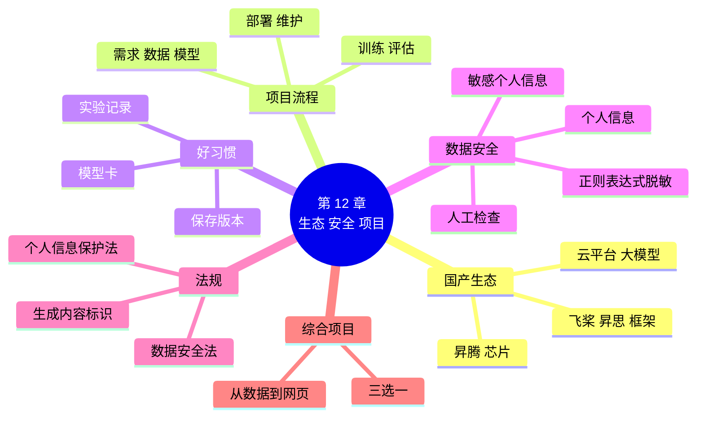

# 第 12 章 国产 AI 生态、数据安全与综合项目

!!! abstract "本章学时"
    理论 5 学时（线上 3 + 线下 2）· 实验 1 学时（本章共 3 个实验，实验 12-2 为综合项目，课后继续完成）

## 学习目标

学完本章，你应该能够：

1. **说出**国产 AI 生态中框架、芯片、平台的主要代表（记忆）；
2. **描述**一个 AI 项目从需求到维护的完整流程，以及做项目的好习惯（理解）；
3. **运行**代码，对含有个人信息的文本做脱敏（应用）；
4. **判断**一个 AI 应用在个人信息、数据许可、生成内容标识等方面是否合规（评价）；
5. **完成**一个从数据到网页发布的小型综合项目（创造）。

!!! info "先修要求"
    学习本章前，你需要掌握：

    - 飞桨和昇思的基本情况（[1.2.2](../01-intro/index.md#122)）；
    - 本书第 5～11 章的训练、调参、迁移学习和部署方法；
    - 人脸、声音和隐私（[8.5 节](../08-image-apps/index.md#85)、[10.4 节](../10-speech-apps/index.md#104)），API Key 的保管（[9.4.2](../09-text-apps/index.md#942)）。

??? abstract "本章概念清单（6 个，点击查看定义和例子）"
    1. [昇腾](../../appendix/glossary.md#g-昇腾)
    2. [模型卡](../../appendix/glossary.md#g-模型卡)
    3. [个人信息](../../appendix/glossary.md#g-个人信息)
    4. [敏感个人信息](../../appendix/glossary.md#g-敏感个人信息)
    5. [脱敏](../../appendix/glossary.md#g-脱敏)
    6. [正则表达式](../../appendix/glossary.md#g-正则表达式)

## 情景导入

花卉识别网页上线一个月，老板娘的店员每天都在用。这天，小林收到一个区里“智慧商圈”项目的邀请：希望把这个小工具推广给更多花店，但有两个要求：一是系统要能部署在区里的政务云上，那里用的是国产服务器和国产 AI 芯片；二是要提交一份数据安全说明，讲清楚收集了哪些数据、怎样保护顾客隐私。

小林有点慌：“国产芯片我没用过，数据安全说明也不知道怎么写。”

小周说：“别慌，你会的东西大部分都用得上。国产框架你已经会了飞桨，昇思的写法也差不多；至于数据安全，先把客服记录里的手机号、身份证号遮住，就是第一步。这一章，我们把整本书串起来，再做一个属于你自己的完整项目。”

## 12.1 国产 AI 生态 { #121 }

### 12.1.1 从芯片到应用 { #1211 }

做一个 AI 应用，要用到好几层“底座”。每一层都有国际上常用的产品，也有国产的产品：

| 层次 | 作用 | 国际常用 | 国产代表 |
|---|---|---|---|
| 芯片 | 做计算 | 英伟达 GPU | 华为[**昇腾**](../../appendix/glossary.md#g-昇腾 "华为公司研发的 AI 芯片系列，配套 CANN 软件，与昇思框架配合紧密，用于国产 AI 算力"){ .term }、寒武纪、海光、昆仑芯 |
| 芯片软件 | 让框架用上芯片 | CUDA | 昇腾 CANN 等 |
| 深度学习框架 | 搭网络、训练 | TensorFlow / Keras、PyTorch | 飞桨 PaddlePaddle、昇思 MindSpore |
| 模型和工具 | 现成模型、开发套件 | Hugging Face、Ultralytics | 飞桨 PaddleOCR / PaddleX、魔搭社区 |
| 云平台 | 算力、托管 | Colab、AWS | 飞桨 AI Studio、华为云 ModelArts、阿里云百炼、百度智能云千帆 |
| 大模型 | 通用能力 | GPT、Gemini | DeepSeek、通义千问、文心、豆包、智谱 GLM |

本书国产版用的是飞桨（百度，2016 年开源），它的产业套件最丰富<sup class="cite">[[1]](#ref12-1)</sup>；第 1 章还介绍过昇思（华为，2020 年开源），它和昇腾芯片配合最紧密<sup class="cite">[[2]](#ref12-2)</sup>。

### 12.1.2 什么时候选国产方案 { #1212 }

- **行业有要求**：政务、金融、能源、通信、交通等关键行业，越来越多地要求使用国产的芯片、操作系统和软件（常说的“信创”），部署在国产服务器上；
- **数据不能出境**：数据要存放在国内，模型和服务也要在国内运行；
- **中文和本土场景**：国产模型在中文、本土业务（票据、方言、行业术语）上往往准备得更充分，文档、社区也是中文的；
- **长期可控**：不受外部限制，出了问题能找到本地的技术支持。

国际通用方案的优势是资料多、社区大、新技术来得快。所以本书两套都学：**思路是相通的**，会了一套，另一套照着对照表很快就能上手。

### 12.1.3 昇思 MindSpore 体验 { #1213 }

用昇思把第 4 章认鸢尾花的三层网络再写一遍，对照一下（完整代码见实验 12-3）：

```python
net = nn.SequentialCell(
    nn.Dense(4, 8), nn.ReLU(),                       # 隐藏层：4 个输入 → 8 个神经元
    nn.Dense(8, 3),                                  # 输出层：3 种鸢尾花（不加 Softmax）
)
loss = nn.CrossEntropyLoss()                         # 交叉熵损失，自带 Softmax
opt = nn.Adam(net.trainable_params(), learning_rate=0.01)
model = Model(net, loss_fn=loss, optimizer=opt, metrics={"accuracy"})
model.train(100, train_ds)                           # 训练 100 轮
```

| 做的事 | Keras | 飞桨 | 昇思 |
|---|---|---|---|
| 把积木摞起来 | `keras.Sequential` | `nn.Sequential` | `nn.SequentialCell` |
| 全连接层 | `layers.Dense(8)` | `nn.Linear(4, 8)` | `nn.Dense(4, 8)` |
| 训练前的设置 | `model.compile(...)` | `model.prepare(...)` | `Model(net, loss_fn, optimizer, metrics)` |
| 训练 | `model.fit(...)` | `model.fit(...)` | `model.train(轮数, 数据)` |

名字不同，步骤完全一样。编者在 CPU 上实际运行，训练 100 轮后验证集 30 朵花全部认对（准确率 1.0），对新花 `[5.1, 3.5, 1.4, 0.2]` 的预测是“山鸢尾”，把握 99.9%。昇思在昇腾芯片上能发挥最大的性能，华为云 ModelArts 和昇思大模型平台都提供了带昇腾芯片的在线环境<sup class="cite">[[3]](#ref12-3)</sup>。

## 12.2 一个 AI 项目的完整流程 { #122 }

回头看这本书，你已经把一个 AI 项目的每一步都走过了：

| 步骤 | 要回答的问题 | 本书在哪里 |
|---|---|---|
| ① 需求 | 解决谁的什么问题？分类、检测还是识别？有没有现成模型？ | 第 2、7、8 章 |
| ② 数据 | 数据从哪来？许可允许吗？有没有个人信息？标注对不对？ | 第 3 章、本章 |
| ③ 模型 | 用现成模型、迁移学习还是从零训练？ | 第 4、7 章 |
| ④ 训练 | 损失、优化器、学习率、轮次 | 第 5 章 |
| ⑤ 评估 | 看曲线、混淆矩阵、认错的例子，有没有过拟合？ | 第 6、7 章 |
| ⑥ 部署 | 网页、接口还是手机？要不要量化？ | 第 11 章 |
| ⑦ 维护 | 用户用得怎么样？出现新情况（新品种的花）怎么办？ | 本章 |

很多人以为做 AI 主要是第 ③、④ 步。实际项目中，**大部分时间花在第 ①、②、⑤、⑦ 步**：想清楚要做什么、准备好数据、找出模型错在哪、上线后持续改进。第 ⑦ 步最容易被忽视：花店进了新品种的花，模型不认识；拍照的手机换了，照片的颜色变了，效果都可能悄悄变差。要定期用新数据检查模型，必要时重新训练。

## 12.3 做项目的好习惯 { #123 }

**1. 记录每一次实验。** 改了什么、结果如何，当时觉得记得住，一周后就忘了。最简单的办法是一张表：

| 日期 | 改了什么 | 训练 / 验证准确率 | 结论 |
|---|---|---|---|
| 10-20 | 从零训练，10 轮 | 86.8% / 54.7% | 过拟合严重 |
| 10-22 | 加数据增强 | — / 68.7% | 有改善 |
| 10-25 | 迁移学习 MobileNetV2 | — / 82.7% | 采用 |

第 6 章的 TensorBoard / VisualDL 也能自动记录。

**2. 保存版本。** 每次得到更好的模型，另存一份，名字带上日期和成绩，比如 `flowers_1025_val827.keras`，不要覆盖旧的。代码也一样，会用 Git 最好，不会的话至少按日期复制一份。

**3. 写说明。** 项目文件夹里放一份 `README.md`，写清楚怎么运行。模型最好附一张[**模型卡**](../../appendix/glossary.md#g-模型卡 "随模型一起提供的说明文档，写明用途与禁止用途、训练数据、评估效果、局限和风险"){ .term }<sup class="cite">[[4]](#ref12-4)</sup>，像药品说明书一样写清楚：

- 用途：能做什么，**不能**做什么（例如“只能认 5 种花，不能用于判断植物是否有毒”）；
- 数据：用什么数据训练的，来源和许可；
- 效果：在什么数据上测的、准确率多少，哪些情况容易错；
- 局限和风险：例如“花很小、光线暗时容易认错”。

## 12.4 数据安全与隐私 { #124 }

### 12.4.1 哪些是个人信息 { #1241 }

[**个人信息**](../../appendix/glossary.md#g-个人信息 "以电子或者其他方式记录的、与已识别或者可识别的自然人有关的各种信息（匿名化处理后的信息除外）"){ .term }是能单独或者和其他信息结合起来识别出某个人的各种信息<sup class="cite">[[5]](#ref12-5)</sup>，比如姓名、手机号、身份证号、住址、照片、声音。其中一旦泄露容易让人受到伤害的，叫[**敏感个人信息**](../../appendix/glossary.md#g-敏感个人信息 "一旦泄露或者被非法使用，容易导致人格尊严受到侵害或者人身、财产安全受到危害的个人信息，处理时一般需取得单独同意"){ .term }，包括生物识别（人脸、声纹、指纹）、宗教信仰、特定身份、医疗健康、金融账户、行踪轨迹等，以及不满十四周岁未成年人的个人信息。处理敏感个人信息要求更严格，一般要取得个人的**单独同意**。

注意“结合起来”这几个字：单独一个“孙**”认不出是谁，但“孙**、10 月 29 日、订了满天星、东风大街附近”组合在一起，熟人可能就猜到了。

### 12.4.2 脱敏：把关键部分遮住 { #1242 }

把数据里的个人信息遮住或替换掉，让人认不出是谁，叫[**脱敏**](../../appendix/glossary.md#g-脱敏 "对数据中的个人信息进行遮盖、替换等处理，使其不能直接识别到具体个人"){ .term }。最常见的做法是**部分遮盖**：手机号留前 3 位和后 4 位（`139****1234`），身份证号留前 6 位和后 4 位，姓名只留姓。

手机号、身份证号这些有固定格式的信息，用[**正则表达式**](../../appendix/glossary.md#g-正则表达式 "描述文字格式规律的规则，可以用来查找、替换符合规律的文字"){ .term }来找最方便。正则表达式是描述“文字长什么样”的规则：

| 正则表达式 | 意思 | 能找到 |
|---|---|---|
| `\d` | 一个数字 | `5` |
| `\d{4}` | 连续 4 个数字 | `2026` |
| `1[3-9]\d{9}` | 1 开头，第二位是 3～9，后面再跟 9 个数字 | `13900001234` |
| `-?` | 有没有短横线都行 | `139-0000-5678` |
| `[\dXx]` | 一个数字，或者 X、x | 身份证最后一位 |

两版的写法相同（Python 自带的 `re` 库）：

```python
import re
def mask(s, head, tail):                             # 只留前 head 位和后 tail 位，中间换成 *
    return s[:head] + "*" * (len(s) - head - tail) + s[len(s) - tail:]

RULES = [                                            # （名称，正则表达式，留前几位，留后几位）
    ("身份证号", r"\d{17}[\dXx]", 6, 4),
    ("银行卡号", r"\d{4} \d{4} \d{4} \d{4}", 0, 4),
    ("手机号", r"1[3-9]\d-?\d{4}-?\d{4}", 3, 4),
    ("门牌号", r"\d+号[\d栋单元室]*", 0, 0),
]
for name, pattern, head, tail in RULES:
    text = re.sub(pattern, lambda m: mask(m.group(), head, tail), text)   # 找到就替换
```

`re.sub(规则, 替换方法, 文字)` 把文字里所有符合规则的部分替换掉；`lambda m: ...` 是一个“一次性的小函数”，告诉它每找到一处怎么替换。规则的顺序也有讲究：身份证号要排在手机号前面，否则身份证号中间的一段数字可能被当成手机号。

在下面的动画里试一试，特别是改写一下手机号的写法，看规则会不会漏掉：

<iframe class="sim-frame" src="../../sims/desensitize/main.html" height="640" loading="lazy" title="个人信息脱敏"></iframe>

### 12.4.3 人名：要靠模型，而且会出错 { #1243 }

人名没有固定格式，正则表达式没法找。要用第 9 章的分词工具或专门的“命名实体识别”模型，找出哪些词是人名：

=== "通用版"

    ```python
    import jieba.posseg as pseg                       # 带词性的分词
    for word, flag in pseg.cut(line):
        if flag == "nr" and word not in KEEP:         # nr 表示人名；KEEP 是“不要遮”的白名单
            line = line.replace(word, word[0] + "*" * (len(word) - 1))   # 只留姓
    ```

=== "国产版"

    ```python
    from paddlenlp import Taskflow
    ner = Taskflow("ner")                             # 命名实体识别
    for word, tag in ner(line):
        if tag.startswith("人物类") and word not in KEEP:   # 人物类实体就是人名
            line = line.replace(word, word[0] + "*" * (len(word) - 1))   # 只留姓
    ```

    !!! warning "待实测"
        PaddleNLP 的命名实体识别模型要从飞桨服务器下载，编者的环境无法连接，请以实际运行为准。它找人名通常比 jieba 准，但同样会有误判，处理方法和通用版一样。

通用版第一次运行（白名单还是空的）的实际结果：

```text
【2026-10-28 09:12】顾*张*来电，手机号139****1234，说昨天订的红**花束送错了地址，应该送到幸福路********。已安排重新配送。
```

“顾客”被当成了人名，“红玫瑰”也被遮成了“红**”；另外几条记录里，“银行卡”“满天星”也被误判了。jieba 的词典里，这些词恰好也可以是人名。把它们加进白名单 `KEEP` 后再运行：

```text
【2026-10-28 09:12】顾客张*来电，手机号139****1234，说昨天订的红玫瑰花束送错了地址，应该送到幸福路********。已安排重新配送。
【2026-10-28 10:45】顾客李*要开发票，抬头写个人，身份证号990101********1234，发票发到邮箱 ***@example.com。
【2026-10-28 14:03】王**投诉骑手态度差，联系电话 139******5678，要求退款 128 元，退到尾号 4321 的银行卡 ***************4321。
【2026-10-29 08:30】赵*预订明天的生日花篮，收货人陈**，电话139****8888，地址：东风大街***，备注“不要写卡片”。
【2026-10-29 16:20】顾客孙**反映满天星有点蔫，同意补发一束，联系方式 139****2468，身份证 990101********567X 用于核实会员。
```

这说明：**自动脱敏既会漏掉，也会误伤，一定要人工抽查**。重要的数据，宁可多遮一点。

### 12.4.4 其他要注意的安全问题 { #1244 }

- **数据和模型的许可**：用别人的数据集、模型之前，先看许可。本书用的花卉照片是 CC BY 2.0（可以用，但要署名），语音指令是 CC BY 4.0，第 10 章的语音合成模型只许非商业使用。
- **来路不明的模型文件**：`.pt`、`.pkl` 等文件加载时可以执行任意代码，只从可信的来源下载（第 11 章）。
- **API Key 和密码**：不写进代码，不上传，不截图（第 9 章）。
- **发给大模型之前先脱敏**：调用云端大模型 API 时，数据会发到别人的服务器，含有个人信息的内容要先脱敏，或者改用本地模型（第 11 章）。

## 12.5 本领域法规要点 { #125 }

人工智能导论课程第 9 章讲过法规的总体框架，这里只列出和本课程开发工作关系最密切的几部：

| 法规 | 施行时间 | 和开发者关系最密切的要求 |
|---|---|---|
| 《中华人民共和国数据安全法》<sup class="cite">[[6]](#ref12-6)</sup> | 2021-09-01 | 开展数据处理活动要建立数据安全管理制度，采取技术措施保障数据安全 |
| 《中华人民共和国个人信息保护法》<sup class="cite">[[5]](#ref12-5)</sup> | 2021-11-01 | 处理个人信息要告知、取得同意，遵循最小必要原则；敏感个人信息要单独同意 |
| 《生成式人工智能服务管理暂行办法》<sup class="cite">[[7]](#ref12-7)</sup> | 2023-08-15 | 向公众提供生成式 AI 服务，训练数据要来源合法、不侵犯知识产权，要采取措施防止生成违法内容 |
| 《人工智能生成合成内容标识办法》<sup class="cite">[[8]](#ref12-8)</sup> | 2025-09-01 | AI 生成的文字、图片、声音、视频要按规定添加显式或隐式标识 |

落到日常开发，就是几句话：**收集数据先告知、取得同意；只收集必要的；存好、用完删；对外提供 AI 生成的内容要标识；用别人的东西看许可**。

!!! cert "证书考点"
    人工智能应用工程师、人工智能数据处理工程师（高级）等证书都会考查数据安全与隐私保护的基本要求，包括个人信息和敏感个人信息的范围、数据脱敏的常用方法，以及生成式人工智能相关法规的要点。

## 12.6 综合项目指引 { #126 }

### 12.6.1 三选一 { #1261 }

从图像、文本、语音中选一个方向，做一个**能用的小应用**。下面的选题可以直接用，也可以自己想（要和老师确认）：

| 方向 | 参考选题 | 数据怎么来 | 主要方法 |
|---|---|---|---|
| 图像 | 校园植物识别、垃圾分类、水果识别 | 自己拍，每类至少 50 张，3～5 类 | 第 7 章迁移学习 |
| 文本 | 课程评价分类、客服问题分类（咨询 / 投诉 / 售后） | 自己写或用大模型辅助生成，人工检查标注，至少 300 条 | 第 9 章评论分类器，或大模型 API |
| 语音 | 中文指令词识别（开灯 / 关灯 / 上一页 / 下一页） | 自己和同学录，每个词至少 30 条（录同学的声音要征得同意） | 第 10 章指令词识别 |

### 12.6.2 项目要求 { #1262 }

1. **能用**：做成 Gradio 网页（第 11 章），别人打开就能用；最好发布到云平台，交一个链接；
2. **有评估**：在验证集上给出准确率，至少分析 3 个认错的例子；
3. **有记录**：实验记录表至少 3 次改进尝试；
4. **合规**：写清楚数据来源和许可；数据中如有个人信息，说明怎样处理（脱敏、取得同意）；
5. **有说明**：一份项目报告（模板见附录 E），包括需求、数据、模型、结果、局限和模型卡。

### 12.6.3 评分参考 { #1263 }

| 项目 | 分值 | 要点 |
|---|---|---|
| 需求与选题 | 10 | 问题清楚，有实际用处，难度合适 |
| 数据 | 20 | 数量和质量达到要求，来源合法，处理了隐私问题 |
| 模型与训练 | 20 | 方法合适，有调参和改进的记录 |
| 评估与分析 | 20 | 有准确率，有错误分析，结论合理 |
| 应用与发布 | 20 | 网页能用，界面清楚，说明了能做和不能做的事 |
| 报告与展示 | 10 | 报告完整，模型卡清楚，展示时能回答问题 |

## 12.7 本章常见报错对照 { #127 }

| 报错原文 | 用大白话说 | 怎么改 |
|---|---|---|
| `No module named 'mindspore'` | 昇思还没有安装 | 运行 `!pip install mindspore "numpy<2"`，或使用昇思大模型平台、华为云 ModelArts 的在线环境 |
| 昇思报 `ValueError: Unable to avoid copy while creating an array as requested` | 昇思的数据工具还不支持新版 NumPy 2 | 运行 `!pip install "numpy<2"` 后重启内核 |
| `re.error: unterminated character set` | 正则表达式里的方括号没配对 | 检查 `[` 和 `]` 是否成对 |
| 正则表达式什么都没找到 | 规则写得太严，或者文字的写法和规则不一样（多了空格、全角数字） | 用 `re.findall(规则, 文字)` 先测试；用动画试一试 |
| 不该遮的词被遮住了 | 分词模型把普通词当成了人名 | 把误判的词加进白名单 `KEEP` |
| 读文件报 `UnicodeDecodeError` | 文件的编码不是 UTF-8 | `open(..., encoding="gbk")` 试试，或把文件另存为 UTF-8 |

## 12.8 前沿视窗：开源国产大模型与自主算力 { #128 }

2025 年初，DeepSeek 发布了推理大模型 DeepSeek-R1，并以宽松的 MIT 许可公开了模型参数<sup class="cite">[[9]](#ref12-9)</sup>，用远低于同行的成本达到了和国际顶尖模型接近的推理能力，在全世界引起轰动。通义千问、智谱 GLM、Kimi 等国产大模型也纷纷开源，国产开源模型的下载量和衍生模型数量位居世界前列。

开源意味着：任何学校、企业都可以下载这些模型，在自己的服务器上部署和微调，不用把数据交给别人。配合昇腾等国产芯片，从芯片、框架到模型、应用，一条自主可控的 AI 链条正在形成，各大国产芯片厂商都在第一时间适配主流开源模型。

对你来说，这意味着更多的机会：会用框架、会调用和部署模型、懂数据安全，正是各行各业把 AI 用起来时最需要的本领。这本书只是起点。

## 本章实验

!!! abstract "实验总览"
    | 实验 | 类型 | 建议时长 | 内容 |
    |---|---|---|---|
    | 实验 12-1 | ★ 必做 | 20 分钟 | 给一份客服记录做脱敏 |
    | 实验 12-2 | ★ 必做 | 课内 25 分钟 + 课后 | 综合项目 |
    | 实验 12-3 | ☆ 选做 | 20 分钟 | 昇思 MindSpore 体验 |

    代码见配套资源 `labs/ch12/` 目录（`keras/` 通用版，`paddle/` 国产版，`common/` 两版通用）。客服记录 `labs/data/service_records/records.txt` 由编者编写，内容为虚构。

### 实验 12-1 ★ 给一份客服记录做脱敏 { #12-1 }

**实验目的**

1. 用正则表达式找出并遮住手机号、身份证号等个人信息；
2. 用分词或命名实体识别遮住人名，体会自动脱敏的局限。

**实验环境**：云端 Notebook 或本机，CPU 即可。

**实验数据**：`labs/data/service_records/records.txt`（5 条虚构的客服记录）。

**实验步骤与代码**

第一档 · 跑通：打开 `lab12_1_desensitize.ipynb`，依次运行三个单元格：读入记录 → 正则表达式脱敏 → 遮住人名并保存。代码见 12.4 节。

完整代码：`labs/ch12/keras/lab12_1_desensitize.ipynb`、`labs/ch12/paddle/lab12_1_desensitize.ipynb`

**运行结果**（通用版第 2 步）：

```text
身份证号 找到 2 个： ['990101199001011234', '99010119951212567X']
银行卡号 找到 1 个： ['6222 0000 0000 4321']
手机号 找到 4 个： ['13900001234', '139-0000-5678', '13900008888', '13900002468']
门牌号 找到 2 个： ['88号3栋502', '12号']
```

第 3 步的结果见 12.4.3 节（国产版待实测）。

第二档 · 改一改：

1. 在记录里加一行，手机号写成“139 0000 1357”（用空格分开），看规则能不能找到；修改手机号的正则表达式，让它也能找到；
2. 加一条规则，遮住“退款 128 元”这样的金额（提示：`\d+ ?元`）。

第三档 · 挑战：除了遮盖，另一种脱敏方法是**替换**：把每个不同的手机号换成“手机号A”“手机号B”……，同一个号码换成同一个代号。想一想这样做有什么好处，试着实现。

**实验记录表**

| 信息类型 | 原文中有几处 | 程序找到几处 | 漏掉或误伤的例子 |
|---|---|---|---|
| 手机号 | | | |
| 身份证号 | | | |
| 人名 | | | |

**常见问题排查**

| 现象 | 原因 | 解决办法 |
|---|---|---|
| 身份证号中间一段被当成手机号遮住了 | 规则顺序不对 | 身份证号的规则放在手机号前面 |
| 输出文件打开是乱码 | 编码不一致 | 写文件时用 `encoding="utf-8"`，用记事本或 VS Code 打开 |

**思考与练习**

1. 脱敏后的记录还能不能认出是谁？如果能，还应该怎么处理？

**实验报告要求**

提交脱敏后的文件、修改后的规则代码和实验记录表。

### 实验 12-2 ★ 综合项目 { #12-2 }

**实验目的**

1. 综合运用本书的方法，独立完成一个从数据到网页发布的 AI 小应用；
2. 养成记录实验、评估分析、关注合规的习惯。

**实验环境**：云端 Notebook 或本机；发布用魔搭创空间、AI Studio 或 Hugging Face Spaces。

**实验数据**：自己收集，要求见 12.6 节。

**实验步骤与代码**

1. **课内（25 分钟）**：分组讨论选题，填写下面的项目计划表，交老师确认；
2. **课后第 1 周**：收集和整理数据，写数据说明（来源、许可、个人信息处理）；
3. **课后第 2 周**：训练、调参、评估，填写实验记录表，做错误分析；
4. **课后第 3 周**：做成网页并发布，写项目报告和模型卡，准备 5 分钟展示。

可以复用的代码：第 7 章（图像迁移学习）、第 9 章（文本分类）、第 10 章（指令词识别）、第 11 章（Gradio 网页和发布）、本章（脱敏）。

**运行结果**：各组不同。

**项目计划表**

| 项目 | 内容 |
|---|---|
| 组员和分工 | |
| 选题和要解决的问题 | |
| 类别（要认哪几类） | |
| 数据来源和计划数量 | |
| 是否涉及个人信息，怎样处理 | |
| 计划使用的方法 | |
| 准确率目标 | |

**常见问题排查**

| 现象 | 原因 | 解决办法 |
|---|---|---|
| 准确率很低 | 数据太少、类别太像，或者拍摄条件差别太大 | 每类多拍一些；拍摄条件尽量多样；用迁移学习 |
| 训练很好，自己网页上一试就错 | 网页的预处理和训练时不一样 | 对照第 11 章检查预处理 |
| 发布失败 | 见实验 11-2 的排查表 | |

**思考与练习**

1. 你的应用最可能在什么情况下出错？在模型卡里写清楚。

**实验报告要求**

提交项目报告（模板见附录 E）、网页链接或截图、代码和数据说明，并进行 5 分钟的展示。

### 实验 12-3 ☆ 昇思 MindSpore 体验 { #12-3 }

**实验目的**

1. 用昇思完成一次“搭网络—训练—预测”；
2. 对照 Keras、飞桨，体会不同框架思路相通。

**实验环境**：本机或云端 Notebook，CPU 即可；也可以使用昇思大模型平台或华为云 ModelArts 提供的昇腾环境。

**实验数据**：鸢尾花数据集（scikit-learn 自带）。

**实验步骤与代码**

第一档 · 跑通：打开 `lab12_3_mindspore.ipynb`，依次运行四个单元格：准备数据 → 搭网络 → 训练 → 认一朵新花。核心代码见 12.1.3 节。

完整代码：`labs/ch12/common/lab12_3_mindspore.ipynb`（两版通用）

**运行结果**：

```text
epoch: 20 step: 8, loss is 0.1333901584148407
epoch: 40 step: 8, loss is 0.1040068194270134
epoch: 60 step: 8, loss is 0.019724875688552856
epoch: 80 step: 8, loss is 0.11494699120521545
epoch: 100 step: 8, loss is 0.08779870718717575
验证集： {'accuracy': 1.0}
预测： 山鸢尾 [[0.999 0.001 0.   ]]
```

第二档 · 改一改：

1. 把隐藏层从 8 个神经元改成 4 个、16 个，比较结果；
2. 对照 12.1.3 节的表格，把这个网络用你熟悉的那一版（Keras 或飞桨）再写一遍。

**实验记录表**

| 做的事 | 昇思的写法 | 你熟悉的那一版的写法 |
|---|---|---|
| 搭网络 | | |
| 训练前的设置 | | |
| 训练 | | |
| 预测 | | |

**常见问题排查**

| 现象 | 原因 | 解决办法 |
|---|---|---|
| `Unable to avoid copy while creating an array` | NumPy 版本太新 | `!pip install "numpy<2"` 后重启内核 |
| 安装很慢 | 昇思安装包较大 | 使用国内镜像：`!pip install mindspore -i https://pypi.tuna.tsinghua.edu.cn/simple` |

**思考与练习**

1. 学会一个框架以后，换一个新框架，你会先查哪几样东西？

**实验报告要求**

提交运行结果截图和填好的对照表。

## 本章小结

- 国产 AI 生态覆盖芯片（**昇腾**等）、框架（飞桨、昇思）、模型工具、云平台和大模型。关键行业、数据不出境、中文场景时优先考虑国产方案；不同框架思路相通。
- AI 项目的完整流程：需求 → 数据 → 模型 → 训练 → 评估 → 部署 → 维护，大部分时间花在需求、数据、评估和维护上。
- 好习惯：记录每次实验、保存版本、写 README 和**模型卡**。
- **个人信息**能识别出具体的人，**敏感个人信息**要单独同意。**脱敏**常用部分遮盖；有固定格式的信息用**正则表达式**找，人名要靠模型，自动脱敏会漏也会误伤，要人工检查。
- 法规要点：告知同意、最小必要、存好删净、生成内容要标识、用别人的东西看许可。



**全书结语**

从第 1 章打开第一个 Notebook，到现在亲手做出能发布给别人用的 AI 应用，你已经走完了一个 AI 开发者的完整路线：会调用现成模型，会准备数据、搭网络、训练和调参，会借用预训练模型，会处理图片、文字和声音，会把模型做成应用，也知道哪些事不能做。框架和模型会不断更新，但“数据—模型—训练—评估—部署”的思路，以及对数据安全和他人权益的尊重，会一直有用。

## 参考文献

正文中的上标编号（如<sup class="cite">[[1]](#ref12-1)</sup>）对应下面的文献。带链接的可以直接打开；书籍可在图书馆或电子书平台查阅。

<div class="refs" markdown>

**经典论文与报告**

- <span id="ref12-4"></span>[4] MITCHELL M, WU S, ZALDIVAR A, et al. Model Cards for Model Reporting[C]//Proceedings of the Conference on Fairness, Accountability, and Transparency. Atlanta: ACM, 2019: 220-229.
    <span class="ref-note">提出“模型卡”的论文，建议每个模型都附上用途、数据、效果和局限的说明，对应 12.3 节。</span>
- <span id="ref12-9"></span>[9] DeepSeek-AI. DeepSeek-R1: Incentivizing Reasoning Capability in LLMs via Reinforcement Learning[EB/OL]. (2025-01-22)[2026-10-31]. <https://arxiv.org/abs/2501.12948>.
    <span class="ref-note">DeepSeek-R1 的技术报告，模型参数以 MIT 许可开源，对应 12.8 节。</span>

**在线资源**

- <span id="ref12-1"></span>[1] 飞桨 PaddlePaddle[EB/OL]. [2026-10-31]. <https://www.paddlepaddle.org.cn/>.
    <span class="ref-note">飞桨官方网站，含框架、产业套件和 AI Studio 的入口，对应 12.1 节。</span>
- <span id="ref12-2"></span>[2] 昇思 MindSpore[EB/OL]. [2026-10-31]. <https://www.mindspore.cn/>.
    <span class="ref-note">昇思官方网站，含安装说明、教程和昇思大模型平台的入口，对应 12.1.3 节。</span>
- <span id="ref12-3"></span>[3] 华为云. ModelArts[EB/OL]. [2026-10-31]. <https://www.huaweicloud.com/product/modelarts.html>.
    <span class="ref-note">华为云的 AI 开发平台，提供昇腾算力的在线 Notebook，对应 12.1.3 节。</span>

**法律法规与标准**

- <span id="ref12-5"></span>[5] 中华人民共和国个人信息保护法[Z]. 2021-08-20.
    <span class="ref-note">第四条定义个人信息，第二十八条定义敏感个人信息，第二十九条规定单独同意，对应 12.4 节和 12.5 节。</span>
- <span id="ref12-6"></span>[6] 中华人民共和国数据安全法[Z]. 2021-06-10.
    <span class="ref-note">2021 年 9 月 1 日起施行，规定了数据处理活动的安全保护义务，对应 12.5 节。</span>
- <span id="ref12-7"></span>[7] 国家互联网信息办公室, 国家发展和改革委员会, 教育部, 等. 生成式人工智能服务管理暂行办法[Z]. 2023-07-10.
    <span class="ref-note">2023 年 8 月 15 日起施行，对向公众提供生成式 AI 服务提出了要求，对应 12.5 节。</span>
- <span id="ref12-8"></span>[8] 国家互联网信息办公室, 工业和信息化部, 公安部, 等. 人工智能生成合成内容标识办法[Z]. 2025-03-07.
    <span class="ref-note">2025 年 9 月 1 日起施行，规定了 AI 生成合成内容的标识要求，对应 12.5 节。</span>
- <span id="ref12-10"></span>[10] 全国信息安全标准化技术委员会. 信息安全技术 个人信息安全规范：GB/T 35273—2020[S]. 北京：中国标准出版社，2020.
    <span class="ref-note">国家标准，给出了个人信息去标识化、匿名化等术语和做法，可作为写数据安全说明的参考，对应 12.4 节。</span>

</div>

## 课后练习

选择题和判断题可以直接点击选项作答，系统会马上告诉你对错，并展开答案与解析；多选题选好后点“提交答案”。简答和实操题请先自己作答，再点开“答案与解析”核对。每道题的解析下方都有“回看”链接，做错了可以直接跳回正文复习。

**一、单项选择题**

<div class="quiz" data-answer="C" markdown>

**1.** 下列属于国产 AI 芯片的是（　　）。

- A. 飞桨
- B. 昇思
- C. 昇腾
- D. 魔搭

</div>

??? tip "答案与解析"
    **答案：C**

    飞桨、昇思是深度学习框架，魔搭是模型社区，昇腾是华为的 AI 芯片。

    考查：国产 AI 生态 · 认知层次：记忆 · [回看 12.1.1](#1211)
    { .quiz-meta }

<div class="quiz" data-answer="B" markdown>

**2.** 昇思中“把积木摞起来”的写法是（　　）。

- A. `keras.Sequential`
- B. `nn.SequentialCell`
- C. `nn.Sequential`
- D. `model.fit`

</div>

??? tip "答案与解析"
    **答案：B**

    A 是 Keras，C 是飞桨。

    考查：昇思 · 认知层次：记忆 · [回看 12.1.3](#1213)
    { .quiz-meta }

<div class="quiz" data-answer="D" markdown>

**3.** 在实际 AI 项目中，最容易被忽视的步骤是（　　）。

- A. 训练
- B. 搭网络
- C. 选优化器
- D. 上线后的维护：用新数据检查模型、必要时重新训练

</div>

??? tip "答案与解析"
    **答案：D**

    上线后情况会变化（新品种、新手机），效果可能悄悄变差。

    考查：项目流程 · 认知层次：理解 · [回看 12.2](#122)
    { .quiz-meta }

<div class="quiz" data-answer="A" markdown>

**4.** 模型卡的主要作用是（　　）。

- A. 像说明书一样写清模型的用途、数据、效果和局限
- B. 存放模型的参数
- C. 提高模型准确率
- D. 给模型加密

</div>

??? tip "答案与解析"
    **答案：A**

    考查：模型卡 · 认知层次：记忆 · [回看 12.3](#123)
    { .quiz-meta }

<div class="quiz" data-answer="C" markdown>

**5.** 下列信息中，属于敏感个人信息的是（　　）。

- A. 喜欢的花的品种
- B. 订单的日期
- C. 人脸照片、银行卡号
- D. 花店的地址

</div>

??? tip "答案与解析"
    **答案：C**

    生物识别信息（人脸）、金融账户（银行卡号）属于敏感个人信息。

    考查：敏感个人信息 · 认知层次：理解 · [回看 12.4.1](#1241)
    { .quiz-meta }

<div class="quiz" data-answer="B" markdown>

**6.** 正则表达式 `1[3-9]\d{9}` 能找到的是（　　）。

- A. 12345678901
- B. 13900001234
- C. 1390000123
- D. 23900001234

</div>

??? tip "答案与解析"
    **答案：B**

    要求 1 开头、第二位 3～9、后面 9 个数字，共 11 位。A 第二位是 2；C 只有 10 位；D 不是 1 开头。

    考查：正则表达式 · 认知层次：应用 · [回看 12.4.2](#1242)
    { .quiz-meta }

<div class="quiz" data-answer="D" markdown>

**7.** 手机号 13900001234 按“留前 3 位、后 4 位”脱敏，结果是（　　）。

- A. 139*******
- B. ****1234
- C. 1390000****
- D. 139****1234

</div>

??? tip "答案与解析"
    **答案：D**

    `mask("13900001234", 3, 4)`：前 3 位 139，中间 4 个 *，后 4 位 1234。

    考查：脱敏 · 认知层次：应用 · [回看 12.4.2](#1242)
    { .quiz-meta }

<div class="quiz" data-answer="A" markdown>

**8.** AI 生成的图片、声音对外发布时要添加标识，依据的是（　　）。

- A. 《人工智能生成合成内容标识办法》
- B. 《数据安全法》
- C. 鸢尾花数据集的许可
- D. 《民法典》中的合同条款

</div>

??? tip "答案与解析"
    **答案：A**

    考查：法规要点 · 认知层次：记忆 · [回看 12.5](#125)
    { .quiz-meta }

**二、多项选择题**

<div class="quiz quiz-multi" data-answer="ABC" markdown>

**1.** 优先考虑国产 AI 方案的情形有（　　）。

- A. 政务、金融等关键行业的项目
- B. 数据不能出境
- C. 中文和本土业务场景
- D. 只是因为国产的一定更好

</div>

??? tip "答案与解析"
    **答案：ABC**

    选方案要看具体需求，国际方案也有资料多、社区大的优势。

    考查：国产方案的选择 · 认知层次：评价 · [回看 12.1.2](#1212)
    { .quiz-meta }

<div class="quiz quiz-multi" data-answer="ABD" markdown>

**2.** 做项目的好习惯包括（　　）。

- A. 每次实验都记下改了什么、结果如何
- B. 更好的模型另存一份，不覆盖旧的
- C. 只保留最后一个版本，节省空间
- D. 写 README 和模型卡

</div>

??? tip "答案与解析"
    **答案：ABD**

    考查：好习惯 · 认知层次：理解 · [回看 12.3](#123)
    { .quiz-meta }

<div class="quiz quiz-multi" data-answer="ACD" markdown>

**3.** 关于自动脱敏，正确的有（　　）。

- A. 手机号、身份证号等有固定格式的信息适合用正则表达式找
- B. 自动脱敏一定能找全所有个人信息
- C. 分词模型可能把“顾客”“满天星”误当成人名
- D. 脱敏后还要人工抽查

</div>

??? tip "答案与解析"
    **答案：ACD**

    自动脱敏会漏也会误伤，比如手机号换一种写法，规则就可能找不到。

    考查：脱敏的局限 · 认知层次：分析 · [回看 12.4.3](#1243)
    { .quiz-meta }

**三、判断题**

<div class="quiz quiz-judge" data-answer="√" markdown>

**1.** Keras、飞桨、昇思的写法不同，但搭网络、设置、训练、预测的步骤是一样的。

- √ 正确
- × 错误

</div>

??? tip "答案与解析"
    **答案：√**

    考查：框架思路相通 · 认知层次：理解 · [回看 12.1.3](#1213)
    { .quiz-meta }

<div class="quiz quiz-judge" data-answer="×" markdown>

**2.** 姓名遮成“孙**”以后，就一定认不出是谁了。

- √ 正确
- × 错误

</div>

??? tip "答案与解析"
    **答案：×**

    和日期、订单内容、地址等信息组合起来，熟人仍可能认出。

    考查：个人信息 · 认知层次：分析 · [回看 12.4.1](#1241)
    { .quiz-meta }

<div class="quiz quiz-judge" data-answer="√" markdown>

**3.** 把含有顾客信息的客服记录发给云端大模型分析之前，应该先脱敏。

- √ 正确
- × 错误

</div>

??? tip "答案与解析"
    **答案：√**

    数据会发到别人的服务器，要先脱敏或改用本地模型。

    考查：数据安全 · 认知层次：应用 · [回看 12.4.4](#1244)
    { .quiz-meta }

<div class="quiz quiz-judge" data-answer="×" markdown>

**4.** 脱敏规则的顺序无关紧要。

- √ 正确
- × 错误

</div>

??? tip "答案与解析"
    **答案：×**

    身份证号要排在手机号前面，否则身份证号中间的数字可能被当成手机号。

    考查：正则表达式 · 认知层次：理解 · [回看 12.4.2](#1242)
    { .quiz-meta }

<div class="quiz quiz-judge" data-answer="√" markdown>

**5.** 用同学的录音做综合项目的数据，要事先征得同学同意。

- √ 正确
- × 错误

</div>

??? tip "答案与解析"
    **答案：√**

    声音受法律保护，属于个人信息，要告知用途并取得同意。

    考查：数据合规 · 认知层次：应用 · [回看 12.6.1](#1261)
    { .quiz-meta }

**四、简答题**

**1.** 以本书的花卉识别助手为例，说明 AI 项目完整流程的七个步骤各做了什么。

??? tip "答案与解析"
    **参考答案：** ① 需求：帮花店识别 5 种花；② 数据：TensorFlow 花卉数据集（CC BY 2.0）750 张，缩放、增强；③ 模型：先从零搭卷积网络，后改用 MobileNetV2 迁移学习；④ 训练：Adam、学习率 0.001、10 轮；⑤ 评估：看训练曲线，发现过拟合，用混淆矩阵和认错的照片做错误分析，验证准确率从 54.7% 提高到 82.7%；⑥ 部署：Gradio 网页、发布到云平台、导出 ONNX 并量化；⑦ 维护：店里进了新品种要补充数据、重新训练，定期用新照片检查效果。

    考查：项目流程 · 认知层次：理解 · [回看 12.2](#122)
    { .quiz-meta }

**2.** 为第 9 章的外卖评论分类器写一张简短的模型卡。

??? tip "答案与解析"
    **参考答案（要点齐全即可）：** 用途：判断外卖评论是好评还是差评，供商家快速了解评价；不能用于判断评论真假或用户身份。数据：编者程序生成的 1600 条评论（1200 训练、400 验证），含 3% 故意标错的标签，可自由使用。效果：验证准确率约 96%（通用版）。局限：没见过的说法（如“可惜”、网络用语）容易判断错；只分两类，不能分出“中评”；评论超过 40 个字会被截断。建议：重要决策前人工复核，定期用新评论检查。

    考查：模型卡 · 认知层次：应用 · [回看 12.3](#123)
    { .quiz-meta }

**3.** 小林想把花店的会员数据（姓名、手机号、购买记录）交给大模型分析“哪些顾客可能流失”。请你从数据安全的角度给出建议。

??? tip "答案与解析"
    **参考答案（言之有理即可）：** ① 先想清楚是否必要，只用分析需要的字段（比如购买次数、最近一次购买时间），姓名、手机号不必发送（最小必要）；② 必须用到的个人信息先脱敏，或者用代号替换；③ 优先考虑本地运行的大模型，数据不出店；④ 使用云端 API 时，查看平台的数据使用政策，API Key 妥善保管；⑤ 会员注册时告知数据的用途，取得同意；⑥ 分析结果用完及时删除临时文件。

    考查：数据安全 · 认知层次：评价 · [回看 12.4.4](#1244)
    { .quiz-meta }

**五、实操题**

**1.** 修改实验 12-1 的手机号规则，让它既能找到 `13900001234`、`139-0000-5678`，也能找到 `139 0000 1357`（中间用空格分开）。

??? tip "答案与解析"
    **参考答案：** 把规则改成 `r"1[3-9]\d[- ]?\d{4}[- ]?\d{4}"`：`[- ]?` 表示“一个短横线或一个空格，也可以没有”。

    ```python
    import re
    rule = r"1[3-9]\d[- ]?\d{4}[- ]?\d{4}"
    print(re.findall(rule, "13900001234、139-0000-5678、139 0000 1357"))
    # ['13900001234', '139-0000-5678', '139 0000 1357']
    ```

    注意：这样改以后，`mask` 遮住的字符里会包含空格和短横线，结果仍然是“前 3 位 + 若干 * + 后 4 位”。改完规则后，要再检查一遍有没有误伤其他数字（比如订单号）。

    考查：正则表达式 · 认知层次：应用 · [回看 12.4.2](#1242)
    { .quiz-meta }
